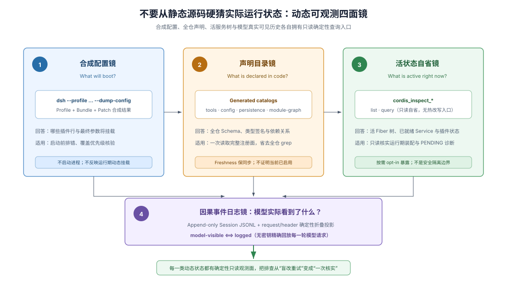

# 06 · 动态可检查性：给 Coding Agent 装上四面运行时状态镜

## 为什么只读静态源码必然会产生环境幻觉

在模块化程度较高的现代系统里，静态源码树只能回答“代码库理论上定义了哪些组件”，却无法回答“此刻在这台机器、这套环境配置、这个用户会话里究竟挂载了什么”。多层配置文件叠加、按条件启用的可选模块、运行时作用域隔离以及热加载，都会让实际生效的系统与静态目录树大相径庭。

如果仓库不提供确定性的状态查询入口，coding agent 在排查问题或接入新功能时就只能靠全局 `grep` 盲猜配置优先级，极易改错层级或调用一个根本未激活的服务。真正成熟的 Agent-Friendly Repo 会为系统配齐**四面互补的动态可观测镜**，让 agent 用一次精准查询替代十轮盲猜。



## 第一面镜：最终合成配置导出（查“启动时到底装什么”）

只要系统支持多层配置合并（例如默认配置 + 环境 Profile + 插件 Bundle 补丁 + 用户本地覆盖），就必须提供一个**不真正启动重型服务即可打印最终合成配置树**的命令行开关。

> To see the tree your machine boots:
>
> ```sh
> dsh --profile web --dump-config
> ```
>
> — DSH [`docs/architecture.md`](https://github.com/deepseek-ai/deepseek-harness/blob/master/docs/architecture.md#profiles-and-bundles)。这条命令直接输出所有配置层按序叠加后的真实启动树，让“某个配置项究竟被哪一层覆盖”“某个扩展包有没有排进加载序列”在几百毫秒内水落石出，同时也为缺陷复现提供了零歧义的快照。

## 第二面镜：受新鲜度门禁保护的源码生成目录（查“全仓声明了哪些契约”）

当模块数量超过几十个，让 coding agent 挨个翻源码目录去找“系统里有哪些事件名、哪些配置字段、哪些注册表接口”既昂贵又容易漏查；但若靠人工维护汇总表格，不出两周就会过期。通用解法是**从源码 AST 或声明元数据自动生成全量契约目录，并用新鲜度门禁锁死同步**。

DSH 在 `docs/` 下自动生成工具 Schema 目录（`tool-catalog.md`）、配置字段目录（`config-catalog.md`）、事件生产者/消费者与分发模式图谱（`event-producer-consumer.md`）、能力接缝关系表（`capability-seams.md`）、持久化事件目录（`persistence-catalog.md`）与 CLI 帮助索引（`cli-help.md`）。源码一改而目录未重算时门禁立即标红。Agent 读这批目录查的是**全仓静态声明真源**，至于当前进程里具体激活了哪一个实现，则交给第三面镜回答。

## 第三面镜：只读活进程自省接口（查“此刻内存里正跑着什么”）

当系统已经在运行（例如长驻守护进程、Web 前后端双树或动态插件宿主），agent 最需要的是像数据库查系统表一样**只读查询当前活进程里的服务、监听器和界面槽位状态**，同时绝不能因为“查状态”误触业务副作用。

DSH 通过按需启用的 `@deepseek-ai/dsh-tool-cordis` 给出了极干净的只读自省范式——只注册两个纯粹的发现与查询工具（`cordis_inspect_list` 与 `cordis_inspect_query`）：

> List every Cordis Inspect Provider currently known to the Host [...]. Call this Tool before writing or configuring a plugin, then select the provider and method for cordis_inspect_query from its result. Do not guess names or treat an Inspect method as a business Service that Plugin code can call. [...] Run a read-only query declared by an Inspect Provider. [...] This Tool cannot invoke business Service methods or modify the runtime.
>
> — DSH [`tool-cordis` source 的两个工具 description](https://github.com/deepseek-ai/deepseek-harness/blob/master/packages/extensions/tool-cordis/src/index.ts)。该包不塞入任何额外的常驻 system prompt，直接用工具描述教会模型两步自省纪律：先调 `list` 发现当前宿主与前端已注册的 Inspect Provider 及其方法签名，再按声明的参数 Schema 调 `query` 读取活状态，严禁盲猜名称或把自省接口当成业务 RPC 调用。

在为任何系统设计这类运行时自省与动态试验能力时，必须严格守住两条物理边界：

1. **只读自省、内存试验与持久安装三权分立。** 在 DSH 中，`tool-cordis` 只负责只读观测，不再承载任何自身修改或动态代码执行；进程内临时加载与卸载动态插件由 `cordis-host-runner` / `cordis-client-runner` 的程序化 API 承担（进程重启即消失，不改写仓库文件与 `cordis.yml`）；而真正落盘的持久安装与配置修改则必须走受控的 `plugin_manager` 与 Bundle 流程。只读权限绝不隐含修改权限。
2. **动态隔离环境不等于安全沙箱（Security Sandbox）。** 即使动态代码在独立的 `vm` 上下文中求值，也仅仅防止了意外的全局变量污染；只要向它注入了真实的文件系统、Shell 或网络服务句柄，它就拥有与宿主同等的真实系统权限（这道边界与其它三组常见等价误区的完整对照见 [第 7 章](./07-boundaries-and-costs.md)）。

## 第四面镜：可重建的仅追加事件账本（查“模型与外部交互实际看见了什么”）

配置可能切换、组件可能热插拔，但一旦要复盘“刚才那一轮 agent 为什么做出这个决定”，光看当前内存快照已经晚了。第四面镜要求系统遵守 **`可见即已记录`（在 DSH 中即 `Model-visible ⟺ logged`）**：任何真正进入模型请求的工具定义、系统提示词片段、技能目录与消息投影，都必须能从仅追加的会话事件日志与请求头记录中精确重建。

四面镜合在一起，为 coding agent 构成了无死角的观测闭环：**合成配置导出**回答启动前会装什么，**生成契约目录**回答全仓有哪些合法接口，**只读活自省**回答此刻进程里正挂着什么，**仅追加事件日志**回答过去每一轮实际发生了什么。

## 证据入口

- DSH [`docs/architecture.md`](https://github.com/deepseek-ai/deepseek-harness/blob/master/docs/architecture.md)：多层配置叠加、`--dump-config` 启动配置导出与 `Model-visible ⟺ logged` 会话日志不变量。
- DSH [`tool-cordis` source](https://github.com/deepseek-ai/deepseek-harness/blob/master/packages/extensions/tool-cordis/src/index.ts)、[`docs/tool-catalog.md`](https://github.com/deepseek-ai/deepseek-harness/blob/master/docs/tool-catalog.md#deepseek-aidsh-tool-cordis) 与 [`@deepseek-ai/dsh-tool-cordis` README 的 “Known Limitations and Deferred Work”](https://github.com/deepseek-ai/deepseek-harness/blob/master/packages/extensions/tool-cordis/README.md#known-limitations-and-deferred-work)：两个只读自省工具的精确描述与只读能力边界。
- DSH [`docs/config-catalog.md`](https://github.com/deepseek-ai/deepseek-harness/blob/master/docs/config-catalog.md)、[`docs/cli-help.md`](https://github.com/deepseek-ai/deepseek-harness/blob/master/docs/cli-help.md)、[`docs/event-producer-consumer.md`](https://github.com/deepseek-ai/deepseek-harness/blob/master/docs/event-producer-consumer.md)、[`docs/capability-seams.md`](https://github.com/deepseek-ai/deepseek-harness/blob/master/docs/capability-seams.md) 与 [`docs/persistence-catalog.md`](https://github.com/deepseek-ai/deepseek-harness/blob/master/docs/persistence-catalog.md)：由源码自动生成并受新鲜度门禁保护的静态契约目录家族。
