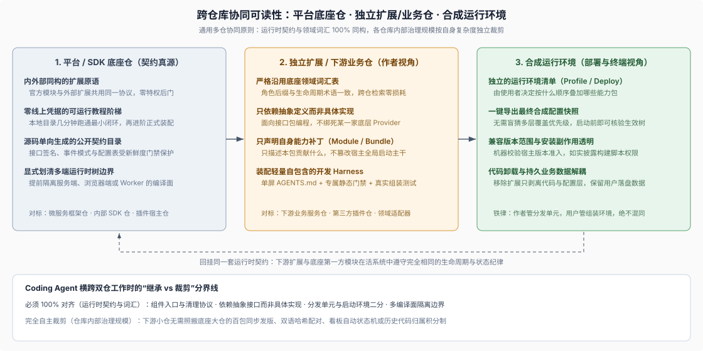

# 09 · 跨仓库与可扩展平台的生态可读性：底座仓如何赋能下游仓库

## 当 Coding Agent 同时横跨“平台底座仓”与“下游业务/扩展仓”

在真实的企业研发或开源生态中，coding agent 干活时面对的往往不是一座孤立仓库，而是**“平台/SDK 底座仓 + 多个独立下游业务仓或扩展仓”的多仓协同场景**：例如企业内部有一座公共微服务框架仓（Go/Java/Python）和二十个业务服务仓，或者一座 AI/前端平台宿主仓和一批独立维护的领域插件仓。Agent 一边要查底座仓库的接口契约与生命周期规则，一边要在下游独立仓库里编写业务代码、配置打包与验证脚本。

许多技术平台只把精力花在打磨底座主仓内部文档上，给下游仓库留下的却是过时的 Hello World 玩具片段，甚至给外部扩展强行包装出一套与底座内部截然不同的“二等公民 API”和黑话。结果就是：**coding agent 一旦跨出主仓，在主仓学会的所有概念检索词、角色后缀和架构边界瞬间失灵**。本章提炼出适用于任何多仓库体系与可扩展平台的**五条跨仓可读性设计准则**，并以 DSH 平台如何赋能外部生态作为工业级实证（若你正准备动手搭建一座独立的 DSH 插件仓库，读完本章通用原理后请直接进入 [卷二：DSH 插件仓库开发与专属 Harness](../02-dsh-plugin-harness/00-index.md) 获取完整工程样板）。

## 1. 跨技术栈对标：底座仓向外部辐射可读性的四个通用抓手

无论你的技术栈是 Python 数据/AI 平台、Go/Rust 基础设施、企业前端工作台还是插件化 Agent 宿主，想要让下游仓库的 coding agent 不靠口头传授就能一次写对集成代码，底座仓都必须主动提供以下四件基础设施：

| 跨仓赋能维度 | 反面失效症状（下游 Agent 为什么总写错） | 通用平台工程解法（不限语言） | 跨技术栈典型形态举例 |
|---|---|---|---|
| **1. 内外部同构原语** | 平台内部走特权私有通道，外部扩展走残缺包装层，导致无法抄官方模块当范本 | 第一方功能模块与外部扩展使用**完全相同的注册协议、配置校验与卸载接口** | Python FastAPI 内部路由与第三方 Router 插件同构；VS Code 内置扩展与市场扩展共用 Extension API |
| **2. 零凭据分层教程阶梯** | 入门文档第 1 步就要求申请生产密钥、拉起全套云端中间件，或者只给跑不通的伪代码 | 先给**零外部密钥、本地内存/临时目录几分钟可跑通**的机制沙盒，再无缝衔接到正式工程装配 | Go/Python SDK 提供内存 `InMemoryTransport` 可运行教程，跑通后再切线上配置树 |
| **3. 分发单元与运行环境二分** | 下游包在自己的构建配置里硬改全局启动入口或写死生产环境变量，多包组合时互相覆盖 | 严格拆分**作者分发的“能力补丁包”**与**部署方拥有的“整机装配清单”**，任何包不得兼任两者 | Helm Library/Subchart 与生产 `values.yaml` 分离；前端微应用 Manifest 与宿主壳路由表分离 |
| **4. 运行时环境面显式隔离** | 同一个仓库混写服务端 Node/Python 代码与浏览器/边缘端代码，Agent 把两边全局对象混引报错 | 在底座文档第 1 页明确划清**有几棵独立运行时树/编译面**，声明只做后端能力无需触碰前端面 | Next.js / Remix 显式隔离 Server 与 Client 模块边界；全栈插件显式分离宿主与浏览器编译配置 |

## 2. 准则一：分层递进且零外部密钥门槛的可运行教程阶梯

要让下游仓库的人类工程师与 coding agent 在十分钟内验证自己对平台心智模型的理解，底座入口文档必须铺设“先在本地沙盒隔离学会核心机制，再接入完整宿主配置”的递进阶梯。DSH 为外部开发者设计了两条衔接严密的轨道：

> This tutorial teaches Cordis hands-on: each chapter is a runnable example you build in a scratch directory inside this repository, ending with a plugin wired into real harness services.
>
> — DSH [`docs/cordis-tutorial/index.md`](https://github.com/deepseek-ai/deepseek-harness/blob/master/docs/cordis-tutorial/index.md)。第一条轨道（`docs/cordis-tutorial/` 七讲）全部在本地临时目录无线上 API Key 独立运行，从最小组件、副作用回卷、服务注入、类型事件、配置校验与热重载，一路走到把真实组件挂进核心服务管线。

> To write plugins for the harness itself — loaded from a `cordis.yml` and driven from the Web UI rather than the launcher below — start from your first Harness plugin.
>
> — DSH [`docs/cordis-tutorial/index.md`](https://github.com/deepseek-ai/deepseek-harness/blob/master/docs/cordis-tutorial/index.md)。第二条轨道（`docs/user/develop/` 的 basic / framework / practice 三层）则按正式加载与分发方式接棒，把同一个组件模型带入声明式配置树、打包准入与三角色能力接缝实践。

## 3. 准则二：消灭“二等公民 API”，让整个底座仓成为下游的活范本库

为什么很多企业平台的下游业务仓总是在用反射、猴子补丁（monkey patch）或未公开内部路径绕过框架？根源往往是底座团队给自己留了特权后门，给下游提供的公开扩展口却功能残缺。真正对 Agent 友好的平台在架构上贯彻**内外部同构**：

> In Harness, a plugin is a TypeScript module that exports an `apply` function. The framework calls `apply` when loading the plugin and passes a `ctx` context object through which the plugin registers capabilities: [...] That is the complete configuration.
>
> — DSH [`docs/user/develop/basic/index.md` 的 “What is a plugin?”](https://github.com/deepseek-ai/deepseek-harness/blob/master/docs/user/develop/basic/index.md#what-is-a-plugin)。外部独立仓库编写的扩展与底座主仓自己的数百个第一方模块遵循**完全一致的协议**——同样的入口签名、同样的依赖声明、同样的配置 Schema 校验与同样的“只依赖抽象接口定义而不依赖具体实现”单向原则。这意味着下游仓库的 coding agent 遇到任何边界疑问时，都可以直接把底座主仓里的第一方生产模块当作 1:1 的权威参考实现。

## 4. 准则三：严格切分“分发单元”与“运行环境”，诚实披露安装边界

在多团队或多仓库拼装的生态里，底座平台必须在清单协议层定下铁律：**下游仓库作者只负责声明“我这个包提供什么能力与默认补丁”，终端部署方或用户才负责声明“整台机器按什么顺序启动哪些包”**。

> A bundle is what you author and distribute; a profile is what a user boots with `dsh --profile <name>`. Nothing is both.
>
> — DSH [`docs/user/develop/basic/publish.md` 的 “Two concepts, two manifests”](https://github.com/deepseek-ai/deepseek-harness/blob/master/docs/user/develop/basic/publish.md#two-concepts-two-manifests)。这句 `Nothing is both`（没有任何东西同时是两者）是所有插件化与微服务配置管理系统的黄金法则：一旦严禁下游扩展包私自篡改整机启动入口，再配合 [第 6 章](./06-runtime-inspection.md) 的最终合成配置导出命令，多仓库叠加冲突就能在启动前被瞬间看清。同时，负责任的平台文档还会把**版本兼容范围校验**、**安装期构建脚本的安全放行边界**以及**卸载代码不自动删除用户业务数据**等物理契约明确告知生态作者（DSH 插件的具体打包字段与安全细则见 [卷二第 1 章](../02-dsh-plugin-harness/01-new-plugin-repository.md)）。

## 5. 准则四：划清“契约必须继承”与“治理完全自主”的分界线

站在研发组织全局视角，推进多仓 Agent 友好化时最忌讳走向另一个极端——强迫一个只有 3 个文件的小型下游扩展仓，去照抄底座巨型 monorepo 的全套重型工程制度。健康的平台生态永远清晰划开两条线：

- **必须 100% 跨仓继承的部分（运行时契约、安全边界与领域词汇）**：组件的注册与资源回卷协议、面向抽象接口编程的依赖方向、角色后缀命名词典（如 `Store` / `Registry` / `Policy` / `Gateway`）、多编译面物理隔离（如服务端树与浏览器端树绝不混编），以及错误分类语义。两边词汇越同构，coding agent 跨仓检索和迁移范本的准确率就越高。
- **完全由下游仓库自主裁剪的部分（仓库内部治理规模）**：底座主仓为了管理数百个模块而建设的跨语言双语哈希配对、多序列同步发版脚本、复杂看板自动流转或基于历史行归属的加权审批积分，属于巨型主仓专属的规模税。下游独立仓库只需按自身体量装配轻量化四件套（单屏 `AGENTS.md`、决策记录、高频任务 `SKILL.md` 与秒级静态门禁 `verify.mjs`）即可获得极高的 Agent 自驱质量——通用新建仓库骨架见 [第 10 章](./10-agent-ready-repo-blueprint.md)，存量业务老仓库的不停工渐进改造演练见 [第 12 章](./12-brownfield-repo-migration.md)。

## 证据入口

- DSH [`docs/cordis-tutorial/index.md`](https://github.com/deepseek-ai/deepseek-harness/blob/master/docs/cordis-tutorial/index.md) 与 [`docs/cordis-primer.md`](https://github.com/deepseek-ai/deepseek-harness/blob/master/docs/cordis-primer.md)：零线上密钥可运行教程阶梯与浓缩运行时概念参考。
- DSH [`docs/user/develop/basic/index.md`](https://github.com/deepseek-ai/deepseek-harness/blob/master/docs/user/develop/basic/index.md)、[`docs/user/develop/framework/`](https://github.com/deepseek-ai/deepseek-harness/tree/master/docs/user/develop/framework) 与 [`docs/user/develop/practice/`](https://github.com/deepseek-ai/deepseek-harness/tree/master/docs/user/develop/practice)：内外部同构的扩展定义与三角色能力演进教程。
- DSH [`docs/user/develop/basic/publish.md`](https://github.com/deepseek-ai/deepseek-harness/blob/master/docs/user/develop/basic/publish.md) 与 [`packages/boot/plugin-manager/README.md`](https://github.com/deepseek-ai/deepseek-harness/blob/master/packages/boot/plugin-manager/README.md#version-compatibility-and-exemptions)：分发单元与运行环境严格二分法、版本准入与安装期脚本安全边界。
- DSH [`docs/development.md` 的 “TypeScript project layout”](https://github.com/deepseek-ai/deepseek-harness/blob/master/docs/development.md#typescript-project-layout) 与 [`docs/subsystems/web-client.md`](https://github.com/deepseek-ai/deepseek-harness/blob/master/docs/subsystems/web-client.md)：多端运行时树与独立编译器面隔离的工程实证。
