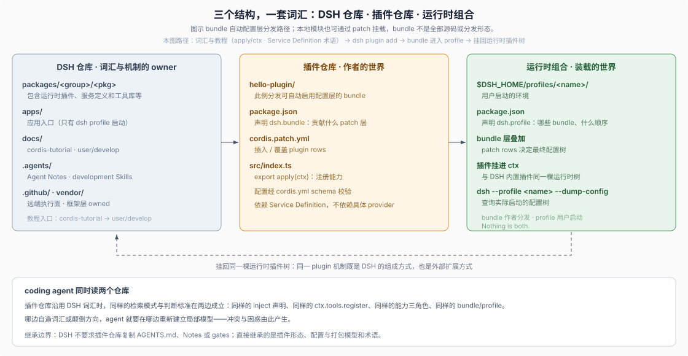

# 09 · 可扩展平台的生态可读性：宿主仓库如何赋能外部扩展仓

## 当 Coding Agent 同时横跨“宿主仓”与“外部扩展仓”

在任何支持插件、SDK 或第三方扩展的软件平台里，coding agent 干活时面对的往往不是一座孤立仓库，而是**“平台宿主仓 + 独立扩展仓”的双仓协同场景**：agent 一边要查宿主平台的扩展协议与服务契约，一边要在外部独立仓库里编写业务代码、配置打包与验证脚本。

许多开源或内部平台只把精力花在打磨主仓内部文档上，给外部扩展开发者留下的却是过时的 Hello World 玩具代码和一套与内核截然不同的黑话。结果就是：coding agent 一旦跨出主仓，在主仓学会的所有概念检索词和架构边界瞬间失灵。DSH 展示了另一种高阶平台设计：**用内外部同构的词汇表、无需凭据即可跑通的分层教程阶梯，以及清晰的组合清单二分法，把主仓的可读性无缝辐射到整个外部生态**（如果你正准备动手搭建一座独立的 DSH 插件仓库，读完本章的平台设计原理后请直接进入 [卷二：DSH 插件仓库开发与专属 Harness](../02-dsh-plugin-harness/00-index.md) 获取完整拓扑、编码铁律与门禁模板）。

## 1. 分层递进且零 API Key 门槛的可运行教程阶梯

要让人类与 coding agent 都能在几分钟内验证自己对扩展模型的理解，平台入口文档最忌讳两件事：一是只给跑不起来的伪代码片段，二是第 1 步就强迫读者申请线上密钥、拉起全套重型服务。DSH 为外部开发者铺设了两条分工严密的递进轨道：

> This tutorial teaches Cordis hands-on: each chapter is a runnable example you build in a scratch directory inside this repository, ending with a plugin wired into real harness services.
>
> — DSH [`docs/cordis-tutorial/index.md`](https://github.com/deepseek-ai/deepseek-harness/blob/master/docs/cordis-tutorial/index.md)。第一条轨道（`docs/cordis-tutorial/` 七讲）全部在本地 scratch 目录无 Key 独立运行，从最小组件、副作用卸载、服务注入、类型事件、配置校验、组合与热重载，一路走到把真实工具挂进 Harness 的 `tools` 服务并跑通完整管道。

> To write plugins for the harness itself — loaded from a `cordis.yml` and driven from the Web UI rather than the launcher below — start from your first Harness plugin.
>
> — DSH [`docs/cordis-tutorial/index.md`](https://github.com/deepseek-ai/deepseek-harness/blob/master/docs/cordis-tutorial/index.md)。第二条轨道（`docs/user/develop/` 的 basic / framework / practice 三层）则按“加载与驱动方式”无缝接棒，把同一个组件模型带入正式的 `cordis.yml` 配置树、打包安装与高级适配器实践。

## 2. 内核与外部扩展共享同一套原语，消灭“二等公民 API”

为什么很多平台的第三方插件总是在用 hack 手段绕过框架？因为平台自己写核心功能走一套内部特权通道，给外部扩展者却只开一套受限的阉割包装。DSH 彻底抹平了这道鸿沟：

> In Harness, a plugin is a TypeScript module that exports an `apply` function. The framework calls `apply` when loading the plugin and passes a `ctx` context object through which the plugin registers capabilities: [...] That is the complete configuration.
>
> — DSH [`docs/user/develop/basic/index.md` 的 “What is a plugin?”](https://github.com/deepseek-ai/deepseek-harness/blob/master/docs/user/develop/basic/index.md#what-is-a-plugin)。外部插件与 DSH 主仓 `packages/` 下的数百个第一方包采用**完全相同的模块协议**——同样的 `apply(ctx)` 入口、同样的 `inject` 依赖声明、同样的 `Config` Schema 校验与同样的“只依赖 Service Definition 而不依赖具体 Provider”单向原则。这意味着外部仓库的 coding agent 可以直接把整个 DSH 主仓的官方包当成 1:1 的高质量参考范本。

## 3. 分发清单与运行环境清单严格二分（Bundle vs Profile）

外部扩展生态最容易陷入混乱的另一个环节，是把“扩展包自己贡献什么”和“终端用户最终怎么组装整机环境”搅在同一份配置里。DSH 用两个严格互斥的包清单字段厘清了作者与使用者的权责边界：

> A bundle is what you author and distribute; a profile is what a user boots with `dsh --profile <name>`. Nothing is both.
>
> — DSH [`docs/user/develop/basic/publish.md` 的 “Two concepts, two manifests”](https://github.com/deepseek-ai/deepseek-harness/blob/master/docs/user/develop/basic/publish.md#two-concepts-two-manifests)。扩展作者分发的包通过 `package.json` 的 `dsh.bundle` 声明自己向宿主贡献哪些配置补丁层（也可作为不含 `dsh.bundle` 的普通模块由配置显式挂载），并通过 `engines.dsh`（缺省时回退检查 `@deepseek-ai/dsh*` peer dependency 范围）声明兼容的宿主版本；而终端用户启动的 `dsh.profile` 则决定按什么顺序把多个 Bundle 叠成最终运行环境（可随时用 [`--dump-config`](./06-runtime-inspection.md) 核验）。

与此同时，平台文档诚实地把**安装期安全边界**摊在桌面上：通过 `dsh plugin add`（尤其是从 Git 源安装含 `prepare` 脚本的包）可能在工作区沙箱之外触发依赖构建脚本；pnpm 默认拦截未批准脚本，仅解除版本准入豁免也绝不隐式授权任何脚本执行。好的平台可读性不仅教“怎么跑通”，更教扩展作者在 README 中如实披露安装副作用与所需权限（详见 DSH [构建脚本放行说明](https://github.com/deepseek-ai/deepseek-harness/blob/master/docs/user/develop/basic/publish.md#installing-from-github-the-build-script-catch)与[版本兼容豁免](https://github.com/deepseek-ai/deepseek-harness/blob/master/packages/boot/plugin-manager/README.md#version-compatibility-and-exemptions)）。

## 4. 双运行时树边界显式化（如后端 Host 树 vs 浏览器 Client 树）

当平台同时横跨服务端与浏览器端时，生态文档必须第一时间阻止 agent 把两边的模块图混为一谈。在 DSH 中，Node 侧 **Host 插件树**由 Loader 按 `cordis.yml` 合成行加载；而 Web 浏览器侧还有第二棵独立的 **Client Cordis 树**（由 `@deepseek-ai/dsh-client-web` 驱动，产物可随 Bundle 携带，但经由 Host 推送的客户端入口图加载，通过 `ctx.slots.register` 与 `ctx.remote.<namespace>` 挂载界面槽位和远端调用）。提前划清“只加后端能力无需建前端包，需要改界面槽位才进第二棵树”，能帮外部扩展仓省去大量跨环境试错成本。

## 5. 平台契约继承 vs 仓库治理自主：外部扩展仓该抄什么、不该抄什么

站在跨仓库工程学的高度，任何平台生态中的外部扩展仓库都应当认清一条核心分界线：

- **必须 100% 对齐的部分（运行时契约与领域词汇）**：组件协议、生命周期回卷、依赖抽象接口而非具体实现、打包清单字段与双运行时树边界——两边词汇越一致，coding agent 跨仓检索和迁移范本的准确率就越高。
- **完全自主裁剪的部分（仓库内部治理规模）**：宿主平台自己的百包级双语配对哈希、加权评审积分、多车道同步发版脚本属于主仓规模治理，外部扩展仓无需生搬硬套，只需按自身规模装配轻量级 `AGENTS.md`、决策记录与插件专属静态门禁即可（通用四件套模板见 [第 10 章](./10-agent-ready-repo-blueprint.md)；针对独立 DSH 插件仓量身定制的三类仓库拓扑、Cordis 六条防坑编码铁律与 `verify-plugin.mjs` 完整门禁代码，请直接阅读 [卷二：DSH 插件仓库开发与专属 Harness](../02-dsh-plugin-harness/00-index.md)）。

## 证据入口

- DSH [`docs/cordis-tutorial/index.md`](https://github.com/deepseek-ai/deepseek-harness/blob/master/docs/cordis-tutorial/index.md) 与 [`docs/cordis-primer.md`](https://github.com/deepseek-ai/deepseek-harness/blob/master/docs/cordis-primer.md)：无 Key 可运行七讲教程阶梯与浓缩运行时概念参考。
- DSH [`docs/user/develop/basic/index.md`](https://github.com/deepseek-ai/deepseek-harness/blob/master/docs/user/develop/basic/index.md)、[`docs/user/develop/framework/`](https://github.com/deepseek-ai/deepseek-harness/tree/master/docs/user/develop/framework) 与 [`docs/user/develop/practice/`](https://github.com/deepseek-ai/deepseek-harness/tree/master/docs/user/develop/practice)：内外部同构的插件最小定义与三层进阶开发文档。
- DSH [`docs/user/develop/basic/publish.md`](https://github.com/deepseek-ai/deepseek-harness/blob/master/docs/user/develop/basic/publish.md) 与 [`packages/boot/plugin-manager/README.md`](https://github.com/deepseek-ai/deepseek-harness/blob/master/packages/boot/plugin-manager/README.md#version-compatibility-and-exemptions)：`bundle` / `profile` 双清单二分法、`engines.dsh` 版本范围与构建脚本安全放行边界。
- DSH [`docs/subsystems/web-client.md`](https://github.com/deepseek-ai/deepseek-harness/blob/master/docs/subsystems/web-client.md)、[`client-modules.md`](https://github.com/deepseek-ai/deepseek-harness/blob/master/docs/subsystems/client-modules.md)、[`slots.md`](https://github.com/deepseek-ai/deepseek-harness/blob/master/docs/subsystems/slots.md) 与 [`packages/client/AGENTS.md`](https://github.com/deepseek-ai/deepseek-harness/blob/master/packages/client/AGENTS.md)：Host 与浏览器 Client 双 Cordis 树的加载机制与职责隔离。
