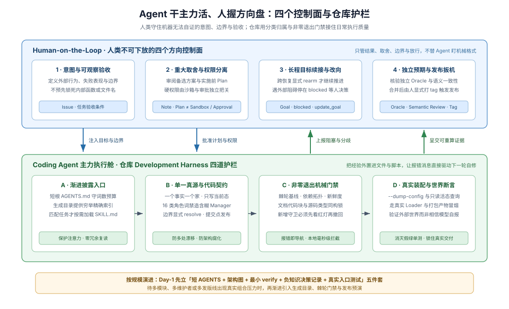

# 10 · 通用 Agent-Friendly Repo 蓝图：人类方向盘、三级裁剪与四件套起步骨架

## 当干活主力变成 Agent，人类在仓库里具体把控什么

前面九章逐层拆解了如何把导航地图、职责边界、工作流记忆、确定性门禁和运行时自省外置进仓库。对准备新建或改造自家仓库的技术负责人而言，还剩两个最关键的落地问题：**如果日常写代码、补测试、修报错的主力已经是 coding agent，人类退居方向盘（Human-on-the-Loop）时死守哪几个开关？一个小团队第 1 天又该先装哪几件最小设施，才不会被大厂级重型流程拖垮？**

本章给出与编程语言、业务框架完全无关的通用总装蓝图，并附上可直接复制进任何新仓库的**四件套起步骨架**（`AGENTS.md` + 轻量决策记录 ADR + 按需任务 `SKILL.md` + 零依赖 `scripts/verify.mjs`）。如果你维护的是独立 DSH 插件仓库，读完本章后可直接前往 [卷二第 6 章](../02-dsh-plugin-harness/06-plugin-gate-and-ci-harness.md) 获取插件专属门禁与回放测试模板。



## 1. 人类不可下放的四个方向控制面

让 coding agent 高效自主推进的前提，既不是“彻底撒手不管”，也不是“替 agent 人肉抓缩进和拼写”——凡是确定性细节一律交给门禁拦截，人类精力 100% 集中守住机器在原理上无法自证的四个控制面：

| 控制面 | 人类具体拍板什么 | 为什么机器或 Agent 无法自证 | DSH 对应实证与深挖入口 |
|---|---|---|---|
| **1. 意图与可观察验收边界** | 定义业务触发条件、调用方或用户可观察的结果、失败表现与明确不做范围；刻意不在任务单里预先写死内部类名或文件列表 | Agent 擅长在给定目标下搜索最优实现，却不能替业务方决定“哪个问题值得解”；预先锁死内部函数名反而堵死重构空间、让评审退化为核对名字 | 语义化 Issue 模板与任务准入（[意图入口参考](../03-dsh-sdlc-reference/09-intake-and-work-items.md)） |
| **2. 重大取舍与硬权限隔离** | 动工前审阅跨模块方案的被拒备选与代价（决策记录提案）及当次实施计划；将“文字计划获批”与“高危写盘/联网/命令权限”物理拆开控制 | 架构取舍本质是对未来演进方向的赌注；批准一份 Markdown 计划绝不等于授权进程越过沙箱或跳过高危操作确认 | 强制备选方案（[Agent Note 参考](../03-dsh-sdlc-reference/01-agent-note-lifecycle.md)）+ 计划与沙箱隔离（[Plan 与沙箱参考](../03-dsh-sdlc-reference/03-plan-and-sandbox.md)） |
| **3. 长程续接、阻塞交还与改向** | 为跨多轮长任务设定持久目标；会话恢复或分叉后显式重新授权才继续跑；遇到 `blocked` 挂起时介入拍板或显式改向 | 运行时不知道外部环境是否已在停机期间改变，更不能在缺少凭据、需求冲突或预算见底时替人类硬编答案 | 持久相位与非持久续跑许可分离（[会话与插件状态纪律](../02-dsh-plugin-harness/03-context-and-drift.md)） |
| **4. 独立预期（Oracle）、语义评审与发布扳机** | 守护不被录制脚本顺手刷新的独立预期基准；围绕 [机器六大盲区](./07-boundaries-and-costs.md) 做语义评审；人工打 tag 并触发正式发布 | 单测全绿可能只是“被测代码自己出卷自己批”，目标标为完成也只是状态变更；对外发版承担真实生产与安全责任 | 外部世界断言（[Agent 契约证据](../03-dsh-sdlc-reference/12-agent-contract-evidence.md)）、[语义评审](../03-dsh-sdlc-reference/06-review-and-human-role.md) 与人工发布链（[发布参考](../03-dsh-sdlc-reference/11-release-sequences-and-publish-lanes.md)） |

DSH 在长程目标控制上用一条极清晰的权限切分体现了“Agent 跑腿、人类掌舵”：

> Creating, editing, pausing, or resuming requires that direct request in a top-level agent turn; completing or blocking also works in an autonomous goal round.
>
> — DSH [`@deepseek-ai/dsh-tool-goal` README](https://github.com/deepseek-ai/deepseek-harness/blob/master/packages/goal/tool-goal/README.md)。自主续跑轮里的 agent 有权如实标记目标完成（`complete`）或在连续受阻达标后挂起求助（`blocked`），但立项、改目标、暂停与恢复四个方向盘动作只听命于顶层会话中人类的直接指令。

## 2. 按项目规模渐进装配的三级阶梯（Tier 1 → Tier 3）

切忌在项目第 1 天就把百包级基础设施的全部门禁照搬过来。应当按仓库承受的真实组合压力分三级渐进演进：

| 演进层级 | 适用项目规模 | 必装高性价比装备 | 明确暂缓、避免过度工程的重型设施 |
|---|---|---|---|
| **Tier 1 · Day-1 最小五件套** | 新建单服务/单包仓库、1–5 人 + Agent 快速迭代团队 | ① **≤150 行根 `AGENTS.md`**（地图、角色命名红线、验证命令）；② **单页 `docs/architecture.md`**（含“新行为挂哪”路由表）；③ **`docs/decisions/` 轻量决策记录**（强制含被拒备选）；④ **单入口 `scripts/verify.mjs`**（预算、断链、编码、决策格式）；⑤ **至少一条真实入口组装测试 + 独立预期断言** | 双语配对哈希、自动生成目录家族、多层子树 `AGENTS.md`、GitHub Project 状态机、加权评审积分 |
| **Tier 2 · 成长期十件套** | 多模块服务或小型 monorepo、多 Agent 并行提 PR、对外提供 SDK/API | 在 Tier 1 之上增配：⑥ **模块单向依赖拓扑门禁**；⑦ **棘轮防退化基线锁**（存量老债只减不增）；⑧ **2–4 份高频任务 `SKILL.md`**（聚焦选测、语义审查、清理推理残渣）；⑨ **本地 `pre-commit` 秒级钩子**；⑩ **每次 PR 的无凭据打包安装预演（Rehearsal）** | 跨语言多车道独立发版序列、`git blame` 历史行归属加权计分、多世代持久化快照矩阵 |
| **Tier 3 · 大规模平台全套** | 数十至数百包核心平台、多端运行时（Web/Desktop/CLI/SDK）、严格兼容承诺 | 在 Tier 2 之上补齐：**源码 AST 生成穷举目录 + 新鲜度锁**、**文档代码块编译与 `type-equiv` 同构校验**、**模块级 `Model Experience` 预算门禁**、**破坏性变更升级指南与持久化世代迁移锁**、**归档树 SHA-256 防篡改锁**、**默认分支可信裁判与受保护环境人工发布链** | 无（高组合压力已完全摊薄基础设施维护成本） |

从 Tier 1 往 Tier 2 升级只需遵循一条经验触发器：**当同一类错误在人工 Code Review 里被指正了第二次，就立刻停下往文档里加粗标红的手，把它变成 `verify.mjs` 里一条带修复提示的非零退出检查，或提炼成一份按需加载的 `SKILL.md`。**

## 3. 开箱即用模板一：通用根 `AGENTS.md` 骨架

将以下模板拷入任意语言新仓库根目录，替换尖括号命令占位符，并将总词数长期锁死在单屏可读预算内：

````markdown
# AGENTS.md

Read [docs/architecture.md](docs/architecture.md) before adding modules or changing public contracts.

## Repository map & fact ownership

Each fact has one authoritative home; link there instead of duplicating it:

```
src/               Production source (named by exact role, never vague Manager/Helper)
tests/             Unit, real-entry integration, and independent expected-output fixtures
docs/
  architecture.md  System map, extension seams, and "Where new behavior goes" routing table
  decisions/       Durable trade-offs + mandatory rejected alternatives (active / archived)
.agents/skills/    On-demand task workflows (loaded only when task matches description)
scripts/verify.mjs Deterministic repository gates (exits non-zero with file:line + fix hint)
```

## Commands

```sh
<run-unit-tests>          # focused module behavior and teardown tests
<run-integration-smoke>   # real entry / packed artifact composition check
<run-typecheck-and-lint>  # strict static types and lint checks
node scripts/verify.mjs   # doc budgets, link integrity, decision schema & hygiene gates
```

## Core engineering rules

- **Keep docs in present tense; never rewrite reversed decisions in place.** Update paths, symbols, and defaults in place in the same change. Put durable trade-offs in `docs/decisions/`; reverse an old decision by writing a new record and running a supersession check (see [11 · Metabolism]).
- **Purge session transcript residue.** Never commit dead draft citations (`decision 3`, `plan §2`), change narration (`used to`, `this PR`), or reviewer-addressed apologies in comments or docs; every reference must resolve at `HEAD`.
- **Name exact component roles.** Separate `Store` (data CRUD), `Registry` (named dynamic entries + disposer), `Policy` (allow/deny decisions), `Resolver` (stateless derivation), `Runtime` (live task lifecycle), and `Gateway` (process/network boundary). Hang mutable state on explicit instances, never module globals.
- **Trust internal static types; validate and resolve explicitly at boundaries.** Validate untrusted inputs and resolve defaults (`resolve(request): Spec`) at config, CLI, file, IPC, and wire boundaries — never bury `?? default` inside execution helpers.
- **Publish state only at the commit point.** Emit notifications and update derived views only after the operation succeeds; never paper over async ordering with `setTimeout` or microtasks.
- **Test the real entry path and prove new guards fail.** Assert external files, persisted state, or wire outputs against an independent oracle. Introduce the target regression, watch the check fail red, then revert before trusting a new guard.
````

## 4. 开箱即用模板二：轻量级决策记录（ADR / Decision Note）模板

存放于 `docs/decisions/YYYY-MM-DD-<slug>.md`（只在代码、类型和常规文档无法自明的非平凡架构/契约取舍时创建；机械局部改动免写）：

```markdown
# Decision: <One-line concrete outcome>

Status: implemented
Supersedes: none

## Problem

State the concrete constraint, failure mode, or competing pressure that current code and READMEs alone cannot explain.

## Decision

State the active rule, ownership boundary, or invariant in present tense. Link to the authoritative code or config files instead of pasting volatile line counts.

## Alternatives considered

- **<Plausible alternative A>.** Explain concretely why it lost (cost, coupling, failure mode, or invariant violated) so a future agent does not re-propose it.
- **<Plausible alternative B>.** State under what changed premise this option would become worth revisiting.

## Consequences

- Positive guarantee or simplification gained, and the mechanical gate or real-entry test that pins it.
- Accepted trade-off, capability given up, or semantic boundary still owned by code review.
```

## 5. 开箱即用模板三：按需加载的任务 `SKILL.md` 模板

存放于 `.agents/skills/pre-push-checks/SKILL.md`，展示如何用精准 `description`、明确禁区和诚实汇报契约封装非布尔型判断流程：

```markdown
---
name: pre-push-checks
description: Use before pushing, marking a PR ready for review, or claiming checks pass, to select the smallest local test and gate set that covers the outgoing diff without running the full suite blindly.
---

# Select Focused Pre-Push Evidence

Choose local verification proportional to the changed surface; let remote CI own the full cross-platform matrix.

## Workflow

1. Inspect `git status --short` and `git diff --stat <base>...HEAD` to list every touched module, config, doc, and script.
2. Always run `node scripts/verify.mjs` and `git diff --check` (sub-second hygiene, link, and budget gates).
3. Map each touched surface to its owning evidence:
   - Source module or public contract -> focused unit test + typecheck + affected real-entry smoke.
   - Packaging, build config, or CLI entry -> clean artifact build + packed-install smoke test.
   - New guard or regression test -> apply negative control (inject the bug, confirm non-zero red exit, revert, re-verify green).
4. Do not re-run unchanged heavy suites locally unless diagnosing a CI failure or changing a repo-wide config.

## Reporting contract

Report only the exact commands executed and their exit results. State explicitly any surface (such as OS-specific paths or live-credential e2e) left to remote CI or human review.
```

## 6. 开箱即用模板四：零依赖 `scripts/verify.mjs` 静态门禁骨架

以下纯 Node 内置模块脚本开箱即检查**常驻文档词数预算、Markdown 本地相对链接不断链、决策记录必填小节（强制包含 `## Alternatives considered`）以及 UTF-8/LF/尾换行卫生**，每条报错均直接输出 `file:line + 修复提示`：

```js
#!/usr/bin/env node
import { existsSync, readFileSync, readdirSync } from 'node:fs'
import { dirname, extname, relative, resolve } from 'node:path'
import { fileURLToPath } from 'node:url'

const root = resolve(fileURLToPath(new URL('..', import.meta.url)))
const decoder = new TextDecoder('utf-8', { fatal: true })
const failures = []

function fail(file, line, rule, fixHint) {
  const loc = line ? `${relative(root, file)}:${line}` : relative(root, file)
  failures.push(`${loc}: [${rule}] ${fixHint}`)
}

function walk(dir, out = []) {
  for (const entry of readdirSync(dir, { withFileTypes: true })) {
    if (['.git', 'node_modules', 'dist', 'lib', 'coverage'].includes(entry.name)) continue
    const full = resolve(dir, entry.name)
    if (entry.isDirectory()) walk(full, out)
    else out.push(full)
  }
  return out
}

// 1. 常驻上下文词数预算锁（超限时走 relocate -> condense -> raise）
const budgets = { 'AGENTS.md': 600, 'docs/architecture.md': 1200 }
for (const [relPath, ceiling] of Object.entries(budgets)) {
  const target = resolve(root, relPath)
  if (!existsSync(target)) {
    fail(target, 1, 'doc-budget', `缺少核心权威入口 ${relPath}；请创建并声明模块职责归属`)
    continue
  }
  const words = decoder.decode(readFileSync(target)).trim().split(/\s+/).filter(Boolean).length
  if (words > ceiling) {
    fail(target, 1, 'doc-budget', `当前 ${words} 词超出预算上限 ${ceiling}；请将长流程迁往专职文档或 .agents/skills/ 并改用链接引用`)
  }
}

// 2. 文本编码卫生、Markdown 相对链接闭合与决策记录结构锁
const textExts = new Set(['.md', '.ts', '.tsx', '.js', '.mjs', '.py', '.go', '.rs', '.json', '.yml', '.yaml'])
const linkPattern = /!?\[[^\]]*\]\(([^)\s]+)\)/g

for (const file of walk(root)) {
  const ext = extname(file)
  if (!textExts.has(ext)) continue
  let content
  try {
    content = decoder.decode(readFileSync(file))
  } catch {
    fail(file, 1, 'utf8', '检测到非法 UTF-8 字节序列；请统一保存为无 BOM UTF-8')
    continue
  }
  if (content.includes('\r')) fail(file, 1, 'line-ending', '检测到 CR 字符；请统一使用 LF 换行')
  if (!content.endsWith('\n') || content.endsWith('\n\n')) {
    fail(file, 1, 'trailing-newline', '文件必须以且仅以一个换行符结尾')
  }

  if (ext === '.md') {
    const lines = content.split('\n')
    let inFence = false
    lines.forEach((line, idx) => {
      if (/^\s*(`{3,}|~{3,})/.test(line)) inFence = !inFence
      if (inFence) return
      for (const match of line.matchAll(linkPattern)) {
        const rawTarget = match[1].split('#')[0]
        if (!rawTarget || /^(https?:|mailto:|#)/.test(rawTarget)) continue
        const resolved = resolve(dirname(file), rawTarget)
        if (!existsSync(resolved)) {
          fail(file, idx + 1, 'md-link', `相对链接目标不存在 (${rawTarget})；请更新为现行权威文件路径`)
        }
      }
    })

    const rel = relative(root, file).replaceAll('\\', '/')
    if (rel.startsWith('docs/decisions/') && !rel.endsWith('README.md') && !rel.includes('/archived/')) {
      if (!/^Status:\s*(proposed|implemented|rejected)$/m.test(content)) {
        fail(file, 1, 'decision-schema', '缺少合法的 Status: proposed|implemented|rejected 状态声明行')
      }
      if (!/^## Alternatives considered$/m.test(content)) {
        fail(file, 1, 'decision-schema', '缺少必填的 "## Alternatives considered" 章节；必须记录被拒备选方案与否决理由')
      }
    }
  }
}

if (failures.length > 0) {
  console.error(`Repository verification failed (${failures.length} issue(s)):`)
  for (const item of failures) console.error(`  - ${item}`)
  process.exitCode = 1
} else {
  console.log('Repository verification passed.')
}
```

把这套脚本放进新仓后，请立即按 [第 5 章的负例证明纪律](./05-executable-feedback.md) 做一次演习——故意在 `docs/decisions/` 下放一篇漏写 `## Alternatives considered` 的测试文档，亲眼确认 `node scripts/verify.mjs` 报错返回退出码 `1`，再清理测试文件，让你的第一道仓库门禁从诞生起就真实可信。

## 证据入口

- DSH [`AGENTS.md`](https://github.com/deepseek-ai/deepseek-harness/blob/master/AGENTS.md) 与 [`docs/AGENTS.md`](https://github.com/deepseek-ai/deepseek-harness/blob/master/docs/AGENTS.md)：根级常驻指令结构、单一事实归属分层表与词数预算处置顺序。
- DSH [`.agents/notes/README.md`](https://github.com/deepseek-ai/deepseek-harness/blob/master/.agents/notes/README.md) 与 [`.agents/skills/dsh-pre-push-checks/SKILL.md`](https://github.com/deepseek-ai/deepseek-harness/blob/master/.agents/skills/dsh-pre-push-checks/SKILL.md)：强制备选方案的决策记录结构与按改动范围选测的 Skill 原型。
- DSH [`docs/subsystems/plan.md`](https://github.com/deepseek-ai/deepseek-harness/blob/master/docs/subsystems/plan.md)、[`packages/goal/goal/README.md`](https://github.com/deepseek-ai/deepseek-harness/blob/master/packages/goal/goal/README.md) 与 [`packages/goal/tool-goal/README.md`](https://github.com/deepseek-ai/deepseek-harness/blob/master/packages/goal/tool-goal/README.md)：计划引导与沙箱硬权限隔离、持久目标相位与顶层人类控制权边界。
- DSH [`docs/testing.md`](https://github.com/deepseek-ai/deepseek-harness/blob/master/docs/testing.md)、[`.agents/skills/dsh-code-review/SKILL.md`](https://github.com/deepseek-ai/deepseek-harness/blob/master/.agents/skills/dsh-code-review/SKILL.md) 与 [`scripts/release/bump.ts`](https://github.com/deepseek-ai/deepseek-harness/blob/master/scripts/release/bump.ts)：真实入口验证、负例证明、语义评审职责与人工发布扳机。
