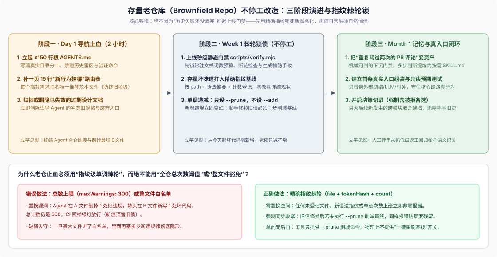

# 12 · 存量老仓库（Brownfield Repo）不停工改造实战：体检表与单调棘轮止血

## 现实痛点：90% 的团队手头不是空白新目录，而是一座背满历史债的老仓库

[第 10 章](./10-agent-ready-repo-blueprint.md) 提供了从零新建仓库的四件套起步模板。但在真实工程世界里，绝大多数技术负责人面对的是一座已经运行了两三年、拥有数万至数十万行代码、存在上百处跨层私引或宽泛类型强转、且每周都有紧迫业务交付压力的**存量业务仓库（Brownfield Repository）**。

如果试图按“先把全仓历史坏味道一次性改干净，再上线 Agent 门禁”的完美主义路线推进，改造往往在立项第一周就会夭折——要么因为重构面太大不敢合入，要么在拖延两周的分支期间又长出几十处新违规。反过来，如果放任 coding agent 直接进入一座有历史包袱的老仓，**Agent 天生是“破窗放大器”**：只要它在某个老文件里搜到过一次 `utils/common_helper` 或裸类型强转，就会把那个最烂的历史文件当成全仓标准编码风格到处复制。

本章给出一套**零停工、不推翻现有目录结构**的存量老仓改造方案：先用 10 项体检表在 15 分钟内定位失血点，再按 **Day 1（导航与标杆隔离止血）→ Week 1（指纹级单调棘轮锁债）→ Month 1（从高频返工提炼 Skill 与真入口测试）** 三步稳健落地。



## 1. 动手前 15 分钟：存量仓库 Agent 友好度 10 项自检评分表

拿你手头最核心的一座业务仓库（无论是 Python 后端、Go 微服务、Java 工程还是全栈 Web 仓库）逐行打分（每项满足记 1 分，不满足记 0 分）：

| 编号 | 体检维度 | 零分典型症状（Agent 进场必踩坑的信号） | 1 分合格标准 | 改造阶段 |
|---|---|---|---|---|
| **01** | **单屏入口预算** | 根目录没有 `AGENTS.md`，或只有一份上千行混合了营销介绍与过期安装步骤的 README | 根 `AGENTS.md` ≤ 600 词，一眼看清目录分工、红线与精确验证命令 | **Day 1** |
| **02** | **新行为两跳路由 + 黄金标杆** | 加新接口/新任务时，老文件五花八门，Agent 随便抓到一个三年前的反模式照抄 | `docs/architecture.md` 含 15 行行为路由表，每类需求显式点名 **1 个现行黄金范本文件** | **Day 1** |
| **03** | **僵尸过期文档清理** | `docs/` 或 Wiki 里躺着两年前早已推翻的架构图与旧配置名，与现行代码直接矛盾 | 现行目录零过期规格；失效旧文档已删除或移入明确标明的冻结 `archived/` 目录 | **Day 1** |
| **04** | **生成物防手改隔离** | OpenAPI/Protobuf/SQL 模型生成文件与手写文件混放且无新鲜度校验，常被顺手硬改 | 生成文件带清晰头部标记，且单条校验命令可立即揪出手工篡改或漏重算 | **Week 1** |
| **05** | **存量技术债单调棘轮** | 因历史代码有 200 处违规而干脆关掉静态规则，或设宽泛总数上限任由新债替旧债 | 存量违规打入精确指纹基线（只减不增），任何新文件或新位置违规立即非零报错 | **Week 1** |
| **06** | **模块单向依赖锁** | 下游实现反向引用上层业务，或到处深掏其他模块的内部私有子文件 | 门禁脚本锁死层间依赖方向（如消费方只准依赖接口定义，严禁耦具体实现） | **Week 1** |
| **07** | **边界显式解析与零全局单例** | 配置默认值散落在几十个业务函数深处的 `??` / `or` 里，模块顶层到处挂可变缓存 | 外部输入在入口统一校验解析，运行态可变状态归属显式实例而非模块全局变量 | **Month 1** |
| **08** | **高频返工提炼为按需 Skill** | Code Review 评论区每周重复指出同一种选测遗漏、异步泄漏或错误处理问题 | 凡人工重复纠正 ≥ 2 次的多步判断，已沉淀进 `.agents/skills/*/SKILL.md` | **Month 1** |
| **09** | **真实入口组装与只读预期** | 单测全靠手写 Mock 凑覆盖率，服务真启动时却因配置键写错或依赖漏挂当场崩溃 | 至少有一条走真实启动加载器的组装测试，仅替身外部网络/LLM/时钟，对照只读预期验证 | **Month 1** |
| **10** | **决策取代与推理残渣免疫** | 注释里写满 `used to`、`PR #123`；推翻旧方案时无人记录被拒备选与原因 | 新跨模块取舍必记 `docs/decisions/`（含被拒备选），代码与现行文档保持纯粹现在时 | **Month 1** |

- **0–3 分（高退化风险区）**：此时扩大 Agent 编码比例只会加速堆砌技术债，务必先花半天完成下方 **阶段一 + 阶段二** 止血。
- **4–7 分（局部可控区）**：基础导航已在，重点补齐**指纹级单调棘轮**与**真实入口组装测试**，堵住“测试全绿但上线报错”和“新债换旧债”漏洞。
- **8–10 分（成熟自驱区）**：人类精力已可从盯低级返工彻底转向 [第 10 章](./10-agent-ready-repo-blueprint.md) 的四个高层控制面与长周期新陈代谢。

## 2. 阶段一（Day 1 · 2 小时）：不做大重构，先立“黄金范本路由”与禁抄黑名单

改造老仓库的第 1 天，**一行生产业务逻辑都不要改**，只做三件净收益最高的信息排雷动作：

1. **在 `docs/architecture.md` 建立“黄金标杆点名 + 历史遗留隔离声明”**：老仓库最大的陷阱是新旧两代写法并存（例如旧订单模块还在用裸全局字典拼 SQL，新结算模块已经用上了标准 `Repository + Policy` 分层）。必须在路由表里**点名唯一允许模仿的新标杆文件，并把尚未迁移的老目录明确标为 Legacy（只准修 Bug 缩减体积，严禁作为新功能模板复制）**：

```markdown
## Where new behavior goes (Authoritative Routing Table)

Copy patterns ONLY from the canonical reference column. Never copy patterns from `src/legacy_*` directories.

| Change intent | Target directory | Canonical reference file to follow | Required local check |
|---|---|---|---|
| Add an HTTP / RPC endpoint | `src/api/routes/` | `src/api/routes/invoices.py` | `pytest tests/api/test_invoices.py` |
| Add a business authorization rule | `src/domain/policies/` | `src/domain/policies/refund_policy.py` | `pytest tests/domain/test_policies.py` |
| Add an external provider integration | `src/providers/<name>/` | `src/providers/stripe/gateway.py` | `pytest tests/integration/test_boot.py` |
```

2. **清退或封存根目录与 `docs/` 下的过期规格**：把所有与当前 `HEAD` 代码不符的历史设计草稿、旧版部署说明要么原地更新为现状，要么一键移入 `docs/archived/` 并在顶部写明“历史存档，非现行规范”，立刻切断 Agent 读错旧文档的污染源。
3. **放入 ≤150 行的根 `AGENTS.md`**：直接基于 [第 10 章 §3 模板](./10-agent-ready-repo-blueprint.md#3-开箱即用模板一通用根-agentsmd-骨架) 填入本仓真实的单测、类型检查与静态门禁命令。

## 3. 阶段二（Week 1 · 不停工止血）：用“精确指纹单调棘轮”锁死存量技术债

到了第 1 周，你想在老仓库里立下硬规矩——比如“禁止新增跨层反向依赖”“禁止新增 `Manager/Helper` 万能命名”或“禁止新增绕过类型系统的逃逸强转”，但一跑扫描脚本发现老代码里已经有 180 处历史违规。怎么办？

DSH 主仓在演进过程中同样面对过完全相同的跨数十个包的存量历史债问题。看 DSH 在落地“禁止新增 `as unknown` 类型强转”门禁时如何精准否决两种常见错误做法，并给出工业级单调棘轮解法：

> **Remove every existing assertion before enforcing the rule.** Rejected because the cleanup spans unrelated services, wire parsers, and test doubles. Exact existing exceptions let enforcement begin without treating a bulk substitution as a type-safety improvement.
>
> **Allow whole files or a repository-wide count.** Rejected because either permits a new assertion to replace a removed one. The baseline identifies each existing assertion and rejects increased occurrence counts.
>
> — DSH [`Prohibit new assertions to unknown` Agent Note](https://github.com/deepseek-ai/deepseek-harness/blob/master/.agents/notes/implemented/process/2026-09-19-no-unknown-casts.md#alternatives-considered)。这两段否决理由一针见血：**等全仓清零再开检查**会把门禁无限期拖死；而**按全仓总次数设上限（如 `maxWarnings: 180`）或按整文件豁免**则会留下致命的“债务置换漏洞”——Agent 在 A 文件删了 1 个旧违规，转手在 B 文件新写 1 个违规，总计数还是 180，门禁居然绿灯放行！

> Existing assertions have an exact baseline keyed by repository-relative path, a SHA-256 digest of the assertion's syntax tokens, and occurrence count. Baseline edits may only delete entries or decrease counts; reviewers must reject added files, new fingerprints, and increased counts. New or changed assertions outside the baseline and stale baseline entries fail the check; a file-wide allowance or a count budget cannot authorize replacement debt. `--prune` mechanically removes entries or reduces counts and refuses to write while new violations exist. There is no command that adds new exceptions.
>
> — DSH [`Prohibit new assertions to unknown` Agent Note](https://github.com/deepseek-ai/deepseek-harness/blob/master/.agents/notes/implemented/process/2026-09-19-no-unknown-casts.md#decision)。

### 开箱即用：语言无关的精确指纹单调棘轮脚本（`scripts/ratchet-check.mjs`）

你可以把这套**“零 `--add` 后门、强制 `--prune` 收紧”**的棘轮机制直接复制进任何 Python、Go、Java 或 TypeScript 老仓库，当天就把存量坏味道彻底封死（以下脚本仅用 Node 内置模块，扫描任意你指定的反模式——如遗留跨层私有导入、裸全局状态或禁用逃逸语法）：

```js
#!/usr/bin/env node
import { createHash } from 'node:crypto'
import { existsSync, readFileSync, readdirSync, writeFileSync } from 'node:fs'
import { extname, relative, resolve } from 'node:path'
import { fileURLToPath } from 'node:url'

const root = resolve(fileURLToPath(new URL('..', import.meta.url)))
const baselinePath = resolve(root, 'scripts/ratchet-baseline.json')
const isPrune = process.argv.includes('--prune')

// 按需替换为你要在老仓库止血的违规模式（示例：跨层偷引 internal 目录、裸逃逸强转等）
const RULES = [
  { id: 'no-internal-reach', ext: new Set(['.ts', '.py', '.go']), re: /from\s+['"][^'"]*\/_internal\/|import\s+[^;\n]*\/_internal\//g },
  { id: 'no-vague-helper-class', ext: new Set(['.ts', '.py', '.java']), re: /\bclass\s+\w+(Manager|Helper|Util|Utils)\b/g },
]

function walk(dir, out = []) {
  for (const entry of readdirSync(dir, { withFileTypes: true })) {
    if (['.git', 'node_modules', 'dist', 'lib', 'venv', '__pycache__', 'vendor'].includes(entry.name)) continue
    const full = resolve(dir, entry.name)
    if (entry.isDirectory()) walk(full, out)
    else out.push(full)
  }
  return out
}

// 采集当前工作树的精确指纹：key = "<relPath>::<ruleId>::<normalizedSnippetSha256>" -> count
const current = new Map()
for (const file of walk(resolve(root, 'src'))) {
  const ext = extname(file)
  const rel = relative(root, file).replaceAll('\\', '/')
  const text = readFileSync(file, 'utf8')
  for (const rule of RULES) {
    if (!rule.ext.has(ext)) continue
    for (const match of text.matchAll(rule.re)) {
      const normalized = match[0].replace(/\s+/g, ' ').trim()
      const digest = createHash('sha256').update(normalized).digest('hex').slice(0, 12)
      const key = `${rel}::${rule.id}::${digest}`
      current.set(key, (current.get(key) ?? 0) + 1)
    }
  }
}

const baseline = existsSync(baselinePath) ? JSON.parse(readFileSync(baselinePath, 'utf8')) : {}
const newViolations = []
const staleAllowances = []

for (const [key, count] of current.entries()) {
  const allowed = baseline[key] ?? 0
  if (count > allowed) {
    newViolations.push(`${key} (current=${count}, baseline=${allowed}) — 严禁新增违规；请按 docs/architecture.md 标准范本改写`)
  }
}
for (const [key, allowed] of Object.entries(baseline)) {
  const actual = current.get(key) ?? 0
  if (actual < allowed) {
    staleAllowances.push(`${key} (current=${actual}, baseline=${allowed}) — 恭喜消除了历史债！请运行 node scripts/ratchet-check.mjs --prune 收紧基线`)
  }
}

// 物理上不提供任何自动扩容基线的开关；只有在零新增违规时，--prune 才允许单向削减基线
if (newViolations.length > 0) {
  console.error(`Ratchet gate FAILED — 拦截到 ${newViolations.length} 处新增或膨胀的违规指纹:`)
  for (const v of newViolations) console.error(`  - ${v}`)
  process.exit(1)
}
if (isPrune) {
  const nextBaseline = Object.fromEntries([...current.entries()].sort(([a], [b]) => a.localeCompare(b)))
  writeFileSync(baselinePath, `${JSON.stringify(nextBaseline, null, 2)}\n`, 'utf8')
  console.log(`Pruned ratchet baseline to ${current.size} remaining legacy fingerprint(s).`)
  process.exit(0)
}
if (staleAllowances.length > 0) {
  console.error(`Ratchet baseline has ${staleAllowances.length} stale allowance(s) that must be pruned:`)
  for (const s of staleAllowances) console.error(`  - ${s}`)
  process.exit(1)
}
console.log(`Ratchet gate passed (${current.size} legacy fingerprint(s) frozen, 0 new violations).`)
```

上线当天只需由架构师初始化一次快照并合入主干，此后任何 Coding Agent 既不能偷塞一处新违规，也不能在修好旧文件后留下空头额度给别处挥霍——存量历史债会在日常迭代中稳步归零。

## 4. 阶段三（Month 1）：用“两次复发规则”驱动演进，拒绝常见改造翻车

完成止血与锁债后，第一个月按真实业务痛点把最后两块拼图补齐：

1. **只从真实 PR 返工记录里长出 `SKILL.md` 与新门禁**：翻看过去两周团队人工 Code Review 的评论记录，挑出重复出现过两次以上的问题——如果是布尔可判定的（如漏导出类型、配置文件写了明文密钥），加进 `verify.mjs`；如果是需要多步上下文权衡的（如“改数据库 Schema 前怎样核对读写双兼容”“发版前按 diff 跑哪几条冒烟”），按 [第 3 章规范](./03-skills-as-procedural-memory.md) 写成一份 60 行的 `.agents/skills/<topic>/SKILL.md`。
2. **为核心主链路补上一条真实组装测试 + 只读预期文件**：挑业务最核心的一条端到端入口（例如从真实配置加载整个 HTTP/RPC 应用，只把最外层的第三方支付/大模型网关换成确定性脚本替身），断言落库记录或输出文件与只读的 `expected/` 夹具完全一致，彻底终结“单测 90% 覆盖率但全是假 Mock”的虚假安全感。

最后，在改造存量老仓库的全程警惕以下**四大常见翻车陷阱**：

- **陷阱一：把根 `AGENTS.md` 写成老仓库的“历史吐槽大全”。** 切忌把几百条细碎编码偏好全堆进根文件挤爆上下文；根 `AGENTS.md` 永远只放全局硬红线与跳转链接，局部遗留目录的特殊规矩放进该子目录自己的短 `AGENTS.md`（按需触碰才加载）。
- **陷阱二：把带有主观模糊性的代码品味塞进非零退出门禁。** 门禁一旦频繁误报（False Positive），人类和 Agent 的第一反应就是寻找绕过开关；只有边界 100% 确定性的不变量才进门禁，品味与抽象取舍留在 Skill 与语义评审。
- **陷阱三：要求团队回头给过去三年的老代码补写决策记录（ADR）。** 决策记录只服务于**从今天开始发生的新增非平凡取舍**；对存量反直觉老逻辑，只有在某次任务真正触碰并查清原因时才顺手落盘，绝不搞形式主义补作业。
- **陷阱四：上了门禁却没做负例证明（Prove-Red）。** 每往老仓库加一条正则或 AST 检查，必须亲手在源码里造一处目标坏味道，亲眼看到脚本非零报错、报错行号与修复提示准确无误后再撤回（详见 [第 5 章](./05-executable-feedback.md)）。

## 证据入口

- DSH [`Prohibit new assertions to unknown` Agent Note](https://github.com/deepseek-ai/deepseek-harness/blob/master/.agents/notes/implemented/process/2026-09-19-no-unknown-casts.md) 与 [`scripts/verify-no-unknown-casts.ts`](https://github.com/deepseek-ai/deepseek-harness/blob/master/scripts/verify-no-unknown-casts.ts)：存量历史债精确语法指纹基线、禁止整文件/总数置换、仅提供 `--prune` 单向收紧而无扩容后门的工业实证。
- DSH [`Mechanical quality gates over prose guidelines` 已归档 Agent Note](https://github.com/deepseek-ai/deepseek-harness/blob/master/.agents/notes/archived/process/2026-06-11-quality-gates.md) 与 [`docs/testing.md`](https://github.com/deepseek-ai/deepseek-harness/blob/master/docs/testing.md)：优先用确定性门禁替代散文劝导、真实入口组装测试与负例控制（Prove-Red）准则。
- DSH [`docs/architecture.md`](https://github.com/deepseek-ai/deepseek-harness/blob/master/docs/architecture.md) 与 [`.agents/skills/`](https://github.com/deepseek-ai/deepseek-harness/tree/master/.agents/skills)：“新行为挂在哪里”权威路由表与从高频复杂判断沉淀按需加载工作流的实践样本。
