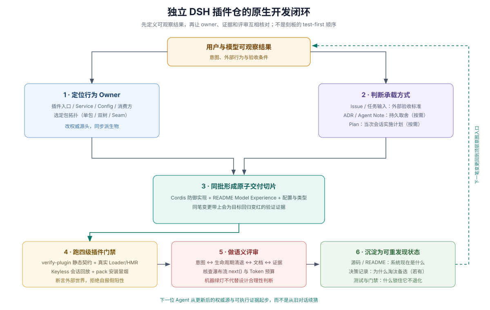
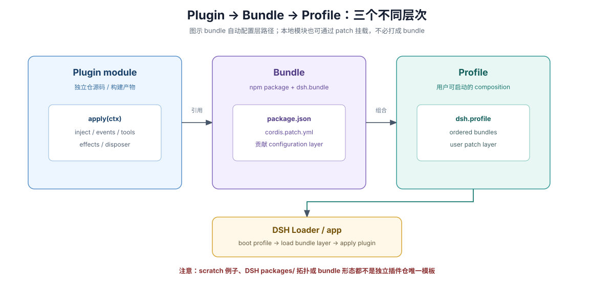
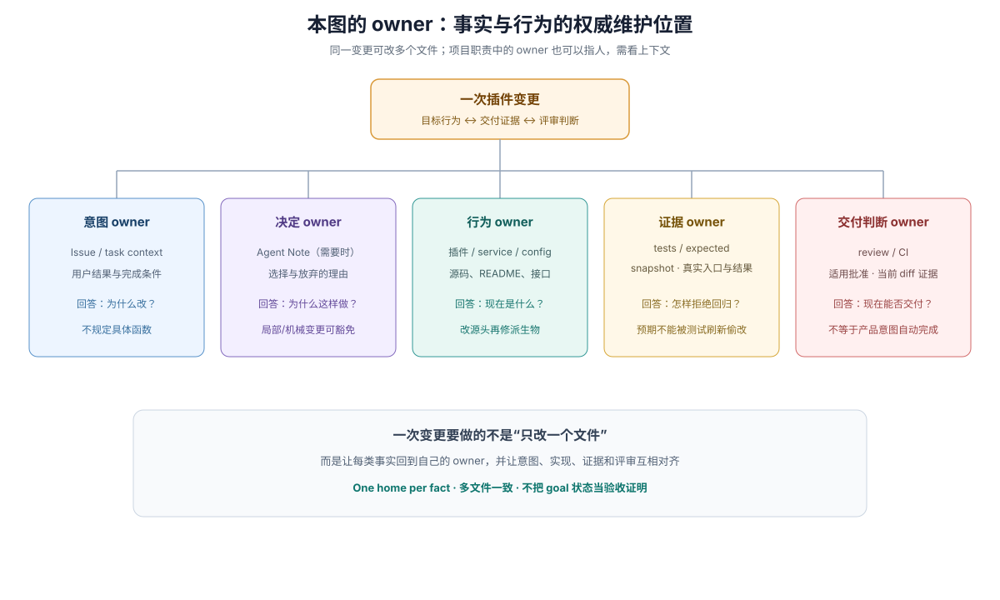
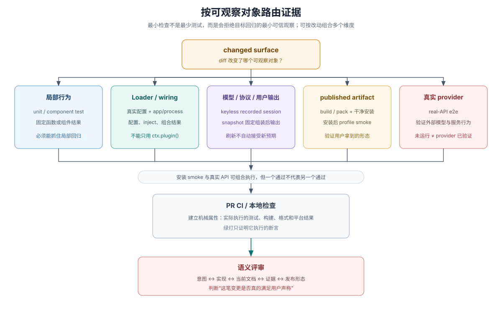
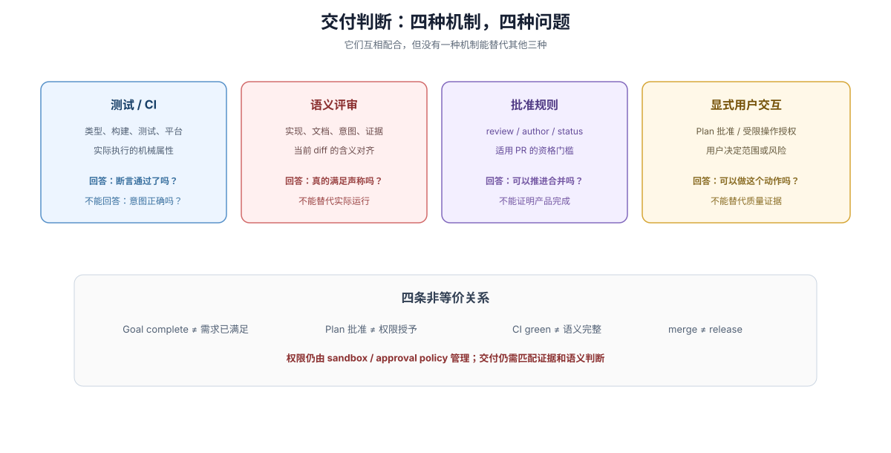

# DSH 插件仓库开发与专属 Harness 实战总览

## 为什么会写 `apply(ctx)` 离“交付可靠插件仓”还差得很远

新建一座独立的 DSH 插件仓库时，写通第一个 `export function apply(ctx)` 往往只需要十分钟；真正的工程事故几乎全部爆发在随后的多轮 Agent 协作中：把函数式插件顺手加上 `export default` 导致真实 `Loader` 静默丢弃 `inject`、用模块级全局变量存状态导致多会话串台与热重载泄漏、用纯 `tsc` 编译全栈插件导致浏览器端 `dsh-client-modules` 根本加载不到 `window.__ModuleLoader__.load` 工厂产物、只给工具写 `presentResult` 却发现内置 Web 客户端根本不调它、改了工具描述击穿整条会话的前缀缓存，或者因为外部仓库没有 DSH 主仓内部的私有测试基建，只写几个全 mock 单测就匆忙发包，结果用户执行 `dsh plugin add` 当场报错。

本卷专为**独立 DSH 插件仓库的架构师与主力 Coding Agent** 编写，将 DSH 一手源码、Cookbook、防御模式、Postmortem 与 Skills 提炼为一套可直接落地的**插件仓四层工程体系、能力扩展配方与专属开发 Harness**（通用的跨语言 Agent-Friendly Repo 设计哲学由 [卷一](../01-general-repo-harness/00-index.md) 拥有，本卷直接进入 DSH 插件实战）。

首次接触根 `ctx` vs 会话 `agent.ctx`、`Loader`、`PENDING`、`Tool / Command / Skill`、`Typert @Remote` 或 `Volatile<T>` 时，可随时对照 [`02 · 术语与心智模型`](./02-terms-and-mental-models.md)。

## 一页选型：我想给 DSH 扩展什么能力 → 该选哪种原语、拓扑与验证证据？

动手写代码前，先按下表锁定**正确的扩展原语**与**最窄仓库拓扑**——90% 的插件返工都源于一开始选错了扩展层（例如把人类确定性快捷操作硬写成模型工具，或把简单工具拆成跨端双树包）：

| 你想给 DSH 增加的能力 | 首选扩展原语（权威专章） | 推荐仓库拓扑 | 必跑的最窄真实证据 |
|---|---|---|---|
| **让模型自主决定何时调用外部系统或本地受控能力** | `ctx.tools.register(defineTool(...))` + `output.schema`（免费兼容 PTC `await tools.<name>`）（[`07`](./07-extension-recipes-and-host-services.md)） | 拓扑 A：单包 Host Bundle（需要自定义 Web 富交互卡片时升拓扑 B） | `ScriptedLlmAdapter` 无 Key Turn 回放 + CLI 展示纯函数测试（升 Web 补 Client 槽位测试） |
| **审批、拦截、限流、超时包裹或脱敏既有工具** | `tools/pre-execute` / `ctx.tools.guard()` / `tools/execute` / `tools/post-execute` / `tools/result` 五层钩子（[`07`](./07-extension-recipes-and-host-services.md)） | 拓扑 A：单包 Host Bundle | 真实 `Loader` 多插件挂载顺序测试 + 允许/拒绝/脱敏双分支断言 |
| **人类在输入框敲 `/xxx` 立即执行的确定性操作** | `ctx.commands.register(...)` 斜杠命令（不消耗模型轮次）（[`07`](./07-extension-recipes-and-host-services.md)） | 拓扑 A：单包 Host Bundle | 命令派发单测 + 会话 `command/run`、`command/done` 日志投影断言 |
| **向系统提示词追加规范，或收窄会话可用工具集** | `ctx.systemPrompt.section()` / 按需 `SKILL.md` / `ctx.tools.restrict()`（[`07`](./07-extension-recipes-and-host-services.md)） | 纯 `SKILL.md` 或拓扑 A | 提示词组装快照 + 会话中途工具集不变以保住 KV Cache 前缀测试 |
| **不重开进程即可在设置页动态修改并立即生效的配置** | `Schema.object({ ... }).volatile()` + `.get()` + `loader/volatile-update`（[`04`](./04-plugin-repo-topologies.md)） | 拓扑 A（自动渲染标准表单）或拓扑 B（自定义 `plugins.detail.*` 卡片） | `Volatile<T>` 热更新切换测试 + `.role('secret')` 脱敏校验 |
| **在 Web / Desktop 界面挂载自定义面板并调后端能力** | Client `ctx.slots.register(...)` + Host `TypertRemoteService` `@Remote` RPC（[`04`](./04-plugin-repo-topologies.md)） | 拓扑 B：Host + Web Client 双树包（`tsdown` 产出 `window.__ModuleLoader__.load` 格式 `lib/client.js`） | Host `remoteErrorOf` 契约测试 + Client `TestRemote` 槽位渲染测试 + `verify-plugin.mjs` 双面检查 |
| **后台长耗时任务执行完毕后主动唤醒当前会话** | `ctx.jobs.start(...)` + 自定义 `SessionEventMap` 声明合并 + `exec.agent.inject()`（[`03`](./03-context-and-drift.md)、[`07`](./07-extension-recipes-and-host-services.md)） | 拓扑 A：单包 Host Bundle | 父 Turn 结束后后台信号存活测试 + 会话恢复/卸载 `ignorable` 兼容测试 |
| **可热插拔的多后端能力底座（如本地与远端双实现）** | `Service` 抽象类 + Provider 实现包 + Consumer 消费包（[`04`](./04-plugin-repo-topologies.md)） | 拓扑 C：Capability Seam 多包 Workspace | 真实 `Loader` 切换 Provider 组合测试 + HMR 重载排空测试 |

## 一页看清：独立 DSH 插件仓必须打通的四个工程层次

开发独立 DSH 插件同时横跨四个彼此正交的层次。DSH 官方入门教程主要覆盖第 1 层（运行时 API）和第 3 层的基础打包命令；而一座能让 Coding Agent 长期高质量自驱的插件仓，必须把第 2 层（仓库拓扑与双面构建）与第 4 层（插件专属门禁与回放 Harness）一并建齐：

| 工程层次 | 核心要解决的问题 | DSH 宿主平台直接提供的机制 | 独立插件仓必须自己建好的设施（本卷对应专章） |
|---|---|---|---|
| **1. Cordis 运行时与扩展原语层** | 插件如何声明依赖、复用宿主底座服务、挂载工具/钩子/命令并在卸载时干净排空？ | `apply(ctx)`、`Service`、`inject`、12+ 个宿主内置服务、五种事件模式、`ctx.effect()` | 严守导出互斥、零模块单例、优先注入宿主 `ctx.fs`/`ctx.shell`/`ctx.jobs`、双轨工具卡片与 `SessionEventMap` 投影纪律（[`03`](./03-context-and-drift.md)、[`05`](./05-cordis-contracts-and-model-experience.md)、[`07`](./07-extension-recipes-and-host-services.md)） |
| **2. 插件仓库拓扑与跨端编译层** | Node 宿主端、浏览器端代码与跨端 RPC 类型如何隔离编译并打包成宿主可加载产物？ | `@deepseek-ai/dsh-*` 公开类型包、`dsh-client-modules` 浏览器加载器、`TypertRemoteService` | 按复杂度选定单包 Host、Host+Client 双树（双 `tsconfig` + `tsdown` lazy-CJS `lib/client.js` 打包）或 Capability Seam 多包拓扑（[`01`](./01-new-plugin-repository.md)、[`04`](./04-plugin-repo-topologies.md)） |
| **3. 配置叠加与 Bundle 分发层** | 用户装什么、配在哪一层生效、安装期允许跑什么脚本、升级时怎样校验宿主兼容？ | `dsh.bundle` 补丁层、`dsh.profile` 启动层、`engines.dsh`、安装期 `prepare` 脚本门禁与五层配置 | 三层 npm 依赖精准归位、裸包名根行承载 `dsh.client`、`Volatile<T>` 活配置、`pnpm pack` 与干净 `$DSH_HOME` 安装冒烟（[`01`](./01-new-plugin-repository.md)、[`04`](./04-plugin-repo-topologies.md)） |
| **4. 插件仓专属 Harness 与排障层** | 没有主仓内部私有脚本时，谁在提交前自动拦住插件特有缺陷并快速定位线上怪象？ | 公开的 `cordis-plugin-loader`、`dsh-llm`、`dsh-client-test-runtime` 等可编程测试构件 | 自有 `scripts/verify-plugin.mjs` 静态门禁、防 `PENDING` 真实 Loader 测试、`ScriptedLlmAdapter` 无 Key 回放 + 8 大故障 1 分钟排障表（[`06`](./06-plugin-gate-and-ci-harness.md)、[`08`](./08-troubleshooting-and-postmortems.md)） |

牢记四条底线不等式：**代码能编译 ≠ `Loader` 真能激活 ≠ 会话与 CLI/Web 双端输出符合预期 ≠ 打包 tarball 能装进干净 Profile**。四道关口必须各有独立证据。

## 全卷 8 章实战路线图（`01`–`08`）

| 专章 | 解决的核心痛点与可直接拿走的工程资产 |
|---|---|
| [`01-new-plugin-repository.md`](./01-new-plugin-repository.md) | **Day-1 单包快速通关与安全安装边界**：最小单包 Host Bundle 黄金目录、`dsh.bundle` vs `dsh.profile`（`Nothing is both`）、`engines.dsh` 回退、`dsh plugin add` 安装期脚本放行边界、真实 `Loader` 测试与起步 `AGENTS.md` |
| [`02-terms-and-mental-models.md`](./02-terms-and-mental-models.md) | **插件核心心智模型与防误判词典**：厘清 `根 ctx vs 会话 agent.ctx`、`Tool vs Command vs Skill`、`CLI presentResult vs Web presentationMeta`、`Slot vs Typert @Remote`、`Config vs Volatile<T>` 等高频混淆词对及一行自检法 |
| [`03-context-and-drift.md`](./03-context-and-drift.md) | **会话日志与插件运行时状态纪律**：深入 `session log` 仅追加与 `deriveMessages()` 投影、`compaction/*` 遮蔽、`goal / plan / todo / skill` 跨 `resume`/`fork`/`spawn` 存活矩阵，以及插件新增模型可见输入时的 `SessionEventMap` 硬约束 |
| [`04-plugin-repo-topologies.md`](./04-plugin-repo-topologies.md) | **三种插件仓拓扑、全栈构建与跨端 RPC**：单包 Host、Host + Web Client 双树包（双 `tsconfig` + 外部仓 `tsdown.config.ts` `window.__ModuleLoader__.load` 打包模板 + `TypertRemoteService` `@Remote` 五步闭环）、Capability Seam 多包与 `Volatile<T>` 活配置 |
| [`05-cordis-contracts-and-model-experience.md`](./05-cordis-contracts-and-model-experience.md) | **Cordis 六大防坑契约与 Model Experience**：可直接喂给 Agent 的六条代码级红线（禁函数插件默认导出、禁模块可变单例、强制 Waterfall `next()`、异步排空卸载与提交点改状态、工具 Schema 极简与 KV Cache 记账、结构化错误分类） |
| [`06-plugin-gate-and-ci-harness.md`](./06-plugin-gate-and-ci-harness.md) | **独立插件仓门禁、无 Key 回放与 CI 模板**：支持 Host+Client 双面校验的零依赖 `scripts/verify-plugin.mjs`、带 `PENDING` 缺失依赖点名的真实 `Loader`/HMR 竞态测试、`ScriptedLlmAdapter` 无 Key 回放 + 独立 `workspace.expected/` 与插件 `ci.yml` |
| [`07-extension-recipes-and-host-services.md`](./07-extension-recipes-and-host-services.md) | **宿主可注入服务货架与五大扩展配方**：12+ 个官方宿主服务（`fs`/`shell`/`jobs`/`approval`/`sandbox`/`spill` 等）速查表，以及生产级 `defineTool`（PTC + CLI/Web 双轨卡片 + 后台任务 + V4 `MessageSourceMap`）、五层工具钩子、`ctx.commands`、`systemPrompt.section()` 与协议桥接配方 |
| [`08-troubleshooting-and-postmortems.md`](./08-troubleshooting-and-postmortems.md) | **高频故障 1 分钟排障手册与四大真实事故复盘**：8 大插件症状速查表（`PENDING` 静默失活、Web 白屏缺 `__DSH_BOOT__`、`presentResult` Web 不生效、同 `id` 覆盖配置等）+ DSH 官方 Postmortem `0001`–`0004` 插件视角深度拆解 |

## 插件变更的事实归属与分层证据闭环

在独立插件仓中推进非玩具改动时，无需照搬百包主仓的行政流程，但必须守住**“一个事实一个家”同提交联动**与**按可观察对象分层布置证据**两条工程底线：

| 需要确认或修改的事实 | 插件仓内的权威位置 | 交付前核对动作 |
|---|---|---|
| 当前配置、上下文开销与数据留存义务 | `src/`、导出类型、JSDoc、`README.md` | 核对 `README.md` 是否同步反映现行参数与 `## Model Experience` |
| 默认挂载关系、裸包名根行与条件启停 | `cordis.patch.yml`、`package.json`（`dsh.bundle` / `dsh.client`） | 核对跑过 `verify-plugin.mjs` 与 `dsh --dump-config` |
| 哪条自动化检查锁住回归 | `tests/`、独立 `workspace.expected/` | 核对注入故障时检查确实变红失败（Prove-Red），按改动触及表面精准选测 |

> Every behavior change needs the narrowest available test or purpose-built check that would fail for its regression; add broader checks only for surfaces the diff actually reaches.
>
> — DSH [pre-push checks Skill](https://github.com/deepseek-ai/deepseek-harness/blob/master/.agents/skills/dsh-pre-push-checks/SKILL.md#select-relevant-evidence)

手工拼装假 `ctx` 的单测只能验证纯算法分支；配置闭合、`PENDING` 死锁、模型请求投影、跨端 RPC 与打包完整性必须按可观察对象路由到对应的真实证据层（完整代码模板见 [`06`](./06-plugin-gate-and-ci-harness.md)），并区分自动化测试、人类语义评审、合并准入与正式发版四个独立角色：

## 插件仓最常见的六大防踩坑红线

1. **切勿只写手工 `ctx.plugin(...)` 或全 Mock 单测就上线。** 绕过真实 `Loader` 的测试抓不到 `export default` 吞掉 `inject`（Postmortem `0001`）、`cordis.patch.yml` 路径写错以及 `peerDependencies` 漏声明等致命打包故障。
2. **切勿拿纯 `tsc` 产物充当全栈插件的 `lib/client.js`，也切勿把 `dsh.client` 挂在子路径行上。** 浏览器端必须打包为 `window.__ModuleLoader__.load` lazy-CJS 工厂格式，且只有裸包名根 Loader 行会挂载浏览器模块（详见 [`04`](./04-plugin-repo-topologies.md)）。
3. **切勿以为写了 `presentResult` 就能改变内置 Web 界面的工具卡片。** `presentCall`/`presentResult` 仅供 CLI/SDK 终端消费；Web 卡片消费的是 `output.presentationMeta` 与 `tool.call.toolview` 槽位（详见 [`07`](./07-extension-recipes-and-host-services.md)）。
4. **切勿让录制或快照刷新脚本顺手覆盖独立预期（Oracle）或盲目提交刷新结果。** 盲刷录制会把 `UNKNOWN_TOOL` 等回归当成“新预期”固化入库（Postmortem `0002`，详见 [`08`](./08-troubleshooting-and-postmortems.md)）。
5. **切勿模仿早年已退役的 `./invariant` 伴生导出，也切勿裸调 `fs`/`child_process` 绕过宿主底座。** 优先注入宿主现成服务（`ctx.fs`、`ctx.shell`、`ctx.jobs`、`ctx.approval`、`ctx.sandbox`），详见 [`07`](./07-extension-recipes-and-host-services.md)。
6. **切勿生搬硬套 DSH 主仓内部的百包级行政流程。** DSH 主仓的 GitHub Project 状态机、加权评审积分、双语哈希配对与三序列同步发版服务于官方大仓（归档于 [卷三](../03-dsh-sdlc-reference/00-index.md)）；独立插件仓直接采用 [`06`](./06-plugin-gate-and-ci-harness.md) 的轻量高信噪比门禁与 CI。

## 相关入口

- **动手新建与进阶**：[`01 · 单包起步`](./01-new-plugin-repository.md) → [`07 · 宿主服务与五大扩展配方`](./07-extension-recipes-and-host-services.md) → [`04 · 全栈拓扑、打包与跨端 RPC`](./04-plugin-repo-topologies.md) → [`05 · Cordis 六大契约`](./05-cordis-contracts-and-model-experience.md) → [`06 · 门禁与无 Key 回放`](./06-plugin-gate-and-ci-harness.md)。
- **查概念、查状态与排故障**：[`02 · 术语与心智模型`](./02-terms-and-mental-models.md)、[`03 · 会话日志与状态纪律`](./03-context-and-drift.md)、[`08 · 1 分钟排障与 Postmortem 复盘`](./08-troubleshooting-and-postmortems.md)。
- **跨卷联动**：[卷一：通用 Agent-Friendly Repo 工程学](../01-general-repo-harness/00-index.md) 与 [卷三：DSH 主仓研发条款字典](../03-dsh-sdlc-reference/00-index.md)。
