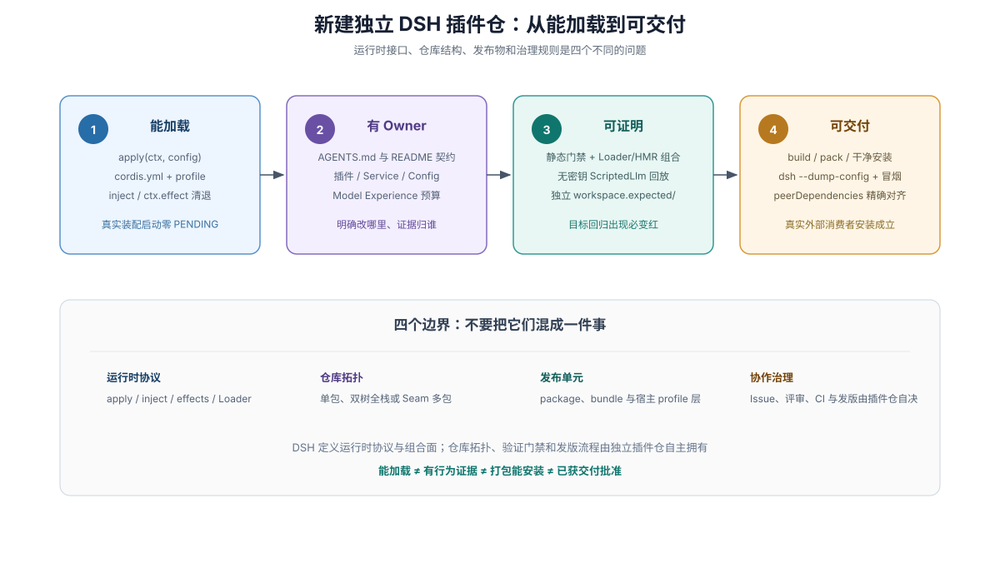
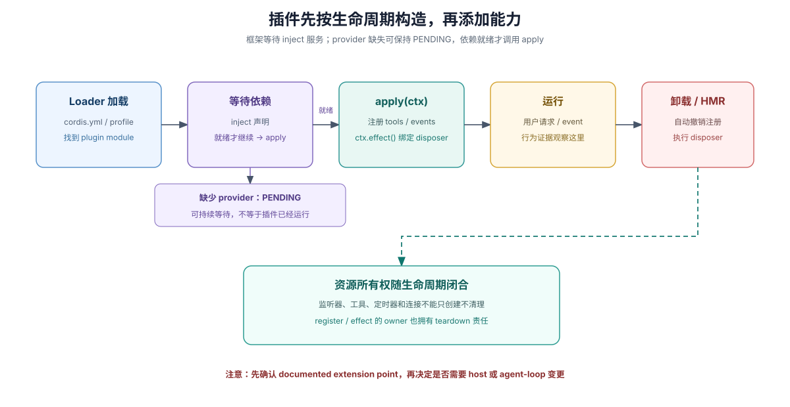

# 01 · 新建独立 DSH 插件仓：Day-1 最小单包 Host Bundle 通关样板

## 本章目标与适用范围

本章为刚建仓的独立 DSH 插件团队与 coding agent 提供一条**半小时内可从零跑通的最小单包 Host Bundle 标准样板**——一步到位立好目录骨架、三层 npm 依赖镜像、双形态入口代码、真实 `Loader` 组合与 HMR 卸载测试、干净 Profile 打包安装冒烟，以及开箱即用的插件仓根 `AGENTS.md`。

如果你的插件只需注册后端模型工具、CLI 子命令、提示词片段、事件拦截器或新模型适配器，直接采用本章的单包结构即可长期演进；若你的插件还需要向 Web 界面注入自定义槽位组件（Host + Client 双树）或拆分为多包 Capability Seam，请在本章基础上继续阅读 [`04 · 三种插件仓拓扑与配置工程`](./04-plugin-repo-topologies.md)；编码防坑细节与自动化门禁脚本分别见 [`05`](./05-cordis-contracts-and-model-experience.md) 与 [`06`](./06-plugin-gate-and-ci-harness.md)。



图中四项工作是新仓建立基础设施的逻辑闭环（而非每次改一行代码都要手工重搭）：**真实 Loader 确实激活了插件 → 行为与文档各有明确归属 → 独立门禁与测试能拦截回归 → 打出的 `.tgz` 包在干净宿主环境可安装运行**。遇到生疏概念可随时查阅 [`02 · 术语与心智模型`](./02-terms-and-mental-models.md)。

## 1. 黄金单包目录树与三层依赖镜像规则

切忌把 DSH 主仓容纳数百个包的 `packages/<group>/<pkg>` 深层目录照搬进单插件仓库。对于绝大多数独立发布的 Host 插件 Bundle，下面这套扁平单包结构清晰度最高、维护阻力最小：

```text
dsh-greet-bundle/
├── AGENTS.md                        # 给 coding agent 的插件仓专属常驻红线（见 §7 模板）
├── README.md                        # 配置表、行为契约、Model Experience、数据留存与已知限制
├── package.json                     # 声明 type:module、exports、files、dsh.bundle、engines.dsh 与依赖镜像
├── tsconfig.json                    # ESM NodeNext 严格编译配置（src -> lib，本地相对导入带 .ts）
├── cordis.patch.yml                 # bundle 安装后自动叠加的配置补丁层（按包名挂载入口）
├── locale/
│   ├── en.json                      # 可选：供 Plugin Manager / Settings 读取的名称与简介
│   └── zh.json
├── scripts/
│   └── verify-plugin.mjs            # 插件专属静态门禁（完整脚本见第 06 章）
├── src/
│   └── index.ts                     # 插件入口（函数式具名导出，或 Service 子类默认导出）
└── tests/
    └── loader-composition.spec.ts   # 导出防呆、真实 Loader 激活与 HMR 卸载清理测试
```

编写 `package.json` 时，第一道生死线是 **三层依赖归位**——凡是运行期必须与宿主进程共享同一实例或同一注册表身份的包（`@deepseek-ai/cordis` 及所消费的 `@deepseek-ai/dsh-*` Service Definition 包），**必须以匹配的版本范围同时写进 `peerDependencies` 与 `devDependencies`**（在宿主里安装时复用宿主实例，在本仓独立跑类型检查与 Vitest 时用本地开发依赖）；而运行期自身直接调用的无状态值工具（如 `@deepseek-ai/schemastery` 参数校验、`@deepseek-ai/dsh-brand` 品牌类型构造）则放进 `dependencies`（依据：DSH [打包与安装指南](https://github.com/deepseek-ai/deepseek-harness/blob/master/docs/user/develop/basic/publish.md#install-into-a-profile) 与 [建包清单](https://github.com/deepseek-ai/deepseek-harness/blob/master/docs/cookbook/adding-a-package.md)）：

```json
{
  "name": "dsh-greet-bundle",
  "version": "0.1.0",
  "type": "module",
  "main": "./lib/index.js",
  "types": "./lib/types/index.d.ts",
  "exports": {
    ".": {
      "types": "./lib/types/index.d.ts",
      "default": "./lib/index.js"
    },
    "./package.json": "./package.json",
    "./locale/*.json": "./locale/*.json"
  },
  "files": [
    "lib",
    "cordis.patch.yml",
    "locale/*.json"
  ],
  "scripts": {
    "typecheck": "tsc --noEmit",
    "test": "vitest run",
    "verify": "node scripts/verify-plugin.mjs"
  },
  "dsh": {
    "bundle": {
      "patch": "./cordis.patch.yml"
    }
  },
  "engines": {
    "dsh": ">=0.2.0 <0.3.0"
  },
  "dependencies": {
    "@deepseek-ai/dsh-brand": "^0.2.0",
    "@deepseek-ai/schemastery": "^4.3.0"
  },
  "peerDependencies": {
    "@deepseek-ai/cordis": "^4.0.0",
    "@deepseek-ai/dsh-llm": "^0.2.0",
    "@deepseek-ai/dsh-tools": "^0.2.0"
  },
  "devDependencies": {
    "@deepseek-ai/cordis": "^4.0.0",
    "@deepseek-ai/cordis-plugin-include": "^4.0.0",
    "@deepseek-ai/cordis-plugin-loader": "^4.0.0",
    "@deepseek-ai/dsh-llm": "^0.2.0",
    "@deepseek-ai/dsh-system-prompt": "^0.2.0",
    "@deepseek-ai/dsh-tools": "^0.2.0",
    "typescript": "^5.8.0",
    "vitest": "^3.0.0"
  }
}
```

配套的 `cordis.patch.yml` 必须使用**发布包名**（而非开发机上的相对源码路径）声明插入行，确保打包安装到任意用户的 `$DSH_HOME` 后 Node 模块解析都能直接命中 `exports["."]`：

```yaml
- insert:
    - id: greet-tool
      name: dsh-greet-bundle
```

## 2. 建立最小可加载插件

顺着 DSH [首次插件指南](https://github.com/deepseek-ai/deepseek-harness/blob/master/docs/user/develop/basic/index.md) 编写 `src/index.ts` 时，第一时刻就要把**依赖声明、配置校验、副作用回卷与数据留存说明**四件事一起闭合：



1. **依赖等待与 `PENDING` 意识**：通过 `inject` 声明必需服务，框架会在上游服务就绪后自动激活插件；若上游服务未配置，插件会静默停在合法的 `PENDING` 等待态而不会立即抛异常——因此后续测试必须显式断言 `FiberState.ACTIVE`（详见 [不加载插件的诊断](https://github.com/deepseek-ai/deepseek-harness/blob/master/docs/cordis-tutorial/06-composition-and-hmr.md#diagnosing-a-plugin-that-never-loads)）。
2. **可变选择进 `Config`，自包含错误立即 Fail Loud**：部署方会调整的参数一律放进 Schemastery `Config` 定义，加载期即可判定的非法配置直接报错拒绝，绝不用硬编码常量凑合。
3. **注册即受管副作用，但卸载插件不等于删除用户数据**：工具、监听器与自定义定时器一律通过 `ctx.tools.register()`、`ctx.on()` 或 `ctx.effect()` 绑定到当前 Fiber；同时必须在 `README.md` 中写明：`dsh plugin remove` 只移除代码依赖与配置补丁层，插件运行期间写下的文件、会话记录或工作区数据会原样保留，需按文档指引单独清理（依据：DSH [打包与安装 remove 语义](https://github.com/deepseek-ai/deepseek-harness/blob/master/docs/user/develop/basic/publish.md#install-into-a-profile)）。

编写入口代码时，严守 **函数式插件与 Service 插件的导出形式互斥铁律**——DSH 主仓曾发生过 178 个单测全绿，只因函数式插件末尾多写了一句 `export default apply`，导致真实 `Loader.unwrapExports` 优先取走 `.default` 裸函数而静默丢弃具名导出的 `inject` 与 `Config` 的严重故障（详见 [`0001-acp-default-export-drops-inject` 复盘](https://github.com/deepseek-ai/deepseek-harness/blob/master/docs/postmortem/0001-acp-default-export-drops-inject.md)，更多深层生命周期防坑见 [`05`](./05-cordis-contracts-and-model-experience.md)）：

```ts
// 形态 A：函数式插件（具名导出 name / inject / Config / apply，严禁同时写 export default！）
import type { Context } from '@deepseek-ai/cordis'
import { defineTool } from '@deepseek-ai/dsh-tools'
import Schema from '@deepseek-ai/schemastery'

export const name = 'greet-tool'
export const inject = ['tools']

export interface Config {
  prefix: string
}

export const Config: Schema<Config> = Schema.object({
  prefix: Schema.string().default('Hello'),
})

export function apply(ctx: Context, config: Config) {
  // 已在 inject 声明的必需服务直接访问 ctx.tools；未声明的可选服务必须走 ctx.get('...')
  ctx.tools.register(defineTool({
    name: 'greet',
    description: 'Greet the named person.',
    parameters: {
      person: { type: 'string', required: true, description: 'Name to greet' },
    },
    output: {
      schema: { type: 'string' },
      render: (_args, value) => [{ type: 'text', text: value }],
    },
    async execute(args) {
      return `${config.prefix}, ${args.person}!`
    },
  }))
}
```

只有当你的包本身是在向 `Context` 贡献一个新的可注入服务（参见 DSH [Services 与依赖指南](https://github.com/deepseek-ai/deepseek-harness/blob/master/docs/user/develop/framework/service.md)）时，才采用默认导出 `Service` 子类的形态：

```ts
// 形态 B：Service 插件（默认导出 Service 子类，配合 declaration merging 扩展 Context 类型）
import { Service, type Context } from '@deepseek-ai/cordis'

declare module '@deepseek-ai/cordis' {
  interface Context {
    greetingAudit: GreetingAuditService
  }
}

export default class GreetingAuditService extends Service {
  static inject = ['tools']

  constructor(ctx: Context) {
    super(ctx, 'greetingAudit')
  }
}
```

## 3. 明确第一笔交付的事实归属（Owner）

哪怕只有寥寥几个文件，第 1 天也要定下清晰的归属纪律：`src/index.ts` 拥有运行时实现，`README.md` 拥有配置字段表、`## Model Experience`（模型看见什么、Token 与 KV Cache 影响）、持久化数据位置与 `## Known Limitations and Deferred Work`（已知限制），`cordis.patch.yml` 拥有自动挂载行，`tests/` 拥有独立验证断言。代码、文档与测试在同一笔提交中对齐刷新。

## 4. 写下第一条真实 `Loader` 组合与 HMR 清理测试

仅靠公开的 `@deepseek-ai/cordis`、`@deepseek-ai/cordis-plugin-loader`、`@deepseek-ai/cordis-plugin-include` 与宿主服务包，就能在 `tests/loader-composition.spec.ts` 里一次性锁住**禁默认导出、真实 YAML 配置加载、`FiberState.ACTIVE` 激活确认、工具管线执行与卸载回卷**（注意 `@deepseek-ai/dsh-tools` 自身依赖 `systemPrompt` 服务，组合配置中必须一并挂载，否则 `tools` 会停在 `PENDING`，见 [Cordis 教程第 7 讲](https://github.com/deepseek-ai/deepseek-harness/blob/master/docs/cordis-tutorial/07-into-the-harness.md#compose-and-run)）：

```ts
import { mkdtemp, rm, writeFile } from 'node:fs/promises'
import { tmpdir } from 'node:os'
import { join } from 'node:path'
import { fileURLToPath, pathToFileURL } from 'node:url'
import { Context, FiberState } from '@deepseek-ai/cordis'
import Include from '@deepseek-ai/cordis-plugin-include'
import Loader from '@deepseek-ai/cordis-plugin-loader'
import { brandString } from '@deepseek-ai/dsh-brand'
import type { ToolCallId } from '@deepseek-ai/dsh-llm'
import type {} from '@deepseek-ai/dsh-tools'
import { afterEach, describe, expect, it } from 'vitest'
import * as greetPlugin from '../src/index.ts'

const pluginEntryPath = fileURLToPath(new URL('../src/index.ts', import.meta.url))
let tempDir: string | undefined
let context: Context | undefined

afterEach(async () => {
  await context?.fiber.dispose()
  context = undefined
  if (tempDir !== undefined) await rm(tempDir, { recursive: true, force: true })
  tempDir = undefined
})

describe('greet-tool real Loader composition', () => {
  it('forbids stray default export on a function plugin', () => {
    expect('default' in greetPlugin).toBe(false)
  })

  it('activates to ACTIVE through Loader, runs via tools pipeline, and unwinds on dispose', async () => {
    tempDir = await mkdtemp(join(tmpdir(), 'greet-loader-'))
    const configPath = join(tempDir, 'cordis.yml')
    await writeFile(configPath, [
      "- name: '@deepseek-ai/dsh-system-prompt'",
      "- name: '@deepseek-ai/dsh-tools'",
      `- id: greet-under-test`,
      `  name: ${JSON.stringify(pluginEntryPath)}`,
      `  config:`,
      `    prefix: 'Welcome'`,
      '',
    ].join('\n'))

    context = new Context()
    await context.plugin(Loader, { baseUrl: pathToFileURL(tempDir).href + '/' })
    context.loader.builtins.include = Include
    await context.loader.create({
      name: 'cordis:include',
      config: { path: pathToFileURL(configPath).href },
    })
    await context.loader.await()

    // 1. 验证全部启用行均已进入 ACTIVE，杜绝漏配依赖导致静默卡在 PENDING
    const activeEntries = [...context.loader.entries()].filter(entry => !entry.disabled)
    expect(activeEntries.every(entry => entry.fiber?.state === FiberState.ACTIVE)).toBe(true)

    // 2. 经真实 tools 服务执行并验证事件通知与返回值
    const observed: string[] = []
    context.on('tools/result', (exec, result) => {
      observed.push(`${exec.name}:${JSON.stringify(result.content)}`)
    })
    const outcome = await context.tools.execute({
      callId: brandString<ToolCallId>('call-1'),
      name: 'greet',
      arguments: { person: 'Ada' },
      signal: new AbortController().signal,
    })
    expect(outcome.content).toEqual([{ type: 'text', text: 'Welcome, Ada!' }])
    expect(observed).toHaveLength(1)

    // 3. HMR 卸载清理验证：销毁插件 Fiber 后，工具注册表不残留旧 schema
    const targetEntry = activeEntries.find(entry => entry.options.id === 'greet-under-test')
    await targetEntry?.fiber?.dispose()
    expect(context.tools.schemas().some(schema => schema.name === 'greet')).toBe(false)
  })
})
```

（当插件进一步涉及多轮模型交互、工作区文件落盘或异步资源排空竞态时，如何编写基于公开 `LlmAdapter` 的无 Key 脚本化会话回放与 `PENDING` 诊断辅助器，见 [`06 · 独立插件仓门禁、无 Key 回放与 CI`](./06-plugin-gate-and-ci-harness.md)。）

## 5. 在干净隔离的 Profile 中验证打包产物（Tarball Smoke）

本地源码跑通 Vitest 不代表发出去的 npm 包能被用户装上（最常见的翻车是 `files` 漏列 `cordis.patch.yml` 或 `exports` 指向未生成的 `lib/` 路径）。每次发版前或 CI 中，应在带真实运行表面的全新测试 Profile 上跑通打包安装冒烟。注意：`dsh plugin` 对不存在的自定义 profile 只会初始化不含交互表面的 `base`，因此必须先用 `--from-default-profile headless`（或 `web`、`sdk`、`acp`）克隆出完整表面；且 `--from-default-profile` 对同名已有自定义 profile 是**整目录覆盖替换**，切勿对日常在用的业务 profile 执行（依据：DSH [profile 创建规则](https://github.com/deepseek-ai/deepseek-harness/blob/master/docs/user/develop/basic/publish.md#the-profile-manifest) 与 [`--from-default-profile` 替换语义升级指南](https://github.com/deepseek-ai/deepseek-harness/blob/master/docs/upgrade-guide/v0.2.1-alpha.2/from-default-profile-replaces-target/guide.md)）：

```sh
# 1. 编译产物并打出真实 tarball（检验 files 清单与构建导出完整性）
pnpm run build && pnpm pack

# 2. 在临时隔离的 DSH_HOME 中基于内置 headless 模板初始化干净测试 profile
export DSH_HOME="$(mktemp -d)"
dsh --profile smoke-greet --from-default-profile headless

# 3. 安装本地 tarball 并通过 --dump-config 验证 bundle 层与 greet-tool 行确已合入
dsh plugin --profile smoke-greet add ./dsh-greet-bundle-0.1.0.tgz
dsh --profile smoke-greet --dump-config

# 4. 验证卸载可干净剥离配置补丁层，最后清理临时目录
dsh plugin --profile smoke-greet remove dsh-greet-bundle
rm -rf "$DSH_HOME"
```

## 6. 交付说明与语义评审

提交 PR 时，如实列出外部可观察行为、影响范围、实际跑过的命令（`verify`、`typecheck`、`test`、打包冒烟）以及未执行的边界（如缺少线上凭据而跳过的真实模型端到端测试），由 reviewer 对照当前 diff、`README.md` 与独立测试预期完成语义签收。

## 7. 开箱即用：独立 DSH 插件仓根 `AGENTS.md` 起步模板

将以下精简高密度的 `AGENTS.md` 放入插件仓根目录，进入该仓的 coding agent 即可从第 1 轮起严守 DSH 插件契约：

```markdown
# AGENTS.md — Independent DSH Plugin Repository

This repository ships an installable DeepSeek Harness (DSH) plugin bundle.

## Commands

- `pnpm run verify` — deterministic plugin gate (`exports`/`files`/`dsh.bundle` closure, peer mirror, doc budget)
- `pnpm run typecheck` — strict TypeScript check (`noImplicitAny`, explicit `.ts` relative imports)
- `pnpm run test` — unit, quiescent HMR disposal, real `Loader` composition, and keyless scripted-turn specs
- `pnpm run build && pnpm pack` — emit `lib/` artifacts and verify publishable tarball layout

## DSH & Cordis Plugin Rules

- **Export form is exclusive:** function plugins named-export `name`, `inject`, `Config`, and `apply` with **NO `export default`** (`Loader.unwrapExports` drops sibling `inject`/`Config` when `.default` exists). Service plugins `export default class ... extends Service`.
- **Dependency faces:** depend on `@deepseek-ai/dsh-*` Service Definitions, never concrete providers. Declare host-shared packages (`@deepseek-ai/cordis`, consumed `@deepseek-ai/dsh-*` definitions) in BOTH `peerDependencies` and `devDependencies` with matching ranges; put runtime validators (`@deepseek-ai/schemastery`, `@deepseek-ai/dsh-brand`) in `dependencies`.
- **Zero module singletons & required vs optional services:** never store mutable state in module globals (`let cache`, `globalThis`); own state on a `Service` or `agentCtx`. Read `inject`-declared services via `ctx.<name>` and optional services strictly via `ctx.get('<name>')`.
- **Lifecycle & waterfall delegation:** bind every registration/resource to `ctx.on()` / `ctx.effect()` and await in-flight work before releasing cleanup dependencies. Cooperative `waterfall` listeners MUST `return next()`. Remember `dsh plugin remove` removes code/patch layers, not persisted user data.
- **Validated Config & commit-point state:** expose deployment choices via Schemastery `Config` (`Config.volatile()` for settings UI); fail loud at load on invalid config; emit events and update derived views only at the commit point after operations succeed.

## Documentation & Verification Discipline

- Update `README.md` (config, `## Model Experience`, data retention, `## Known Limitations and Deferred Work`) in the same commit as any public behavior change.
- Hand-mounted `ctx.plugin(...)` unit tests are insufficient: prove `FiberState.ACTIVE` through real `Loader` composition, verify quiescent disposal, and run clean `$DSH_HOME` tarball install smoke before release.
```

## 证据入口

- DSH [首次插件指南](https://github.com/deepseek-ai/deepseek-harness/blob/master/docs/user/develop/basic/index.md) 与 [打包与安装指南](https://github.com/deepseek-ai/deepseek-harness/blob/master/docs/user/develop/basic/publish.md)：最小插件定义、`dsh.bundle` / `dsh.profile` 清单与安装/移除语义。
- DSH [Cordis 七讲教程](https://github.com/deepseek-ai/deepseek-harness/blob/master/docs/cordis-tutorial/index.md) 与 [`0001-acp-default-export-drops-inject` 故障复盘](https://github.com/deepseek-ai/deepseek-harness/blob/master/docs/postmortem/0001-acp-default-export-drops-inject.md)：真实 `Loader` 组合、`PENDING` 诊断与默认导出吞掉 `inject` 的真实案例。
- DSH [`docs/cookbook/adding-a-package.md`](https://github.com/deepseek-ai/deepseek-harness/blob/master/docs/cookbook/adding-a-package.md) 与 [`from-default-profile-replaces-target` 升级指南](https://github.com/deepseek-ai/deepseek-harness/blob/master/docs/upgrade-guide/v0.2.1-alpha.2/from-default-profile-replaces-target/guide.md)：包清单三层依赖契约与测试 Profile 初始化替换规则。
