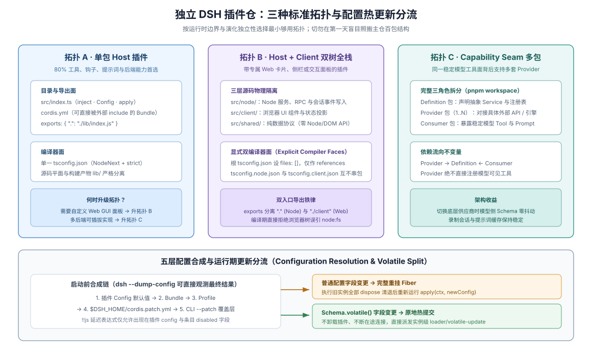

# 04 · DSH 插件仓库的三种标准拓扑与五层配置工程

## 什么时候该超越“单包 Host 插件”

[`01 · 新建独立 DSH 插件仓`](./01-new-plugin-repository.md) 给出的单包扁平结构足以覆盖 70% 的纯后端扩展场景（新增模型工具、CLI 命令、事件拦截策略或新模型适配器）。但一旦你的插件迈入以下两类需求，继续硬塞在单一 Node `tsconfig.json` 里就会立刻撞墙：

1. **需要向 DSH Web 图形界面注入自定义槽位组件、顶栏按钮、对话卡片或设置弹窗**——此时同一个包既要给 Node 宿主提供后端能力，又要给浏览器第二棵 Cordis 树提供 React 视图，两边对 `Context` 的类型声明合并会在单一 TypeScript 编译程序里直接冲突报错；
2. **需要定义一项支持多后端替换的全新基础设施能力**（例如一套统一的向量检索接口，同时提供本地内存版与远端集群版两套实现），消费方绝不能反向耦合某一个重型后端的依赖。

本章给出一张零歧义的 **DSH 插件仓拓扑选型矩阵**，逐一拆解单包 Host、Host + Client 双树全栈包、Capability Seam 多包 Workspace 三种标准布局，并讲透 DSH 的五层配置叠加、`Config.volatile()` 设置表单与 `!!js` 动态表达式规则。



## 一张表选对你的插件仓拓扑

| 拓扑形态 | 适用业务场景 | 交付包数量与编译器面 | 何时绝对不要选它 |
|---|---|---|---|
| **拓扑 A · 单包 Host Bundle** | 纯服务端能力：新增 `defineTool`、系统提示词片段、事件监听拦截、LLM 适配器或持久化后端 | 1 个 npm 包；1 个 NodeNext `tsconfig.json` | 需要渲染浏览器 React 槽位或自定义对话节点时 |
| **拓扑 B · Host + Web Client 双树全栈包** | 既有 Node 宿主服务/命令，又向 Web 界面挂载槽位（`ctx.slots`）或前端控制器 | 仍可保持 **1 个 npm 包**（同时导出 `.` 与 `./client`）；但必须拆出 **Host 与 Client 两个独立编译器面** | 只做后端工具、完全不需要改自定义 UI 槽位时（普通工具默认已有通用卡片渲染） |
| **拓扑 C · Capability Seam 多包 Workspace** | 创造一项新抽象能力（`Service Definition`），并有多个演进节奏或重型依赖彼此独立的 `Provider` | `pnpm-workspace.yaml` 多包仓库（`definition` + `provider-*` + 可选 `bundle`） | 只有唯一一种实现且短期内无替换需求时（拆成空壳三包只会徒增发版与测试摩擦） |

## 1. 拓扑 A：单包 Host Bundle（基准复习与源码导入铁律）

单包 Host Bundle 的完整 `package.json` 与目录树已在 [`01` §1](./01-new-plugin-repository.md) 给出。在此只补充两条编码期必须写入门禁的模块解析细节：

- **全程纯 ESM（`"type": "module"`）且包内相对导入显式写 `.ts` 后缀**：源码中写 `import { helper } from './helper.ts'`，TypeScript 编译产物自动改写运行时 JS 为 `.js` 并保持 `.d.ts` 可被下游 NodeNext 消费方正确解析；跨包引用一律走公开包名，严禁深掏其他包的未导出内部路径。
- **遵循 16 类精确角色后缀命名组件**：管理动态注册与卸载的类叫 `Registry`，管理单数据集快照与订阅的叫 `Store`，只做准入裁决不执行动作的叫 `Policy`，跨进程/网络边界的叫 `Gateway`（完整角色词典见 [卷一第 8 章 §7](../01-general-repo-harness/08-repository-taxonomy.md#7-代码与模块契约防-agent-写腐化的三道防线)）。

## 2. 拓扑 B：Host + Web Client 双树全栈插件包（双编译器面与槽位铁律）

很多开发者误以为“既有后端逻辑又有前端界面，就必须拆成两个 npm 包”。在 DSH 架构下并非如此：**一个全栈功能插件完全可以保持在同一个 npm 包内**——由 `src/index.ts` 编译出 Node 宿主加载的 `lib/index.js`，由 `src/client/index.ts` 打包出浏览器第二棵 Cordis 树加载的 `lib/client.js`，并在 `package.json` 中通过 `dsh.client` 与 `exports["./client"]` 声明客户端面（DSH 主仓的 `@deepseek-ai/dsh-session-log-export` 即采用这一单包双面结构）。

### 为什么根 `tsconfig.json` 必须做成 `solution-only` 双编译器面隔离

一旦同一个仓库或同一个包里同时出现 Host 代码和 Client 代码，如果用同一份 `tsconfig.json` 把两边一起塞进同一个 `tsc` 编译程序，TypeScript 会立刻报接口合并冲突：

> Host and Client stay two aggregate programs because both sides declaration-merge the cordis `Context` interface under the same keys with different services; one program seeing both merges reports a collision.
>
> — DSH [`docs/development.md` 的 “TypeScript project layout”](https://github.com/deepseek-ai/deepseek-harness/blob/master/docs/development.md#typescript-project-layout)。Node 侧的 `Context` 与浏览器侧的 `Context` 都会通过 declaration merging 挂载同名但签名不同的服务键；只要拆成两个独立的 `ts.Program` 编译，模块解析本身绝不会冲突。

因此，全栈插件仓的标准目录与三份 `tsconfig` 布局如下：

```text
dsh-audit-panel-plugin/
├── package.json                 # 同时声明 exports["."], exports["./client"] 与 dsh.client
├── tsconfig.json                # Solution-only 根配置：files: []，仅引用 host 与 client 两片叶子
├── tsconfig.host.json           # NodeNext / Host 编译器面（只含 src/index.ts 等服务端文件）
├── tsconfig.client.json         # Browser / JSX / DOM 编译器面（只含 src/client/** 与共享纯类型）
├── cordis.patch.yml             # 宿主挂载行（Client 入口由宿主扫描 dsh.client 自动推送至浏览器）
├── locale/
│   ├── en.json
│   └── zh.json
└── src/
    ├── routes.ts                # 可选：两边共享的纯数据结构/常量（无 Node 或 DOM 专属导入）
    ├── index.ts                 # Host 入口：注册后端服务、命令或网关路由
    └── client/
        ├── index.ts             # Client 入口：仅导出 apply / inject（及类型专用的 createXXXStore）
        ├── store.ts             # createAuditPanelStore() 工厂（严禁模块级单例句柄！）
        ├── locales.ts           # 客户端多语言字典（严禁在 JSX 硬编码英文/中文产品文案）
        └── Panel.tsx            # 纯展示 React 组件（严禁触碰 ctx 或手写外部订阅）
```

根 `tsconfig.json` 保持纯粹的 `files: []` 聚合器，绝不直接包含源码文件：

```json
{
  "files": [],
  "references": [
    { "path": "./tsconfig.host.json" },
    { "path": "./tsconfig.client.json" }
  ]
}
```

而在 `package.json` 中，Client 面与 Host 面的依赖归位同样有严格铁律（依据：DSH [`packages/client/AGENTS.md`](https://github.com/deepseek-ai/deepseek-harness/blob/master/packages/client/AGENTS.md) 与 [`docs/subsystems/client-modules.md`](https://github.com/deepseek-ai/deepseek-harness/blob/master/docs/subsystems/client-modules.md)）：

```json
{
  "name": "dsh-audit-panel-plugin",
  "version": "0.1.0",
  "type": "module",
  "main": "lib/index.js",
  "types": "lib/types/index.d.ts",
  "exports": {
    ".": {
      "types": "./lib/types/index.d.ts",
      "default": "./lib/index.js"
    },
    "./client": {
      "types": "./lib/types/client/index.d.ts",
      "default": "./lib/client.js"
    },
    "./package.json": "./package.json",
    "./locale/*.json": "./locale/*.json"
  },
  "files": [
    "cordis.patch.yml",
    "locale/*.json",
    "lib/index.js",
    "lib/client.js",
    "lib/types/**/*.d.ts"
  ],
  "dsh": {
    "bundle": {
      "patch": "./cordis.patch.yml"
    },
    "client": {
      "platform": "web",
      "inject": [
        "@deepseek-ai/dsh-client-locale",
        "@deepseek-ai/dsh-client-ui-renderer",
        "@deepseek-ai/dsh-client-ui-slots"
      ]
    }
  }
}
```

### Coding Agent 写 Web Client 插件时绝不能破的五条红线

DSH 浏览器端插件树与普通自由发挥的 React 项目完全不同，必须在仓库 `AGENTS.md` 中给 coding agent 钉死以下五条硬边界：

1. **React 组件（`.tsx`）永远看不见 `ctx`。** `ctx` 只活在 `src/client/index.ts` 的 `apply(ctx)` 闭包与 `inject` 工厂里：

> `ctx` belongs to the apply world only: the plugin body and the inject factories closed over it. Components — every `.tsx` under a feature domain — receive all data and callbacks through the derived props shares; they never call a hook that reaches ctx, never import a service class to poke it, never read a React context (business components see zero contexts — `BindingContext` and its kin are renderer-internal).
>
> — DSH [`packages/client/AGENTS.md`](https://github.com/deepseek-ai/deepseek-harness/blob/master/packages/client/AGENTS.md)。业务组件只消费框架在 `ctx.slots.register({ name, children, store, inject }, Component)` 时自动派生的五份 props（`useSession`、`useStore`、`actions`、`renderSlot` 等），严禁自己调 `useSyncExternalStore` 或用 `useEffect` 同步外部状态。

2. **Store 只能导出 `createXXXStore()` 工厂，严禁模块顶层实例化句柄。** 在 `apply` 内创建实例传给 `slots.register`，跨组件共享靠显式传递同一个实例句柄，测试里则可直接调用工厂做零框架纯逻辑验证。
3. **`./client` 入口严禁顺手导出业务组件或工具函数，严禁跨特性插件直接运行时互引。** `./client` 只导出 Cordis 加载所需的 `apply` / `inject`（`Config`）及仅供类型推导的 Store 工厂；特性插件之间靠 Cordis 服务通信、靠 Slot 组合界面，严禁声明 `dsh.client.external` 去强拉另一个业务插件的内部值。
4. **浏览器专属依赖一律进 `devDependencies`。** 只有 Node Host 运行期真正需要的库才进 `dependencies` / `peerDependencies`；`react` 及 `@deepseek-ai/dsh-client-*` 构建与类型依赖放在 `devDependencies`（若为多包 monorepo，`@types/react` 与 `@types/react-dom` 只声明在根 `package.json` 以免拖慢全仓 JSX 类型扫描）。
5. **样式走 `--dsw-*` 语义变量与 CSS Modules，界面文案 100% 归属多语言字典。** 严禁硬编码十六进制颜色、引入重型第三方组件库或把英文/中文提示词直接写死在 JSX 标签里。

## 3. 拓扑 C：Capability Seam 多包 Workspace（何时拆包与单向依赖锁）

当你的插件仓库确实在构建一套**有多种独立后端实现的可替换能力**（例如同时维护一套抽象审批网关接口、一套企业飞书实现、一套企业微信实现，以及消费该接口的策略插件）时，才升级为 `pnpm-workspace.yaml` 多包仓库：

```text
dsh-enterprise-approval/
├── pnpm-workspace.yaml              # packages: ['packages/*']，开启严格非提升链接防幽灵依赖
├── tsconfig.base.json               # 纯 compilerOptions 与源码 paths 映射（严禁写 include 或 files！）
├── tsconfig.host.json               # 聚合引用各包的工程引用图
└── packages/
    ├── approval-bridge/             # Role 1 · Service Definition：纯类型、事件声明与基础抽象服务
    ├── approval-bridge-feishu/      # Role 2a · Service Provider A：飞书具体实现（只依赖 approval-bridge）
    ├── approval-bridge-wecom/       # Role 2b · Service Provider B：企微具体实现（只依赖 approval-bridge）
    └── tool-request-signoff/        # Role 3 · Consumer：模型工具消费方（只依赖 approval-bridge，绝不 import 具体 Provider！）
```

维护多包 Seam 仓库时守住三条纪律：① **根 `tsconfig.base.json` 永远不写 `include` 或 `files`**（否则会泄漏进所有继承它的子包）；② 在 `scripts/verify-plugin.mjs` 里加一条 15 行的依赖断言，确保任何 Consumer 包的 `package.json` 和 `import` 都绝对不出现具体 `*-feishu` / `*-wecom` Provider 包名；③ 提供一个默认开箱即用的组合 Bundle 包，把 Definition、默认 Provider 与 Consumer 串成用户一键 `dsh plugin add` 即可跑通的完整交付物。

## 4. 五层配置叠加、`Config.volatile()` 设置卡与 `!!js` 动态求值防坑

很多插件代码本身没写错，却在进入真实用户环境后出现“设置界面里看不见开关”“改了配置被上层静默冲掉”或“命令行动态参数突然失灵”。把下面三组配置工程规则一次吃透即可彻底免疫：

### 规则一：五层配置优先级与“同 `id` 整块替换 `config`”

DSH 加载插件配置时严格按以下五层从低到高叠加（越往右优先级越高）：

1. **插件源码 `Config` Schema 默认值**（最低优先级）
2. **Bundle 补丁层**（随 `dsh.bundle` 分发的 `cordis.patch.yml`）
3. **Profile 补丁层**（用户当前 profile 目录下的 `cordis.patch.yml`，也是 GUI 设置页保存修改的落盘位置）
4. **Home 全局补丁层**（`$DSH_HOME` 级全局覆盖）
5. **启动命令行 `--patch <file>` 覆盖层**（最高优先级，常用于开发调试与自动化测试注入）

**极易踩坑的覆盖语义**：当高优先级补丁层按同一个条目 `id` 覆盖已有插件行时，**替换的是该行的整个 `config` 对象，而不是逐字段深合并（deep merge）**！如果你在测试覆盖层里按同 `id` 只写了 `{ timeoutMs: 5000 }`，原本在 Bundle 层配好的其他非默认字段会被一并清掉；只想局部微调或新增独立插件实例时，务必看清 `dsh --profile <name> --dump-config` 打印出的最终合成结果。

### 规则二：需要进图形设置页的字段必须显式标 `Config.volatile()`

为什么你的插件明明写了完整的 `Schema.object({ ... })`，但在 DSH Web 设置界面里却找不到对应的配置表单？因为 DSH 设置子系统严格区分**需要重启进程的启动期静态配置**与**可在运行期热更新的设置项**——只有包裹了 `Config.volatile()`（并配合字段描述与多语言文案）的配置项才会被设置服务投影为可交互表单，用户保存后自动写回第 3 层 Profile 补丁（详见 DSH [设置子系统](https://github.com/deepseek-ai/deepseek-harness/blob/master/docs/subsystems/settings.md)与 [添加设置卡食谱](https://github.com/deepseek-ai/deepseek-harness/blob/master/docs/cookbook/adding-a-settings-card.md)）。

### 规则三：`cordis.yml` 动态表达式只能写双感叹号 `!!js`，且仅限两个字段

在 YAML 配置或补丁层中读取环境变量或上游服务属性时，严守解析器边界：

> `@deepseek-ai/cordis-plugin-include` parses `!!js` into expression nodes. Loader interpolates an entry's `config` (after declared injections activate, against that plugin context — `ctx.serviceName`) and its `disabled` field (at every mount decision, against the loader context); Include preserves nested row expressions until target activation. Other entry metadata stays literal. Use overlays when the environment selects plugins.
>
> — DSH [`docs/cordis-primer.md` 的 “Loader Configuration”](https://github.com/deepseek-ai/deepseek-harness/blob/master/docs/cordis-primer.md#loader-configuration)。

Coding agent 写 YAML 时有三个高频错误必须用静态门禁直接封死：① 把双感叹号 `!!js` 误写成单感叹号 `!js`；② 试图在 `name` 或 `id` 等静态元数据字段上写 `!!js`（除 `config` 和 `disabled` 外全部保持字面量，按环境选不同插件包应使用 overlay 补丁文件）；③ 在 YAML 里硬编码明文 API Key 而非通过环境变量传入。

## 证据入口

- DSH [`docs/development.md` 的 “TypeScript project layout”](https://github.com/deepseek-ai/deepseek-harness/blob/master/docs/development.md#typescript-project-layout)：Host 与 Client 双编译器面隔离原理、`solution-only` 根 `tsconfig.json` 与 `tsconfig.base.json` 禁写 `include`/`files` 规则。
- DSH [`packages/client/AGENTS.md`](https://github.com/deepseek-ai/deepseek-harness/blob/master/packages/client/AGENTS.md)、[`docs/subsystems/client-modules.md`](https://github.com/deepseek-ai/deepseek-harness/blob/master/docs/subsystems/client-modules.md) 与 [`docs/subsystems/slots.md`](https://github.com/deepseek-ai/deepseek-harness/blob/master/docs/subsystems/slots.md)：客户端包 `dsh.client` 清单、`ctx.slots` 五份派生 props、组件禁碰 `ctx`、Store 工厂与客户端依赖归位规则。
- DSH [`docs/cookbook/adding-a-package.md`](https://github.com/deepseek-ai/deepseek-harness/blob/master/docs/cookbook/adding-a-package.md) 与 [`packages/session-query/session-log-export/package.json`](https://github.com/deepseek-ai/deepseek-harness/blob/master/packages/session-query/session-log-export/package.json)：单包同时承载 Host 与 Client 双入口的真实官方包样板。
- DSH [`docs/user/develop/basic/publish.md`](https://github.com/deepseek-ai/deepseek-harness/blob/master/docs/user/develop/basic/publish.md)、[`docs/subsystems/settings.md`](https://github.com/deepseek-ai/deepseek-harness/blob/master/docs/subsystems/settings.md)、[`docs/cookbook/adding-a-settings-card.md`](https://github.com/deepseek-ai/deepseek-harness/blob/master/docs/cookbook/adding-a-settings-card.md) 与 [`docs/cordis-primer.md`](https://github.com/deepseek-ai/deepseek-harness/blob/master/docs/cordis-primer.md#loader-configuration)：五层配置加载顺序、同 `id` 整块覆盖、`Config.volatile()` 与 `!!js` 求值范围。
