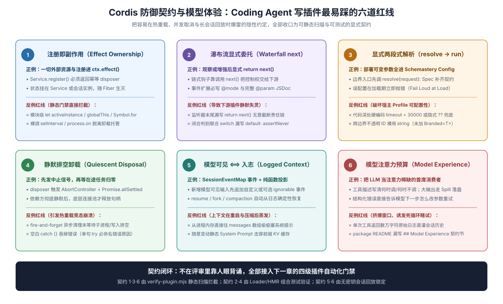

# 05 · 插件防坑编码契约：Cordis 六大生命周期铁律与 Model Experience 设计

## 为什么普通 TypeScript 习惯在 Cordis 插件里会频频暴雷

让一个没有受过专门约束的 coding agent 去写 DSH 插件，它写出的代码往往能轻松通过 `tsc` 编译和简单 happy-path 单测，却在一进真实多会话宿主或触发热重载（HMR）时当场炸穿：两个并发用户会话共享了同一个顶层 `Map` 导致上下文串台、拦截器忘了返回 `next()` 把后续所有官方插件全废掉、插件卸载时底层数据库连接先于正在收尾的工具调用提前掐断，或者一段啰嗦且每轮变动的动态工具描述直接把整个长会话的 Prompt Cache 命中率归零。

本章将 DSH 主仓内部的生命周期审查规范（[`cordis-styling-nitpicking`](https://github.com/deepseek-ai/deepseek-harness/blob/master/.agents/skills/cordis-styling-nitpicking/SKILL.md)）、错误处理准则（[`dsh-error-handling`](https://github.com/deepseek-ai/deepseek-harness/blob/master/.agents/skills/dsh-error-handling/SKILL.md)）与模型体验准则（[`agent-experience`](https://github.com/deepseek-ai/deepseek-harness/blob/master/.agents/skills/agent-experience/SKILL.md)）浓缩为**六条可直接塞进插件仓代码审查与静态门禁的硬契约**。



## 契约一：导出形态严格互斥，必需服务与可选服务分道读取

第一条防线守在模块入口与依赖访问方式上：

- **函数式插件绝不写 `export default`**：具名导出 `name`、`inject`、`Config`、`apply` 时，一旦同时存在 `export default`，真实 `Loader.unwrapExports` 会直接拿走 `.default` 函数引用，把同模块具名导出的 `inject` 依赖等待与 `Config` 默认值/校验静默丢进黑洞（复盘见 [`0001-acp-default-export-drops-inject`](https://github.com/deepseek-ai/deepseek-harness/blob/master/docs/postmortem/0001-acp-default-export-drops-inject.md)）。只有暴露 `Service` 子类的包才使用 `export default class ... extends Service`。
- **必需依赖写进 `inject` 后读 `ctx.<name>`，可选依赖一律走 `ctx.get('<name>')`**：未列入 `inject` 的服务在你的插件激活瞬间完全可能尚未挂载，直接点号访问无异于埋下加载顺序竞态炸弹。

## 契约二：零模块级可变单例（P0 红线）——状态必须归属显式生命周期

Coding agent 最顽固的坏习惯是在 `.ts` 文件顶层随手写 `let activeClient: Client | null = null`、`const sessionCache = new Map()`，甚至挂到 `globalThis` 或 `Symbol.for` 上。在 Cordis 架构中，**任何生命周期由 Node 模块加载决定、而非由 Cordis Fiber 拥有的进程级可变状态，一律属于 P0 级缺陷**：

1. **为什么必炸**：第一，同一个宿主进程内可能同时运行多个独立 `Context`（并行测试 worker 内的多实例、多工作区或多子代理作用域），模块顶层变量会让不同实例互相污染；第二，当用户在运行期修改配置或触发 HMR 重载插件时，旧 Fiber 被销毁但 ESM 模块缓存仍在，顶层 `Map` 里的脏数据和悬空回调会原封不动泄漏到下一代实例。
2. **正确挂法**：跨调用共享的宿主级状态收进自定义 `Service` 实例字段（或 `apply(ctx)` 闭包内局部变量，随 Fiber 卸载自然回收）；仅归属单个会话/单个 Agent 的状态则挂载在 `agent.ctx` 作用域或以 `SessionId` 为键、监听 `session` 销毁事件自动清理的受管表里（只读标量常量与 `Object.freeze` 静态查找表除外）。

## 契约三：看清五种事件分发模式，协作式 Waterfall 必须 `return next()`

Cordis 事件并非只有“广播通知”一种语义。插件注册监听器或派发自定义事件前，必须先查清生成的事件目录（[`docs/event-producer-consumer.md`](https://github.com/deepseek-ai/deepseek-harness/blob/master/docs/event-producer-consumer.md)）中该事件的 `@mode` 契约：

| 分发模式（`@mode`） | 是否异步等待（Awaited） | 执行顺序与返回值语义 | 插件监听器的核心义务 |
|---|---|---|---|
| `emit` | 否（同步触发） | 按注册顺序通知观察，无返回值 | 只做轻量同步状态记录，不阻塞主链路 |
| `parallel` | 是（`Promise.all`） | 所有监听器并发异步执行，无返回值 | 遵守传入的取消信号，不假设与其他监听器的先后次序 |
| `serial` | 是（逐个 `await`） | 按注册顺序串行异步执行 | 适合有严格先后依赖的异步钩子 |
| `bail` | 否 | 按序执行，遇到第一个非空裁决值立即停止并返回 | 仅在确有否决/接管理由时返回裁决值，否则返回 `undefined` 放行 |
| **`waterfall`** | 否（洋葱圈包装） | 监听器接收 `(...args, next)`，通过调用 `next()` 向内层传递并接回结果 | **协作式监听器必须显式 `return next()`！** |

> `ctx.waterfall` is around-middleware. A listener receives `(...args, next)`. Call `next()` to delegate the possibly wrapped result to the next service; return without `next()` to short-circuit. Values propagate through `next()`'s return value.
>
> — DSH [`docs/cordis-primer.md` 的 “Cordis Waterfall Semantics”](https://github.com/deepseek-ai/deepseek-harness/blob/master/docs/cordis-primer.md#cordis-waterfall-semantics)。

在代码审查中，凡是看到 `ctx.on('some/waterfall-event', (req, next) => { req.tag = 'x' })` 漏掉了末尾的 `return next()`，就是一起百发百中的静默截断事故——除非你的插件本身就是拥有最终拍板权的独占策略器并有意短路，否则永远记得把 `next()` 的结果返回出去。

## 契约四：异步排空卸载（Quiescent Disposal）与“只在提交点发布状态”

这是区分“玩具插件”与“生产级插件”的分水岭。许多开发者以为只要在 `ctx.effect()` 里写了 `close()` 就万事大吉，却忽略了**卸载瞬间正在飞行的异步任务（in-flight work）**：

> Any service call or event delivery required to finish cleanup is a lifecycle dependency. Keep its actual resources and listeners usable until the consumer has settled, including final result publication and durable writes. A provider's disposal promise finishing after consumers does not prove its resources survived their cleanup.
>
> — DSH [`cordis-styling-nitpicking` Skill](https://github.com/deepseek-ai/deepseek-harness/blob/master/.agents/skills/cordis-styling-nitpicking/SKILL.md)。在当前 Cordis 实现中，同一个 Fiber 卸载时会**并发启动**其名下并列注册的多个兄弟 disposer！如果一边正在等待消费者收尾写盘，另一边的兄弟 disposer 却已经把数据库连接或底层子进程关掉了，收尾写入就会当场抛异常甚至留下半截损坏状态。

编写持有底层连接、子进程或后台队列的插件时，必须遵守三条异步排空与状态发布铁律：

1. **三段式优雅停机（停准入 → 等在途排空 → 关底层资源）**：卸载开始时先关上准入闸门（拒绝新请求进入），接着 `await` 所有已接纳的在途操作完成最终结果发布与持久化写入（包括发了 `abort()` 或 `kill()` 后，也必须 `await` 子进程或流真正退出结算，绝不能发完信号扭头就走），最后才关闭底层传输或文件句柄。
2. **用单一组合生成器 `ctx.effect(function* () { ... })` 串行编排撤回顺序**：当一个函数式 Provider 插件既持有底层资源又向外暴露服务时，不要把资源注册和 `ctx.provide` 拆成两个独立的顶层调用（否则卸载时并发竞争），而是收进同一个 `ctx.effect(function* () { ... })` 中，严格 `yield` 每一步返回的原始 disposer，并把 `yield ctx.provide(name, service)` 放在最后——这样反序卸载时会先撤回服务、等待仍注册在 Cordis 上的依赖消费者收尾，然后再销毁先前申请的底层资源：

```ts
export function apply(ctx: Context, config: Config) {
  ctx.effect(function* () {
    let accepting = true
    const inFlight = new Set<Promise<unknown>>()
    const conn = openBackendConnection(config.endpoint)

    // 1. 先注册底层连接释放（反序卸载时最后执行，且额外等待已接纳任务排空）
    yield ctx.effect(() => async () => {
      await Promise.allSettled(inFlight)
      await conn.close()
    })

    // 2. 再暴露服务（反序卸载时先撤回服务并等待注册消费者卸载）
    const api = {
      async send(payload: Uint8Array) {
        if (!accepting) throw new BackendClosedError()
        const task = conn.write(payload)
        inFlight.add(task)
        try {
          return await task
        } finally {
          inFlight.delete(task)
        }
      },
    }
    yield ctx.provide('auditSink', api)

    // 3. 最后注册准入闸门关闭（反序卸载时第 1 步立即拦截新请求）
    yield ctx.effect(() => () => {
      accepting = false
    })
  })
}
```

3. **状态与事件只在成功提交点（Commit Point）发布，严禁靠 `setTimeout` / `queueMicrotask` 猜时序**：更新内存索引或发出业务完成事件，必须紧跟在底层写入确已成功之后；绝不允许为了掩盖初始化或卸载顺序缺陷去塞 `await new Promise(r => setTimeout(r, 0))`。

## 契约五：`Model Experience` 预算意识——工具描述即模型策略，严禁击穿前缀缓存

插件一旦调用 `ctx.tools.register(defineTool(...))` 或注入系统提示词片段，它的每一个字符都会在每轮模型请求中真金白银地消耗上下文窗口，并直接左右 KV Cache 命中率。按照 DSH [`agent-experience`](https://github.com/deepseek-ai/deepseek-harness/blob/master/.agents/skills/agent-experience/SKILL.md) 与包 README 契约，插件作者必须守住四条模型侧纪律：

1. **工具 `description` 与参数 Schema 极简五律**：① 删掉执行报错自然会告诉模型的废话（如“若 URL 非法会报错”）；② 只写模型做调用决策所需的外部行为与返回语义，不暴露内部类名或缓存机制；③ 参数格式、枚举、互斥或配对规则直接写在对应字段的 `parameters.<key>.description` 上；④ 同一条规则绝不在系统提示词和工具 `description` 里复读两遍；⑤ 控制单个工具返回体积（大输出提供分页、过滤或落盘摘要路径，避免单次返回几万词把历史上下文直接挤进压缩区）。
2. **死守前缀稳定性（KV Cache Stability）**：切忌在系统提示词片段或工具 `description` 字符串里拼接当前时间戳、随机数、每轮跳动的内存计数器或无序集合（如未排序的 `Object.keys`）——前缀哪怕变动一个字符，整条长会话的 KV Cache 复用就会在那一轮彻底失效！固定指令放静态前缀，随轮次变化的动态提示走会话消息或显式受控节点。
3. **在插件 `README.md` 强制填写 `## Model Experience` 账本**：哪怕是外部独立插件仓，也强烈建议照搬 DSH 官方包的记账小节（可用 [`06`](./06-plugin-gate-and-ci-harness.md) 的门禁脚本自动检查标题存在），老老实实写清三项：`What the model sees`（模型看见哪些固定工具名/提示词）、`Token effect`（固定开销约多少词、返回是否有上限）与 `KV Cache effect`（是否保持前缀稳定，改哪项配置会触发缓存失效）。

## 契约六：类型化结构错误边界——分清“给模型自愈”与“启动期立即炸响”

插件里的错误处理最忌讳两件事：一是把所有异常全 `catch` 住打一行 `console.warn` 后吞掉（假装成功）；二是用字符串正则去匹配 `err.message` 做分支路由。遵循 DSH [`dsh-error-handling`](https://github.com/deepseek-ai/deepseek-harness/blob/master/.agents/skills/dsh-error-handling/SKILL.md)，插件应将错误清晰划分为三类处理：

> Expected failures need declared types, stable discriminants, and handling-relevant details. Reuse package error conventions, preserve causes, and separate machine identity from display text. Never route handling by parsing messages.
>
> — DSH [`dsh-error-handling` Skill](https://github.com/deepseek-ai/deepseek-harness/blob/master/.agents/skills/dsh-error-handling/SKILL.md)。

| 故障发生阶段与性质 | 正确的错误形态与归属动作 | 严禁出现的反模式 |
|---|---|---|
| **1. 启动与配置加载期错误**（非法配置组合、缺失自包含静态资源） | 在最早可解析点直接抛出带清晰修复指引的结构化异常（Fail Loud），让宿主明确报出故障插件 | 静默 `return` 跳过注册，假装插件加载成功 |
| **2. 工具执行期预期业务失败**（模型传参越界、目标文件不存在、远端限流、用户拒绝审批） | 返回带稳定错误码与可行动下一步提示的工具错误结果（`isError: true`，附原始 `cause` 留给诊断），让模型在下一轮修正参数重试或向用户求助 | 抛出未捕获崩溃打断整个宿主，或吞掉异常返回空字符串 `{ text: '' }` 误导模型以为执行成功 |
| **3. 未知结果或状态已受损**（外部写入半途超时，无法确认远端是否已扣款/落盘） | 立即停止依赖该状态的后续步骤，在返回与日志中诚实标明“结果未知（unknown outcome）+ 受影响对象 + 安全核查动作” | 在未证实幂等安全前盲目自动重试，或谎报“已自动回滚” |

## 证据入口

- DSH [`packages/AGENTS.md`](https://github.com/deepseek-ai/deepseek-harness/blob/master/packages/AGENTS.md) 与 [`docs/postmortem/0001-acp-default-export-drops-inject.md`](https://github.com/deepseek-ai/deepseek-harness/blob/master/docs/postmortem/0001-acp-default-export-drops-inject.md)：导出互斥、可选依赖 `ctx.get()`、共享状态归属与提交点状态发布规则。
- DSH [`.agents/skills/cordis-styling-nitpicking/SKILL.md`](https://github.com/deepseek-ai/deepseek-harness/blob/master/.agents/skills/cordis-styling-nitpicking/SKILL.md) 与 [`docs/cordis-primer.md`](https://github.com/deepseek-ai/deepseek-harness/blob/master/docs/cordis-primer.md)：禁模块级单例、Waterfall `next()` 委派与 `ctx.effect(function* ...)` 异步排空卸载模式。
- DSH [`.agents/skills/agent-experience/SKILL.md`](https://github.com/deepseek-ai/deepseek-harness/blob/master/.agents/skills/agent-experience/SKILL.md) 与 [`docs/cookbook/adding-a-package.md`](https://github.com/deepseek-ai/deepseek-harness/blob/master/docs/cookbook/adding-a-package.md#4-write-the-package-readme)：工具描述极简五律与 `## Model Experience` 记账规范。
- DSH [`.agents/skills/dsh-error-handling/SKILL.md`](https://github.com/deepseek-ai/deepseek-harness/blob/master/.agents/skills/dsh-error-handling/SKILL.md)：结构化判别错误、禁止解析错误消息文本与未知结果诚实披露原则。
