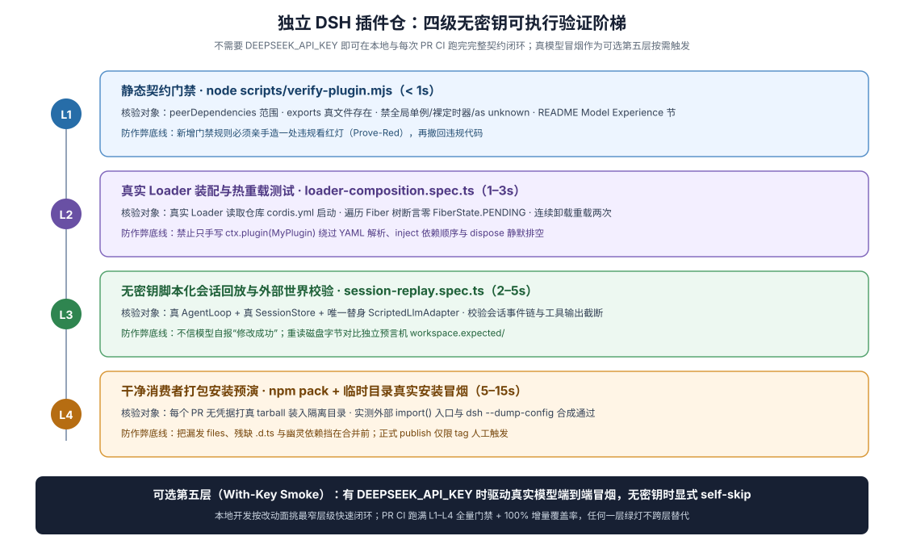

# 06 · 独立 DSH 插件仓的自动化门禁、无 Key 回放与 CI Harness

## 痛点破局：脱离 DSH 主仓内部基建后，外部插件仓怎么搭硬门禁

阅读 DSH 主仓源码时，外部插件作者最常遇到一个现实落差：主仓拥有庞大的内部 `scripts/run-gates.ts` 与未对外作为通用脚手架发行的内部快照辅助包，独立插件仓不可能把那几十个内部脚本拷出来维护；但如果因此退回到“只跑 `tsc` 和两个手写 Mock 单测”，Coding Agent 写出的默认导出冲突、`peerDependencies` 漏镜像、`cordis.patch.yml` 断链、卸载竞态以及工具 Schema 漂移就会一路畅通无阻流进生产环境。

本章给出专门面向**独立 DSH 插件仓**设计的**四阶自动化验证金字塔**——全部仅依赖 Node 内置模块与 DSH 公开发布的 `@deepseek-ai/*` 包，每一段代码均可直接复制进你的插件仓库投入运行。



> Mock only the expensive or non-deterministic boundary (LLM adapter, network, clock); keep everything downstream real. A hand-rolled stand-in proves the bridge moves bytes, not that the shipping tool behaves as asserted.
>
> — DSH [`docs/testing.md` 的 “Prefer the real implementation over a mock”](https://github.com/deepseek-ai/deepseek-harness/blob/master/docs/testing.md#prefer-the-real-implementation-over-a-mock)。下面四阶设施正是这一原则在独立插件仓的完整工程兑现。

## 第一阶：插件专属零依赖静态门禁 `scripts/verify-plugin.mjs`

把 [`01`](./01-new-plugin-repository.md)、[`04`](./04-plugin-repo-topologies.md)、[`05`](./05-cordis-contracts-and-model-experience.md) 中最容易被 coding agent 写错的打包与契约规则，直接浓缩成一份不到 130 行、毫秒级跑完的纯 Node 内置脚本 `scripts/verify-plugin.mjs`。它一次性自动拦截六类插件致命伤：

1. `package.json` 漏写 `"type": "module"`、漏配 `exports["."]` 或 `files` 未覆盖补丁文件；
2. `@deepseek-ai/cordis` 及 `peerDependencies` 中的宿主共享包未在 `devDependencies` 中以相同版本范围镜像；
3. `dsh.bundle.patch` 指向的 YAML 文件不存在，或把动态求值标签 `!!js` 误写成了单感叹号 `!js`；
4. 函数式插件入口文件同时出现了具名 `export const inject` / `export function apply` 与致命的 `export default`；
5. `README.md` 漏写 `## Model Experience` 或 `## Known Limitations and Deferred Work` 契约章节，或本地相对链接断链；
6. 根 `AGENTS.md` 超出单屏词数预算（默认上限 500 词）。

```js
#!/usr/bin/env node
import { existsSync, readFileSync, readdirSync } from 'node:fs'
import { dirname, extname, relative, resolve } from 'node:path'
import { fileURLToPath } from 'node:url'

const root = resolve(fileURLToPath(new URL('..', import.meta.url)))
const decoder = new TextDecoder('utf-8', { fatal: true })
const failures = []

function fail(file, line, rule, fixHint) {
  const rel = relative(root, file).replaceAll('\\', '/')
  failures.push(`${line ? `${rel}:${line}` : rel}: [${rule}] ${fixHint}`)
}

// 1. 校验 package.json 插件导出、三层依赖镜像与 dsh.bundle 闭合
const pkgPath = resolve(root, 'package.json')
const pkg = JSON.parse(decoder.decode(readFileSync(pkgPath)))

if (pkg.type !== 'module') {
  fail(pkgPath, 1, 'esm-only', 'DSH 插件包必须声明 "type": "module"')
}
if (!pkg.exports?.['.']?.default) {
  fail(pkgPath, 1, 'exports-map', '缺少 exports["."].default 导出声明')
}

const peers = pkg.peerDependencies ?? {}
const devs = pkg.devDependencies ?? {}
if (!peers['@deepseek-ai/cordis']) {
  fail(pkgPath, 1, 'peer-cordis', '必须在 peerDependencies 中声明 @deepseek-ai/cordis 以复用宿主实例')
}
for (const [depName, peerRange] of Object.entries(peers)) {
  if (devs[depName] !== peerRange) {
    fail(pkgPath, 1, 'peer-mirror', `peerDependencies["${depName}"] (${peerRange}) 必须在 devDependencies 中保持完全一致的版本范围（当前为 ${devs[depName] ?? '缺失'}）`)
  }
}

const publishedFiles = new Set(pkg.files ?? [])
const bundlePatch = pkg.dsh?.bundle?.patch
if (bundlePatch) {
  const normalizedPatch = bundlePatch.replace(/^\.\//, '')
  const absPatch = resolve(root, normalizedPatch)
  if (!existsSync(absPatch)) {
    fail(pkgPath, 1, 'bundle-patch', `dsh.bundle.patch 指向的文件不存在: ${bundlePatch}`)
  } else {
    if (!publishedFiles.has(normalizedPatch)) {
      fail(pkgPath, 1, 'bundle-files', `files 清单漏列了 ${normalizedPatch}，会导致 npm 打包后用户安装报错`)
    }
    const yamlLines = decoder.decode(readFileSync(absPatch)).split('\n')
    yamlLines.forEach((line, i) => {
      if (/(^|\s)!js\b/.test(line)) {
        fail(absPatch, i + 1, 'yaml-js-tag', '检测到非法的单感叹号 !js 标签；Cordis 动态表达式必须写作 !!js（且仅限 config 与 disabled 字段）')
      }
    })
  }
}

// 2. 扫描 src/：拦截函数式插件混用 export default 与模块顶层 globalThis 污染
function walk(dir, out = []) {
  if (!existsSync(dir)) return out
  for (const entry of readdirSync(dir, { withFileTypes: true })) {
    if (['.git', 'node_modules', 'lib', 'dist', 'coverage'].includes(entry.name)) continue
    const full = resolve(dir, entry.name)
    if (entry.isDirectory()) walk(full, out)
    else out.push(full)
  }
  return out
}

for (const file of walk(resolve(root, 'src'))) {
  if (!['.ts', '.tsx'].includes(extname(file))) continue
  const src = decoder.decode(readFileSync(file))
  const hasNamedFunctionPlugin = /export\s+(async\s+)?function\s+apply\b/.test(src) || /export\s+const\s+inject\b/.test(src)
  if (hasNamedFunctionPlugin && /export\s+default\b/.test(src)) {
    fail(file, 1, 'exclusive-export', '函数式插件严禁同时存在 export default（Loader.unwrapExports 会丢弃具名导出的 inject 与 Config）')
  }
  src.split('\n').forEach((line, idx) => {
    if (/\bglobalThis\s*\[|\bSymbol\.for\s*\(/.test(line)) {
      fail(file, idx + 1, 'no-singleton', '禁止通过 globalThis 或 Symbol.for 挂载隐式全局单例；请将状态收归 Cordis Service 或作用域实例')
    }
  })
}

// 3. 校验 AGENTS.md 预算、README 契约章节与全仓 Markdown 相对链接
const agentsMd = resolve(root, 'AGENTS.md')
if (existsSync(agentsMd)) {
  const wordCount = decoder.decode(readFileSync(agentsMd)).trim().split(/\s+/).filter(Boolean).length
  if (wordCount > 500) {
    fail(agentsMd, 1, 'agents-budget', `AGENTS.md 当前 ${wordCount} 词超过 500 词上限；请将复杂工作流抽入 .agents/skills/`)
  }
}

const readmePath = resolve(root, 'README.md')
if (existsSync(readmePath)) {
  const readme = decoder.decode(readFileSync(readmePath))
  for (const requiredSection of ['## Model Experience', '## Known Limitations and Deferred Work']) {
    if (!readme.includes(requiredSection)) {
      fail(readmePath, 1, 'readme-contract', `README.md 缺少必填契约章节 "${requiredSection}"`)
    }
  }
}

const mdLinkRe = /!?\[[^\]]*\]\(([^)\s]+)\)/g
for (const file of walk(root)) {
  if (extname(file) !== '.md') continue
  const lines = decoder.decode(readFileSync(file)).split('\n')
  let inFence = false
  lines.forEach((line, idx) => {
    if (/^\s*(`{3,}|~{3,})/.test(line)) inFence = !inFence
    if (inFence) return
    for (const m of line.matchAll(mdLinkRe)) {
      const target = m[1].split('#')[0]
      if (!target || /^(https?:|mailto:|#)/.test(target)) continue
      if (!existsSync(resolve(dirname(file), target))) {
        fail(file, idx + 1, 'md-link', `本地相对链接目标不存在: ${target}`)
      }
    }
  })
}

if (failures.length > 0) {
  console.error(`Plugin verification failed (${failures.length} issue(s)):`)
  for (const item of failures) console.error(`  - ${item}`)
  process.exitCode = 1
} else {
  console.log('Plugin verification passed.')
}
```

## 第二阶：带缺失依赖精准诊断的 `Loader` 激活与在途排空（Quiescent HMR）测试

在 [`01` §4](./01-new-plugin-repository.md) 的基础 Loader 测试之上，复杂插件还要重点防范两件事：**一是测试组合里漏挂了某个上游依赖导致插件静默停在 `PENDING` 却报出一句看不懂的空指针；二是插件正在执行异步动作时恰逢卸载，底层资源提前关闭炸毁在途请求**。在插件仓 `tests/helpers/assert-active.ts` 中放入下面两个可复用断言模式：

```ts
import { FiberState, type Context } from '@deepseek-ai/cordis'
import { expect } from 'vitest'

/** 断言 Loader 内所有未禁用条目均已进入 ACTIVE；若卡在 PENDING，直接打印具体条目与缺失的 inject 服务名 */
export function assertAllEntriesActive(ctx: Context): void {
  const stuck: string[] = []
  for (const entry of ctx.loader.entries()) {
    if (entry.disabled) continue
    if (entry.fiber?.state !== FiberState.ACTIVE) {
      const stateName = entry.fiber ? FiberState[entry.fiber.state] : 'UNMOUNTED'
      const declaredInject = Array.isArray(entry.plugin?.inject)
        ? entry.plugin.inject.filter((key: string) => ctx.get(key) === undefined)
        : []
      stuck.push(`${entry.options.id ?? entry.options.name} -> state=${stateName}, missingInject=[${declaredInject.join(', ')}]`)
    }
  }
  expect(stuck, `以下插件条目未能激活:\n${stuck.join('\n')}`).toEqual([])
}
```

而在验证 [`05` 契约四](./05-cordis-contracts-and-model-experience.md) 的异步排空卸载（Quiescent Disposal）时，不要只测空闲状态下的 `dispose()`——应当用受控 `Promise` 闸门把一次工具调用精准卡在“即将执行最后一步写入”的瞬间，此时发起 `targetFiber.dispose()`，断言卸载 Promise 保持挂起等待、在途调用放行后能顺利拿到完整结果且无资源关闭报错，随后卸载才正式结算完成。

## 第三阶：基于公开 `LlmAdapter` 的无 Key 脚本化会话回放 + 独立 `workspace.expected/` Oracle

外部插件仓没有 DSH 主仓内部的录制快照引擎，怎样在没有 `DEEPSEEK_API_KEY` 的常规 PR CI 里完整验证**“真实 `AgentLoop` 组装请求 → 模型看见正确的工具 Schema 与提示词 → 模型发起工具调用 → 插件修改工作区文件 → 会话日志完整落账”**？

答案是直接继承公开包 `@deepseek-ai/dsh-llm` 的 `LlmAdapter` 编写一个 35 行的确定性 `ScriptedLlmAdapter`，将其与公开的 7 个核心运行时包（`dsh-llm`、`dsh-session-projection`、`dsh-session`、`dsh-system-prompt`、`dsh-tools`、`dsh-agent`、`dsh-agent-loop`）一起挂载，最后对照只读的 `tests/fixtures/write-note/workspace.expected/` 目录核验外部世界状态：

```ts
import { cp, mkdtemp, readFile, rm } from 'node:fs/promises'
import { tmpdir } from 'node:os'
import { join } from 'node:path'
import { fileURLToPath } from 'node:url'
import { Context } from '@deepseek-ai/cordis'
import AgentRegistry from '@deepseek-ai/dsh-agent'
import AgentLoop from '@deepseek-ai/dsh-agent-loop'
import { brandString } from '@deepseek-ai/dsh-brand'
import LlmRuntime, { LlmAdapter, type GenerateOptions, type LlmResolvedModelInfo, type StreamChunk, type ToolCallId } from '@deepseek-ai/dsh-llm'
import SessionStore, { type SessionId } from '@deepseek-ai/dsh-session'
import SessionProjectionRegistry from '@deepseek-ai/dsh-session-projection'
import SystemPrompt from '@deepseek-ai/dsh-system-prompt'
import ToolRuntime from '@deepseek-ai/dsh-tools'
import { afterEach, describe, expect, it } from 'vitest'
import * as myNotePlugin from '../src/index.ts'

class ScriptedLlmAdapter extends LlmAdapter {
  readonly capturedRequests: GenerateOptions[] = []
  private step = 0

  constructor(private readonly turns: StreamChunk[][]) {
    super()
  }

  override resolveModel(provider: string, model: string): Promise<LlmResolvedModelInfo> {
    return Promise.resolve({
      provider,
      id: model,
      name: model,
      inputModalities: ['text'],
      context: { contextWindow: 32_768 },
    })
  }

  async *stream(options: GenerateOptions): AsyncIterable<StreamChunk> {
    this.capturedRequests.push(options)
    const chunks = this.turns[this.step++]
    if (!chunks) throw new Error(`Unexpected extra model step #${this.step}`)
    for (const chunk of chunks) yield chunk
  }
}

const expectedOracleDir = fileURLToPath(new URL('./fixtures/write-note/workspace.expected', import.meta.url))
let workDir: string | undefined
let ctx: Context | undefined

afterEach(async () => {
  await ctx?.fiber.dispose()
  ctx = undefined
  if (workDir) await rm(workDir, { recursive: true, force: true })
  workDir = undefined
})

describe('keyless scripted-turn replay with independent workspace oracle', () => {
  it('exposes stable tool schema to model, runs full loop turn, and matches workspace.expected', async () => {
    workDir = await mkdtemp(join(tmpdir(), 'plugin-replay-'))
    await cp(fileURLToPath(new URL('./fixtures/write-note/workspace.seed', import.meta.url)), workDir, { recursive: true })

    const callId = brandString<ToolCallId>('call-note-1')
    const argsJson = JSON.stringify({ filename: 'summary.md', title: 'Release Ready' })
    const adapter = new ScriptedLlmAdapter([
      // Step 1：模拟模型决定调用插件注册的工具
      [
        { type: 'block-start', index: 0, blockType: 'tool-call' },
        { type: 'tool-call-delta', index: 0, id: callId, name: 'write_release_note', argumentsDelta: argsJson },
        { type: 'block-end', index: 0, block: { type: 'tool-call', id: callId, name: 'write_release_note', arguments: argsJson } },
        { type: 'usage', usage: { inputTokens: 120, outputTokens: 24 } },
        { type: 'finish', reason: { kind: 'tool-calls' } },
      ],
      // Step 2：模型收到真实工具返回后收敛结束本轮
      [
        { type: 'block-start', index: 0, blockType: 'text' },
        { type: 'text-delta', index: 0, text: 'Done.' },
        { type: 'block-end', index: 0, block: { type: 'text', text: 'Done.' } },
        { type: 'usage', usage: { inputTokens: 160, outputTokens: 5 } },
        { type: 'finish', reason: { kind: 'stop' } },
      ],
    ])

    ctx = new Context()
    // 按公开核心栈顺序挂载真实运行时（唯独替换最外层 LlmAdapter）
    await ctx.plugin(LlmRuntime)
    ctx.llm.registerAdapter(['scripted'], adapter)
    await ctx.plugin(SessionProjectionRegistry)
    await ctx.plugin(SessionStore)
    await ctx.plugin(SystemPrompt, {})
    await ctx.plugin(ToolRuntime, {})
    await ctx.plugin(AgentRegistry)
    await ctx.plugin(AgentLoop, { agents: [] })
    await ctx.plugin(myNotePlugin, { rootDir: workDir })

    const sessionId = brandString<SessionId>('replay-session-1')
    const handle = await ctx.agents.create({
      sessionId,
      agentOptions: { provider: 'scripted', model: 'scripted-v1' },
    })

    handle.agent.followup({
      content: [{ type: 'text', text: 'Create the release summary file.' }],
      source: { kind: 'user' },
    })
    await handle.agent.whenIdle()

    // 1. 断言模型实际看见的请求表面（锁住 Model Experience，防止工具 schema 意外漂移）
    expect(adapter.capturedRequests).toHaveLength(2)
    expect(adapter.capturedRequests[0]?.tools?.map(t => t.name)).toContain('write_release_note')

    // 2. 断言外部世界真实文件字节与只读独立 Oracle 完全一致（不信模型自报的 "Done."！）
    const actualFile = await readFile(join(workDir, 'summary.md'), 'utf8')
    const expectedFile = await readFile(join(expectedOracleDir, 'summary.md'), 'utf8')
    expect(actualFile).toBe(expectedFile)

    await handle.dispose()
  })
})
```

同时，在 `tests/live-model.e2e.ts` 中保留一条单独的真模型冒烟测试（用 `describe.skipIf(!process.env.DEEPSEEK_API_KEY)` 自跳过）：没有密钥时常规 PR CI 保持全绿不阻塞，配置了密钥的夜间任务或发版前检查则实弹验证大模型能否仅凭你的工具 `description` 一次选对参数。

## 第四阶：开箱即用的插件仓 `.github/workflows/ci.yml` 与 2 份专属 `SKILL.md`

### 1. 插件仓标准 GitHub Actions 工作流（含隔离 `$DSH_HOME` 打包安装预演）

将以下工作流存为 `.github/workflows/ci.yml`，每次 PR 自动串起**静态门禁 → 类型检查 → 聚焦/回放测试 → 构建打包与干净 Profile 安装卸载预演**：

```yaml
name: Plugin CI

on:
  pull_request:
  push:
    branches: [main, master]

permissions:
  contents: read

jobs:
  verify-and-rehearse:
    runs-on: ubuntu-latest
    steps:
      - uses: actions/checkout@v4
      - uses: actions/setup-node@v4
        with:
          node-version: '24'
      - run: corepack enable
      - run: pnpm install --frozen-lockfile

      - name: Static plugin harness gate
        run: pnpm run verify

      - name: Strict TypeScript check
        run: pnpm run typecheck

      - name: Unit, Loader HMR & keyless scripted-turn replay
        run: pnpm run test

      - name: Build, pack & clean DSH_HOME install rehearsal
        run: |
          pnpm run build
          TARBALL="$(pnpm pack | tail -n 1)"
          export DSH_HOME="$(mktemp -d)"
          npx dsh --profile ci-smoke --from-default-profile headless
          npx dsh plugin --profile ci-smoke add "./${TARBALL}"
          npx dsh --profile ci-smoke --dump-config | grep -F '"name"'
          npx dsh plugin --profile ci-smoke remove "$(node -p "require('./package.json').name")"
          rm -rf "${DSH_HOME}"
```

### 2. 给插件仓 Coding Agent 配备的 2 份高价值 `SKILL.md`

把无法塞进 500 词 `AGENTS.md` 的专门审查与发版流程，放进插件仓的 `.agents/skills/` 按需触发：

- **`.agents/skills/cordis-lifecycle-audit/SKILL.md`（插件生命周期与竞态自审 Skill）**：

```markdown
---
name: cordis-lifecycle-audit
description: Use when adding or reviewing Cordis services, event listeners, timers, subprocesses, or network handles in this DSH plugin repository, to detect P0 module singletons, missing waterfall next() delegation, and premature cleanup races.
---

# Audit Cordis Plugin Ownership & Quiescent Teardown

1. Trace from exported `apply` or `Service` roots: verify zero mutable state lives in module-level `let`/`Map`/`Set`/`globalThis`.
2. Check every `ctx.on(...)` call: if the target event uses `waterfall` mode, confirm cooperative paths end with `return next()`.
3. Trace disposal across every `await`: confirm cleanup gates new admission first, awaits in-flight tool/event operations (including aborted child processes or streams) to settlement, and closes underlying handles last via a composed `ctx.effect(function* () { ... })`.
4. Prove teardown with an interleaving test that pauses an active call just before its final write while `fiber.dispose()` begins.
```

- **`.agents/skills/plugin-release-check/SKILL.md`（插件发版与宿主版本兼容核验 Skill）**：

```markdown
---
name: plugin-release-check
description: Use before bumping version, updating engines.dsh or @deepseek-ai/* peerDependencies, or publishing this DSH plugin bundle.
---

# Verify Plugin Bundle Release Readiness

1. Confirm `engines.dsh` and `@deepseek-ai/*` ranges in `peerDependencies` match the DSH versions actually tested in CI (mirroring exact ranges in `devDependencies`).
2. Audit `git diff` against public surfaces (config keys, tool names/parameters, persisted session events): document any breaking change and update `README.md` (`## Model Experience`, data retention, `## Known Limitations and Deferred Work`).
3. Run `pnpm run verify && pnpm run typecheck && pnpm run test && pnpm run build`, execute the clean `$DSH_HOME` tarball install rehearsal, and run live-API `test:e2e` if `DEEPSEEK_API_KEY` is available (reporting honestly if skipped).
```

把这四阶金字塔和两份轻量 Skill 装进独立插件仓后，哪怕主力开发者全是零历史启动的 coding agent，每一次提交也都在严密、快速、自包含的工程护栏内运行。

## 证据入口

- DSH [`docs/testing.md`](https://github.com/deepseek-ai/deepseek-harness/blob/master/docs/testing.md) 与 [`snapshots/AGENTS.md`](https://github.com/deepseek-ai/deepseek-harness/blob/master/snapshots/AGENTS.md)：真实入口组合测试、仅替换最外层 `LlmAdapter`、负例证明（Prove-Red）与只读 `workspace.expected/` Oracle 规范。
- DSH [`docs/user/develop/practice/llm-adapter.md`](https://github.com/deepseek-ai/deepseek-harness/blob/master/docs/user/develop/practice/llm-adapter.md)、[`packages/core/agent/README.md`](https://github.com/deepseek-ai/deepseek-harness/blob/master/packages/core/agent/README.md) 与 [`packages/core/agent-loop/README.md`](https://github.com/deepseek-ai/deepseek-harness/blob/master/packages/core/agent-loop/README.md)：公开 `LlmAdapter` 流式协议、`ctx.agents.create()` / `followup()` / `whenIdle()` 驱动接口与最小核心服务组合栈。
- DSH [`docs/user/develop/basic/publish.md`](https://github.com/deepseek-ai/deepseek-harness/blob/master/docs/user/develop/basic/publish.md) 与 [`.agents/skills/cordis-styling-nitpicking/SKILL.md`](https://github.com/deepseek-ai/deepseek-harness/blob/master/.agents/skills/cordis-styling-nitpicking/SKILL.md)：`dsh.bundle` 打包安装检查项与生命周期 P0 竞态审查方法。
