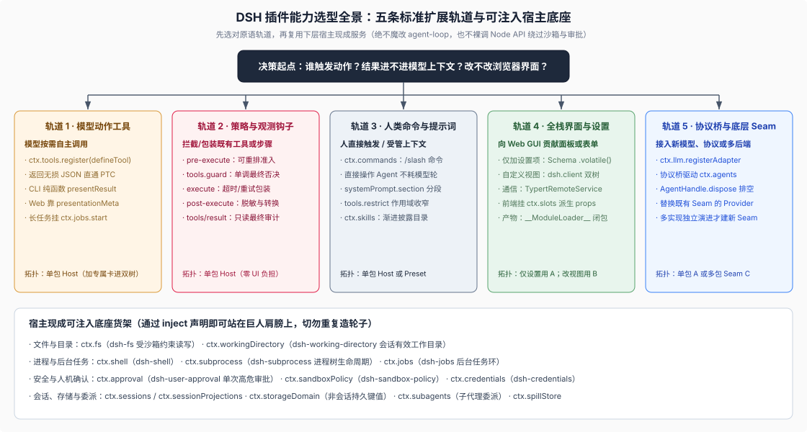

# 07 · DSH 插件能力选型全景：宿主现成服务货架与五大扩展配方

## 为什么外部插件最怕“闭门造车”

在 [`01 · 新建独立 DSH 插件仓`](./01-new-plugin-repository.md) 跑通 10 行 `greet` 示例后，外部开发者和 coding agent 进入真实业务开发时往往会立刻犯两类大错：

1. **不知道宿主 `ctx` 上已经有哪些现成的工业级底座服务**——结果在插件里直接 `import { exec } from 'node:child_process'` 或 `fs.writeFile`，一举绕过了 DSH 的工作区目录跟随、进程树清理、文件沙箱与用户审批围栏；
2. **把所有扩展需求全往 `defineTool` 傻瓜文本返回里硬塞**——不知道结构化 `output.schema` 怎样免费打通 PTC 编程调用、不知道为什么写了 `presentResult` 在内置 Web 界面却不生效、也不知道工具拦截钩子有五层精确分工，或者把本该做成 `/slash` 人类命令的操作做成了白白浪费模型轮次的工具。

本章依据 DSH 官方生成的能力目录（[`docs/capability-seams.md`](https://github.com/deepseek-ai/deepseek-harness/blob/master/docs/capability-seams.md)）与扩展食谱（[`extension-cookbook.md`](https://github.com/deepseek-ai/deepseek-harness/blob/master/docs/cookbook/extension-cookbook.md)、[`adding-a-tool.md`](https://github.com/deepseek-ai/deepseek-harness/blob/master/docs/cookbook/adding-a-tool.md)），为你整理出一张**开箱即用的宿主服务货架总表**和**五大核心扩展配方**。



## 1. 先查货架再写代码：DSH 官方可注入宿主服务速查表

写任何业务插件前，先让你的 coding agent 核对下表——凡是宿主已经提供的能力接缝（Seam）或核心服务，一律将该定义包加入 `peerDependencies` + `devDependencies` 并在 `inject` 中声明复用，**严禁手搓裸 Node 替代品**：

| `ctx` 服务键（`inject` 名） | 权威定义包（`peerDependencies`） | 解决什么问题 & 为什么必须优先复用它 |
|---|---|---|
| **`ctx.tools`** | `@deepseek-ai/dsh-tools` | 注册模型可见工具、执行参数校验、免费桥接 PTC 模式，并串联五层执行策略与审计管线 |
| **`ctx.commands`** | `@deepseek-ai/dsh-commands` | 注册 `/name` 人类直接交互命令（含可选附件准入与 `command/run`、`command/done` 日志），**不消耗模型推理轮次** |
| **`ctx.systemPrompt`** | `@deepseek-ai/dsh-system-prompt` | 通过 `section()` 按稳定顺序或作用域遮蔽贡献系统提示词片段，保护前缀 KV Cache 稳定性 |
| **`ctx.fs`** + **`ctx.workingDirectory`** | `@deepseek-ai/dsh-fs`、`@deepseek-ai/dsh-working-directory` | 感知当前会话有效工作目录、自动受宿主沙箱策略（本地/SSH/受限写）约束的文件读写；替代裸 `node:fs` 直写用户工作区 |
| **`ctx.shell`** / **`ctx.subprocess`** | `@deepseek-ai/dsh-shell`、`@deepseek-ai/dsh-subprocess` | 受沙箱包装、信号升级终止与进程树生命周期保护的 Shell 或子进程执行；替代裸 `child_process.spawn` 防孤儿进程泄漏 |
| **`ctx.jobs`** | `@deepseek-ai/dsh-jobs` | 将长耗时命令或后台流注册为宿主受管后台任务（自动对接 `job_list` / `job_read` / `job_kill` 与会话销毁清理） |
| **`ctx.approval`** + **`ctx.userQuestions`** | `@deepseek-ai/dsh-user-approval`、`@deepseek-ai/dsh-user-questions` | `ctx.approval` 在无回答器时默认安全拒绝（fail-closed）地请求高危动作单次放行；`ctx.userQuestions` 在各端界面挂起等待人类结构化回答 |
| **`ctx.credentials`** | `@deepseek-ai/dsh-credentials` | 配置文件只存凭据引用，每次操作按需解析最新密钥值（密钥轮换无需重启，且图形设置页读取自动脱敏） |
| **`ctx.sessions`** + **`ctx.sessionProjections`** | `@deepseek-ai/dsh-session`、`@deepseek-ai/dsh-session-projection` | 访问仅追加会话事件流，或注册按水位线增量折叠并由宿主自动缓存快照的每会话派生状态 |
| **`ctx.storageDomain`** | `@deepseek-ai/dsh-storage-domain` | 存储**跨会话或非会话级**的类型化持久业务数据（如插件自有索引或工作区级元数据），避免污染单次会话 JSONL 日志 |
| **`ctx.agents`** + **`ctx.subagents`** | `@deepseek-ai/dsh-agent`、`@deepseek-ai/dsh-subagent` | `ctx.agents` 管理顶层会话 Agent 句柄与消息入队；`ctx.subagents` 统一调度进程内 `fork`/`spawn` 或进程外子代理后端 |
| **`ctx.llm`** | `@deepseek-ai/dsh-llm` | 注册新的大模型供应商流式适配器（`LlmAdapter`），或发起与具体供应商解耦的模型流式请求 |

（注：工具返回文本过大时的自动截断落盘已由宿主默认挂载的 `dsh-spill-policy` + `ctx.spillStore` 在 `tools/post-execute` 阶段自动接管，普通工具插件无需手写大文本落盘器。）

## 2. 配方一：生产级模型工具（`defineTool`）的四个进阶契约

写一个玩具工具只需要 `execute` 返回字符串；而写一个在 CLI、Web GUI、长会话回放与 **PTC（Programmatic Tool Calling）代码编排模式**下都滴水不漏的生产级工具，必须吃透 [`docs/cookbook/adding-a-tool.md`](https://github.com/deepseek-ai/deepseek-harness/blob/master/docs/cookbook/adding-a-tool.md) 的四条核心机制：

### 1. 返回结构化无损 JSON 值（Canonical Value），免费打通 PTC 模式

许多新手直接在 `execute()` 里拼好一大段人类阅读的 Markdown 文本返回——这会导致当高阶 Agent 在 PTC 模式（`run_code`）中以 `const res = await tools.my_tool(args)` 编程调用你的工具时，被迫用正则去抠文本里的 ID 或字段！正确做法是分离**机器结构化真值（`output.schema`）**与**模型散文渲染（`output.render`）**：

> `output.schema` uses `ValueSchemaSpec` and may have an object, array, scalar, or null root. `execute` returns only the inferred value; the registry snapshots it as lossless JSON, validates it, freezes it, and passes it to `output.render(args, value)`. Do not return content blocks from the body or make callers parse prose for ids and fields.
>
> — DSH [`docs/cookbook/adding-a-tool.md` 的 “Rules of the execute() contract”](https://github.com/deepseek-ai/deepseek-harness/blob/master/docs/cookbook/adding-a-tool.md#rules-of-the-execute-contract)。只要 `output.schema` 定义了精确字段（如 `{ issueId: { type: 'string', required: true }, url: { type: 'string', required: true } }`），PTC 模式下的程序就能直接拿到强类型的 `{ issueId, url }` 对象，而常规对话模式下的大模型则看到 `output.render` 格式化后的精炼文本，一举两得！

### 2. 工具 UI 卡片的“双轨真相”：为什么写了 `presentResult` 在内置 Web 里没反应？

这是外部全栈插件作者踩坑率排名第一的盲区——**宿主通用卡片投影与内置 Web 客户端采用两套不同的职责链路**：

- **轨道 A（CLI / 通用适配器）：纯函数 `presentCall` 与 `presentResult`**。在 `defineTool` 上可选声明 `presentCall(args)` 与 `presentResult(args, result)`，返回带 `card` 判别标签的纯渲染意图（`'generic'` | `'terminal'` | `'diff'` | `'read'` | `'search'` | `'web'`）。**铁律：这两者会在实时流与历史日志回放时反复调用，必须是 100% 零 I/O、零时钟、零外部会话读取的纯函数！**
- **轨道 B（内置 Web Client）：`output.presentationMeta` + 前端 `tool.call.toolview` 槽位**。看清一手文档的明确声明：

> The built-in Web Client does not consume `presentCall` or `presentResult`. Session `page` and `follow` transport raw `tool/call` and `tool/result` events, including persisted `result.meta`. A Client plugin registers its wire tool name in the `tool.call.toolview` keyed slot and derives component props from the `ToolCallBlock` arguments, content, error, metadata, existing PTC dispatch `parentCallId`, and Session path facts.
>
> — DSH [`docs/cookbook/adding-a-tool.md` 的 “Web Client presentation”](https://github.com/deepseek-ai/deepseek-harness/blob/master/docs/cookbook/adding-a-tool.md#web-client-presentation)。换言之：如果你不写前端插件，内置 Web 客户端会自动用干净的默认通用卡片展示你的工具（大多数工具完全够用）；如果你确实需要像 `write`/`edit` 那样在 Web 端画出专属交互卡片，就用 `output.presentationMeta(args, value)` 把回放必需的有界结构化摘要持久化进 `result.meta`，再按 [`04 · 全栈双树拓扑`](./04-plugin-repo-topologies.md) 在 `./client` 入口把工具名注册进 `tool.call.toolview` 槽位。

### 3. 长耗时后台任务接入 `ctx.jobs.start()` 与取消信号交接

如果工具支持 `run_in_background: true`（例如启动长编译或日志监听），切忌自己用裸 `Promise` 悬在后台不管：应通过 `ctx.jobs.start({ kind, label, owner: exec.agent, run })` 注册给宿主任务中心，并遵守**信号交接铁律**——前台同步等待期间遵守传入的 `exec.signal`；**一旦 `ctx.jobs.start()` 成功发布并返回 `{ kind: 'background', jobId }`，后台任务内部必须改用任务自有的取消信号，而不再绑定外层当次工具调用的 `exec.signal`**（否则外层单步调用一结束就会把刚转入后台的活任务误杀！后台任务的生命周期此后归 `job_kill`、所属 `Agent` 销毁与宿主停机统一管辖）。

### 4. 异步向会话补发上下文：Session V4 必须扩展 `MessageSourceMap`

当后台监听器或外部回调需要往某个活会话追加一条供下一轮模型读取的通知时，调用 `agent.inject({ content, source: { kind: 'my-plugin' } })`（注意它只入账上下文，不会主动唤醒处于空闲态的 Agent，且需 `try/catch` 防御已销毁的 Agent）。**特别注意版本红线**：现行 Session Format V4 已彻底废弃早年的 `{ kind: 'plugin', plugin: '<name>' }` 通用包装并在准入时直接报错拒绝；你的插件必须通过 TypeScript declaration merging 向 `@deepseek-ai/dsh-llm` 的 `MessageSourceMap` 显式声明自己的 `kind` 键！

```ts
import type { Context } from '@deepseek-ai/cordis'
import { defineTool } from '@deepseek-ai/dsh-tools'

// 若需使用 agent.inject() 注入异步通知，必须合并声明专属 source kind（V4 严禁旧式 kind:'plugin'）
declare module '@deepseek-ai/dsh-llm' {
  interface MessageSourceMap {
    'deploy-watcher': { readonly kind: 'deploy-watcher'; readonly deploymentId: string }
  }
}

export const name = 'tool-deploy-ticket'
export const inject = ['tools', 'fs', 'workingDirectory']

export function apply(ctx: Context) {
  ctx.tools.register(defineTool({
    name: 'create_deploy_manifest',
    description: 'Write a validated deploy manifest under the session working directory.',
    parameters: {
      service: { type: 'string', required: true, description: 'Target service slug' },
      replicas: { type: 'number', description: 'Desired replica count (positive integer)' },
    },
    output: {
      // 结构化真值：PTC 模式下 await tools.create_deploy_manifest(...) 直接拿到该强类型对象
      schema: {
        type: 'object',
        additionalProperties: false,
        properties: {
          manifestPath: { type: 'string', required: true },
          replicas: { type: 'number', required: true },
        },
      },
      render: (_args, val) => [{ type: 'text', text: `Wrote ${val.manifestPath} (replicas=${val.replicas}).` }],
      // 可选：持久化回放所需的轻量卡片元数据（绝不往里塞 React 组件或大体积原文）
      presentationMeta: (_args, val) => ({ manifestPath: val.manifestPath }),
    },
    // 纯函数 CLI/通用卡片投影：零 I/O，仅依赖入参计算
    presentCall: args => ({
      card: 'generic',
      title: `Prepare deploy manifest for ${args.service}`,
    }),
    async execute(args, exec) {
      const replicas = args.replicas ?? 1
      if (!Number.isInteger(replicas) || replicas < 1) {
        throw new Error('replicas must be a positive integer')
      }
      const cwd = ctx.workingDirectory.get(exec.agent.sessionId)
      const targetPath = `${cwd}/deploy.${args.service}.json`
      const payload = JSON.stringify({ service: args.service, replicas }, null, 2) + '\n'
      await ctx.fs.writeTextFile({ path: targetPath, content: payload, signal: exec.signal })
      return { manifestPath: targetPath, replicas }
    },
  }))
}
```

## 3. 配方二：工具管线五层拦截钩子（Hook / Policy Plugins）精准选型

很多企业插件并不需要新增工具，而是要对宿主已有的 `bash`、`write`、`web_fetch` 等工具施加**安全准入策略、统一超时包装、敏感凭据脱敏或合规审计日志**。DSH 不需要任何进程外 Hook 脚本协议——普通 Cordis 插件直接挂载在 `dsh-tools` 的五个精确扩展点上即可，但**五个钩子职责严禁混用**：

> This waterfall is the reorderable policy layer. Use `ctx.tools.guard()` when an invariant needs a monotonic final denial, `tools/execute` when a plugin must wrap the dispatch lifetime (timeouts/retries/metrics; only `exec.signal` is replaceable), `tools/post-execute` for explicit result transformation, and `tools/result` for contained observation of the immutable final outcome.
>
> — DSH [`docs/cookbook/extension-cookbook.md` 的 “A hook plugin”](https://github.com/deepseek-ai/deepseek-harness/blob/master/docs/cookbook/extension-cookbook.md#a-hook-plugin-permission-gate-example)。

| 挂载点 / API | 触发阶段与模式 | 典型业务用途 | 核心行为红线 |
|---|---|---|---|
| **`ctx.on('tools/pre-execute', ...)`** | 执行前（Waterfall） | 可重排的业务权限策略（返回 `allow` / `deny` / 或联动 `ctx.approval` 询问用户） | 放行路径**必须 `return next()`**；可能被调整加载顺序覆盖 |
| **`ctx.tools.guard(fn)`** | 执行前最终闸门 | 硬安全不变量或模式锁（如只读模式下绝对封死写工具） | **单调最终否决（Monotonic Deny）**：一旦拒绝，后续任何监听器都无法翻案 |
| **`ctx.on('tools/execute', ...)`** | 包裹实际派发生命周期（Waterfall） | 施加统一截止时间（Deadline）、重试或耗时统计 | 整个入参已深度冻结，包装器**仅允许替换并在结束后恢复 `exec.signal`** |
| **`ctx.on('tools/post-execute', ...)`** | 执行后、落盘前（Waterfall） | 敏感输出脱敏（擦除密钥）、替换展示内容或附加模型上下文 | 仅改展示文本不影响 PTC 拿到的结构化 `value`；保密脱敏必须连 `value` 一并替换或拦截 |
| **`ctx.on('tools/result', ...)`** | 最终归一化结果落定后（Emit） | 只读合规审计、外部指标上报、状态观察 | 结果已完全不可变，观察器抛错会被隔离，绝不影响主流程 |

## 4. 配方三：人类斜杠命令（`ctx.commands`）vs 模型工具 vs 系统提示词分段

当你想给用户加一个快捷开关或动作（比如 `/deploy-check`、`/team-sync`）时，先问自己：**这个动作需要大模型先思考推理吗？**

- **不需要模型思考、由人在输入框敲 `/xxx` 直接确定性执行 → 用 `ctx.commands.register()`**（依赖 `@deepseek-ai/dsh-commands`）：

> Interactive adapters use it to discover and directly execute plugin-owned commands for an exact agent without creating a model message.
>
> — DSH [`docs/subsystems/commands.md`](https://github.com/deepseek-ai/deepseek-harness/blob/master/docs/subsystems/commands.md)。斜杠命令自动出现在 Web/CLI 输入框补全菜单中，生命周期作为 log-only 的 `command/run` 与 `command/done` 记入会话日志，既省 Token 又零延迟！

```ts
import type { Context } from '@deepseek-ai/cordis'
import type {} from '@deepseek-ai/dsh-commands'

export const name = 'command-env-check'
export const inject = ['commands']

export function apply(ctx: Context) {
  ctx.commands.register({
    name: 'env-check',
    description: 'Verify required deployment environment variables for this session.',
    input: { hint: '[target-env]' },
    async handler({ rawInput, signal }) {
      signal.throwIfAborted()
      const envName = rawInput.trim() || 'staging'
      return { kind: 'success', text: `Environment "${envName}" preflight passed.` }
    },
  })
}
```

- **需要向模型注入常驻规则或按会话裁剪可见工具集 → 优先用 `ctx.systemPrompt.section()` 与 `ctx.tools.restrict()`**：切忌轻易监听底层的 `system-prompt/assemble` 全量组装瀑布流（一旦覆盖不当会破坏宿主内置的 PTC 协议段与结构化输出契约）；用 `ctx.systemPrompt.section()` 按命名槽位安全贡献片段，用 `ctx.tools.restrict()` 在特定 `agent.ctx` 作用域内同步收窄工具的展示、查找与执行权限。

## 5. 配方四：外部协议桥接器（Protocol Driver）与模型适配器（`LlmAdapter`）

如果你的团队要把 DSH 嵌入自家 IM 机器人、内部 IDE 管道，或接入私有部署的大模型网关，则走最后两条标准底座轨道：

1. **外部协议桥接器（以官方 [`packages/acp/acp`](https://github.com/deepseek-ai/deepseek-harness/blob/master/packages/acp/acp/README.md) 为黄金标杆）**：插件 `inject = ['agents', 'sessions', 'sessionPersistence']`，通过 `ctx.agents.create()` / `resume()` 获取 `AgentHandle`。收到外部用户输入时调用 `agent.followup(...)` 并立即返回入队回执（**切勿试图靠把某条 `MessageId` 和某一次 `turn/end` 硬凑成一对一 RPC 请求——Agent 忙碌态与回合边界是独立事件流**）；流式增量展示监听 `agent/assistant-stream`，已提交权威结果监听 `session/event`；连接断开或停机时调用 `await handle.dispose()` 确保停止在途轮次并排空落盘。
2. **自定义大模型供应商适配器（详见 [`docs/cookbook/adding-an-llm-adapter.md`](https://github.com/deepseek-ai/deepseek-harness/blob/master/docs/cookbook/adding-an-llm-adapter.md)）**：继承 `@deepseek-ai/dsh-llm` 的 `LlmAdapter`，实现 `resolveModel()` 与异步生成器 `stream(options)`，在激活时调用 `ctx.llm.registerAdapter(['my-provider'], adapter)` 并在卸载 disposer 中注销（测试替身版的最小代码已在 [`06 · 无 Key 回放测试`](./06-plugin-gate-and-ci-harness.md#第三阶基于公开-llmadapter-的无-key-脚本化会话回放--独立-workspaceexpected-oracle) 完整给出）。

## 证据入口

- DSH [`docs/capability-seams.md`](https://github.com/deepseek-ai/deepseek-harness/blob/master/docs/capability-seams.md)：源码自动生成的全量宿主 `ctx.<service>` 注册键、权威定义包、实现包与消费方图谱。
- DSH [`docs/cookbook/extension-cookbook.md`](https://github.com/deepseek-ai/deepseek-harness/blob/master/docs/cookbook/extension-cookbook.md) 与 [`docs/cookbook/adding-a-tool.md`](https://github.com/deepseek-ai/deepseek-harness/blob/master/docs/cookbook/adding-a-tool.md)：扩展机制映射总表、`output.schema` 无损 JSON 与 PTC 免费桥接、CLI 纯函数卡片 vs Web `presentationMeta`/`tool.call.toolview` 双轨机制、后台 `ctx.jobs.start()` 与 V4 `MessageSourceMap` 规则。
- DSH [`docs/subsystems/commands.md`](https://github.com/deepseek-ai/deepseek-harness/blob/master/docs/subsystems/commands.md)、[`packages/core/tools/README.md`](https://github.com/deepseek-ai/deepseek-harness/blob/master/packages/core/tools/README.md#extension-points) 与 [`packages/acp/acp/README.md`](https://github.com/deepseek-ai/deepseek-harness/blob/master/packages/acp/acp/README.md)：人类斜杠命令契约、五层工具扩展点语义与外部协议驱动器标杆实现。
