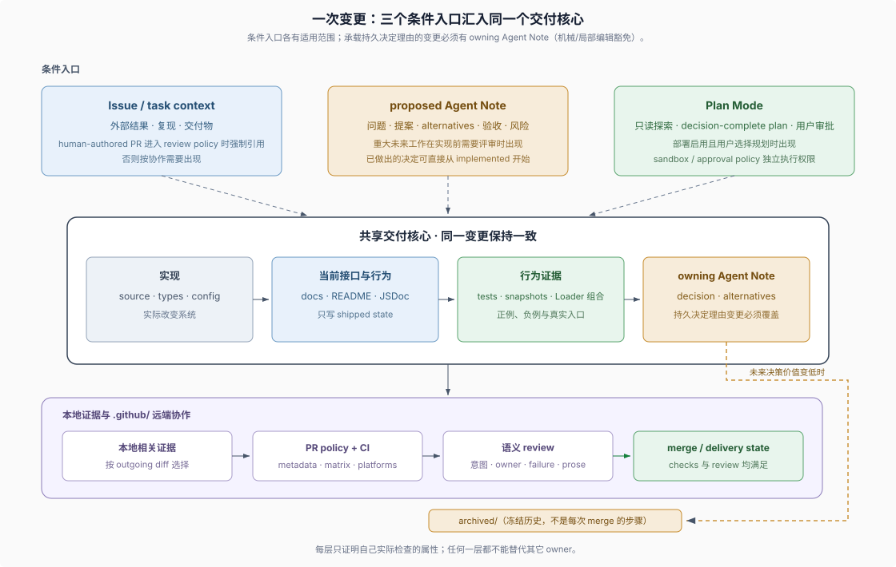

# SDLC Reference · 精确机制与例外流程

## 什么时候读这里

这里是 SDLC Reference（软件开发生命周期的精确参考），面向需要核对 DSH 主仓精确条件、内部状态或少见流程的读者。各页支持按问题查找，不要求从 `01` 顺序读到 `12`（文件编号保留历史落盘顺序以确保跨库永久零断链，建议外部读者直接按下方的**六阶段生命周期总表**检索）。独立插件仓可以参考这些机制，但不因使用 DSH runtime 就自动继承主仓的 Issue、Project、加权批准、CI 或多序列发布制度。

本目录直接回答“具体由哪个文件执行”“边界条件是什么”“失败后怎样处理”，不要求先阅读其它卷。开发独立 DSH 插件仓并落地专属验证门禁时，可读 [DSH 插件开发与专属 Harness](../02-dsh-plugin-harness/00-index.md)；提炼跨语言仓库结构、Skills、门禁与老仓渐进改造原则时，可读 [通用 Agent-Friendly 仓库工程](../01-general-repo-harness/00-index.md)。

本卷从 DSH 一手规则归纳出三条组织立场，不依赖另一份教程，也不把它们命名为 DSH 官方方法：

1. **agent 是一等参与者**：规则让初次参与的 coding agent 能找到状态、条件和证据。对应 Agent Note 生命周期（`01`）、意图入口与非 Issue 意图载体（`09`）、git 历史能证明什么（`08`）。
2. **可机械判断的规则接入可执行检查**：policy 定义判断，workflow 定义远端执行，不能据此宣称全部语义规则都可自动验证。对应 trusted policy 与 workflow 拆分（`02`）、gates 与检查路由（`04`）、双语 pairing 与文档门禁（`05`）、加权批准实现（`10`）。
3. **每类事实有权威维护位置**：本卷的 owner 指拥有相应事实或职责的位置，不是统一的人类职位。对应 Note 与 Plan 的分工（`01`、`03`）、文档归属（`05`）、评审职责（`06`）、发布 lane 归属（`11`）、agent 契约资产的原文归属（`12`）。

## 按研发全生命周期六阶段直达（推荐外部读者首站入口）

由于 `01`–`12` 按归档演进编号，初次进入的外部架构师或研究者可先按下表看清一笔变更从“产生意图”到“上线归档”的完整串联关系：

| 生命周期阶段 | 核心工程命题 | 对应参考页 | 外部仓库借鉴结论 |
|---|---|---|---|
| **① 意图准入** | 需求从哪进来？哪些工作不必先建 Issue？ | [`09 · Intake`](./09-intake-and-work-items.md) | 必借“模板只问外部可观察行为，不预设内部类名”与非 Issue 载体；免抄外部 PR 禁令 |
| **② 决策与计划** | 什么持久取舍写进仓库？单次会话计划如何与硬权限解耦？ | [`01 · Agent Note`](./01-agent-note-lifecycle.md)、[`03 · Plan 与权限`](./03-plan-and-sandbox.md) | **全栈通用**：直接复用备选方案/取代归档机制，以及 `Plan` 软引导与 `Sandbox`/`Approval` 硬隔离 |
| **③ 实现、文档与契约证据** | 当前事实写在哪？怎么锁住 Agent 契约并按 diff 精准选测？ | [`05 · 文档归属`](./05-prose-doc-standards.md)、[`12 · 契约证据`](./12-agent-contract-evidence.md)、[`04 · 证据路由`](./04-gates-and-local-checks.md) | **全栈通用**：必借“一个事实一个家”、独立外部世界 Oracle、Prove-Red 与本地聚焦选测 |
| **④ 远端策略、评审与批准** | CI 怎么防 PR 篡改规则？语义评审查什么？谁有合并投票权？ | [`02 · 远端自动化`](./02-issue-pr-lifecycle.md)、[`06 · 语义评审`](./06-review-and-human-role.md)、[`10 · 加权批准`](./10-approval-gate.md) | 必借默认分支可信策略与 `06` 语义评审职责边界；`10` 的 `blame` 积分制仅大型多维护者仓参考 |
| **⑤ 栈式合并与多轨发布** | 依赖链 PR 怎么安全改写与落地？合并后怎么打包预演与发版？ | [`07 · 分支改写与 PR 栈`](./07-push-merge-stacked-prs.md)、[`11 · 发布序列`](./11-release-sequences-and-publish-lanes.md) | 必借 `--force-with-lease` 显式租约与每 PR 无凭据打包安装预演；多家族序列仅主仓需要 |
| **⑥ 历史考古边界** | 翻查旧 commit 时，哪些流程事实不能靠 Git 历史硬猜？ | [`08 · 历史证据边界`](./08-example-web-seam.md) | **全栈通用**：Git 只能证明同切片落盘物，核验现行规则永远看 `HEAD` 权威 owner 与门禁脚本 |

## 参考目录（`01`–`12` 逐页速查）

| 页面 | 适用问题 | 外部借鉴定位 | 新手阶段可以暂时忽略 |
|---|---|---|---|
| [`01-agent-note-lifecycle.md`](./01-agent-note-lifecycle.md) | 什么改动会成为一篇 Note；三个状态怎样转换；留下、归档与合并删除怎样分开 | **通用高价值迁移**（强制备选方案、取代检查与归档判据适用于任意长期仓库） | sidecar hash、功能移除的逐条合并条件 |
| [`02-issue-pr-lifecycle.md`](./02-issue-pr-lifecycle.md) | trusted policy（可信策略）、Project lifecycle（项目生命周期）、CI workflow 和 Dependabot | **插件仓按需裁剪**（借鉴“检出默认分支可信校验代码”的安全模式，不照搬 Project 状态机） | policy 函数条件、runner/job 拆分 |
| [`03-plan-and-sandbox.md`](./03-plan-and-sandbox.md) | `plan/mode` event、pending transition（待提交转换）和审批时序 | **通用高价值迁移**（软计划引导与硬权限执行解耦是人机协作核心边界） | session log payload、pre-step 时机 |
| [`04-gates-and-local-checks.md`](./04-gates-and-local-checks.md) | outgoing scope（待推送差异）、focused coverage（聚焦覆盖率）和远端矩阵 | **通用高价值迁移**（本地聚焦选测 + 远端穷举 CI 的成本分工可直接复用） | exact base、job topology |
| [`05-prose-doc-standards.md`](./05-prose-doc-standards.md) | 文档 owner、双语 pairing（配对）和 VitePress projection（站点投影） | **插件仓按需裁剪**（必借“只写当前状态”与去推理过程泄漏；双语配对与站点投影按需采用） | generator 与 manifest 细节 |
| [`06-review-and-human-role.md`](./06-review-and-human-role.md) | 高风险 semantic review、findings 和 review 状态失效 | **通用高价值迁移**（人或 agent 执行语义评审的职责边界与失效重审纪律） | 生命周期、安全与真实入口清单 |
| [`07-push-merge-stacked-prs.md`](./07-push-merge-stacked-prs.md) | branch rewrite（分支改写）与 Stacked Pull Requests（依赖式 PR 栈） | **插件仓按需裁剪**（多人/多代理拆栈协作时采用；单人小仓走普通单分支 PR 即可） | GraphQL stack membership、partial landing |
| [`08-example-web-seam.md`](./08-example-web-seam.md) | git 历史能够证明和不能证明哪些流程事实 | **通用高价值迁移**（理解代码库考古与交付切片的证据边界） | 历史 commit 与现行格式差异 |
| [`09-intake-and-work-items.md`](./09-intake-and-work-items.md) | 意图从哪里进来：外部 Discussions 边界、Issue 模板、Project 生命周期、标签分工与非 Issue 意图载体 | **插件仓按需裁剪**（必借“按外部可观察行为提需求”，免抄主仓标签与外部 PR 禁令） | policy 函数细节、模板演进史 |
| [`10-approval-gate.md`](./10-approval-gate.md) | merge 的真实门槛：weighted approval 加权批准、`/delegate` 积分转移与 branch rules | **仅主仓治理样本**（多维护者大型仓库的 `blame` 归属积分制，独立小仓无需复制） | blame 分类器、委托的完整状态机 |
| [`11-release-sequences-and-publish-lanes.md`](./11-release-sequences-and-publish-lanes.md) | merge 之后怎样上线：三条 release 序列、bump 与 tag、rehearsal 与 publish 分离、各发布 lane | **插件仓按需裁剪**（必借“每 PR 无凭据打包安装预演 + 人工受控发布”，免抄多语言家族序列） | registry 三态参数、Desktop/Python 细节 |
| [`12-agent-contract-evidence.md`](./12-agent-contract-evidence.md) | agent 看见的请求、可回放会话、外部世界；改行为、修 bug、新守卫三种情况下红灯各表示什么 | **通用高价值迁移**（不信自报验外部世界、新守卫必须先看红灯再撤回） | 代际文件名、snapshot 命令参数 |

## 使用方式

按问题进入一篇对应 reference；每页顶部的 **`> **外部借鉴切面**`** 先帮你区分哪些机制可直接搬回自家仓库、哪些只是 DSH 主仓内部参数，页面末尾的“证据入口”链接到 owning source、policy、workflow、skill 或 Agent Note；核对现行仓库事实时，以这些一手来源为准。
