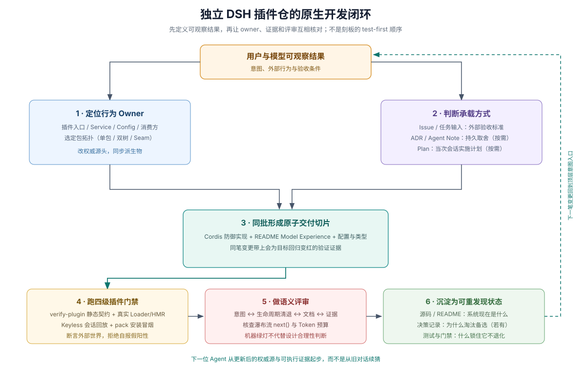
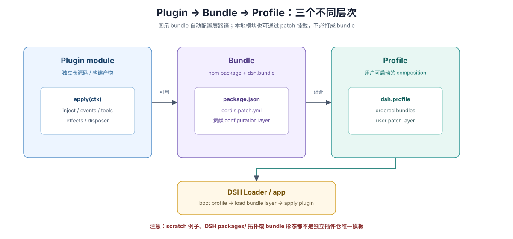
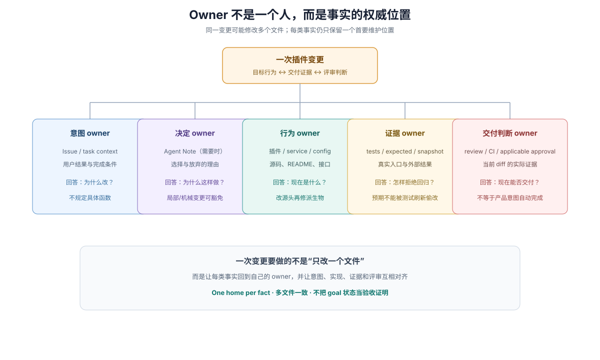
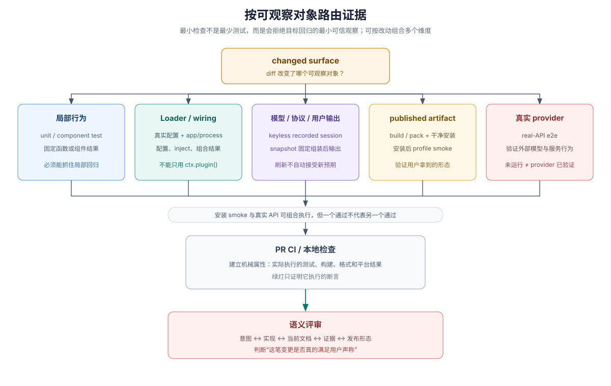
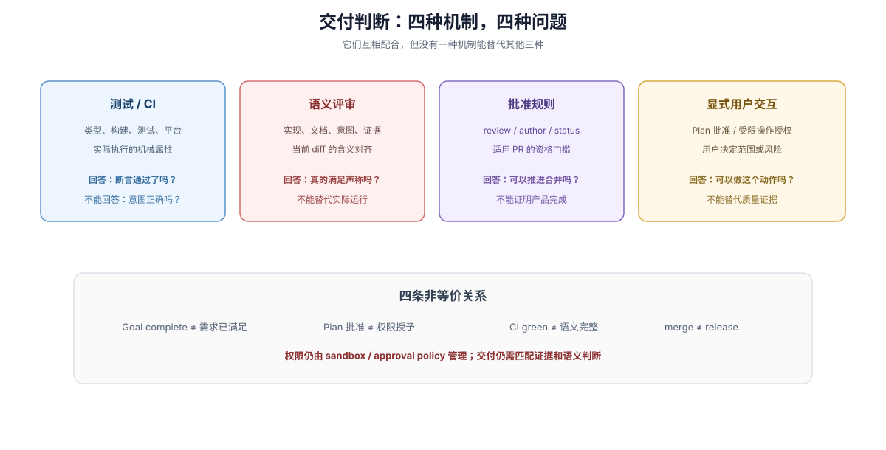

# DSH 插件仓库开发与专属 Harness 实战总览

## 为什么会写 `apply(ctx)` 离“交付可靠插件仓”还差得很远

新建一座独立的 DSH 插件仓库时，写通第一个 `export function apply(ctx)` 往往只需要十分钟；真正的工程事故几乎全部爆发在随后的多轮 Agent 协作中：把函数式插件顺手加上 `export default` 导致真实 `Loader` 静默丢弃 `inject`、用模块级全局变量存状态导致多会话串台与热重载泄漏、把带 Web 界面的全栈插件塞进同一个 `tsconfig` 撞出 `Context` 声明合并冲突、改了工具描述击穿整条会话的前缀缓存，或者因为外部仓库没有 DSH 主仓内部的私有测试基建，只写几个全 mock 单测就匆忙发包，结果用户执行 `dsh plugin add` 当场报错。

本卷专为**独立 DSH 插件仓库的架构师与主力 Coding Agent** 编写，将 DSH 一手源码、文档、防御模式与 Skills 提炼为一套可直接落地的**插件仓四层工程体系与专属开发 Harness**（通用的跨语言 Agent-Friendly Repo 设计哲学由 [卷一](../repo-harness/00-index.md) 拥有，本卷不再重复铺垫）。

首次接触 `Loader`、`PENDING`、`HMR`、`bundle`、`profile`、`preset` 或 `oracle` 时，可随时对照 [`02 · 术语与心智模型`](./02-terms-and-mental-models.md)。

## 一页看清：独立 DSH 插件仓必须打通的四个工程层次

开发独立 DSH 插件同时横跨四个彼此正交的层次。DSH 官方入门教程主要覆盖第 1 层（运行时 API）和第 3 层的基础打包命令；而一座能让 Coding Agent 长期高质量自驱的插件仓，必须把第 2 层（仓库拓扑）与第 4 层（插件专属门禁与回放 Harness）一并建齐：

| 工程层次 | 核心要解决的问题 | DSH 宿主平台直接提供的机制 | 独立插件仓必须自己建好的设施（本卷对应专章） |
|---|---|---|---|
| **1. Cordis 运行时契约层** | 插件如何声明依赖、挂载能力、拦截事件并在卸载时干净排空？ | `apply(ctx)`、`Service`、`inject`、五种事件分发模式、`ctx.effect()`、会话事件流 | 严守导出互斥、零模块单例、Waterfall `next()`、异步排空（Quiescent Disposal）与 `SessionEventMap` 投影纪律（[`03`](./03-context-and-drift.md)、[`05`](./05-cordis-contracts-and-model-experience.md)） |
| **2. 插件仓库拓扑与编译层** | 源码、类型声明、Node 宿主端与浏览器端代码如何隔离编译？ | `@deepseek-ai/dsh-*` 公开类型包、客户端槽位与远程调用协议 | 按业务复杂度选定单包 Host、Host+Client 双树（双 `tsconfig` 编译器面）或 Capability Seam 多包拓扑（[`01`](./01-new-plugin-repository.md)、[`04`](./04-plugin-repo-topologies.md)） |
| **3. 配置叠加与 Bundle 分发层** | 用户装什么、配在哪一层生效、升级时怎样校验宿主兼容？ | `dsh.bundle` 补丁层、`dsh.profile` 启动层、`engines.dsh` 与五层配置叠加 | 三层 npm 依赖精准归位、`Config.volatile()` 设置表单声明、`pnpm pack` 与干净 `$DSH_HOME` 安装冒烟（[`01`](./01-new-plugin-repository.md)、[`04`](./04-plugin-repo-topologies.md)） |
| **4. 插件仓专属 Harness 门禁层** | 没有主仓内部私有脚本时，谁在提交前自动拦住插件特有缺陷？ | 公开的 `cordis-plugin-loader`、`dsh-llm`、`dsh-agent-loop` 等可编程构件 | 自有 `scripts/verify-plugin.mjs` 静态门禁、防 `PENDING` 真实 Loader 测试、`ScriptedLlmAdapter` 无 Key 回放 + 独立 `workspace.expected/` 与插件 CI（[`06`](./06-plugin-gate-and-ci-harness.md)） |

牢记四条底线不等式：**代码能编译 ≠ `Loader` 真能激活 ≠ 会话与工具输出符合预期 ≠ 打包 tarball 能装进干净 Profile**。四道关口必须各有独立证据。

## 全卷 7 篇实战路线图（`00`–`06`）

| 专章 | 解决的核心痛点与可直接拿走的工程资产 |
|---|---|
| [`01-new-plugin-repository.md`](./01-new-plugin-repository.md) | **Day-1 单包快速通关**：最小单包 Host Bundle 黄金目录、`peerDependencies`/`devDependencies` 镜像模板、双形态入口代码、真实 `Loader` 组合测试、打包安装冒烟与起步 `AGENTS.md` |
| [`02-terms-and-mental-models.md`](./02-terms-and-mental-models.md) | **核心心智模型与防误判词典**：厘清 `Plugin / Bundle / Profile / Preset`、`inject / PENDING / HMR`、`Plan / Goal / Sandbox` 等高频概念，附带 Coding Agent 最常犯的代码级误判与一行自检法 |
| [`03-context-and-drift.md`](./03-context-and-drift.md) | **会话日志与插件运行时状态纪律**：深入 `session log` 仅追加与 `deriveMessages()` 投影、`compaction/*` 遮蔽、`goal / plan / todo / skill` 跨 `resume`/`fork`/`spawn` 存活矩阵，以及插件新增模型可见输入时的 `SessionEventMap` 与 `@messageProjection` 硬约束 |
| [`04-plugin-repo-topologies.md`](./04-plugin-repo-topologies.md) | **三种插件仓拓扑与五层配置工程**：单包 Host Bundle、Host + Web Client 双树全栈包（含 `solution-only` 根 `tsconfig` 与双编译器面隔离、`ctx.slots` 五份派生 props 纪律）、Capability Seam 多包 Workspace，以及五层配置、`Config.volatile()` 与 `!!js` 动态表达式 |
| [`05-cordis-contracts-and-model-experience.md`](./05-cordis-contracts-and-model-experience.md) | **Cordis 六大防坑契约与 Model Experience**：可直接喂给 Agent 的六条代码级红线（禁函数插件默认导出、禁模块可变单例、强制 Waterfall `next()`、异步排空卸载与提交点改状态、工具 Schema 极简与 KV Cache 记账、结构化错误分类） |
| [`06-plugin-gate-and-ci-harness.md`](./06-plugin-gate-and-ci-harness.md) | **独立插件仓门禁、无 Key 回放与 CI 模板**：零依赖 `scripts/verify-plugin.mjs` 完整源码、带 `PENDING` 缺失依赖点名的真实 `Loader`/HMR 竞态测试、基于公开 `LlmAdapter` 的无 Key 脚本化 Turn 回放 + 独立 `workspace.expected/`、`.github/workflows/ci.yml` 与 2 份专属 `SKILL.md` |

## DSH 原生插件交付的七步标准闭环

在独立插件仓中推进每一笔非玩具改动时，遵循以下七步闭环（流程图表达职责衔接，不强制机械串行）：

1. **先用外部可观察结果定义意图，不预先锁死内部函数名。** 在 Issue 或任务上下文中写清触发条件、模型或终端用户能观察到的输出、错误表现与边界，把源码落点交给仓库 owner 路由决定。
2. **定位唯一事实与行为 Owner，同提交联动更新。** 源码拥有实现，插件 `README.md` 拥有配置说明、`## Model Experience`、数据留存与已知限制，`cordis.patch.yml` 拥有默认挂载关系，测试场景拥有回归断言——“一个事实一个家”要求一笔功能切片同步更新所有受影响面，而不是只改 `.ts` 文件：

| 需要确认或修改的事实 | 插件仓内的权威位置 | 交付前核对动作 |
|---|---|---|
| 为什么要改、外部验收结果是什么 | Issue 或当次任务说明 | 核对最终行为与测试证据是否正面回答原始意图 |
| 为什么选当前架构而非备选方案 | `docs/decisions/`（仅非平凡持久取舍需要） | 核对是否写清被拒备选与代价，且未与旧记录冲突 |
| 当前配置、上下文开销与数据留存义务 | `src/`、导出类型、JSDoc、`README.md` | 核对 `README.md` 是否反映现行参数与 `Model Experience` |
| 哪条自动化检查锁住回归 | `tests/`、独立 `workspace.expected/`、`verify-plugin.mjs` | 核对注入故障时检查确实变红失败（Prove-Red） |
| 发布产物在真实宿主里能否安装激活 | PR 验证记录与 CI 干净 `$DSH_HOME` 安装预演 | 核对跑过 `pnpm pack` + `dsh plugin add` + `--dump-config` |

3. **按需使用决策记录与 Plan Mode，绝不制造空头仪式。** 局部缺陷修复或常规小改动免写决策记录；跨包接口、持久化事件或安全边界取舍才写决策记录。`Plan Mode` 只负责当次会话实施对齐，既不是长期 API 文档，也不授予越过沙箱或审批的额外执行权限（详见 [Plan 与沙箱参考](../sdlc-reference/03-plan-and-sandbox.md)）。
4. **按改动触及的真实表面聚焦选测。** 不必每改一行注释都重跑全套慢速端到端任务，但凡触及公开行为就必须跑通能锁住该回归的最窄真实检查：

> Every behavior change needs the narrowest available test or purpose-built check that would fail for its regression; add broader checks only for surfaces the diff actually reaches.
>
> — DSH [pre-push checks Skill](https://github.com/deepseek-ai/deepseek-harness/blob/master/.agents/skills/dsh-pre-push-checks/SKILL.md#select-relevant-evidence)

5. **按可观察对象分层布置证据，拒绝“全 Mock 假绿”。** 手工拼装假 `ctx` 的单测只能验证纯算法分支；配置闭合、依赖注入、`PENDING` 死锁、模型请求头与文件副作用必须交给真实 `Loader` 组合测试与无 Key 脚本化回放 + 独立 `workspace.expected/` Oracle 验证（完整测试代码见 [`06`](./06-plugin-gate-and-ci-harness.md)）：

6. **在隔离的干净 Profile 中验证真实打包产物（Tarball Smoke）。** 源码工作区依赖齐全不代表发出的 npm 包能用；每次改动打包清单、导出路径或 `cordis.patch.yml` 时，都必须经 `pnpm pack` 装入新建测试 Profile 跑通配置导出与激活检查。
7. **由人类语义评审完成最终交付与发版拍板。** 区分测试/CI（证明已写断言成立）、语义评审（核对意图对齐、生命周期无竞态、文档无漏项）、合并准入与正式发版四个独立角色：

## 插件仓最常见的六大防踩坑红线

1. **切勿把持久 `Goal` 标为 `complete` 当成产品验收通过。** `Goal` 只是帮助长会话跨轮续接的状态记录，完成度永远由外部可观察结果、独立 Oracle 测试和打包冒烟共同证明。
2. **切勿只写手工 `ctx.plugin(...)` 或全 Mock 单测就上线。** 绕过真实 `Loader` 的测试抓不到 `export default` 吞掉 `inject`、`cordis.patch.yml` 路径写错以及 `peerDependencies` 漏声明等致命打包故障。
3. **切勿让录制或刷新脚本顺手覆盖独立预期（Oracle）。** 验证工作区文件变更时，对照基准 `workspace.expected/` 必须保持只读独立，否则测试只证明了“代码和上次跑出来的一样错”。
4. **切勿模仿早年已退役的 `./invariant` 伴生导出。** DSH 现行版本已彻底移除 `@deepseek-ai/dsh-invariants` 与 `ctx.invariants`（详见 [卷一第 5 章](../repo-harness/05-executable-feedback.md)）；插件仓不要设计任何 `./invariant` 子路径或挂载同名插件。
5. **切勿绕过既有扩展点去魔改 `agent-loop`。** 绝大多数需求都能通过 `defineTool`、`agent/*` 或 `tools/*` 事件、Service Seam、`Preset` 或 Client Slot 干净实现；先穷尽标准扩展面（[`02`](./02-terms-and-mental-models.md)、[`04`](./04-plugin-repo-topologies.md)）。
6. **切勿生搬硬套 DSH 主仓内部的百包级行政流程。** DSH 主仓的 GitHub Project 状态机、加权评审积分、双语哈希配对与三序列同步发版服务于官方大仓；独立插件仓应当采用 [`06`](./06-plugin-gate-and-ci-harness.md) 中轻量、高信噪比的插件专属门禁与 CI。

## 相关入口

- [`01-new-plugin-repository.md`](./01-new-plugin-repository.md) → [`04`](./04-plugin-repo-topologies.md) → [`05`](./05-cordis-contracts-and-model-experience.md) → [`06`](./06-plugin-gate-and-ci-harness.md)：从第 1 天单包建仓一路进阶到全栈双树拓扑、Cordis 防坑契约与全自动验证金字塔。
- [`02-terms-and-mental-models.md`](./02-terms-and-mental-models.md) 与 [`03-context-and-drift.md`](./03-context-and-drift.md)：随时查阅 DSH 核心概念边界与会话日志/状态投影规律。
- [卷一：通用 Agent-Friendly Repo 工程学](../repo-harness/00-index.md) 与 [卷三：DSH 主仓研发条款字典](../sdlc-reference/00-index.md)：通用仓库 Harness 思想底座与 DSH 主仓一手规则索引。
