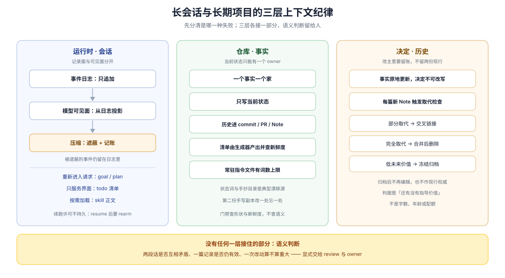

# 03 · DSH 会话日志、上下文压缩与插件运行时状态纪律

## 插件作者最容易踩空的暗礁：以为“塞进内存或对话里就永远在”

编写稍微复杂一点的 DSH 插件（例如自定义上下文注入器、跨轮工作流协调器、状态面板或新型会话工具）时，coding agent 最容易犯两类状态错误：一是在插件内存里维护一份跟着会话走的私有状态，结果用户执行会话恢复（`resume`）、分叉（`fork`）或重启进程后状态瞬间归零；二是往对话历史里塞了一段提示信息，却没意识到长会话触发自动压缩（`compaction`）后旧轮次事件会被遮蔽重写，或者误以为 `todo` 清单会自动回到下一轮模型请求里。

本章 **100% 聚焦 DSH 运行时会话状态与插件之间的精确契约**——讲清仅追加的 `session log` 如何投影为模型可见消息、自动压缩遮蔽了什么又保留了什么、`goal / plan / todo / skill / subagent` 在恢复与分叉下的精确存活矩阵，以及插件新增模型可见输入时必须履行的 `SessionEventMap` 与消息投影义务。（至于通用的仓库文档防漂移、清理会话推理残渣与决策记录归档新陈代谢，已统一收束在 [卷一第 11 章](../repo-harness/11-spec-drift-and-decision-metabolism.md)，本章不再重复。）

## 1. 核心公理：`session log` 是唯一真源，模型可见面只是纯函数投影

在 DSH 中，单次会话发生过的一切事实只有唯一一处权威记录：**仅追加的会话事件日志（append-only `session log`，由 `@deepseek-ai/dsh-session` 管理）**。每一步发给大模型的 `Message[]` 历史并非单独维护的可变数组，而是通过 `session.deriveMessages()` 从会话日志按序折叠派生出来的**模型可见面（surface）**。

这条架构铁律直接推出了所有插件都不得违背的 **`Model-visible ⟺ logged`（模型可见即已记录）** 不变量（一手原文归属见 [Agent 契约证据](../sdlc-reference/12-agent-contract-evidence.md#看见的请求)）：

1. **严禁在请求半途偷塞未入账内容**：`dsh-agent-loop` 构造出的模型请求是深度冻结（deep-frozen）的，插件和模型适配器既不能在半路原地篡改请求对象，也不能绕过会话日志私自往模型眼里塞一段重放时无法复现的隐藏文本。
2. **区分两类事件**：**Surface 事件**（`system/message`、`developer/message`、`user/message`、`assistant/message`、`tool/result`）必须携带显式的 `surfaceOp`（如 `'append'` 或区间替换 `{ op: 'replace', startSeq, endSeq }`）以参与模型消息派生；而 **Log-only 事件**则严禁携带 `surfaceOp`，只留在日志里供审计、UI 折叠或状态恢复读取，绝不直接变成发给模型的聊天消息。

## 2. 长会话自动压缩（Compaction）：遮蔽而非删除，重写而非照抄

当长会话逼近上下文窗口阈值时，DSH 的压缩子系统（`@deepseek-ai/dsh-compaction`）怎样在不破坏审计真源的前提下腾出空间？答案是 **遮蔽（shadow）加有账本的结构化重写**：

> The raw events stay logged but stop appearing in derived model messages; the seam itself performs no rewrite.
>
> — DSH [`packages/compaction/compaction/README.md`](https://github.com/deepseek-ai/deepseek-harness/blob/master/packages/compaction/compaction/README.md)。被压缩覆盖的原始历史事件一字不改地留在底层会话日志中（因此导出日志、计费统计与回放审计毫发无损），只是在 `deriveMessages()` 派生当前模型消息时不再浮出水面。

> All three are **log-only** — they record the lock, summary, selected range, shadowed event seqs, token count, and model call without joining the surface.
>
> — DSH [`docs/subsystems/compaction.md`](https://github.com/deepseek-ai/deepseek-harness/blob/master/docs/subsystems/compaction.md)。压缩锁、选中区间、被遮蔽的事件序号、Token 账目与摘要模型调用全部写进三条 log-only 的 `compaction/*` 事件；真正改动模型可见面的，仅仅是一条携带区间替换 `surfaceOp` 的合并摘要消息。

对插件设计者最重要的一条警示在于压缩器对待旧事实的态度——**绝不原封不动往前抄，而是主动丢弃已过期状态**：

> Do not copy it forward verbatim: preserve still-true facts, drop stale ones, and merge newer information into a single consolidated summary under the same structure.
>
> — DSH [`packages/compaction/compaction-basic/README.md`](https://github.com/deepseek-ai/deepseek-harness/blob/master/packages/compaction/compaction-basic/README.md)。这意味着：如果你的插件有一项必须在第 50 轮对话时依然逐字生效的硬约束或活状态，**千万不要只在第 1 轮发一条普通消息指望模型一直记得**——要么挂进受管系统提示词段，要么像下面的 `plan/mode` 和 `goal/change` 一样写成通过折叠日志恢复的持久状态事件。

## 3. 插件必背表：核心状态跨 Compaction / Resume / Fork / Spawn 的存活矩阵

写联动插件或编排子代理时，最容易踩坑的就是搞错各类内置状态“落不落盘、进不进模型历史、分叉子代理拿不拿得到”。下面这张基于 DSH 源码核实的存活矩阵建议直接贴在插件设计评审单旁：

| 状态或能力载体 | 底层会话日志落点 | 触发 Compaction / `resume` / `fork` 后的真实表现 | 子代理 `fork` vs `spawn` 差异 |
|---|---|---|---|
| **系统提示词（`system/message`）** | Surface 节点 0（及支持 `in-history` 模型上的后续节点） | 节点 0 受保护不被常规非系统事件替换；后续动态追加的系统节点可被压缩区间遮蔽 | `fork` 继承父会话已完成轮次快照；`spawn` 按新代理自身配置重新渲染 |
| **持久目标（`goal/change`）** | 仅追加的会话事件（最后一次写入代表当前相位与目标） | 目标文本与相位跨 `resume`、`fork` 与重启保留，并在自主续跑轮重发；**但“允许自动继续跑”的运行许可（rearm）不持久，恢复或分叉后必须由顶层显式重开** | `spawn` 从空白新会话起步，不继承父会话的 Goal |
| **计划模式姿态（`plan/mode`）** | 单个整值替换的 log-only 事件 | 跨 `resume`、`fork` 与压缩均通过折叠日志精确恢复开关状态，并重新注入计划策略段（计划草稿正文留在工具调用记录中） | `fork` 随前缀日志折叠继承姿态；`spawn` 独立初始化 |
| **任务待办表（`todo/write`）** | 整表快照 log-only 事件（最新写入胜出） | 跨刷新与恢复保留给 **前端 UI 面板展示**，但**永远不进入 `deriveMessages()` 模型派生历史** | 纯 UI 展示状态，绝不能指望模型靠它“自动记住下一步” |
| **运行时技能目录（`skills`）** | 一条耐久目录消息（含名称与截断摘要） | 常驻上下文只付目录成本；某项 Skill 的完整指令只有在模型主动调用 `skill` 工具加载后才进入可见面 | 按目标 Agent 作用域（`agent.ctx`）上挂载的 Skill Provider 决定 |

三条关键原文直接钉死了最容易误判的 `plan/mode`、`todo/write` 与 `skill` 行为边界：

> The durable stance is one log-only whole-value-replace event, never a live mirror, so resume, fork, and compaction recover it by folding the log.
>
> — DSH [`packages/plan/plan-mode/README.md`](https://github.com/deepseek-ai/deepseek-harness/blob/master/packages/plan/plan-mode/README.md)。

> Whole-list snapshot; latest write wins on replay. Log-only UI state; never derived history.
>
> — DSH [`packages/todo/tool-todo/src/types.ts`](https://github.com/deepseek-ai/deepseek-harness/blob/master/packages/todo/tool-todo/src/types.ts)。

> Agents can discover and load skills during a session […] they receive a durable catalog of available skill names and capped descriptions, and can use the `skill` tool to load full instructions.
>
> — DSH [`packages/skill/tool-skill/README.md`](https://github.com/deepseek-ai/deepseek-harness/blob/master/packages/skill/tool-skill/README.md)。

此外，当插件调用子代理能力时，务必分清两条进程内委派通道的上下文隔离语义：**`fork`**（[`@deepseek-ai/dsh-subagent-fork-in-process`](https://github.com/deepseek-ai/deepseek-harness/blob/master/packages/subagent/subagent-fork-in-process/README.md)）从父会话稳定已提交前缀切出一份一次性快照（利于共享前序调研上下文与前缀缓存）；而 **`spawn`**（[`@deepseek-ai/dsh-subagent-spawn-in-process`](https://github.com/deepseek-ai/deepseek-harness/blob/master/packages/subagent/subagent-spawn-in-process/README.md)）则从全新的空会话起步（适合职责独立、避免被父会话庞大历史干扰的干净子任务）。至于跨历史会话全文检索（`session-search` / `tool-session-query`），属于默认不启用的 `packages/experimental/` 实验能力，独立插件不应默认假设宿主已挂载该服务。

## 4. 插件扩展 `SessionEventMap` 与自定义消息投影的四条硬义务

如果你的插件只注册普通工具（走标准 `tool/result`）、挂系统提示词片段或只维护不进模型的瞬态 UI 状态，**完全不需要自定义会话事件**。只有当插件确实引入了**必须在刷新、恢复、`fork` 或会话导出后原样重建的新领域事实或新模型可见输入**时，才扩展 `SessionEventMap`，并严格遵守以下四条持久化契约（主仓读取兼容审查细则见 [持久化兼容说明](https://github.com/deepseek-ai/deepseek-harness/blob/master/docs/cookbook/reviewing-persistence-type-changes.md)）：

1. **命名空间隔离与纯 JSON 无损序列化**：自定义事件名带上清晰的插件域名前缀（如 `'my-plugin/checkpoint'`）；`session.append()` 会对载荷执行无损 JSON 校验并深度冻结，严禁塞入函数、`Map`/`Set`、`Uint8Array` 或类实例。
2. **明确区分 `ignorable` 可选日志与必读事件**：`SessionEventMap` 成员默认在读取旧日志时要求消费方理解；若某条 log-only 事件仅用于插件自身的辅助统计或可选装饰，卸载插件后也不应阻碍宿主读取历史会话，需按会话格式规范评估可忽略（`ignorable: true`）包络语义，切勿制造“一旦装过你的插件写入一条事件，卸载插件后整个历史会话就打不开”的锁死事故。
3. **自定义模型可见事件必须注册纯函数消息投影（`@messageProjection`）**：若插件不复用现成的五种基础 surface 事件，而是定义了会生成或改变模型可见消息的新事件类型，必须使用 `@messageProjection` 标注并通过 `ctx.sessions.registerMessageProjection()` 注册纯函数投影定义——注意：一旦某会话使用了该投影定义，在插件卸载导致该投影定义缺失时，会话的追加、恢复与缓存读取都会被阻止以防产生残缺历史！
4. **纯展示数据绝不污染会话日志**：Web 界面的折叠展开态、选中高亮、草稿框文本等“怎么画”的状态只留在前端 Store 或进程局部快照里；会话日志只记录业务事实与模型契约输入。

## 证据入口

- DSH [`docs/architecture.md` 的 Session log 节](https://github.com/deepseek-ai/deepseek-harness/blob/master/docs/architecture.md#session-log) 与 [`packages/core/session/README.md`](https://github.com/deepseek-ai/deepseek-harness/blob/master/packages/core/session/README.md)：`Model-visible ⟺ logged`、`surfaceOp` 规则与 `registerMessageProjection()` 契约。
- DSH [`packages/compaction/compaction/README.md`](https://github.com/deepseek-ai/deepseek-harness/blob/master/packages/compaction/compaction/README.md)、[`docs/subsystems/compaction.md`](https://github.com/deepseek-ai/deepseek-harness/blob/master/docs/subsystems/compaction.md) 与 [`packages/compaction/compaction-basic/README.md`](https://github.com/deepseek-ai/deepseek-harness/blob/master/packages/compaction/compaction-basic/README.md)：事件遮蔽、三条 log-only 压缩账本事件与丢弃过期事实的摘要重写指令。
- DSH [`packages/plan/plan-mode/README.md`](https://github.com/deepseek-ai/deepseek-harness/blob/master/packages/plan/plan-mode/README.md)、[`packages/goal/goal/README.md`](https://github.com/deepseek-ai/deepseek-harness/blob/master/packages/goal/goal/README.md) 与 [`packages/goal/tool-goal/README.md`](https://github.com/deepseek-ai/deepseek-harness/blob/master/packages/goal/tool-goal/README.md)：日志折叠恢复与非持久续跑许可（rearm）边界。
- DSH [`packages/todo/tool-todo/src/types.ts`](https://github.com/deepseek-ai/deepseek-harness/blob/master/packages/todo/tool-todo/src/types.ts)、[`packages/skill/tool-skill/README.md`](https://github.com/deepseek-ai/deepseek-harness/blob/master/packages/skill/tool-skill/README.md)、[`subagent-fork-in-process`](https://github.com/deepseek-ai/deepseek-harness/blob/master/packages/subagent/subagent-fork-in-process/README.md) 与 [`subagent-spawn-in-process`](https://github.com/deepseek-ai/deepseek-harness/blob/master/packages/subagent/subagent-spawn-in-process/README.md)：UI 专属状态、技能渐进披露与子代理 `fork`/`spawn` 隔离语义。
