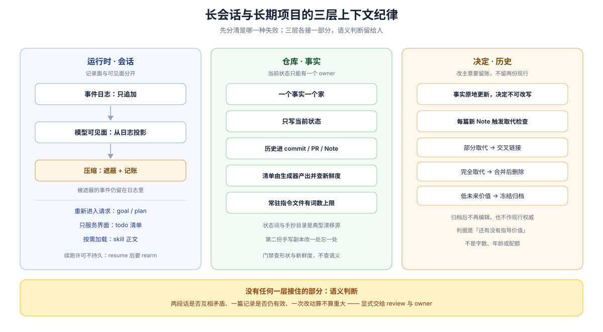

# 03 · 长会话与长期项目：上下文纪律（context discipline）

## 一句话

spec 越堆越多时，先分清坏的是哪一层：**上下文腐化**（模型看见的与真实脱节）、**规格漂移**（写下来的与代码不符）、**方向反复**（决定改了但说不清为什么）、**存量堆积**（都对但太多、没人删）。DSH 用三层分别接：运行时的记录面（日志只追加、模型可见面是投影、压缩遮蔽并记账）、仓库的事实归属（一个事实一个家、只写当前状态）、决定的生命周期（不可原地改写、取代检查、归档冻结）。三层之外的语义判断仍然留给人。

本页把这三层的机制、可迁移到插件仓的做法，以及机器查不到的边界写在一起；精确的 Note 条件由 [Agent Note 生命周期](../sdlc-reference/01-agent-note-lifecycle.md) 拥有，本页不复制。

## 本页读法

| 问题 | 本节 |
|---|---|
| 「腐化」到底指哪一种失败，各自的信号是什么 | [§1](#1-四种失败不要混成一句话) |
| 会话里的上下文被压缩时，什么会丢、什么不会 | [§2](#2-运行时日志是记录模型可见面是投影) |
| 仓库这一侧靠什么不让事实漂移 | [§3](#3-仓库一个事实一个家且只写现在) |
| 改了主意之后，旧记录去哪里 | [§4](#4-决定不可原地改写只能被取代) |
| 使用时具体注意什么 | [§5](#5-使用清单) |
| 哪些事别指望机器 | [§6](#6-机器查不到的部分) |

## 1. 四种失败不要混成一句话

| 失败 | 出事载体 | 典型信号 | 主要接住它的一层 |
|---|---|---|---|
| 上下文腐化 | 一次会话的模型可见面 | 早先的叙述被当成现状；摘要吃掉了决定性细节 | 运行时（§2）+ 录制证据 |
| 规格漂移 | 仓库里的事实载体 | 同一事实出现第二份手写副本，改了一处忘了另一处 | 仓库归属（§3）+ 生成目录与门禁 |
| 方向反复 | 决定的版本化方式 | 说不清为什么变成现在这样，旧方案被重新提出 | 决定生命周期（§4） |
| 存量堆积 | 决定语料的总量 | 检索变慢、没人删，但每篇单看都没错 | 归档与删除判据（§4、§5） |

前三种是「内容错了」，第四种是「内容没错但太多」。混着谈会得出「写少一点就好了」这种既不正确也不可执行的结论——DSH 对第四种给的是归档与删除判据，不是写作克制。

## 2. 运行时：日志是记录，模型可见面是投影

会话事实只有一条来源：仅追加的 session log（会话日志）。模型看见的历史是从它派生出来的 surface（模型可见面）。

> **Model-visible means logged.** Every model request must be reconstructable from the log.
>
> — DSH [`docs/architecture.md` 的 Session log 节](https://github.com/deepseek-ai/deepseek-harness/blob/dsh-v0.2.1-rc.2/docs/architecture.md#session-log)。这条不变量决定了「上下文里丢的东西」在日志里找得回来，也决定了任何新的模型可见输入都必须先成为一条 session event。

长会话一定会压缩。压缩的做法是**遮蔽（shadow）而不是删除**：被压掉的事件不再进入派生消息，但仍留在日志里。

> The raw events stay logged but stop appearing in derived model messages; the seam itself performs no rewrite.
>
> — DSH [`packages/compaction/compaction/README.md`](https://github.com/deepseek-ai/deepseek-harness/blob/dsh-v0.2.1-rc.2/packages/compaction/compaction/README.md)。压缩只改派生历史，不改日志。

压缩过程本身留账：lock、摘要、被选中的范围、被遮蔽事件的序号与 token 数都写进 log-only 的 `compaction/*` 事件，因此「压掉了什么、值多少 token、用哪个模型总结的」可以事后核对。

> All three are **log-only** — they record the lock, summary, selected range, shadowed event seqs, token count, and model call without joining the surface.
>
> — DSH [`docs/subsystems/compaction.md`](https://github.com/deepseek-ai/deepseek-harness/blob/dsh-v0.2.1-rc.2/docs/subsystems/compaction.md)。摘要本身走一条带 `surfaceOp` 的普通 `user/message`，是压缩唯一的一次可见面改动。

更值得记住的是压缩指令对「过期」的态度：摘要**不允许照抄上一版**，必须按「现在还成立吗」重写。

> Do not copy it forward verbatim: preserve still-true facts, **drop stale ones**, and merge newer information into a single consolidated summary under the same structure.
>
> — DSH [`packages/compaction/compaction-basic/README.md`](https://github.com/deepseek-ai/deepseek-harness/blob/dsh-v0.2.1-rc.2/packages/compaction/compaction-basic/README.md)。所以「不写下来就会丢」的事实，不要指望留在对话里。

**什么会重新进入请求，什么不会**，是使用上最容易踩错的一点：

| 状态 | 落点 | 压缩或恢复之后 |
|---|---|---|
| `goal/change` | 仅追加的会话事件，最后一次写入即当前目标 | 跨 turn、resume、fork 与进程重启存活；续轮时整条重发目标 |
| `plan/mode` | 单个 log-only 整值事件 | resume、fork 与 compaction 靠折叠日志恢复状态，并重新注入策略段 |
| `todo/write` | 整表快照事件 | 只作 UI 状态保存与重放，**不进入派生历史** |
| skills 目录 | 一条耐久目录消息 | 正文只在模型用 `skill` 工具按需加载时才进入上下文 |

> The durable stance is one log-only whole-value-replace event, never a live mirror, so resume, fork, and compaction recover it by folding the log.
>
> — DSH [`packages/plan/plan-mode/README.md`](https://github.com/deepseek-ai/deepseek-harness/blob/dsh-v0.2.1-rc.2/packages/plan/plan-mode/README.md)。计划正文不在这条 event 里；它留在工具调用的记录中。

> Whole-list snapshot; latest write wins on replay. Log-only UI state; never derived history.
>
> — DSH [`packages/todo/tool-todo/src/types.ts`](https://github.com/deepseek-ai/deepseek-harness/blob/dsh-v0.2.1-rc.2/packages/todo/tool-todo/src/types.ts)。任务清单会跨 turn 保留给界面，但不会自己回到模型眼前。

> Agents can discover and load skills during a session […] they receive a durable catalog of available skill names and capped descriptions, and can use the `skill` tool to load full instructions.
>
> — DSH [`packages/skill/tool-skill/README.md`](https://github.com/deepseek-ai/deepseek-harness/blob/dsh-v0.2.1-rc.2/packages/skill/tool-skill/README.md)。按需加载（progressive disclosure）让常驻上下文只付目录的价钱。

被压缩或从未进入上下文的历史有两个补充通道：跨会话检索是 experimental 且默认不挂的能力（`session-search` / `tool-session-query`，`packages/experimental/`）；委派则按 `fork` / `spawn` 决定子代理继承多少上下文——fork 拿父级已完成 turn 的一次性快照，spawn 从空会话开始（[`subagent-fork-in-process`](https://github.com/deepseek-ai/deepseek-harness/blob/dsh-v0.2.1-rc.2/packages/subagent/subagent-fork-in-process/README.md)、[`subagent-spawn-in-process`](https://github.com/deepseek-ai/deepseek-harness/blob/dsh-v0.2.1-rc.2/packages/subagent/subagent-spawn-in-process/README.md)）。

**插件仓建议。** 会话是缓存，仓库才是内存：会反复被问的事实（契约、默认值、为什么这样选）写进仓库；长任务用 goal 承载目标，但 resume 或 fork 之后要显式 rearm，运行时不会自己接着干（[`tool-goal` README](https://github.com/deepseek-ai/deepseek-harness/blob/dsh-v0.2.1-rc.2/packages/goal/tool-goal/README.md)）；改方向走 `update_goal` 的 `edit`（`edit` 与 create/pause/resume 一样需要直接人类请求），而不是在对话里含糊带过。

## 3. 仓库：一个事实一个家，且只写现在

仓库这一侧的防腐手段只有一句话：**每类事实有唯一的权威位置，别处链接过去。**

> Each fact has one home: the tier whose job it is; elsewhere, link there.
>
> — DSH [`docs/AGENTS.md` 的文档层级规则](https://github.com/deepseek-ai/deepseek-harness/blob/dsh-v0.2.1-rc.2/docs/AGENTS.md#the-tier-taxonomy-one-home-per-fact)。当前状态、决策理由、教程和生成目录各有 owner。

配套的是时态纪律：文档只写现在，历史进 commit、PR、Agent Note、postmortem 或持久化记录。违反它的写法被明确列为 slop（劣化）：

> Status rots; the repo layout and package manifests carry it.
>
> — DSH [`docs/AGENTS.md` 的 slop checklist](https://github.com/deepseek-ai/deepseek-harness/blob/dsh-v0.2.1-rc.2/docs/AGENTS.md#the-slop-checklist)。同一清单还点名手抄目录：「Hand-restated catalogs, JSDoc, or inventories of tests, packages, and status when source or a generator is authoritative.」

会漂移的清单交给生成器：工具、配置、持久事件、模块关系、capability seam 与 Cordis API 的目录都由源码生成，并有 freshness（新鲜度）门禁在生成物与源码不一致时失败（[Development Harness 的可读性与归属](../repo-harness/02-legibility-and-ownership.md)）。

常驻上下文本身也有预算：根级指令与若干 standing 文档在 `scripts/doc-budgets.manifest.json` 里有词数上限，`verify-doc-budgets` 超限或缺文件即失败，处理顺序是 relocate（搬去 owning tier）→ condense → 才考虑抬上限（DSH [`docs/AGENTS.md` 的 Wordcount Budgets 节](https://github.com/deepseek-ai/deepseek-harness/blob/dsh-v0.2.1-rc.2/docs/AGENTS.md#wordcount-budgets)）。

**插件仓建议。** 给自己的常驻指令文件（`AGENTS.md` 一类）定一个词数上限并接进检查；把「谁拥有什么事实」写成一页表，而不是让同一规则在 README、注释和 CI 配置里各写一版；清单类内容能生成就生成。

## 4. 决定：不可原地改写，只能被取代

方向反复本身不是错误，出问题的是记录方式：把旧记录原地改成新方案，会连同当时的理由、被放弃的备选和约束一起消失。DSH 把**事实**与**决定**分开处理。

> Keep paths, symbols, defaults, and mechanisms current in the same change that alters them. Rewrite stale facts in place; do not append change history.
>
> — DSH [`.agents/notes/implemented/AGENTS.md`](https://github.com/deepseek-ai/deepseek-harness/blob/dsh-v0.2.1-rc.2/.agents/notes/implemented/AGENTS.md)。事实（路径、名称、默认值、机制）原地更新，不写变更史。

> A reversal of the decision or its rationale requires a new Agent Note and cross-link.
>
> — 同上。决定或理由反转，必须新写一篇并与旧篇交叉链接。

而且取代不是靠自觉：**每新增一篇 Note，都要在同一次变更里做一次取代检查**（supersession check），把同一决定、机制或被拒方案的旧记录分类处理。

> Every new Agent Note triggers a supersession check. Search the active tree for older notes covering the same decision or mechanism, classify any full or partial supersession with dsh-archive-agent-notes, and archive every qualifying implemented triplet in the same PR. Keep partial supersessions active and cross-linked.
>
> — DSH [`.agents/notes/AGENTS.md`](https://github.com/deepseek-ai/deepseek-harness/blob/dsh-v0.2.1-rc.2/.agents/notes/AGENTS.md)。这条规则直接消灭「转向之后留下两份互相矛盾的现行文档」这一形态。

分类结果只有三种去向，精确条件与冻结约束由 [Agent Note 生命周期](../sdlc-reference/01-agent-note-lifecycle.md) 拥有：

| 情形 | 去向 |
|---|---|
| 部分取代，或旧理由仍独立有用 | 两篇都留在活动树、交叉链接，并更新仍然有效的事实 |
| 完全取代，且新 owner 已吸收全部独有理由、备选、后果与验证要求 | 合并进新 owner 后删除旧的完整三件套，并修复入站链接 |
| 从未实现、方向作废 | 转入 `rejected/`，否决理由写在 `Status:` 行；不再能防错时删除 |
| 已交付但未来决策价值低 | 归档为冻结快照，只作历史引用，不作当前权威 |

**插件仓建议。** 即使不使用 DSH 的目录约定，也值得照搬两条：改主意时**新开一篇**（含备选与代价）并在两篇之间建立可机械检查的链接；把「还有没有指导价值」而不是字数或年龄作为归档判据。

### 基线上的对照

规则之外，固定基线里有真实的反转样本（历史样本按日期、PR 与准确提交标题定位，本语料不写 commit 标识）：

| 样本 | 转向 | 记录方式 |
|---|---|---|
| 提案被否 | 用运行时 schema 注册表替换编译期事件映射的提案，提出 11 周后被否决 | 转入 `rejected/`，否决理由写在 `Status:` 行（该轮同时归档 453 组已交付三件套、拒绝 7 篇提案、删除 2 篇不再防错的 rejected） |
| 部分取代 | 依赖政策只取代另一篇的 package-selection 一段 | 新 Note 头部声明取代范围，并写明另一篇的其余决定仍然有效 |
| 头部声明取代 | Node 原生 TypeScript 启动方式被 tsx ESM 钩子取代 | 两篇互相链接；归档篇逐条点名仍然生效的子决定 |
| 已交付组件被移除 | PR #3339（2026-08-31，`refactor(session)!: remove SQLite persistence backend`）删除第一方 SQLite 持久化后端 | 旧 Note 归档（正文只加一行 `Archived:`），后继 Note 接管现行叙述并写明放弃的能力与重新引入条件 |
| 上线次日回滚 | PR #3906 的性能特性被 PR #4442 回滚（2026-09-17） | 与实现同组的 Note 三件套随实现删除；同日一条已封存 Note 按原内容恢复 |

上表的可点证据：被否提案在 [`.agents/notes/rejected/architecture/2026-06-16-typed-event-schemas.md`](https://github.com/deepseek-ai/deepseek-harness/blob/dsh-v0.2.1-rc.2/.agents/notes/rejected/architecture/2026-06-16-typed-event-schemas.md)；部分取代见 [`.agents/notes/implemented/process/2026-10-14-experimental-dependency-policy.md`](https://github.com/deepseek-ai/deepseek-harness/blob/dsh-v0.2.1-rc.2/.agents/notes/implemented/process/2026-10-14-experimental-dependency-policy.md)；取代对见 [现行篇](https://github.com/deepseek-ai/deepseek-harness/blob/dsh-v0.2.1-rc.2/.agents/notes/implemented/architecture/2026-07-29-dsh-source-launch-tsx-esm.md) 与 [归档篇](https://github.com/deepseek-ai/deepseek-harness/blob/dsh-v0.2.1-rc.2/.agents/notes/archived/architecture/2026-07-28-dsh-native-typescript-source-launch.md)；SQLite 移除的后继叙述见 [`.agents/notes/implemented/simplification/2026-08-30-jsonl-only-session-persistence.md`](https://github.com/deepseek-ai/deepseek-harness/blob/dsh-v0.2.1-rc.2/.agents/notes/implemented/simplification/2026-08-30-jsonl-only-session-persistence.md)。

归档轮 PR #3548（2026-09-04，`docs(notes): archive low-future-value Agent Notes`）的提交信息自述：归档 **453** 组已交付三件套（417,882 个英文词）、拒绝 **7** 篇前提已消失的提案、删除 **2** 篇不再能阻止错误的 rejected，并保留 201 篇仍有指导价值的记录。规模一侧，本基线实测 `.agents/notes/` 活跃 **343** 篇（proposed 42、implemented 293、rejected 8）、归档 **924** 篇（英文口径，不含 `.zh.md` 与 `.i18n.yaml` sidecar，见 [`.agents/notes/`](https://github.com/deepseek-ai/deepseek-harness/tree/dsh-v0.2.1-rc.2/.agents/notes)）。数量本身不是缺陷；它证明归档与删除判据是被真正执行过的动作，而不是写在纸上的口号。

## 5. 使用清单

| 做法 | 依据 |
|---|---|
| 会反复被问的事实写进仓库，不留在对话里 | 压缩按「现在还成立吗」重写（§2） |
| 常驻指令文件设词数上限，其余内容按需加载 | 文档预算与 Skills 的按需加载（§2、§3） |
| 长任务开 goal；resume/fork 后显式 rearm；改方向用 `edit` | goal 状态持久，续跑许可不持久（§2） |
| 委派前想清楚要继承什么：fork 拿一次性前缀快照，spawn 从零开始 | 子代理上下文隔离（§2） |
| 一个事实一个 owner，其余位置只链接 | one home per fact（§3） |
| 手抄清单改为生成 + freshness 检查 | 生成目录降低查询成本（§3） |
| 改了决定就新开一篇并取代检查，而不是原地改写 | 决定不可改写 + supersession check（§4） |
| 不要把 todo 当成「模型会记得」的状态 | 它只作 UI 状态保存（§2） |

## 6. 机器查不到的部分

三层机制覆盖的是**形状与新鲜度**，不是语义。以下空白在本基线实测存在，使用时要显式补人：

- **没有跨文档的矛盾检测。** 门禁比较的是文档与权威来源（生成器、文件系统、锚点、manifest）；两份叙述是否互相打架，没有检查。双语门禁自己写着限度：「It checks hashes and Markdown structure; it cannot judge whether the two sides say the same thing.」（DSH [`docs/i18n/README.md`](https://github.com/deepseek-ai/deepseek-harness/blob/dsh-v0.2.1-rc.2/docs/i18n/README.md)）
- **「保持现行」是规则，不是门禁。** Note 格式门禁只证明结构合法、不证明事实没过期；语义边界明确归 review：「Review enforces the semantic boundary. No automated gate attempts to classify a diff as trivial or non-trivial.」（DSH [已归档的 require-notes 决定](https://github.com/deepseek-ai/deepseek-harness/blob/dsh-v0.2.1-rc.2/.agents/notes/archived/process/2026-07-19-require-agent-notes-for-non-trivial-changes.md)）
- **破坏性变更「有没有写升级指南」不是机器判断的。** 升级指南门禁只校验已存在指南的路径、小节与词数；目录不存在时它直接通过（[`scripts/verify-upgrade-guides.ts`](https://github.com/deepseek-ai/deepseek-harness/blob/dsh-v0.2.1-rc.2/scripts/verify-upgrade-guides.ts)）。
- **手写数字与权威来源之间也可能不一致。** 本基线实测：`docs/AGENTS.md` 写的预算目标与 `scripts/doc-budgets.manifest.json` 的上限数值不同（2400/1300 对 2410/1350），而没有任何检查核对这一对数字——文档把前者称为 target、后者是 ceiling，差异可能是刻意的，但这类「文字里的数字」正是最容易被漏掉的一类漂移。
- **运行时没有语义偏离检测。** 没有独立的评估器判断「你现在做的和当初说好的还是不是一件事」；goal 域与续轮 driver 都把这件事交给调用方与策略层（DSH [`packages/goal/goal/README.md`](https://github.com/deepseek-ai/deepseek-harness/blob/dsh-v0.2.1-rc.2/packages/goal/goal/README.md)、[`goal-round-driver` README](https://github.com/deepseek-ai/deepseek-harness/blob/dsh-v0.2.1-rc.2/packages/goal/goal-round-driver/README.md)）。
- **撤销未发布的工作不会留下记录。** 三层机制治理的都是已经进入仓库的内容：没有 issue、commit 或 Note 的转向，语料里不会留下任何矛盾，因为什么也没留下；反过来，连同实现一起删除的 Note 与归档清单条目也只保留在 git 对象里（清单语义见 [Agent Note 生命周期](../sdlc-reference/01-agent-note-lifecycle.md)）。

**插件仓建议。** 把「谁来判断语义」写进自己的流程：哪些结论必须由 reviewer 明确确认（例如「这次改动算不算重大」「这篇记录还有没有价值」「这次破坏性变更的升级说明是否完整」），不要让「CI 绿了」隐含地代替这些判断。

## 证据入口

- DSH [`docs/architecture.md` 的 Session log 节](https://github.com/deepseek-ai/deepseek-harness/blob/dsh-v0.2.1-rc.2/docs/architecture.md#session-log)：模型可见即已记录，以及会话日志的地位。
- DSH [`packages/compaction/compaction/README.md`](https://github.com/deepseek-ai/deepseek-harness/blob/dsh-v0.2.1-rc.2/packages/compaction/compaction/README.md) 与 [`docs/subsystems/compaction.md`](https://github.com/deepseek-ai/deepseek-harness/blob/dsh-v0.2.1-rc.2/docs/subsystems/compaction.md)：遮蔽语义、log-only 事件与可见面改动。
- DSH [`packages/compaction/compaction-basic/README.md`](https://github.com/deepseek-ai/deepseek-harness/blob/dsh-v0.2.1-rc.2/packages/compaction/compaction-basic/README.md)：触发与保留策略、摘要指令与「丢弃过期事实」。
- DSH [`packages/plan/plan-mode/README.md`](https://github.com/deepseek-ai/deepseek-harness/blob/dsh-v0.2.1-rc.2/packages/plan/plan-mode/README.md) 与 [`packages/goal/goal/README.md`](https://github.com/deepseek-ai/deepseek-harness/blob/dsh-v0.2.1-rc.2/packages/goal/goal/README.md)：状态落日志、跨 resume/fork 恢复、续跑许可不持久。
- DSH [`packages/todo/tool-todo/src/types.ts`](https://github.com/deepseek-ai/deepseek-harness/blob/dsh-v0.2.1-rc.2/packages/todo/tool-todo/src/types.ts) 与 [`tool-todo` README](https://github.com/deepseek-ai/deepseek-harness/blob/dsh-v0.2.1-rc.2/packages/todo/tool-todo/README.md)：清单的落点与「不进入派生历史」。
- DSH [`packages/skill/tool-skill/README.md`](https://github.com/deepseek-ai/deepseek-harness/blob/dsh-v0.2.1-rc.2/packages/skill/tool-skill/README.md)：目录与按需加载。
- DSH [`docs/AGENTS.md`](https://github.com/deepseek-ai/deepseek-harness/blob/dsh-v0.2.1-rc.2/docs/AGENTS.md)：文档层级（一个事实一个家）、slop checklist 与词数预算。
- DSH [`scripts/doc-budgets.manifest.json`](https://github.com/deepseek-ai/deepseek-harness/blob/dsh-v0.2.1-rc.2/scripts/doc-budgets.manifest.json)：常驻文档的实际上限。
- DSH [`.agents/notes/AGENTS.md`](https://github.com/deepseek-ai/deepseek-harness/blob/dsh-v0.2.1-rc.2/.agents/notes/AGENTS.md)、[`.agents/notes/README.md`](https://github.com/deepseek-ai/deepseek-harness/blob/dsh-v0.2.1-rc.2/.agents/notes/README.md) 与 [implemented 子树规则](https://github.com/deepseek-ai/deepseek-harness/blob/dsh-v0.2.1-rc.2/.agents/notes/implemented/AGENTS.md)：取代检查、事实原地更新与决定不可改写；三条结局的精确条件见 [Agent Note 生命周期](../sdlc-reference/01-agent-note-lifecycle.md)。
- DSH [`docs/i18n/README.md`](https://github.com/deepseek-ai/deepseek-harness/blob/dsh-v0.2.1-rc.2/docs/i18n/README.md) 与 [`scripts/verify-upgrade-guides.ts`](https://github.com/deepseek-ai/deepseek-harness/blob/dsh-v0.2.1-rc.2/scripts/verify-upgrade-guides.ts)：机器检查自称的边界。
