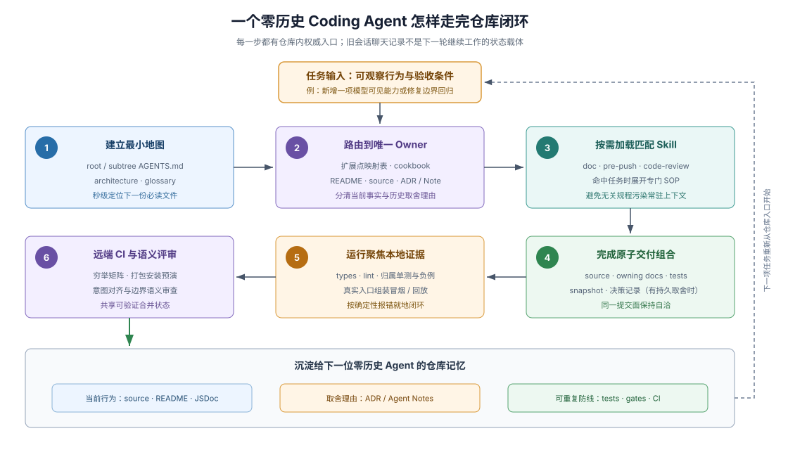

# 01 · 零历史 Agent 参与回路：从陌生仓库到可核验交付

## 零上下文进场是 Agent 时代的默认常态

人类工程师入职后会留在团队里积累默会知识，而 coding agent 每开启一个新会话，面对的都是一座“第一次见”的陌生代码库。如果仓库假设参与者脑子里已经装好了架构红线、历史踩坑与提交流程，fresh agent（零历史进场的编码代理）就只能靠全仓盲搜和统计直觉去猜——猜错位置、漏改关联文档、或者写出一套看似能跑实则违背生命周期约定的补丁。

观察一座仓库是否真正具备 **Development Harness（仓库开发 Harness）**，最直接的方法就是跟踪一个零历史 agent 接手一次真实需求（例如：“新增一项面向调用方或模型的能力，并让前端界面正确展示它”）时，仓库结构如何一步步接住它的六个核心疑问：先读什么、代码挂哪、旧坑在哪、按什么步骤做、怎么自证做对，以及做完后给下一轮留下什么。

下面把这六步拆开：每一节先看 DSH 主仓的具体接应机制，再提炼出适用于任何技术栈仓库的通用结构设计。

## 1. 建立有界最小地图（Bounded Entry Map）

Agent 进场的第一步不是遍历成百上千个源码目录，而是读取根目录受词数预算保护的 `AGENTS.md` 获取全局红线与顶层分区表；发现任务涉及核心包目录后，再顺指针读取 `docs/architecture.md` 与对应子树的 `AGENTS.md`。在架构页里，一张显式的“新行为归属路由表（Where new behavior goes）”直接把需求意图映射到标准扩展接缝，当场阻止 agent 去乱改核心主干循环。

> New behavior attaches to a documented extension point. Changing the loop itself updates this map.
>
> — DSH [`docs/architecture.md` 的行为归属表](https://github.com/deepseek-ai/deepseek-harness/blob/master/docs/architecture.md#where-new-behavior-goes)。这句契约把“优先走既定扩展点、动主干必须同步改地图”变成了架构入口处的第一道分流阀。

**通用仓库迁移法则**：任何项目的根 `AGENTS.md` 都应控制在一屏可读的词数内，并指向一页不讲废话的 `docs/architecture.md`；架构页里必须有一张**「常见需求类型 → 标准挂载入口 / 严禁直接硬改的核心文件」映射表**，让 agent 在写第一行代码前就站对车道。

## 2. 分离读取“当前事实”与“历史取舍理由”

找准扩展机制后，agent 需要弄懂接口细节与边界条件。此时最怕读到一份把“三年前的设计设想”和“现在的真实签名”搅在一起的过期综合文档。DSH 强制把信息拆成互不越界的三类载体：

| 仓库载体 | Agent 从中精确获取什么 | 明确禁止混入什么 |
|---|---|---|
| `architecture` / `cookbook`（操作手册） | 新行为挂在哪个扩展面、按哪几步标准工序接入 | 冗长的历史争论或具体模块的参数细节 |
| 模块 `README` / 导出 `JSDoc` / 源码与类型 | 当前真实接口签名、配置项、失败语义与资源释放责任 | “以前怎么做、后来哪次提交改了”的演进故事 |
| 活跃决策记录（`Agent Note` / ADR） | 为什么选当前方案、哪些看似诱人的备选方案已被击败及原因 | 充当现行 API 的唯一说明书 |

这种物理隔离的收益极其直接：**Agent 既不会从过时的设计故事里抄出早已废弃的 API，也不会因为只看当前源码而把前人特意绕开的死胡同重新发明一遍。**

## 3. 按任务特征动态加载程序化工作记忆（Skills）

根级 `AGENTS.md` 只放每轮必守的常驻硬指令（standing orders）。一旦任务进入带有多分支判断的具体工序——例如重构文档体系、根据待推送差异挑选最小可信测试、或执行深度的代码生命周期审查——agent 就按目录摘要匹配并加载对应的 `.agents/skills/<name>/SKILL.md`（如 `dsh-doc`、`dsh-pre-push-checks`、`dsh-code-review`）。

Skill 既不是聊天记录，也不是死板的布尔脚本：它把资深维护者做某类专门工作时的**先决背景读取清单、高频陷阱排查顺序、豁免边界与诚实报告模板**固化成可按需展开的模块，用完即退，平时零上下文占用。完整设计方法见 [03 · Skills 专章](./03-skills-as-procedural-memory.md)。

## 4. 组装完整的垂直交付切片（Vertical Delivery Slice）

散养状态下的 coding agent 最常交出的半成品是“功能代码跑通了，但文档没改、配置清单漏登记、测试只测了手写 mock、重大设计转向只留在对话气泡里”。成熟的仓库 Harness 会明确定义一次合格交付的闭合边界：

1. **生产实现与生命周期归属**：业务代码与严格类型到位，且所有注册项、监听器或后台句柄都绑定在统一的销毁协议上。
2. **现行契约文档同步**：同一笔提交内同步更新模块 README、公开导出 JSDoc 与受影响的生成目录，确保文档永远描述 `HEAD` 此刻的真实行为。
3. **直达真实入口的行为证据**：不仅有覆盖分支与卸载清理的局部单测，还必须包含走真实配置加载器或应用入口的集成/回放验证，并用独立预期（oracle）检验外部世界结果。
4. **按需沉淀持久决策记录**：如果本笔改动引入了代码、测试和现行文档无法自解释的长期架构取舍，同一笔提交内新增或更新决策记录；纯机械修改或局部呈现调整则明确豁免，不制造文书噪音。

> Add or update an Agent Note in the same PR only for lasting decision rationale that code, tests, and existing documentation do not explain.
>
> — DSH [`.agents/notes/README.md` 的 “When to write one”](https://github.com/deepseek-ai/deepseek-harness/blob/master/.agents/notes/README.md#when-to-write-one)。把决策记忆绑进同一个原子交付切片，同时用清晰豁免门槛卡死形式主义灌水。

## 5. 靠左移分层门禁在本地完成自我纠偏

如果仓库没有本地快速可执行检查，agent 每次犯低级错误都要推上远端等十几分钟 CI 甚至等人类 reviewer 来抓，反馈回路既慢又贵。在 DSH 中，错误被按成本从左向右逐层拦截：

- **毫秒/秒级静态与配置层**：严格编译器检查接口与穷举分支，加载器校验配置合法性，仓库静态门禁（依赖拓扑、导出契约、链接与预算锁）给出带 `文件:行号 + 修复提示` 的非零退出报错；
- **聚焦行为与真实组装层**：根据本次改动触及的真实表面（outgoing scope），定向运行所属单元套件、真实入口组合与录制回放，不靠盲跑全量套件充数；
- **语义评审层**：前面各层只证明各自观测到的机械属性，最终由人或独立评审 agent 对齐任务意图、架构边界与安全假设。分层门禁模式详见 [05 · 可执行反馈](./05-executable-feedback.md)。

## 6. 远端共享校验与跨会话持久交接

本地切片自检通过后进入版本库与协作流水线（如 `.github/workflows/`）：仓库脚本定义“检查什么规则”，远端流水线定义“在受信任权限与跨平台矩阵下如何穷举重验并汇总准入状态”（详见 [卷三：流程参考](../sdlc-reference/00-index.md)）。

更关键的是**这次会话销毁之后仓库里留下了什么**：当明天另一个完全失忆的 fresh agent 接手后续需求时，它根本不需要翻看今天的聊天转录——它从源码与 README 读到最新行为，从决策记录读到今天的取舍与弃案，从测试与录制资产获得防退化护栏，从 `SKILL.md` 复用标准工序。**把单次对话里的临时智力成果持续结晶为仓库结构本身，正是 Agent-Friendly Repo 越用越顺手、而非越改越腐烂的核心秘密。**

## 证据入口

- DSH [`AGENTS.md`](https://github.com/deepseek-ai/deepseek-harness/blob/master/AGENTS.md) 与 [`docs/architecture.md`](https://github.com/deepseek-ai/deepseek-harness/blob/master/docs/architecture.md)：根级常驻指令与“新行为挂哪里”的架构路由表。
- DSH [`docs/cookbook/adding-a-tool.md`](https://github.com/deepseek-ai/deepseek-harness/blob/master/docs/cookbook/adding-a-tool.md)：把单一功能类型的实现、呈现与验证要求串成标准工序的 cookbook 实例。
- DSH [`docs/testing.md`](https://github.com/deepseek-ai/deepseek-harness/blob/master/docs/testing.md)：局部单测、真实入口组装与录制回放的分层证据要求。
- DSH [`.agents/notes/README.md`](https://github.com/deepseek-ai/deepseek-harness/blob/master/.agents/notes/README.md)：持久决策记录的触发判据、局部改动豁免与格式规范。
- DSH [`.agents/skills/dsh-pre-push-checks/SKILL.md`](https://github.com/deepseek-ai/deepseek-harness/blob/master/.agents/skills/dsh-pre-push-checks/SKILL.md) 与 [`dsh-code-review/SKILL.md`](https://github.com/deepseek-ai/deepseek-harness/blob/master/.agents/skills/dsh-code-review/SKILL.md)：聚焦选测与语义评审两项关键开发 Skill。
