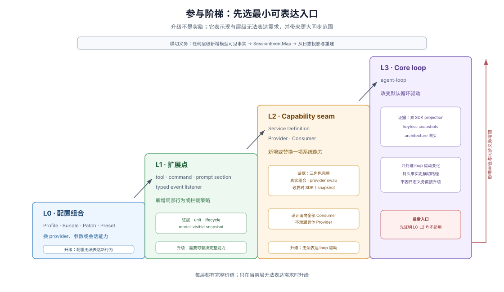

# 04 · 正确路径与改动爆炸半径阶梯

## 仅有可读文档还不够：为什么 Agent 总爱往核心主循环硬塞 `if/else`

文档清晰能让 coding agent 看懂现有代码，却无法自动阻止它走上阻力最小也最伤架构的捷径——在没有明确扩展轨道的仓库里，每来一个新需求，agent 最本能的动作就是打开中央调度大函数，往里再塞一段 `if (options.enableFoo)` 分支和一堆模块级状态变量。十几个 PR 之后，核心主循环就会膨胀成任何局部改动都会引发全局回归的脆弱巨石。

真正对 Agent 友好的架构必须铺设 **paved road（铺装正确路径）**：为高频演进预先留好具名扩展点、标准参考范本、统一的资源卸载协议，以及按**爆炸半径（blast radius）**分级的准入阶梯，让“挂在正确接缝上”比“硬改主干代码”更省上下文、更容易写测试。

> There is no privileged core to patch: you extend dsh by mounting a plugin beside the others, and registrations are effects that unwind when their plugin unloads.
>
> — DSH [`docs/architecture.md`](https://github.com/deepseek-ai/deepseek-harness/blob/master/docs/architecture.md)。这段架构宣言浓缩了铺装路径的两条核心公理：第一，用并列挂载替代修补特权内核；第二，一切注册都是随拥有者卸载自动回卷的受管副作用（effect）。

## 先把“系统现在装了什么”与“刚才发生了什么”彻底拆开

许多代码库难以让 agent 安全落刀，根源在于把“组件装配关系”和“业务执行历史”混在同一个可变大对象里。DSH 在顶层把这两件事交给了两套正交机制，这一拆法适用于任何复杂的事件驱动或插件化系统：

| 正交维度 | 权威状态结构 | 对 Coding Agent 修改代码的直接收益 |
|---|---|---|
| **空间维：当前系统由哪些能力组成？** | 活组件/插件树（live composition tree） | Agent 只需查看装配声明或注册表，就能确认哪些服务实现、拦截器与配置作用域正在生效 |
| **时间维：运行至今已经发生了哪些事实？** | 仅追加事件日志（append-only event log） | 模型输入、界面渲染、断点恢复与审计回放全部从同一份不可变日志纯函数投影，无需猜测散落各处的内存状态 |

核心驱动循环只做两者之间的薄桥梁：从当前装配树读取可用能力，把每次外部交互产生的事实追加进日志。Agent 修改单个扩展组件时，根本不需要通读整个系统的历史状态演进逻辑。

## 通用四级改动爆炸半径阶梯（L0 → L3）

为了让人类与 coding agent 在动手前就对改动代价达成共识，我们可以从 DSH 的架构路由表与扩展食谱中提炼出一套与具体框架无关的 **四级参与阶梯**（本文归纳的通用分层模型；若你正在开发 DSH 插件并需区分 `Profile`、`Bundle` 与 `Preset` 的具体装配语法，见 [卷二核心心智模型](../native-development-model/02-terms-and-mental-models.md)）：

| 爆炸半径层级 | 通用架构落点 | DSH 对应机制样本 | 何时才允许往下一层升级 | 匹配的验证代价 |
|---|---|---|---|---|
| **L0 · 声明式装配层** | 配置文件、环境变量、特性开关或包组合清单 | Profile、Bundle、配置覆盖层、Preset | 纯配置与既有组件排列组合已无法表达新行为 | 配置解析校验 + 启动合成快照核对 |
| **L1 · 叶子扩展点** | 向既有注册表挂载新工具、命令、路由处理器或事件监听器 | `defineTool`、CLI 命令、提示词片段、具名类型事件监听 | 需求不再是单个动作或策略拦截，而是需要一套可整体替换底层实现的抽象能力 | 模块单测 + 卸载清理测试 + 聚焦交互快照 |
| **L2 · 可替换能力接缝（Seam）** | 抽象接口定义 + 至少一个具体后端实现 + 面向接口编程的消费方 | Capability Seam（`Service Definition` + `Provider` + `Consumer`） | 所有既有扩展点与能力接缝都无法表达全新的顶层执行流转语义 | 契约一致性测试 + 真实组装集成测试 + 文档契约同步 |
| **L3 · 核心调度主干** | 修改系统最底层的状态机、事件分发器或主执行循环 | 修改 `agent-loop` 或持久化协议版本 | 已穷尽 L0–L2 并书面证明必须改动内核调度语义 | 全量跨模块回归 + 多端 SDK/快照同步 + 架构文档更新 |

使用这张阶梯时有两条铁律：

1. **低层级不是“低等代码”，高层级也不是“更高级的设计”。** 能在 L0 或 L1 干净解决的需求绝不升入 L2 造一堆多包接口；反过来，确实存在多后端替换需求（如本地文件系统 vs 远程 SSH、内存存储 vs 持久化存储）时，就必须正大光明进入 L2 建完整接缝，绝不在消费方代码里写 `if (backend === 'ssh')`。
2. **持久化与可重建义务横切全部四层，不是升入 L3 的借口。** 在任何一层只要引入了影响下游决策或跨重启恢复的新状态，都必须同步声明对应的持久化事件与日志投影逻辑，而无需触碰 L3 主循环本身。

## 铺装路径的两块工程基石：完整接缝与单一卸载协议

为什么很多仓库明明画了扩展接口，agent 写出来的代码依然耦合严重、热重载必漏资源？DSH 用两条极硬的工程约束堵住了这两个漏洞：

- **能力接缝（Capability Seam）必须三角色齐全，绝不允许只建空壳接口或反向依赖具体实现。** 一个真正的接缝同时包含 `Service Definition`（纯粹的能力契约与类型声明）、`Service Provider`（底层具体实现）和 `Consumer`（只依赖 Definition、对具体 Provider 一无所知的调用方）。Definition 必须服务于所有消费方的共性语义，而不是把某一家底层实现的私有参数原样透传出来；只有三个角色职责在升级节奏上确实独立时才拆包，杜绝为了“显得模块化”制造空心包。
- **全仓只保留唯一一套资源注册与卸载协议。** 无论是注册工具、暴露服务、挂载事件监听还是启动后台定时任务，一律返回标准清理函数（disposer）并绑定到当前组件实例的生命周期作用域上。组件卸载、测试销毁或开发态热替换走完全相同的清理通道——agent 不需要在“正式注册”和“临时挂载”之间记忆两套 API。同时必须在文档中诚实划清物理边界：卸载回调只负责干净回收当前组件拥有的内存注册项、句柄与监听器，**绝不等于外部世界副作用的事务回滚**（已发出的网络请求或已落盘的用户文件若需冲正，必须设计显式的业务补偿逻辑）。

## 如何在自家仓库落地“改动路由表”

想把这套阶梯搬进你自己的仓库，不需要引入任何特定插件框架：只需在 `docs/architecture.md` 里画出一张不超过 15 行的 **“Where new behavior goes（新行为挂接路由表）”**——左列写开发者最常提的 5–8 类需求（如“新增一个外部数据源”“增加一条权限拦截规则”“新加一个 CLI 子命令”），中列写对应的目录落点与可直接照抄的 1 个标杆文件路径，右列写必跑的验证命令。只要这张表永远保持现行，coding agent 从第一轮探索起就会稳稳走在铺好的正确轨道上。

## 证据入口

- DSH [`docs/architecture.md`](https://github.com/deepseek-ai/deepseek-harness/blob/master/docs/architecture.md)：活插件树、仅追加会话日志、能力接缝定义与 “Where new behavior goes” 行为路由表。
- DSH [`docs/glossary.md`](https://github.com/deepseek-ai/deepseek-harness/blob/master/docs/glossary.md#capability-seam)：`Capability Seam` 三角色（Service Definition / Provider / Consumer）的规范定义。
- DSH [`docs/cordis-primer.md`](https://github.com/deepseek-ai/deepseek-harness/blob/master/docs/cordis-primer.md)：组件作用域、事件分发与统一副作用卸载（Effect）的运行时语义。
- DSH [`docs/cookbook/extension-cookbook.md`](https://github.com/deepseek-ai/deepseek-harness/blob/master/docs/cookbook/extension-cookbook.md)：把常见功能需求逐一映射到标准扩展点与验证步骤的食谱入口。
- DSH [`packages/AGENTS.md`](https://github.com/deepseek-ai/deepseek-harness/blob/master/packages/AGENTS.md)：包级角色边界、共享状态归属与卸载幂等测试准则。
