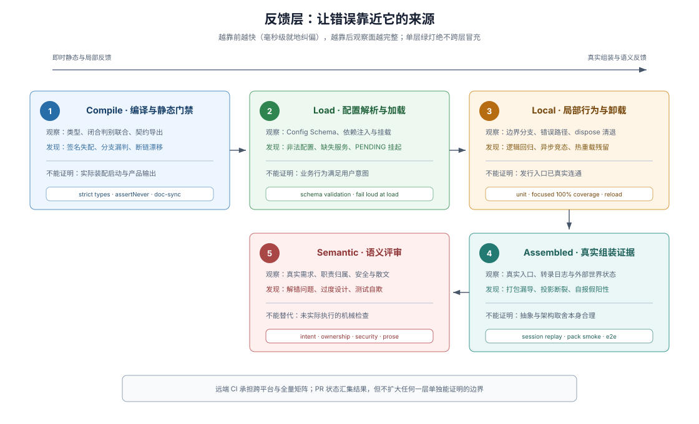

# 05 · 可执行反馈：五层防线、八类反劣化门禁与负例证明

## 文字规则挡不住滑坡，非零退出码才算真正落地

如果仓库规范只停留在 Markdown 段落里，coding agent 写歪之后依然要等人类 reviewer 耗费精力逐行揪错。Agent-Friendly Repo 的核心铁律是：**凡是能用确定性逻辑判定的规则，一律转化为退出码非零的检查命令，并按反馈成本左移到离错误源头最近的一层；只有机器在原理上无法判定的意图与权衡，才留给人类语义评审。**

> Every mechanically checkable AGENTS.md promise gets a command that exits non-zero. CI invokes the exhaustive set, while Git hooks reserve their latency budget for cheap local defects:
>
> — DSH [`Mechanical quality gates over prose guidelines` Agent Note](https://github.com/deepseek-ai/deepseek-harness/blob/master/.agents/notes/archived/process/2026-06-11-quality-gates.md)。这段早期决策确立了双速执行架构：本地 Git 钩子只卡毫秒级低延迟缺陷，远端 CI 负责跑通穷举门禁与跨平台矩阵。

## 五层反馈防线：每一层只证明自己够得着的性质

高可靠的仓库不会迷信单一测试指标（例如“单测覆盖率 100% 所以系统没问题”），而是把验证拆成职责严格正交的五道防线：

| 反馈防线 | 典型工程机制 | 这一层能确切证明什么 | 这一层绝对证明不了什么 |
|---|---|---|---|
| **1. 编译期类型防线** | 严格静态类型、闭合判别联合（`assertNever`）、接口声明合并 | 模块间数据结构对齐、分支穷举无遗漏 | 跨模块真实装配顺序与配置合法性 |
| **2. 加载与解析防线** | 配置 Schema 校验、引用存在性检查、最早可解析点立即报错（Fail Loud） | 非法配置、拼写错误与悬空引用在启动瞬间被拦截 | 模块运行时的异步时序与业务结果正确 |
| **3. 局部行为与生命周期防线** | 模块单元测试、聚焦行/分支覆盖率、动态卸载与重入清理测试 | 单个组件的正负路径、错误包装与资源零泄漏 | 打包后的真实发行入口与多组件联动效果 |
| **4. 真实组装与外部世界防线** | 真实入口冒烟、打包安装预演、确定性回放快照、端到端外部状态断言 | 最终交付物在真实组合下产出符合预期的外部状态 | 架构边界划分是否优雅、是否埋下长期技术债 |
| **5. 人类语义评审防线** | 对齐需求意图的 Code Review、破坏性变更审阅、真实体验验收 | 问题定义准确、取舍代价透明、测试真能锁住回归 | 每一个机械格式与跨文件链接细节都无遗漏 |

五层各司其职意味着：**绝不用昂贵的第 5 层人工评审去抓第 1–3 层机器一秒钟就能拦住的格式、断链和私拉依赖；也绝不用第 3 层全绿的 mock 单测去谎称第 4 层真实打包产物可用。**

## 专治 Coding Agent 八大常见恶习的通用门禁模式

Coding agent 在缺乏硬护栏的代码库里工作时，会表现出惊人一致的偷懒与退化倾向：遇到类型报错就做宽泛强转、图省事跨层私引内部模块、直接手改生成文件凑输出、新增公开函数不写边界契约、改了源码忘改文档示例，或者把根 `AGENTS.md` 越塞越肿。DSH 在 `scripts/` 下将这些高频事故提炼成确定性门禁（由 [`scripts/run-gates.ts`](https://github.com/deepseek-ai/deepseek-harness/blob/master/scripts/run-gates.ts) 统一编排）。任何语言的技术团队都可直接移植以下八类模式：

| 门禁设计模式 | 专治的 Agent 典型退化行为 | DSH 一手实现样本 | 迁移实现与报错信息设计要点 |
|---|---|---|---|
| **1. 棘轮基线锁（Ratchet Baseline）** | 遇到严格类型报错不修根因，顺手做宽泛 `unknown` 强转糊弄过关；存量老债清不完又怕新债继续涨 | [`verify-no-unknown-casts.ts`](https://github.com/deepseek-ai/deepseek-harness/blob/master/scripts/verify-no-unknown-casts.ts) 对照基线指纹锁死存量：新增零容忍，存量只减不增 | 报错精确打印新增违规的 `文件:行号`，并提示应改用类型窄化或边界解析校验 |
| **2. 架构拓扑与依赖方向锁** | 让上层扩展直接 import 某个底层具体实现，或让默认发行物意外混入实验包，或让前端跨领域互引 | [`verify-package-dependencies.ts`](https://github.com/deepseek-ai/deepseek-harness/blob/master/scripts/verify-package-dependencies.ts)、[`verify-default-product-isolation.ts`](https://github.com/deepseek-ai/deepseek-harness/blob/master/scripts/verify-default-product-isolation.ts)、[`verify-client-domain-graph.ts`](https://github.com/deepseek-ai/deepseek-harness/blob/master/scripts/verify-client-domain-graph.ts) | 把“谁只准依赖谁（如只准依赖抽象接口层）”写成静态依赖图断言，违例即非零退出 |
| **3. 文档与源码类型同构锁** | 改了公开函数签名或结构体字段，却漏改文档里的代码块，导致后续 agent 照抄旧文档报错 | `doc-typecheck` 编译文档代码块 + [`verify-type-equiv.ts`](https://github.com/deepseek-ai/deepseek-harness/blob/master/scripts/verify-type-equiv.ts) 校验文档贴出的类型块与源码 AST 等价 | 让文档中的关键接口声明直接参与编译或语法树比对，从根源消灭过期示例代码 |
| **4. 公开契约完整性与反黑话锁** | 导出公共 API 却不写参数/返回值与前置条件，或在注释里堆砌含糊隐喻词与禁用词 | [`verify-export-jsdoc.ts`](https://github.com/deepseek-ai/deepseek-harness/blob/master/scripts/verify-export-jsdoc.ts) 校验公开导出契约注释；[`verify-concrete-terms.ts`](https://github.com/deepseek-ai/deepseek-harness/blob/master/scripts/verify-concrete-terms.ts) 拦截含糊禁用词 | 在包导出边界强制交代行为义务，把团队历史上引发过误解的歧义词加入黑名单 |
| **5. 配置树与包清单双向闭合锁** | 在启动配置里引用了未写进 `dependencies` 的包（本地缓存碰巧能跑、独立安装必挂），或漏填 `exports`/`files` | [`verify-cordis-config.ts`](https://github.com/deepseek-ai/deepseek-harness/blob/master/scripts/verify-cordis-config.ts) 核对配置引用的模块与依赖声明闭合；[`verify-package-meta.ts`](https://github.com/deepseek-ai/deepseek-harness/blob/master/scripts/verify-package-meta.ts) 校验包发布元数据 | 静态打通“源码导出—运行配置—打包清单”三张表，绝不把漏依赖留到用户安装时爆发 |
| **6. 生成目录新鲜度与禁手改锁** | 为图快直接手改生成的接口表或路由清单，下次重跑生成器时改动被静默覆盖 | `gen:*` 生成器配合 `verify:*-catalog` 新鲜度检查（内存重算结果与入库文件逐字节比对） | 报错直接写明“此文件由某某生成器拥有，请修改上游源码并运行指定生成命令” |
| **7. 常驻上下文词数预算锁** | 每次复盘都往根 `AGENTS.md` 塞长篇补丁，导致常驻提示词不断膨胀、稀释核心红线注意力 | [`verify-doc-budgets.ts`](https://github.com/deepseek-ai/deepseek-harness/blob/master/scripts/verify-doc-budgets.ts) 读取 `doc-budgets.manifest.json` 守护常驻文档词数上限 | 超限时强制按 `relocate（迁往专职文档）→ condense（精炼）→ raise（有据提额）` 顺序处置 |
| **8. 封存历史防篡改即时锁** | 全局正则替换时误改已冻结归档的决策记录或历史兼容性快照，污染审计真源 | [`verify-archived-agent-notes.ts`](https://github.com/deepseek-ai/deepseek-harness/blob/master/scripts/verify-archived-agent-notes.ts) 校验冻结文件 SHA-256，并挂入 [`lefthook.yml`](https://github.com/deepseek-ai/deepseek-harness/blob/master/lefthook.yml) 的 `pre-commit` 秒级阻断 | 把零构建前置的哈希防篡改锁前移到本地提交钩子，误碰瞬间即给出红灯 |

这八类门禁真正的精髓在于**把报错输出当成给 Agent 看的精准导航提示词**：每条报错都自带违规坐标、违反的权威规则路径与具体修复动作，让 coding agent 在本地同一轮循环内即可完成自愈。

## 负例证明（Prove-Red）与克制门禁膨胀的真实教训

门禁写得再多，如果自身逻辑有漏洞、面对真故障永远返回 `0`，反而会制造致命的虚假安全感。DSH 对所有新增检查和测试立下了两条硬规矩：

> A guard only guards if the regression fails it. [...] introduce the regression, watch red, revert.
>
> — DSH [`docs/testing.md`](https://github.com/deepseek-ai/deepseek-harness/blob/master/docs/testing.md#test-the-real-entry-path)。新增任何门禁或回归测试时，必须亲手把目标缺陷注入代码、亲眼确认检查变红报错，再撤回故障注入；端到端验证同样必须“验证外部世界而非相信代理自述”（重读磁盘文件、检查持久状态或观测实际进程输出）。

与此同时，好的 Harness 同样敢于**删掉投入产出比失衡的冗余检查层**。DSH 早期曾维护过一套平行的运行时不变量子系统（`@deepseek-ai/dsh-invariants`、各包 `./invariant` 导出与配套门禁），后来在 [`remove-runtime-invariants` 升级指南](https://github.com/deepseek-ai/deepseek-harness/blob/master/docs/upgrade-guide/v0.2.0-rc.2/remove-runtime-invariants/guide.md) 中将其彻底退役，改为由常驻规则、真实入口会话回放快照与语义评审共同守住诸如“模型可见即已记录”的跨层不变量。这一取舍给所有架构师敲响了警钟：**不要在业务代码之外再造一套需要双倍维护的平行运行时断言框架；把静态不变式交给编译与门禁脚本，把动态行为交给真实入口回放测试。**

## 本地聚焦选测与远端 CI 的双层协同

拥有几十条检查命令并不意味着每次改一行文档都要在本地把全仓单测跑一遍。DSH 通过 `dsh-pre-push-checks` Skill 引导 agent 先分析待推送 diff 触碰了哪些包、配置或文档表面，只挑选能精确覆盖该改动面的最小本地检查组合；而 `.github/workflows/` 则在受控权限与干净环境下承担全量覆盖率、跨操作系统矩阵与打包冒烟（本地选测细则见 [门禁与本地检查参考](../sdlc-reference/04-gates-and-local-checks.md)，远端事件编排见 [Issue、PR 与合并生命周期](../sdlc-reference/02-issue-pr-lifecycle.md)，模型请求与外部世界断言规范见 [Agent 契约证据](../sdlc-reference/12-agent-contract-evidence.md)）。

## 证据入口

- DSH [`Mechanical quality gates over prose guidelines` Agent Note](https://github.com/deepseek-ai/deepseek-harness/blob/master/.agents/notes/archived/process/2026-06-11-quality-gates.md)：机械门禁优先于散文劝导、本地低延迟钩子与远端全量 CI 分工的决策原点。
- DSH [`docs/testing.md`](https://github.com/deepseek-ai/deepseek-harness/blob/master/docs/testing.md)：测试分层、真实入口验证、负例控制（Prove-Red）与快照义务。
- DSH [`scripts/run-gates.ts`](https://github.com/deepseek-ai/deepseek-harness/blob/master/scripts/run-gates.ts)、[`verify-no-unknown-casts.ts`](https://github.com/deepseek-ai/deepseek-harness/blob/master/scripts/verify-no-unknown-casts.ts)、[`verify-package-dependencies.ts`](https://github.com/deepseek-ai/deepseek-harness/blob/master/scripts/verify-package-dependencies.ts)、[`verify-type-equiv.ts`](https://github.com/deepseek-ai/deepseek-harness/blob/master/scripts/verify-type-equiv.ts)、[`verify-doc-budgets.ts`](https://github.com/deepseek-ai/deepseek-harness/blob/master/scripts/verify-doc-budgets.ts) 与 [`lefthook.yml`](https://github.com/deepseek-ai/deepseek-harness/blob/master/lefthook.yml)：八类反 Agent 劣化门禁的代表性源码实现。
- DSH [`remove-runtime-invariants` 升级指南](https://github.com/deepseek-ai/deepseek-harness/blob/master/docs/upgrade-guide/v0.2.0-rc.2/remove-runtime-invariants/guide.md)：退役平行运行时不变量框架、回归常驻规则与录制证据的演进实证。
- DSH [`dsh-pre-push-checks`](https://github.com/deepseek-ai/deepseek-harness/blob/master/.agents/skills/dsh-pre-push-checks/SKILL.md) 与 [`.github/workflows/ci.yml`](https://github.com/deepseek-ai/deepseek-harness/blob/master/.github/workflows/ci.yml)：本地按变更面聚焦选测与远端全量 CI 编排的协同边界。
