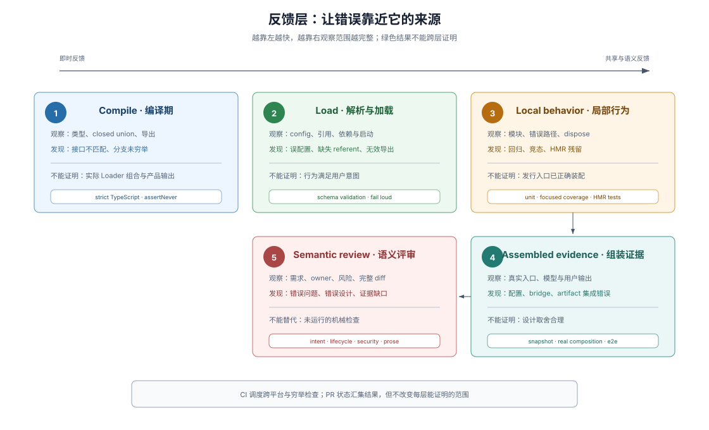

# 05 · 可执行反馈：错误在哪里被发现

## Development Harness 不只提供阅读材料

如果规则只能被阅读，agent 做错后仍要等 review 才知道。DSH 把可机械判断的规则接到类型、load validation（加载校验）、测试和 repository gate（仓库检查），让错误在距离来源较近的位置出现；无法机械判断的语义仍交给 review。

> Every mechanically checkable AGENTS.md promise gets a command that exits non-zero. CI invokes the exhaustive set, while Git hooks reserve their latency budget for cheap local defects:
>
> — DSH [`Mechanical quality gates over prose guidelines` Agent Note](https://github.com/deepseek-ai/deepseek-harness/blob/dsh-v0.2.1-rc.2/.agents/notes/archived/process/2026-06-11-quality-gates.md)。这段决定说明规则怎样从文字进入本地与 CI 的可执行路径。

## 五层反馈各自证明什么

| 反馈层 | 典型机制 | 能证明 | 不能单独证明 |
|---|---|---|---|
| 编译期 | strict TypeScript、closed union、declaration merging | 类型关系和穷举分支成立 | 运行时组合正确 |
| Load / parser | config schema、引用解析、fail loud | 输入在最早可解析点合法 | 行为满足用户意图 |
| 局部行为 | unit tests、focused coverage、HMR disposal tests | 所属模块的正例、错误和生命周期 | 已发行入口与完整产品输出 |
| 组装行为 | snapshots、real composition、built smokes、e2e | 真实入口产生预期外部结果 | 设计选择合理 |
| 语义判断 | code review、用户验收 | 意图、架构、风险和证据是否对齐 | 每个机械细节都已执行 |

每层只拥有自己能够观察的性质。`test:coverage` 为绿不代表产品工作；snapshot 为绿不代表 API 设计合理；review 也不应手工重复已经由绿色 gate 精确拒绝的格式问题。

## 运行时关系由 standing order 与证据维持

DSH 当前版本没有运行时不变量（runtime invariant）机制：`@deepseek-ai/dsh-invariants` 包、各包的 `./invariant` 子路径、`ctx.invariants` 服务、`verify-package-invariants` 与 `verify-built-package-invariants` 门禁、`sdk-minimal` profile 里的 invariant 行都不存在；升级指南见 [`remove-runtime-invariants`](https://github.com/deepseek-ai/deepseek-harness/blob/dsh-v0.2.1-rc.2/docs/upgrade-guide/v0.2.0-rc.2/remove-runtime-invariants/guide.md)。

owner 关系由 standing order、semantic review 与 recorded-session 证据维持。例如根 `AGENTS.md` 的 “Model-visible ⟺ logged” 要求每个 model request 都能从 session log 重建；这条规则由 `docs/architecture.md` 的 Session log 节与录制场景的转录证据支撑，没有运行时比较器代劳。插件仓不要设计 `./invariant` 导出、注入 `ctx.invariants`，或在 `cordis.yml` 里挂同名 companion。

## 负例证明检查真的会失败

> A guard only guards if the regression fails it. [...] introduce the regression, watch red, revert.
>
> — DSH [`docs/testing.md`](https://github.com/deepseek-ai/deepseek-harness/blob/dsh-v0.2.1-rc.2/docs/testing.md#test-the-real-entry-path)。这段规则要求新检查经过 negative control（负例控制），避免一个永远为绿的脚本被误认为保护。

同一原则也要求 e2e “verify the world, not the self-report”：测试重新读取文件、运行命令或观察持久状态，而不相信 agent 声称自己完成了任务。

## 本地检查与 CI 按成本和范围分工

`dsh-pre-push-checks` 先解析 outgoing scope（待推送范围），再为受影响行为选择最小可信证据。Git hooks 保留低延迟检查；GitHub CI 执行穷举 coverage、平台矩阵和较重的真实入口检查。

这不是降低本地标准，而是把反馈按成本和适用范围分工：开发循环先得到相关红灯，远端再验证跨平台和仓库级完整性。精确选择方法见 [Evidence routing 参考](../sdlc-reference/04-gates-and-local-checks.md)。agent 看见的请求、可回放会话和外部世界的原文归属见 [Agent 契约证据](../sdlc-reference/12-agent-contract-evidence.md)。

## `.github/` 是远端反馈执行层

Repository scripts 拥有“检查什么”；`.github/workflows/` 拥有“在什么事件、权限、runner、并发和 job 依赖下运行”。PR status 汇集这些结果，branch protection 或 merge policy 再消费状态。

因此 `.github/` 属于 Development Harness，但不替代本地规则和源码检查。它把仓库已经拥有的证据放入共享协作状态。具体 Issue、PR 和 CI lifecycle 见 [GitHub automation 参考](../sdlc-reference/02-issue-pr-lifecycle.md)。

## Skill、gate 与 review 形成闭环

Skill 帮 agent 决定该查什么和跑什么；gate 对确定条件给出红绿结果；review 检查两者未覆盖的语义。三者不是成熟度不同的同一种工具，而是处理不同类型不确定性的机制。

一个可持续的反馈闭环要求错误信息指出失败对象、违反规则和修正入口。Agent 的下一次行动由实际失败驱动，而不是从无上下文的“检查失败”猜原因。

## 证据入口

- DSH [`quality-gates Agent Note`](https://github.com/deepseek-ai/deepseek-harness/blob/dsh-v0.2.1-rc.2/.agents/notes/archived/process/2026-06-11-quality-gates.md)：机械规则、本地 hooks 和 CI 穷举路径的决策理由。
- DSH [`docs/testing.md`](https://github.com/deepseek-ai/deepseek-harness/blob/dsh-v0.2.1-rc.2/docs/testing.md)：test tiers、真实入口、negative control 和 snapshot 义务。
- DSH [`scripts/run-gates.ts`](https://github.com/deepseek-ai/deepseek-harness/blob/dsh-v0.2.1-rc.2/scripts/run-gates.ts)：仓库检查逻辑的聚合入口。
- DSH [`remove-runtime-invariants` 升级指南](https://github.com/deepseek-ai/deepseek-harness/blob/dsh-v0.2.1-rc.2/docs/upgrade-guide/v0.2.0-rc.2/remove-runtime-invariants/guide.md)：被删除的包、子路径、服务与 profile 行，以及迁移步骤。
- DSH [`.github/workflows/ci.yml`](https://github.com/deepseek-ai/deepseek-harness/blob/dsh-v0.2.1-rc.2/.github/workflows/ci.yml)：PR CI 的触发、job、runner 和依赖关系。
- DSH [`dsh-pre-push-checks`](https://github.com/deepseek-ai/deepseek-harness/blob/dsh-v0.2.1-rc.2/.agents/skills/dsh-pre-push-checks/SKILL.md)：按实际差异选择本地证据的程序化判断。
- DSH [`dsh-code-review`](https://github.com/deepseek-ai/deepseek-harness/blob/dsh-v0.2.1-rc.2/.agents/skills/dsh-code-review/SKILL.md)：自动检查之外的 correctness、lifecycle、security 与 semantic review。
