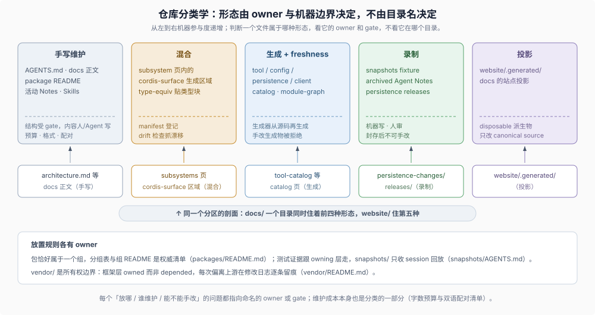

# 08 · 仓库分类学：顶层分区、五种维护形态与三道防代码腐化契约

## 目录树是严格的分类系统，不是按时间堆叠的储物间

大型代码库最隐蔽的腐化往往不是某行逻辑写错，而是**分类失序**：同一份模块清单在两处手抄、机器生成的文件被顺手硬改、组件的期望测试输出全塞进一个无人认领的顶层杂物目录，或者代码里到处长出名叫 `Manager` / `Helper` 的万能大类。一旦分类失序，每次从零启动的 coding agent 就会把旧垃圾当成新范本继续复制放大。

Agent-Friendly Repo 的解法是把整座仓库建成一套**边界可验证的分类学（Repository Taxonomy）**：顶层目录各拥唯一规则文件，业务模块恰好归属一个领域组，所有文档与数据按维护方式划入五种形态，代码内部则用精确的角色词典、显式边界解析与上下文预算守住微观结构。

## 1. 顶层分区：每个目录都有点名道姓的规则 Owner

在任何多模块仓库中，消除“新文件该往哪放”争议的最短路径，是为每一个顶层分区指定唯一一份成文规则文件。以 DSH 主仓为例，十类顶层分区各自拥有清晰的管辖权与门禁：

| 顶层分区 | 唯一承载的资产类别 | 权威规则 Owner |
|---|---|---|
| `packages/<group>/<pkg>` | 核心与扩展包源码（每个 `@deepseek-ai/dsh-*` 工作区包） | `packages/README.md` 分组总表与 `packages/AGENTS.md` |
| `apps/` | 产品受支持的应用宿主入口（Web、Desktop、CLI 配置包） | 根 `AGENTS.md`（仅受支持的 `dsh` profile 可作为应用启动入口） |
| `vendor/` | 固定版本并受仓库完全掌控的底层框架源码副本 | `vendor/README.md` 上游版本清单与穷举本地修改日志 |
| `python/`、`native/` | 独立发布车道的跨语言 SDK/运行时与原生系统扩展源码 | `python/README.md`、`native/README.md` |
| `docs/` | 全部手写、混合与源码生成的技术文档（含双语配对） | `docs/AGENTS.md` 层级分类法与预算规则 |
| `.agents/` | 持久决策记录（Agent Notes）与按需任务工作流（Skills） | `.agents/notes/README.md` 与各 `SKILL.md` |
| `.github/` | 远端事件编排面：CI/发布工作流、Issue 策略、模板与评审归属 | `.github/AGENTS.md` 与各 workflow 定义 |
| `scripts/` | 仓库级确定性门禁（Gates）与源码驱动目录生成器 | `scripts/AGENTS.md` 与 `scripts/run-gates.ts` |
| `snapshots/` | 仅限以会话 JSONL 兼作回放输入与持久化预期的测试资产 | `snapshots/AGENTS.md` |
| `benchmarks/`、`website/`、`patches/` | 性能回归门禁、文档站点静态投影构建、第三方依赖补丁 | 各分区根目录 README |

## 2. 模块分组、演进承诺与单向依赖拓扑

在源码分区内部，怎样防止包越拆越乱、实验代码悄悄污染核心发行物？DSH 在 `packages/README.md` 中用三条可迁移到任何 monorepo 的分类规则锁死了模块秩序：

> Every package lives in exactly one group; new packages join existing groups, and a new group updates its own README and this table.
>
> — DSH [`packages/README.md` 的 “Package groups”](https://github.com/deepseek-ai/deepseek-harness/blob/master/packages/README.md#package-groups)。每个包恰好属于一个分组目录，组内 README 即该家族的权威成员表，从结构上杜绝孤儿包与跨组重名。

> Product groups have maintained product roles, while their public APIs remain pre-stable. Experimental status is independent of publication, installation, and optional delivery. Nonexperimental runtime packages must have product use or an explicit package classification; SDK, build, test, and declaration infrastructure have separate classifications.
>
> — DSH [`packages/README.md` 的 “Release expectations”](https://github.com/deepseek-ai/deepseek-harness/blob/master/packages/README.md#release-expectations)。把“能力是否处于实验评估期（experimental）”“是否随默认产品交付（optional）”和“包的基础设施角色”彻底解耦，并由静态策略脚本强制每个非实验运行时包具备明确的产品消费方或基础设施分类，不给无人使用的僵尸包留生存空间。

> Extension plugins depend on Service Definitions, never concrete providers.
>
> — DSH [`packages/README.md` 的 “Dependencies”](https://github.com/deepseek-ai/deepseek-harness/blob/master/packages/README.md#dependencies)。依赖方向直接内嵌进包分类体系：扩展消费方只准依赖抽象 `Service Definition`，严禁直接依赖具体 `Provider`，从而保证底层实现替换永远只是配置层选择。

## 3. 仓库文件的五种维护形态（消灭“半手工半生成”泥潭）

coding agent 最常制造的事故之一，是分不清某个文件该手改还是该跑脚本重生成。成熟的仓库会把所有非源码内容严格归入以下**五种互斥维护形态**，并为每种形态配齐专属机器边界：

| 维护形态 | 典型仓库资产样本 | 机器强制边界 |
|---|---|---|
| **1. 纯手写维护** | `AGENTS.md`、架构与子系统说明、模块 README、活跃决策记录、Skills | 内容由人或 agent 编写，但词数上限、链接锚点、段落折行与结构契约受门禁硬校验 |
| **2. 纯生成 + 新鲜度锁** | 工具/配置/持久化/客户端目录、依赖图谱、Cordis API 参考、CLI 帮助索引 | 100% 由源码再生成；新鲜度门禁重算比对，任何人工手改字节立即报错拒绝 |
| **3. 混合嵌块（手写 + 生成/同构区）** | 子系统文档内的 `cordis-surface` 生成区块；文档中标注 `type-equiv` / `public-api` 的源码类型块 | 手写散文与生成区域边界清晰登记；嵌块与真实源码声明做 AST 等价性比对防漂移 |
| **4. 录制与封存（写后即冻结）** | `snapshots/` 会话回放夹具、`.agents/notes/archived/` 封存决策、已发布持久化快照 | 由录制工具或封存流程生成并经人工审阅入库；封存后严禁原地手改（演进只加新世代） |
| **5. 可丢弃投影（Disposable Projection）** | `website/.generated/` 静态站点构建输入与产物 | 纯粹由上游权威源文件单向派生的构建期副产物，随时可清空重建，绝不逆向回写 |

> Exhaustive English sources regenerated from source and freshness-gated; reviewed Chinese counterparts follow the pairing workflow
>
> — DSH [`docs/AGENTS.md` tier 表的生成 reference 行](https://github.com/deepseek-ai/deepseek-harness/blob/master/docs/AGENTS.md#the-tier-taxonomy-one-home-per-fact)。同一行明确禁止对生成英文源或生成区块做任何手工编辑；配合 `scripts/doc-budgets.manifest.json` 的词数护栏与 `scripts/translation-pairing.manifest.json` 的双语范围清单（细节见 [散文与文档标准参考](../sdlc-reference/05-prose-doc-standards.md)），五种形态各行其道。

## 4. 测试夹具就近归属与 Vendoring 所有权边界

分类学同样决定了**测试期望输出**和**第三方底层代码**的安放方式：

- **测试预期资产跟着被测模块走，绝不把顶层目录变成杂物间。** DSH 对顶层 `snapshots/` 立下了极严的准入红线：

> This tree contains only tests whose committed session JSONL is replay input and expected persisted output. Keep non-session ARIA, geometry, generator, CLI, and unit expected output with its owning app, script, or package; use `test:expected`, `test:web`, or `test` for its owning tier.
>
> — DSH [`snapshots/AGENTS.md`](https://github.com/deepseek-ai/deepseek-harness/blob/master/snapshots/AGENTS.md)。只有完整会话回放才进顶层 `snapshots/`（且已入库世代作为归一化不动点，只增新世代不删改旧世代）；其余生成器、CLI 或组件级期望文件一律就近留在各自所属包内。

- **Vendoring（源码内嵌）的本质是接管完整所有权与分叉审计义务。** 当项目决定把关键底层库直接拷入 `vendor/` 而非走外部包管理器安装时，买下的是可审计、可打补丁的完全控制权，同时必须承担逐条登记分叉的代价：

> They are copied into this monorepo instead of being depended on via npm, so that the harness fully owns its framework layer (auditable, patchable, pinned).
>
> — DSH [`vendor/README.md`](https://github.com/deepseek-ai/deepseek-harness/blob/master/vendor/README.md)。

> Keep this log exhaustive — every divergence from upstream must be listed.
>
> — DSH [`vendor/README.md` 的 “Local modifications”](https://github.com/deepseek-ai/deepseek-harness/blob/master/vendor/README.md#local-modifications)。上游提交 SHA 清单与穷举本地修改日志缺一不可，防止未来同步上游时把本地关键修复静默冲掉。

## 5. 跨仓库分类一致性为什么能成倍放大 Agent 效率

当一个技术团队维护多座关联仓库（例如微服务群，或宿主平台与多个外部扩展仓库）时，统一的目录与维护形态分类会产生显著的复利效应：coding agent 在 A 仓建立的检索路径（去 `architecture.md` 找扩展落点、去决策目录查历史取舍、看清生成区标记不手改、在模块旁找期望夹具）无需重新摸索即可直接复用到 B 仓。宿主平台如何把这种可读性主动延伸给外部生态仓库，见 [第 9 章](./09-plugin-author-entry.md)。

## 6. 从宏观目录深入到微观代码结构

管住了文件放哪，只赢了一半。如果打开单个模块源码，里面全是职责含糊的 `Helper`、层层嵌套的冗余空值兜底和无人记账的大段提示词拼接，代码库依然会在内部迅速板结。因此分类学必须向下延伸到模块与类级别的设计契约。

## 7. 代码与模块契约：防 Agent 写腐化的三道防线

DSH 在包级规则（[`packages/AGENTS.md`](https://github.com/deepseek-ai/deepseek-harness/blob/master/packages/AGENTS.md)）、建包食谱（[`adding-a-package.md`](https://github.com/deepseek-ai/deepseek-harness/blob/master/docs/cookbook/adding-a-package.md)）与按制品路由的防御模式库（[`docs/defensive-patterns/`](https://github.com/deepseek-ai/deepseek-harness/blob/master/docs/defensive-patterns/README.md)）中，建立起三道可迁移到任何软件与 AI 工程仓库的微观防腐防线：

### 防线一：16 类组件角色精确命名词典，封杀含糊的 `Manager / Helper`

Coding agent 最偷懒的习惯就是随手起名 `SessionManager`、`DataHelper`、`ToolUtils`，随后把存储、鉴权、调度和格式化全塞进同一个文件。DSH 在 [`adding-a-package.md` 的 “Name the role that exists”](https://github.com/deepseek-ai/deepseek-harness/blob/master/docs/cookbook/adding-a-package.md#name-the-role-that-exists) 中规定了一套互斥的 16 类角色后缀词典，要求类名与依赖注入键的单复数诚实反映职责（单个引擎/策略/存储用单数，动态注册集合用复数），并严禁新增模块级全局可变状态（`globalThis`、`Symbol.for` 或顶层可变缓存）：

| 角色词族 | 各后缀的精确职责契约（何时采用 / 严禁混入什么） |
|---|---|
| **状态与集合**：`Store` / `Directory` / `Registry` / `Config` | `Store` 只拥有单一数据集的读写快照与变更订阅（内部有个 `Map` 不代表它是 Store，严禁掺杂权限裁决或任务执行）；`Directory` 只提供只读发现元数据；`Registry` 管理动态命名成员的注册、优先级与卸载回卷；`Config` 只承载已解析配置及其更新契约 |
| **调度与执行**：`Controller` / `Runtime` / `Engine` / `Executor` | `Controller` 接收外部命令推进单一领域或界面状态；`Runtime` 跨多次调用管理活任务、取消信号与生命周期；`Engine` 实现纯粹的领域算法或状态机；`Executor` 在单一能力内执行一份已完成默认值解析的请求规格（`Spec`） |
| **边界与胶水**：`Policy` / `Resolver` / `Binder` / `Presenter` / `Gateway` | `Policy` 只回答允许/拒绝/配额裁决，绝不亲自执行被放行的操作；`Resolver` 无状态地从输入推导唯一结果；`Binder` 将能力绑定到调用方生命周期；`Presenter` 纯函数把领域数据映射为界面渲染意图（零 I/O、零副作用）；`Gateway` 封装跨进程、IPC 或网络传输边界 |
| **可替换分层**：`Provider` / `Backend` / `Handle` / `Service` | `Provider` 实现某项抽象能力定义的具体方案（多实现共存时冠以机制名）；`Backend` 承载接口背后的底层存储或传输通道；`Handle` 控制单个已打开的活资源实例（而非资源池）；仅当以上 15 个精确词均不贴切时才退回通用的 `Service` |

### 防线二：内部信编译器、跨边界显式 `resolve`、状态只在提交点发布

为了根治 coding agent“在安全内部狂写无意义类型判空，在危险异步边界却漏掉状态竞态”的通病，DSH 强制执行三条编码铁律：

1. **同进程类型边界信任静态类型，只在真实外部边界做解析校验与显式默认值收口。** 根 [`AGENTS.md` 的 Conventions](https://github.com/deepseek-ai/deepseek-harness/blob/master/AGENTS.md#conventions) 明确禁止为同进程静态类型已排除的非法值编写防御兜底或敌意单测；校验集中放在配置解析、队列、模型/工具 JSON、持久化文件、worker、子进程与网络边界。跨包参数的默认值必须收敛在显式的 `resolve(request): Spec` 阶段，严禁把隐式 `?? defaultValue` 藏进底层 `run()` 函数深处。
2. **权限在真正执行点强制，事件与派生状态只在成功提交点（Commit Point）发布。** [`packages/AGENTS.md`](https://github.com/deepseek-ai/deepseek-harness/blob/master/packages/AGENTS.md) 规定：安全与配额检查必须守在真正执行动作的底层入口（仅靠裁剪提示词或隐藏上层按钮不算强制）；任何状态变更通知只能在底层操作**确已成功完成后**发出，严禁使用 `setTimeout` 或 `queueMicrotask` 凑异步顺序。
3. **防御性审查规则按改动制品定向挂载。** [`docs/defensive-patterns/README.md`](https://github.com/deepseek-ai/deepseek-harness/blob/master/docs/defensive-patterns/README.md#why-these-rules) 将历史真实故障浓缩为按“包表面 / 远端服务 / 前端组件 / 会话读取 / 异步与子进程”拆分的五份专页，让开发与评审 agent 按当前触碰的制品精准对号入座，而不是泛泛空谈代码质量。

### 防线三：`Model Experience` 上下文预算记账与工具描述极简五律

对于任何包含 LLM 或 Agent 能力的系统，最昂贵的隐性腐化是**提示词与工具 Schema 无节制膨胀并破坏前缀 KV Cache 复用**。DSH 将上下文成本直接纳入模块级静态门禁：

- **模块文档的 `## Model Experience` 强审计**：[`adding-a-package.md`](https://github.com/deepseek-ai/deepseek-harness/blob/master/docs/cookbook/adding-a-package.md#4-write-the-package-readme) 与门禁 [`verify-package-readme-model-experience.ts`](https://github.com/deepseek-ai/deepseek-harness/blob/master/scripts/verify-package-readme-model-experience.ts) 要求每个包固定交代 `What the model sees`（模型看见的精确文本或目录锚点）、`Token effect`（固定/条件/上限成本）与 `KV Cache effect`（是否保持前缀稳定只追加，哪些配置变动会导致缓存失效）；即使完全不触碰模型上下文的纯底层包，也必须显式写出受门禁校验的 `None, as ...` 或 `Indirectly, through ...` 声明。
- **`agent-experience` 工具定义极简五律**：[`.agents/skills/agent-experience/SKILL.md`](https://github.com/deepseek-ai/deepseek-harness/blob/master/.agents/skills/agent-experience/SKILL.md) 给出了任何 Agent 应用都可直接照搬的工具 Schema 瘦身法则：① 删掉调用报错自然会反馈给模型的显而易见常识；② 只写外部契约，不泄露内部实现细节；③ 参数范围与配对关系就近挂在对应参数字段上；④ 同一条事实绝不在系统提示词与工具描述里说两遍；⑤ 修改工具定义前后实测比对首轮 prompt token 净增减。

## 证据入口

- DSH [`packages/README.md`](https://github.com/deepseek-ai/deepseek-harness/blob/master/packages/README.md) 与 [`packages/experimental/README.md` 的 “Experimental, optional, and Official”](https://github.com/deepseek-ai/deepseek-harness/blob/master/packages/experimental/README.md#status)：包分组唯一性、实验/可选/官方三态解耦与单向依赖规则。
- DSH [`docs/AGENTS.md`](https://github.com/deepseek-ai/deepseek-harness/blob/master/docs/AGENTS.md)、[`scripts/doc-budgets.manifest.json`](https://github.com/deepseek-ai/deepseek-harness/blob/master/scripts/doc-budgets.manifest.json) 与 [`scripts/translation-pairing.manifest.json`](https://github.com/deepseek-ai/deepseek-harness/blob/master/scripts/translation-pairing.manifest.json)：五种文档维护形态、生成物禁手改红线与预算/配对清单。
- DSH [`snapshots/AGENTS.md`](https://github.com/deepseek-ai/deepseek-harness/blob/master/snapshots/AGENTS.md) 与 [`vendor/README.md`](https://github.com/deepseek-ai/deepseek-harness/blob/master/vendor/README.md)：测试夹具就近归属原则与 vendoring 穷举分叉日志契约。
- DSH [`packages/AGENTS.md`](https://github.com/deepseek-ai/deepseek-harness/blob/master/packages/AGENTS.md)、[`docs/cookbook/adding-a-package.md`](https://github.com/deepseek-ai/deepseek-harness/blob/master/docs/cookbook/adding-a-package.md)、[`docs/defensive-patterns/README.md`](https://github.com/deepseek-ai/deepseek-harness/blob/master/docs/defensive-patterns/README.md) 与 [`.agents/skills/agent-experience/SKILL.md`](https://github.com/deepseek-ai/deepseek-harness/blob/master/.agents/skills/agent-experience/SKILL.md)：16 类角色后缀词典、显式边界解析、提交点状态发布与 `Model Experience` 记账规范。
