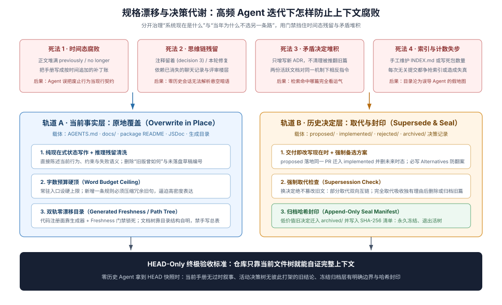

# 11 · 长周期防规格漂移与决策新陈代谢

## 第 1 天建好的 Agent-Friendly Repo，为什么半年后还会腐烂

许多团队满怀热情搭好了 `AGENTS.md`、架构文档和 ADR 目录，前两个月体验极佳；但随着几十个 coding agent 会话、上百个 PR 滚过之后，仓库又重新陷入混乱：注释里到处写着 `previously we used X`、`decision 7`、`this PR adds` 等死无对证的会话黑话；旧架构早已被推翻，但老的设计记录还躺在现行目录里误导新来的 agent；或者决策文档攒了大几百篇，每篇单看都没错，却把检索信噪比冲得稀碎。

要让一座以 Agent 为主力的代码库在半年、一年乃至数千次提交后依然清爽锋利，就必须为仓库装上**抗老化与新陈代谢机制（Anti-Drift & Decision Metabolism）**。第一步是把统称为“文档腐烂”的现象拆解为四种机理完全不同的病理，对症下药：

| 老化病理 | 病灶所在载体 | 典型临床症状 | 对症治理机制 |
|---|---|---|---|
| **1. 会话上下文腐化（Context Decay）** | 单次长对话或跨轮压缩后的模型可见面 | 模型把三小时前已被推翻的假设当成现状，或自动摘要把关键边界条件吞掉了 | 会话只当临时缓存，持久事实及时落盘入库；运行时采用“仅追加日志 + 丢弃过期事实的结构化重写压缩”（DSH 会话层实现细节见 [卷二第 3 章](../native-development-model/03-context-and-drift.md)） |
| **2. 规格漂移与推理残渣（Spec Drift & CoT Leakage）** | 现行 README、模块注释、架构文档 | 代码改了但第二处手抄文档没改；或注释站在某次临时会话视角写满“以前怎样、本轮怎样” | 单一事实归属 + 事实原地改为现在时 + 清理会话推理残渣（本章 §1） |
| **3. 方向反复失忆（Undocumented Reversal）** | 历史决策记录的演进方式 | 有人直接把旧 ADR 原地涂改成相反结论，导致半年后新 agent 不知前车之鉴又把坑重踩一遍 | 事实原地改，但**决定严禁原地改写**——必须新开后继记录并强制执行取代检查（本章 §2） |
| **4. 存量记忆淤积（Corpus Bloat）** | 活跃决策目录的总体积 | 几百篇早已完成历史使命的细碎记录全部留在活跃区，淹没真正仍有约束力的核心契约 | 严控新建门槛 + 按“未来决策指导价值”定期语义裁剪与哈希冻结归档（本章 §3） |

## 1. 现行表面保鲜：原地更新事实，彻底刮除“会话推理残渣”

为什么 coding agent 写出来的注释和文档特别容易在一两个月后读起来像天书？因为模型默认站在**“当前这一次对话/这一个 PR”的临时视角**说话，而不是站在**“半年后检出仓库 `HEAD` 的陌生维护者”视角**说话。DSH 将这种顽疾精准命名为 **Chain-of-Thought Leakage（思维链/会话推理残渣泄漏）**，并在文档标准与专门 Skill 中立下了极硬的清洗铁律：

> Status rots; the repo layout and package manifests carry it.
>
> — DSH [`docs/AGENTS.md` 的 slop checklist](https://github.com/deepseek-ai/deepseek-harness/blob/master/docs/AGENTS.md#the-slop-checklist)。模块状态、文件列表和导出清单由目录结构、包清单与源码生成器承载；散文里严禁手抄易腐化的进度账。

> Keep paths, symbols, defaults, and mechanisms current in the same change that alters them. Rewrite stale facts in place; do not append change history.
>
> — DSH [`.agents/notes/implemented/AGENTS.md`](https://github.com/deepseek-ai/deepseek-harness/blob/master/.agents/notes/implemented/AGENTS.md)。当某个路径、符号或默认值随代码变更而改变时，必须在同一个 PR 里将现行文档中的旧事实**直接原地改写为当前事实**，绝不在后面追加“注：从某月起已改为……”。

> Chain-of-thought leakage is prose whose vantage is the authoring session rather than the repository: it cites artifacts only that session could see, narrates the change instead of the state, or argues with a reviewer who has left.
>
> — DSH [`dsh-trim-cot-leakage`](https://github.com/deepseek-ai/deepseek-harness/blob/master/.agents/skills/dsh-trim-cot-leakage/SKILL.md)。

> For every suspect passage ask: **could a reader at HEAD, with no access to any session transcript, PR thread, or uncommitted draft, resolve every reference and verify every claim?**
>
> — DSH [`dsh-trim-cot-leakage`](https://github.com/deepseek-ai/deepseek-harness/blob/master/.agents/skills/dsh-trim-cot-leakage/SKILL.md)。这一问是检验任何代码注释、JSDoc 和现行文档是否干净的黄金试金石。

任何技术团队都可以直接把 DSH 总结的常见推理残渣列为 Code Review 与自检清单，一经发现立即改写为 `HEAD` 当前态命题或直接删除：

- **死无对证的草稿编号**：如 `(decision 7)`、`audit C2`、`design §4.7`——若对应已入库文档则改为真实路径链接，否则直接剥离编号、只留自足的技术事实。
- **堆栈与提交相对视角**：如 `this PR adds`、`a later PR in this stack`、`the previous commit`——直接陈述当前已交付的机制，未完待办改标明确的 `TODO` 或 Issue 编号。
- **现行文档里的变更叙事**：如 `used to`、`no longer`、`this cut`——现行表面只写现在怎样工作；为了防回归而保留的警示统一写成现在时反事实句式（“若缺少 X，会发生 Y”），而不是仓库编年史（“以前曾发生 Y”）。
- **面向特定评审人的辩解与敷衍留白**：如注释里写 `Rejected in review:`、`this cast is safe because it simply...` 或 `probably fine for now`——删掉对话戏份与含糊托词，只保留支撑代码安全性的客观不变式或真实边界值。

（注意区分禁区：能解析的真实 Issue 编号、静态检查禁用理由 `oxlint-disable -- reason`、实测性能标定值 `measured: ...` 以及描述连接排空等**运行时新旧状态流转**的术语属于合法技术事实，绝不能在清理残渣时误删。）

## 2. 决定严禁原地涂改：反转必开新篇 + 强制取代检查（Supersession Check）

既然路径和默认值等“事实”要原地改写，那如果团队推翻了三个月前的一项架构决定，能不能也把当年那篇 ADR 原地改成相反的结论？**绝对不行。** 把“为什么选 A”的旧记录原地涂改成“为什么选 B”，等于亲手抹掉了历史决策边界与当年踩过的坑。DSH 对“事实更新”与“决定反转”采取了截然不同的版本化协议：

> A reversal of the decision or its rationale requires a new Agent Note and cross-link; a fully superseded old note may be deleted only through the consolidation rule in the Agent Note rules.
>
> — DSH [`.agents/notes/implemented/AGENTS.md`](https://github.com/deepseek-ai/deepseek-harness/blob/master/.agents/notes/implemented/AGENTS.md)。只要结论或核心理由发生反转，就必须新写一篇决策记录并与旧记录建立双向链接；只有当新记录完整吸收了旧记录全部独特理由、备选、后果与验证契约时，才允许按合并规则移除完全被取代的旧篇。

更重要的是，为了防止“新篇写了、旧篇却忘了处理，结果活跃目录里同时躺着两份唱反调的红头文件”，DSH 把**取代检查（Supersession Check）**定为了每次新增决策记录时的强制同步动作：

> Every new Agent Note triggers a supersession check. Search the active tree for older notes covering the same decision or mechanism, classify any full or partial supersession with dsh-archive-agent-notes, and archive every qualifying implemented triplet in the same PR. Keep partial supersessions active and cross-linked.
>
> — DSH [`.agents/notes/AGENTS.md`](https://github.com/deepseek-ai/deepseek-harness/blob/master/.agents/notes/AGENTS.md)。在同一个 PR 里检索同主题旧记录：若只是部分取代（例如只换了默认传输层，核心语义仍由旧篇定义），两篇同留活跃区并标明各自管辖范围；若旧篇使命已尽，当场归档封存或吸收合并，绝不把矛盾留给下一个会话的 agent 去猜。

## 3. 存量记忆新陈代谢：按“未来指导价值”裁剪与冻结归档

即便每篇决策记录都真实有效，随着项目演进到上千次提交，活跃决策目录也会膨胀到难以检索。很多团队要么完全不敢删，要么按“超过半年一刀切归档”或“超过 1000 字就砍”的机械指标乱删。DSH 给出了极具洞察力的语义新陈代谢准则：

> Reduce the active decision corpus without erasing history that can still guide work. Judge every note semantically; word count and age are discovery aids, never archive criteria.
>
> — DSH [`dsh-archive-agent-notes`](https://github.com/deepseek-ai/deepseek-harness/blob/master/.agents/skills/dsh-archive-agent-notes/SKILL.md)。决定一篇记录留在活跃区、迁入封存归档区还是直接删除的唯一标尺，是**它对未来的修改是否仍具备决策指导价值**：

1. **留在活跃区（Keep Active）**：只要它记录的架构边界、持久化/线协议兼容承诺、安全红线、负向保证（明确不做什么）或“未来在什么前提下才允许重新引入某功能”仍会约束后续开发，哪怕全文只有 250 词、写于一年前，也必须留在活跃区；同理，一个**被否决的诱人方案（`rejected`）**只要未来仍很容易被新 agent 反复重提，就作为防重犯护栏继续保留。
2. **迁入冻结归档区（Archive & Seal）**：某项实质性历史决策已经完整落地、不太可能再指导未来日常修改，但保留当年背景仍有历史查考价值时，迁入 `archived/` 并在头部打上归档日期戳，用 SHA-256 清单永久封存——此后只作为只读历史快照供刻意溯源引用，严禁再做任何字面修改，也不再充当现行行为权威（完整状态机见 [Agent Note 生命周期参考](../sdlc-reference/01-agent-note-lifecycle.md)）。
3. **直接清理删除（Delete）**：当初误写的纯机械重构流水账、早已闭环的微小界面微调，或者前提早已随架构演进而彻底消失、再也不会有人重提的被拒提案，直接删除并修好入站链接，不让垃圾进归档区继续占地方。

## 4. DSH 真实历史演进实证：五类方向转向与单次 453 组大归档

这套新陈代谢制度在 DSH 主仓并非纸面口号，而是经受住了高频转向与大规模清理的实战检验：

| 真实演进场景 | 具体架构转向事件 | 仓库记忆的实际处置方式 |
|---|---|---|
| **诱人提案被否决** | 用运行时 Schema 注册表替代编译期类型事件映射的提案经评估被拒 | 迁入 [`rejected/architecture/2026-06-16-typed-event-schemas.md`](https://github.com/deepseek-ai/deepseek-harness/blob/master/.agents/notes/rejected/architecture/2026-06-16-typed-event-schemas.md)，作为阻止后人重走动态事件老路的长期护栏 |
| **跨篇部分取代** | 实验包依赖策略仅接管另一篇通用依赖政策中的包选型子条款 | 新篇 [`2026-10-14-experimental-dependency-policy.md`](https://github.com/deepseek-ai/deepseek-harness/blob/master/.agents/notes/implemented/process/2026-10-14-experimental-dependency-policy.md) 头部精确划定取代边界，明确保留原篇其余条款继续生效 |
| **底层机制整体换代** | CLI 源码直跑方案从 Node 原生 TypeScript 模式切换为 `tsx/esm` 钩子 | 现行篇 [`2026-07-29-dsh-source-launch-tsx-esm.md`](https://github.com/deepseek-ai/deepseek-harness/blob/master/.agents/notes/implemented/architecture/2026-07-29-dsh-source-launch-tsx-esm.md) 接管权威叙述，旧篇迁入 [`archived/`](https://github.com/deepseek-ai/deepseek-harness/blob/master/.agents/notes/archived/architecture/2026-07-28-dsh-native-typescript-source-launch.md) 互链备查 |
| **已交付重量级组件退役** | PR #3339（2026-08-31，`refactor(session)!: remove SQLite persistence backend`）彻底移除第一方 SQLite 会话存储后端 | 旧设计记录封存归档；后继篇 [`2026-08-30-jsonl-only-session-persistence.md`](https://github.com/deepseek-ai/deepseek-harness/blob/master/.agents/notes/implemented/simplification/2026-08-30-jsonl-only-session-persistence.md) 完整记录原始动机、放弃的能力与未来重新引入的硬前提 |
| **上线特性次日回滚** | PR #3906 引入的性能变更在次日由 PR #4442（2026-09-17）整体回滚 | 随该特性新建的记录与实现代码一并移除，同日将此前被归档的前序记录按原内容恢复回活跃区 |

而在存量控容方面，DSH 在归档轮 PR #3548（2026-09-05 合并，`docs(notes): archive low-future-value Agent Notes`）中执行了一次教科书级的大规模新陈代谢：单次将 **453 组**已完成使命的三件套（逾 41.7 万英文词）迁入冻结归档树、否决 **7 篇**前提已失效的悬空提案、删除 **2 篇**已无警示意义的过时否决记录，仅在活跃区留下真正仍在约束未来架构演进的精干核心。

## 5. 外部团队可直接带走的五条长周期保鲜铁律

无论你的团队规模大小，只需守住以下五条极简纪律，就能让 Agent-Friendly Repo 常年保持高信噪比：

1. **严把决策写入关**：只有代码、类型和模块 README 表达不出来的持久取舍才立决策记录；局部 bug 修复、常规小重构与纯 UI 细节一律靠 commit message 说明，绝不往决策目录灌水。
2. **代码与现行文档同提交原地刷新**：改接口、挪目录、换默认值时，当场把现行文档原地改成新事实，禁止留“旧版曾经如何”的尾巴。
3. **每次合并前过一遍“`HEAD` 独立可解性”筛子**：把注释和文档里所有依赖当次会话上下文才能看懂的草稿代号、`this PR`、`used to` 和面向评审人的辩解全部刮干净。
4. **推翻旧决定时新开一篇并做同主题清查**：新篇写清为什么推翻、放弃了什么，同时把同主题旧篇标上 `Superseded by` 迁入 `archived/`，确保活跃目录在任何时刻都只有唯一现行口径。
5. **每季度按“未来还会不会指导改动”做一次轻量归档**：把已经沉淀为常识或底层稳定的早期记录移入只读 `archived/` 目录，让活跃决策区永远控制在人类和 coding agent 几分钟就能扫完的黄金体量。

## 证据入口

- DSH [`docs/AGENTS.md`](https://github.com/deepseek-ai/deepseek-harness/blob/master/docs/AGENTS.md) 与 [`.agents/skills/dsh-trim-cot-leakage/SKILL.md`](https://github.com/deepseek-ai/deepseek-harness/blob/master/.agents/skills/dsh-trim-cot-leakage/SKILL.md)：单一事实归属、反劣化清单与会话推理残渣（Chain-of-Thought Leakage）清洗分类法。
- DSH [`.agents/notes/AGENTS.md`](https://github.com/deepseek-ai/deepseek-harness/blob/master/.agents/notes/AGENTS.md)、[`.agents/notes/implemented/AGENTS.md`](https://github.com/deepseek-ai/deepseek-harness/blob/master/.agents/notes/implemented/AGENTS.md) 与 [`.agents/notes/README.md`](https://github.com/deepseek-ai/deepseek-harness/blob/master/.agents/notes/README.md)：事实原地更新、决定严禁原地改写、强制取代检查与合并删除规则。
- DSH [`.agents/skills/dsh-archive-agent-notes/SKILL.md`](https://github.com/deepseek-ai/deepseek-harness/blob/master/.agents/skills/dsh-archive-agent-notes/SKILL.md) 与 [`scripts/verify-archived-agent-notes.ts`](https://github.com/deepseek-ai/deepseek-harness/blob/master/scripts/verify-archived-agent-notes.ts)：按未来决策价值语义裁剪的标定准则与归档树 SHA-256 防篡改门禁。
