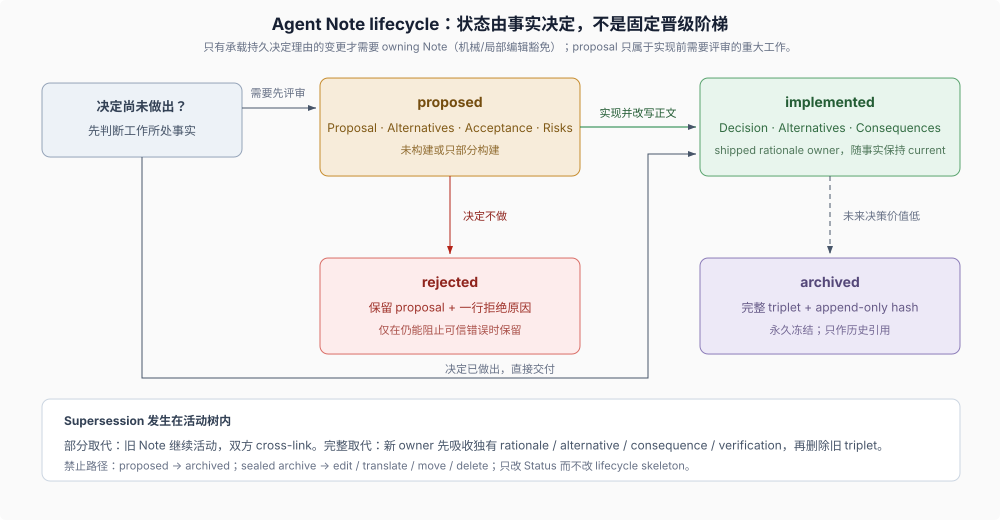

# Reference 01 · Agent Note lifecycle（生命周期）

## 一句话

成为一篇 Agent Note，是在同一次变更里留下一份代码、测试和现有文档都解释不了的持久决定：为什么这样做，以及当时放弃了什么。改动本身不会成为 Note。机械或局部编辑不写。同一决定已有 owner 时，更新那一篇。决定已经做出，就直接写进 `implemented/`；只有尚未构建、需要先评审的重大工作，才从 `proposed/` 开始。写完之后，留下、归档、合并后删除是三种不同结局。

## 本页读法

先判断这次会不会成为一篇 Note，再看它放在哪、正文长什么样，最后看写完之后怎样收场。图回答第一问和最后一问。

| 问题 | 本节 |
|---|---|
| 什么会成为一篇 Note | [§1](#1-什么会成为一篇-note) |
| 成为之后放在哪个路径 | [§2](#2-路径同时编码状态和类别) |
| 三个状态和冻结存放地各表示什么 | [§3](#3-三个-lifecycle-状态与一个冻结存放地) |
| 正文要有哪些段，才算这篇 Note | [§4](#4-文件格式让状态转换可检查) |
| `proposed` 交付时正文怎样改写 | [§5](#5-proposed--implemented-是正文改写) |
| 留下、归档，还是合并后删除 | [§6](#6-写完之后留下归档还是合并后删除) |

本页拥有成为 Note 的判据、状态转换和写完之后的三条结局。[Reference 03](./03-plan-and-sandbox.md) 拥有一次会话里的 Plan。[Reference 05](./05-prose-doc-standards.md) 拥有「系统现在做什么」。[Reference 09](./09-intake-and-work-items.md) 拥有 Issue 与 proposed Note 作为意图载体的分工。长会话与长期项目里压缩、按需加载、取代与归档的使用面，见 [上下文纪律](../native-development-model/03-context-and-drift.md)。

## 1. 什么会成为一篇 Note

DSH 自己的定义是：Agent Note 是 agent 写的 RFC，保存决定或提案的理由、被放弃的方案、后果和必需的验证。

> Agent Notes are effectively RFCs written by agents: durable proposals and decision records that preserve rationale, alternatives, consequences, and required verification.
>
> — DSH [`.agents/notes/AGENTS.md`](https://github.com/deepseek-ai/deepseek-harness/blob/master/.agents/notes/AGENTS.md)。成为 Note 的是一份给以后的参与者看的决定记录。它要能独立回答「为什么是这条路」。

规则把「写不写」收成一个条件。代码和文档装得下的 why，仍然不够；测试也装不下，才写。

> Add or update an Agent Note in the same PR only for lasting decision rationale that code, tests, and existing documentation do not explain. A proposal for substantial future work starts in `proposed/`; a decision already made starts in `implemented/`.
>
> — DSH [`.agents/notes/README.md` 的 “When to write one”](https://github.com/deepseek-ai/deepseek-harness/blob/master/.agents/notes/README.md#when-to-write-one)。`only for` 把 Note 收成例外。后一句规定起点：proposal 只属于实现前要评审的重大工作，已做出的决定直接进入 `implemented/`。

拿这次改动对三个出口：

| 出口 | 怎样判断 | 动作 |
|---|---|---|
| 不成为 Note | 没有新的持久取舍。当前行为已经由代码、测试或现有文档解释；或者这次是机械编辑、局部编辑，包括局部 UI 的呈现与交互 | 不新建。当前行为留在它已有的文档和测试里 |
| 更新已有 Note | 决定还是那一个，变的是它落在哪：路径、包名、key、默认值 | 改 owner 里的事实。不另建一篇 |
| 新写一篇 | 出现一份以后还会被人重新提出的取舍，而代码、测试和现有文档都装不下这份 why 和放弃了什么 | 尚未构建且要先评审：`proposed/<class>/`。决定已随这次变更交付：`implemented/<class>/` |

> Updating the Agent Note that already owns the decision satisfies the rule; do not create a duplicate. Mechanical or local edits, including local UI presentation and interaction changes, are exempt. An Agent Note is never edited into a *different decision*: supersede it with a new one, and keep both notes cross-linked unless the old note is later fully consolidated under the rule below.
>
> — DSH [`.agents/notes/README.md` 的 “When to write one”](https://github.com/deepseek-ai/deepseek-harness/blob/master/.agents/notes/README.md#when-to-write-one)。同一决定不复制。一篇 Note 不能被改写成另一个决定；要换决定，就新写一篇，并与旧篇交叉链接。跟踪既有决定的新位置，是必须做的更新。

`bug-fix` 是正式类别，表示修正缺陷或补上复盘暴露的缺口。一次修复成为 Note，是因为它留下了别处装不下的决定；只是让代码回到既有决定之内，走第一个出口。篇幅、改动文件数都不是这条判据。归档侧把同一边界写在删除上：局部 bug 修复、性能变更、新能力或实质行为决定，不因为实现小就够格删掉。

两则基线上的对照：

- 小改动仍然成为了 Note。[Repeated sandbox modes need no approval](https://github.com/deepseek-ai/deepseek-harness/blob/master/.agents/notes/archived/feature/2026-09-16-sandbox-same-mode.md) 记录：`danger-full-access` 已经生效时，再次请求同一模式应直接返回。拒绝这次调用会挡住已授权的工作，又挡不住任何权限上升。若不写下这个边界，后来的人会把它当成漏洞补上。这篇 Note 同时写明，它只部分取代沙箱决定里的 non-widening rejection，原决定的隔离和逐次批准仍然有效。
- 一次合格交付没有成为 Note。PR #5004 `fix(web): show model IDs in monospace and names on hover` 改了模型设置列表的呈现，同一变更更新了组件、样式、README 和测试，没有新增 Agent Note。局部 UI 呈现由现有文档和测试解释。

一篇文件要真的成为 Note，还得写下它击败了什么。只写结论、不写输家，等于邀请后来的人把同一条路再争论一遍。这段强制要求在 [§4](#4-文件格式让状态转换可检查)。

## 2. 路径同时编码状态和类别

活动树使用 `{lifecycle}/{class}/yyyy-mm-dd-topic-title.md`：

- `lifecycle` 是 `proposed/`、`implemented/` 或 `rejected/`；低未来价值的 implemented triplet 另行移动到冻结的 `archived/` 树；
- `class` 是 `feature`、`bug-fix`、`simplification`、`architecture`、`process` 或 `testing`；
- 日期是主题首次提出的日期，不是实现或归档日期。

分类是 `scripts/agent-note-tree.ts` 中的封闭集合，门禁拒绝未知目录。`refactor` 不在集合中；不增加能力的删除或收缩归 `simplification`。`architecture` 记录交付源码的结构决定；`process` 记录代码周围的工具、政策和流程。

路径树本身就是工作清单：仓库刻意不设集中式 `INDEX.md`（历史上的生成索引已被移除，理由写在 `.agents/notes/README.md` 的 “Layout and naming” 里），读者按 lifecycle/class 目录浏览或全库搜索；Note 之间的交叉引用只用相对 Markdown 链接，不用裸文字或编号。

**树的深度被钉死在三层，没有第四层。** `walkAgentNoteTree` 把深度当等值判断而不是最小值（[`scripts/agent-note-tree.ts`](https://github.com/deepseek-ai/deepseek-harness/blob/master/scripts/agent-note-tree.ts)）：`globSync` 用 `**` 扫出任意深度，但只要路径不是恰好 `{lifecycle}/{class}/file.md` 三段，就报 `expected {lifecycle}/{class}/file.md (got depth N)`。所以按主题、按月或按子系统再分子目录都不行：它们不是被忽略，而是直接报错。

叶子目录**上限** 4×6=24 个，实际存在 **20** 个：`rejected/` 下只有 `architecture/` 与 `simplification/`，其余四个 class 目录从未被创建。20 个叶子目录合计承载 1270 篇英文正文（全树另有根级 `README.md` 等非 Note 文件若干，不含在内），且负载高度集中——`archived/feature` 306 篇、`archived/architecture` 185、`archived/bug-fix` 182、`implemented/architecture` 180，前四项占 853/1270 ≈ 67%，而最小的两个目录各只有 1 篇。

这个取舍有明确的两面。**换来的是**「分类只有一套、且有校验收口」：`class` 是闭集 6、README 与源码双份维护，不存在「两个组重名算谁」的问题。**代价是**可浏览性随规模退化：`implemented/architecture` 按月是 8 / 26 / 28 / 88 / 30，2026-09 那一波强相关的架构决策在目录结构里不可见；180 篇里 `session-` 开头 8 篇、`desktop-` 与 `client-` 各 7 篇，本应聚在一起的一组被日期前缀均匀摊开。而补回可浏览性的唯一替代品 `INDEX.md` 恰好被明文禁止。所以 `browse its lifecycle/class folders or search the repository` 这句话在小规模时是两条路，在当前规模下已退化成检索一条。

> Cross-references between Agent Notes use relative markdown links [...] — never bare prose or numbers — so they are mechanically checkable and survive moves between folders. The active lifecycle tree is the working inventory: browse its lifecycle/class folders or search the repository. Do not add a centralized `INDEX.md`: it duplicates path metadata and makes unrelated note changes contend on one generated file.
>
> — DSH [`.agents/notes/README.md` 的 “Layout and naming”](https://github.com/deepseek-ai/deepseek-harness/blob/master/.agents/notes/README.md#layout-and-naming)。相对链接让引用可被机械检查，也让 Note 在 lifecycle 目录间移动后链接仍然有效；集中索引会重复路径元数据，还让不相关的 Note 改动争用同一个生成文件，因此目录树代替索引。

## 3. 三个 lifecycle 状态与一个冻结存放地

| 位置 | 内容 | 读者怎样使用 |
|---|---|---|
| `proposed/` | 未完成或仅部分完成的重大未来工作 | 评审问题、方案、验收和风险，不能当成已交付功能 |
| `implemented/` | 已交付决定及其替代方案和后果 | 作为当前 rationale owner，并随路径、名称、默认值和机制保持 current |
| `rejected/` | 被否决的提案及一行拒绝原因 | 仅在仍能阻止一个可信错误时保留 |
| `archived/` | 未来决策价值低的 implemented 历史快照 | 只作历史引用，永久冻结，不是当前权威 |

`Status:` 值只有三种，且与所在目录互相校验；`archived/` 不是第四种状态——归档保留 `Status: implemented`、只在其下插入 `Archived:` 行，且只有 implemented Note 能进入。`proposed → rejected` 冻结提案；`proposed → implemented` 必须改写成已交付事实；`implemented → archived` 只在未来决策价值低时发生。Proposed Note 永不归档，过时提案应转 rejected；rejected Note 失去防错价值后删除完整 triplet。

## 4. 文件格式让状态转换可检查

`pnpm run verify-agent-note-format` 是 `doc-sync` 的一部分，强制：

- 前三行是 `# Agent Note: <title>`、空行、`Status: <status>`，且 status 与目录一致；
- body 以 `## Problem` 开头；
- proposed 使用 `## Proposal / ## Alternatives considered / ## Acceptance criteria / ## Risks`；
- implemented 使用 `## Decision / ## Alternatives considered / ## Consequences`，拒绝 proposal-era 的 `Proposal / Plan / Migration plan / Acceptance criteria` 标题；
- rejected 保留提案体，拒绝结论写在 `Status:` 行；
- 每个活动 Note 都有 `## Alternatives considered`，只有规则生效前且无法重建 alternatives 的 Note 可使用固定 grandfather 注释。

强制备选有明确目的：仓库把“没有记录它击败了什么”的决定视为会重新引发争论的失败模式，备选只能记录、不能编造。

> A decision recorded without what it beat invites re-litigation — the failure Agent Notes exist to prevent. Alternatives are recorded, never invented.
>
> — DSH [`.agents/notes/README.md` 的 “Alternatives considered — mandatory”](https://github.com/deepseek-ai/deepseek-harness/blob/master/.agents/notes/README.md#alternatives-considered--mandatory)。Agent Note 的存在理由是防止重新开讼：每篇 Note 固定携带“为什么不是另一条路”，让后续参与者从已知理由开始，而不是重新提出已被击败的方案。

格式门禁只证明结构满足规则，不证明决定正确、替代方案真实或 shipped facts 与代码一致；这些仍需语义 review。

纪律的载体本身是**分片的**：没有哪一份 skill 拥有整条生命周期，而是六份各管一段，靠互相指路拼接——

| Skill | 管哪一段 |
|---|---|
| `dsh-archive-agent-notes` | 归档四分法、校准样例、三件套搬运、封印命令、报告口径 |
| `dsh-code-review` | 「PR 实现了 proposed Note → 同一 diff 内移动并改写成现在时」并核对路径、名字、机制 |
| `dsh-find-simplifications` | 写新 Note 前必做**有范围的取代检查**，并声明「代码巡检不等于全仓 Note 审计」 |
| `dsh-prose-standard` | 全仓排除 `vendor/` 与 `.agents/notes/archived/`；implemented Note 保留理由与证据，删计划清单 |
| `dsh-trim-cot-leakage` | 推理转录泄漏在 Note 里的形态；`#1470` 这类引用留在 README，不得挪进 Note |
| `dsh-doc` | 手册类文档与 Note 的分工；写出当前状态，理由交给 Note |

这一点与「Skill 不等于 gate」是同一条事实的两面：路径和骨架由门禁执行，语义判断留在 skill 里——而因为**没有哪份 skill 常驻上下文**，判据只能被反复指路、反复重述，而不是集中一次讲清。留下还是归档的语义判断留在 [§6](#6-写完之后留下归档还是合并后删除)。

## 5. `proposed → implemented` 是正文改写

移动和改写必须在同一变更完成：

- `Proposal` 改成现在式 `Decision`；
- acceptance 与 risks 中仍有维护价值的事实进入 `Consequences` 或现在式 `Testing / Verification`；
- 删除迁移计划和未来时态，记录实际交付内容；
- 同一 diff 更新源码、当前文档和行为证据。

只修改路径和 `Status:` 会让未来计划伪装成当前事实，因此格式 gate 和 code review 都检查这次改写。

## 6. 写完之后：留下、归档，还是合并后删除

写完不是终点。之后有两个不同的问题。Supersession 问：哪个活动 Note 继续拥有这个决定。保留、归档或删除问：一篇已经写完的记录，还值不值得留在活动树里。字数和年龄只帮助发现候选，从来不是判据。

> Judge every note semantically; word count and age are discovery aids, never archive criteria.
>
> — DSH [`dsh-archive-agent-notes`](https://github.com/deepseek-ai/deepseek-harness/blob/master/.agents/skills/dsh-archive-agent-notes/SKILL.md)。判的是这份理由还能不能指导以后的工作。

每新增一篇 Note，都要在同一个 PR 里搜索同一决定、机制或被拒方案，并分类：

> Every new Agent Note triggers a supersession check. Search the active tree for older notes covering the same decision or mechanism, classify any full or partial supersession with dsh-archive-agent-notes, and archive every qualifying implemented triplet in the same PR. Keep partial supersessions active and cross-linked.
>
> — DSH [`.agents/notes/AGENTS.md`](https://github.com/deepseek-ai/deepseek-harness/blob/master/.agents/notes/AGENTS.md)。`qualifying` 指符合归档条件的那几篇，不是每一篇被提到的旧 Note。部分取代的两边都继续活动，并交叉链接。

完全取代还有另一条出路。新 owner 已经吸收旧篇全部独有内容时，旧三件套删除，不进归档：

> An implemented Agent Note that is fully superseded may be consolidated into the current owning note and deleted. Before deletion, the owner must preserve every unique rationale, alternative, consequence, required verification, and named coverage gap; repair every inbound link; and delete the Chinese counterpart and consistency record in the same change. Partial supersession does not qualify: keep both notes cross-linked and update every fact that remains current.
>
> — DSH [`.agents/notes/README.md` 的 “When to write one”](https://github.com/deepseek-ai/deepseek-harness/blob/master/.agents/notes/README.md#when-to-write-one)。合并删除的前提是独有内容已经活在新 owner 里。不得把旧文件改写成相反结论，也不得只靠 git history 留底。

| 情况 | 结局 |
|---|---|
| 部分取代，或旧理由仍独立有用 | 两边都留在活动树，交叉链接，并更新仍然有效的事实 |
| 完全取代，且新 owner 已吸收全部独有 rationale、alternative、consequence、verification 和 coverage gap | 删除旧的英文、中文和 sidecar，并修复入站链接 |
| 已交付，理由、备选、否定性保证、归属边界、持久化或协议语义、安全规则或重新引入条件仍可能指导以后的改动 | 留在活动树 |
| 已交付且完整，不太再指导以后的工作，历史决定价值仍在 | 归档完整三件套 |
| implemented 只描述小型 UI 调整或纯机械变更 | 直接删除完整三件套。局部 bug 修复、性能变更、新能力或实质行为决定，不因为实现小就走这条 |
| 提案过时 | 不归档。转入 `rejected/`，或在不再能阻止可信错误时删除 |
| rejected 的想法已经过时，或不再能阻止重新开讼 | 删除完整三件套，并修复或删除入站链接 |

功能新增 Note 收进后来的移除 Note，还要多满足一组事实：该功能已从生产代码、配置、schema、持久化或线上格式、迁移和兼容行为中消失；当前文档不再把它写成可用；测试不再把它当成受支持行为。移除 owner 要保住原来的动机、为何不再成立、未完全移除的备选、放弃的能力、重新引入的条件，以及对「已经完全不存在」的验证。只去掉一种传输、默认值、实现或呈现，或者仍有持久数据与兼容处理，是部分取代，两边都留。

归档不是改个文件夹名。一次归档移动完整的 `.md`、`.zh.md`、`.i18n.yaml`，路径是 `archived/{class}/`，中间没有 `implemented`。正文不改，只在两种语言的 `Status: implemented` 下插入同一行 `Archived: YYYY-MM-DD`，机械重录 sidecar，并处理活动 prose 的入站链接。`verify-archived-agent-notes` 把内容写入只追加的 hash manifest：`--write` 先证明既有封存仍匹配，再只追加新封存文件各自的哈希（[`dsh-archive-agent-notes`](https://github.com/deepseek-ai/deepseek-harness/blob/master/.agents/skills/dsh-archive-agent-notes/SKILL.md)）；整组删除已封存记录时，其清单条目必须同步移除，否则 [`archived-agent-notes` 校验器](https://github.com/deepseek-ai/deepseek-harness/blob/master/scripts/archived-agent-notes.ts) 报 `sealed artifact is missing`。封存后不得编辑、翻译、移动或删除。

归档层被门禁**主动排除**，这里要精确区分两件事。`scripts/repo-files.ts` 导出一个判断 `isArchivedAgentNotePath`（[`scripts/repo-files.ts`](https://github.com/deepseek-ai/deepseek-harness/blob/master/scripts/repo-files.ts)），`doc-typecheck`、`verify-md-links`、`verify-md-wrap`、`verify-mermaid`、`verify-package-paths`、`verify-type-equiv` 把它当排除谓词使用。动机是明确的：冻结层是历史快照，按当前标准重排它就是篡改历史。

- **归档发出的出站链接从不被检查。** `verify-md-links` 跳过归档层，所以归档 Note 里指向活跃 Note 的链接即使断了也不会红。`dsh-archive-agent-notes` 明说了这一点：「Do not claim archived outbound links are valid: the archive verifier intentionally never checks them.」
- **指向归档的入站链接没有专门门禁。** 归档要求 repair or delete inbound links，但没有检查能在没有前置改动的情况下证明「该改的都改了」；实际保障来自 `verify-md-links` 会红加上归档提交当场改完。

所以「归档不破坏引用」要写准确：指向归档的链接可机器验证（目标存在），归档发出的链接被明文放弃检查。两者不是同一件事，混着说会把一个刻意留下的空白读成一项保证。

还有一个容易漏掉的实现事实：**「排除归档层」这个判断本身有多份副本**。`repo-files.ts` 提供一个共享谓词 `isArchivedAgentNotePath`，`doc-typecheck`、`verify-md-links`、`verify-md-wrap`、`verify-mermaid`、`verify-package-paths`、`verify-type-equiv` 都引用它；但另有五个脚本根本没引用这个谓词，而是各自写死同一段路径字面量：`verify-concrete-terms`、`verify-public-repository-links`、`verify-repository-references`、`verify-no-unknown-casts`、`translation-pairing`。加上 `lefthook.yml` 自己的 glob，改归档目录名要同时动六处。

注意不要把这条读成「归档层被所有门禁豁免」。准确的区分是：**本来会扫到 `.agents/` 的门禁**要么显式排除（就是上面这些），要么显式处理（`verify-archived-agent-notes` 专管封印）；而 `verify-doc-budgets` 这类门禁的默认作用域里根本没有 `.agents/`，谈不上排除，也谈不上检查。

活动 prose 仍可以在有意引用历史时链进归档 Note；被链的那篇是冻结的，于是同一句话的两半由两个执法者分管——「可以链」是散文自治，「链过去的东西别再改」是封印强制。

`dsh-archive-agent-notes` 拥有上面这张表的语义判断。格式 gate 只证明结构合法，不代替这张表。Skill 为什么适合承载这类判断，见 [Development Harness 的 Skills 章节](../repo-harness/03-skills-as-procedural-memory.md)。

## 证据入口

- DSH [`.agents/notes/README.md` 的 “When to write one”](https://github.com/deepseek-ai/deepseek-harness/blob/master/.agents/notes/README.md#when-to-write-one)：成为 Note 的条件、豁免、禁止改写成另一个决定、完全取代后的合并删除。
- DSH [`.agents/notes/README.md` 的 “Archiving and deletion”](https://github.com/deepseek-ai/deepseek-harness/blob/master/.agents/notes/README.md#archiving-and-deletion)：留下、归档、直接删除，以及 proposed 永不归档。
- DSH [`.agents/notes/AGENTS.md`](https://github.com/deepseek-ai/deepseek-harness/blob/master/.agents/notes/AGENTS.md)：Agent Note 的身份，以及新增 Note 触发 supersession check。
- DSH [`dsh-archive-agent-notes`](https://github.com/deepseek-ai/deepseek-harness/blob/master/.agents/skills/dsh-archive-agent-notes/SKILL.md)：按未来价值分类，以及归档一次的五个动作。字数和年龄不是判据。
- DSH [`.agents/notes/README.md`](https://github.com/deepseek-ai/deepseek-harness/blob/master/.agents/notes/README.md)：路径、六个 class、统一正文结构。
- DSH [`.agents/notes/README.md` 的 “Layout and naming”](https://github.com/deepseek-ai/deepseek-harness/blob/master/.agents/notes/README.md#layout-and-naming)：路径编码、交叉引用规则与不设集中索引的理由。
- DSH [no-index Agent Note](https://github.com/deepseek-ai/deepseek-harness/blob/master/.agents/notes/archived/process/2026-07-19-remove-generated-agent-note-index.md)：移除生成索引那次决定的历史记录（已归档，不是当前权威）。
- DSH [implemented Note 子树规则](https://github.com/deepseek-ai/deepseek-harness/blob/master/.agents/notes/implemented/AGENTS.md)：implemented Note 如何随已交付路径、名称和机制保持当前。
- DSH [archived Note 子树规则](https://github.com/deepseek-ai/deepseek-harness/blob/master/.agents/notes/archived/AGENTS.md)：归档 triplet 的冻结与 seal 约束。
- DSH [统一格式 Agent Note](https://github.com/deepseek-ai/deepseek-harness/blob/master/.agents/notes/archived/process/2026-07-05-uniform-agent-note-format.md)：为什么三种活动 lifecycle 使用一套可检查格式。
- DSH [Repeated sandbox modes need no approval](https://github.com/deepseek-ai/deepseek-harness/blob/master/.agents/notes/archived/feature/2026-09-16-sandbox-same-mode.md)：一次小改动仍然成为 Note 的对照。
