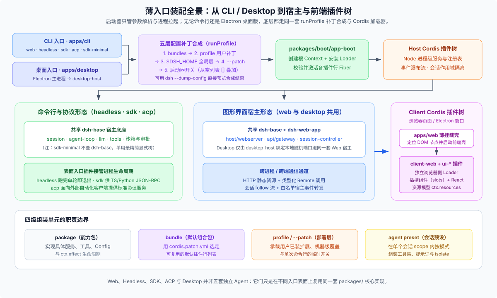

# 01 · 顶层分区与薄入口：为什么 `apps/` 只留一层启动壳？

打开 DSH 根目录，你会看到十几个并列的一级目录。它们并不是从底往上的调用分层，而是按**代码维护权、构建工具链与对外发布载体**切出来的独立工作区。

---

## 一、顶层目录逐一认门

结合 [`pnpm-workspace.yaml`](https://github.com/deepseek-ai/deepseek-harness/blob/master/pnpm-workspace.yaml) 看，仓库顶层可以分成“进 pnpm 工作区的代码包”和“围绕代码运转的文档与工程资产”两类：

| 顶层目录 | 是否进 pnpm workspace | 它真正负责什么 | 最容易误解的地方 |
|---|---|---|---|
| [`vendor/`](https://github.com/deepseek-ai/deepseek-harness/blob/master/vendor/README.md) | `vendor/*` | 本地钉死并重命名（`@deepseek-ai/cordis*` 等）的 Cordis 框架、Loader、Include、HMR 源码及上游同步清单 | 虽然在工作区里一起构建发包，但它有严格的 [`vendor/README.md`](https://github.com/deepseek-ai/deepseek-harness/blob/master/vendor/README.md) 同步流程与本地改动台账，**不能像改业务代码一样顺手重构** |
| [`packages/`](https://github.com/deepseek-ai/deepseek-harness/blob/master/packages/README.md) | `packages/*/*` | 全部 `@deepseek-ai/dsh-*` 可复用能力包、服务接口、Provider、模型工具、前端 `ui-*` 插件与 `bundle/*` 默认组合层 | 必须严格保持 `<group>/<pkg>` 两级深度，才能被工作区通配符统一发现 |
| [`apps/`](https://github.com/deepseek-ai/deepseek-harness/tree/master/apps) | `apps/*` | 最终应用壳与离线工具：`cli`（`dsh` 命令）、`web`（浏览器挂载入口）、`desktop` 与 `desktop-host`（Electron 桌面端）、`plugin-market-generator`（插件市场索引生成器） | **不放任何可复用的模型、工具或会话逻辑**；通用能力一律沉淀回 `packages/` |
| [`native/`](https://github.com/deepseek-ai/deepseek-harness/blob/master/native/README.md) | `native/system` 及子包 | `@deepseek-ai/node-addon-system` 原生扩展源码（Linux Landlock 沙箱限制器与 POSIX `flock` 文件锁）及按平台拆分的预编译包 | 放进根工作区是为了跟沙箱消费方同仓联调，但它的跨平台编译矩阵与发版流水线完全独立 |
| [`python/`](https://github.com/deepseek-ai/deepseek-harness/blob/master/python/README.md) | 仅 `python/sdk-runtime` | `python/sdk` 是纯 Python 客户端包（走 stdio JSON-RPC 调 DSH）；`python/sdk-runtime` 是打包单文件运行时所需的 pnpm 部署根清单 | Python SDK 并不是用 Python 重写了一遍 Agent 循环，它底层拉起的仍然是标准 `dsh --profile sdk`（或 `sdk-minimal`） |
| [`benchmarks/`](https://github.com/deepseek-ai/deepseek-harness/blob/master/benchmarks/package.json) | `benchmarks` | 仓库级性能门禁（私有包 `@deepseek-ai/dsh-benchmarks`）与压测专用依赖，由根 `vitest.bench.config.ts` 编排 | 单个包内部的局部微基准测试留在各自包旁写 `.perf.ts`，不往顶层 `benchmarks/` 塞 |
| [`docs/`](https://github.com/deepseek-ai/deepseek-harness/blob/master/docs/AGENTS.md) | 否 | 架构总览、子系统参考、实操手册（cookbook）、升级指南与脚本自动生成的全局目录 | **`docs/` 只写系统当前状态**（见 [FAQ 06](../06_change-landing-path/answer.md)），不存过往设计方案对比 |
| [`website/`](https://github.com/deepseek-ai/deepseek-harness/blob/master/website/docs.ts) | `website` | VitePress 站点壳与 [`website/docs.ts`](https://github.com/deepseek-ai/deepseek-harness/blob/master/website/docs.ts) 路由投影配置 | 里面没有另一套独立维护的文档正文；改文档永远回 `docs/` 或对应包的 `README` |
| [`scripts/`](https://github.com/deepseek-ai/deepseek-harness/tree/master/scripts) | 否 | 目录生成器（如 `gen-module-graph`）、全仓静态校验门禁（`run-gates.ts`）与开发辅助脚本 | 生成出来的 Markdown/类型文件如果过期，去改上游源码或 `scripts/` 生成器，绝不手改产物 |
| [`snapshots/`](https://github.com/deepseek-ai/deepseek-harness/blob/master/snapshots/AGENTS.md) | 否 | 录制好的真实会话 JSONL 快照，用于无密钥（keyless）端到端回放回归（见 [FAQ 21](../21_recorded-session-snapshots/answer.md)） | 顶层 `snapshots/` 只放走完整会话驱动的用例；普通单包期望输出留在各自包的 `tests/` 下 |
| [`.agents/`](https://github.com/deepseek-ai/deepseek-harness/blob/master/.agents/notes/README.md) | 否 | 记录持久架构取舍的 Agent Notes（`proposed / implemented / rejected / archived`）与仓内专用 `dsh-*` 技能 | `archived/` 已冻结不可改，且不能拿归档记录当现行接口依据 |
| `patches/` · `.github/` | 否 | `pnpm patchedDependencies` 第三方依赖补丁（非 vendored 源码），以及 GitHub CI / PR 规则与发布工作流 | 真正需要长期魔改维护的框架源码进 `vendor/`，零星修第三方包小 bug 才用 `patches/` |

---

## 二、铁律：为什么 `apps/` 必须薄？

[`AGENTS.md`](https://github.com/deepseek-ai/deepseek-harness/blob/master/AGENTS.md) 和 [`docs/architecture.md`](https://github.com/deepseek-ai/deepseek-harness/blob/master/docs/architecture.md#application-launch) 写下了一条由门禁脚本 [`scripts/verify-application-entrypoints.ts`](https://github.com/deepseek-ai/deepseek-harness/blob/master/scripts/verify-application-entrypoints.ts) 死卡的架构规则：

> **Only `dsh` profiles launch supported Node apps; package bins, demos, and public SDK argv escapes are forbidden.**

也就是说，除开构建期专用打包工具（如 `webworker-packer`）和测试夹具，整个仓库对外只允许 [`apps/cli`](https://github.com/deepseek-ai/deepseek-harness/blob/master/apps/cli/README.md) 发布唯一的 `dsh` 可执行入口；严禁哪个业务包自己偷偷挂个 `bin` 绕过 profile 体系单独起进程，也不允许根 `package.json` 的 `demo:*` 脚本直接调某个内部包的入口文件。

把入口收死在这么薄的一层，换来的是极高的复用度——看清 `apps/` 下几个子目录的分工就能明白：

1. **`apps/cli`（唯一的通用 Node 启动器）**：只负责解析命令行参数、初始化并合成 profile 配置层、注入启动环境变量与命令行参数快照（`ctx.cmdlineArgs`）、管理 `dsh plugin` 安装事务，以及处理 `SIGINT/SIGTERM` 优雅停机。它自己既不会调大模型，也不懂怎么读写会话。
2. **`apps/web`（最薄的浏览器挂载壳）**：源码里几乎只有一个 `src/main.ts` 和 Vite 构建配置，干的唯一一件事就是找到页面 DOM 节点并调用 `@deepseek-ai/dsh-client-web`。真正的连接管理、插件加载、槽位系统和聊天界面全在 `packages/client/*` 里，方便单独写测试和跨形态复用。
3. **`apps/desktop` + `apps/desktop-host`（唯一的非 CLI 启动入口，但内核照样走 `runProfile`）**：
   桌面客户端是唯一不让你在终端敲 `dsh --profile desktop` 启动的产品形态——CLI 参数解析器会显式拦截并拒绝 `desktop` 这个保留 profile 名。它的真实启动链是从 Electron 主进程（`apps/desktop`）开始的：
   - Electron 拿到单实例锁后，以 Node 模式（`ELECTRON_RUN_AS_NODE=1`）拉起私有的 `apps/desktop-host`；
   - `desktop-host` 转头就调用与 CLI 同源的 `runProfile`，加载专属的 `$DSH_HOME/profiles/desktop`，在本地回环的操作系统随机端口（`--host 127.0.0.1 --port 0`）上跑起**完完整整的 Web 应用**；
   - Host 就绪后通过 Node IPC 把带认证信息的本地地址与启动注入项传给窗口，窗口加载同一套打包好的 Web 前端资源。桌面端甚至还内置了一份供应用退出后管理桌面插件的打包版 CLI。所以桌面版看似入口独立，底下跑的依然是百分百相同的 `packages/` 插件树。
4. **`apps/plugin-market-generator`**：私有的离线构建小工具，用来根据 npm 包与 Git 仓库清单生成插件市场索引文件，不参与用户侧应用运行时。

---

## 三、从敲下命令到活插件树：启动与配置层是怎么接上的？



既然 `apps/cli` 里没有业务代码，那敲下 `dsh web` 或 `dsh --profile headless "task"` 时，三百多个包是怎么精准拼成当前进程的？整条装配链分成清晰的五步：

```text
apps/cli/src/bin.ts（按模式动态 import 对应执行器）
  → apps/cli/src/profile-boot.ts（定位 $DSH_HOME/profiles/<name>，按序收集补丁层）
  → packages/boot/app-boot（创建根 Context + 安装 Cordis Loader + 执行 prepare）
  → 从空列表 [] 依次叠加 YAML 补丁，生成最终插件行（entry rows）
  → Cordis Loader 激活各 Fiber，由入口插件接管进程生命周期（常驻 Web 服务或跑完单轮退出）
```

### 1. 五大内置 Profile 共享同一套底座

首次使用某个内置 profile 时，`app-boot` 会按 `PROFILE_TEMPLATES` 自动初始化 `$DSH_HOME/profiles/<name>`：

- **`web`**：`@deepseek-ai/dsh-base` + `@deepseek-ai/dsh-web-app`（本地 HTTP/RPC 服务 + 浏览器 GUI）
- **`headless`**：`@deepseek-ai/dsh-base` + `@deepseek-ai/dsh-headless`（无服务端口，跑完一次任务打印结果即退出）
- **`sdk`**：`@deepseek-ai/dsh-base` + `@deepseek-ai/dsh-sdk-app`（供 TypeScript / Python SDK 驱动的 JSON-RPC 服务）
- **`acp`**：`@deepseek-ai/dsh-base` + `@deepseek-ai/dsh-acp-app`（面向外部自动化集成的 ACP 协议服务）
- **`sdk-minimal`**：只挂 `@deepseek-ai/dsh-sdk-minimal` 一个包（刻意不叠 `dsh-base`，提供最精简可控的显式 SDK 树）

可以看到，前四种形态底层全都垫着同一块 **`dsh-base`**（模型适配、核心注册表、JSONL 会话持久化、沙箱与审批策略、设置与凭据），区别只在于最上面叠了哪一层表面入口 bundle。

### 2. 配置层叠顺序（后层可按稳定 `id` 覆盖或禁用前层）

最终喂给 Cordis Loader 的插件列表从空数组 `[]` 起步，严格按从低到高的优先级合成：

1. **Profile 声明的有序 `bundles`**（例如先执行 `dsh-base/cordis.patch.yml`，再执行 `dsh-web-app/cordis.patch.yml`）
2. **当前 Profile 自己的用户补丁**（`$DSH_HOME/profiles/<name>/cordis.patch.yml`）
3. **全局机器级用户补丁**（`$DSH_HOME/cordis.patch.yml`，对本机所有 profile 生效）
4. **单次命令行的 `--patch <file>` 覆盖层**（比如挂载仓内随包附带的示例配置 `apps/cli/config/examples/mcp-memory/*.cordis.yml`，或自动化测试注入的目录选择器补丁）
5. **启动器硬开关**（例如环境变量或命令行触发的遥测关断）

### 3. 排查装配结果的第一利器：`--dump-config`

光肉眼翻 `packages/bundle/` 里的 YAML，很容易漏掉用户目录补丁或后一层 bundle 对前一层的改写（比如 `dsh-base` 先挂了全局工具，`dsh-web-app` 又把部分全局工具禁掉、改由会话级 `preset` 按需挂载）。想确认某个插件最终到底有没有挂上、实际生效的 `config` 是什么，直接跑：

```sh
pnpm dsh --profile web --dump-config
```

它复用跟真实启动完全一致的补丁合成算法打印最终 YAML，但**不创建 `Context`、也不执行任何插件代码**。注意它的边界：`--dump-config` 能证明“配置层有没有把这行塞进去”，但不能代替真实启动去证明“它依赖的上游 `inject` 服务是否就绪”。
