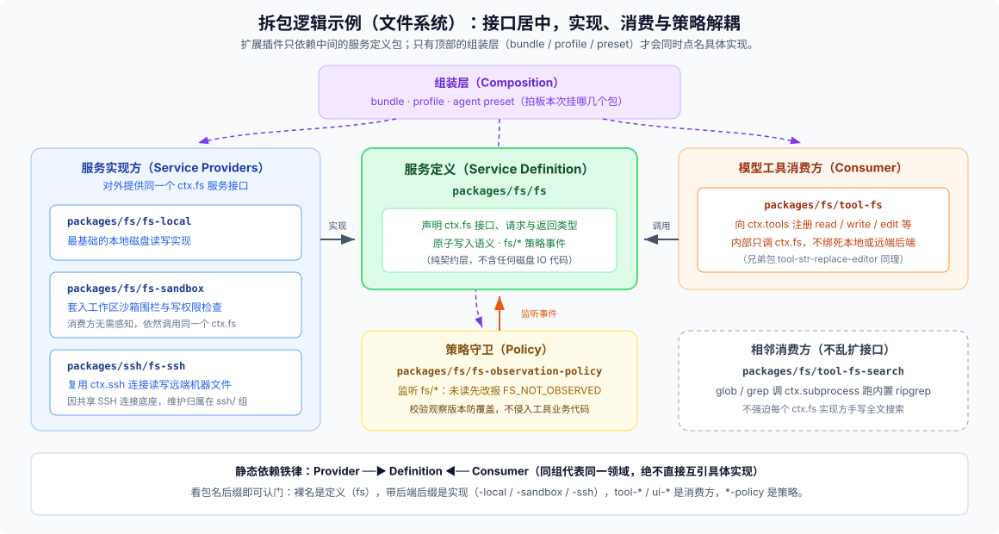

# 02 · 两层包结构与角色切分：`packages/<group>/<pkg>/` 为什么要拆得这么细？

刚翻开 `packages/` 时，很多人会有两个疑问：为什么不直接平铺成 `packages/foo`？为什么不按后端常见的 `services/ · tools/ · controllers/ · ui/` 分目录，反而把一个文件读写功能拆成七八个小包？

答案其实很实在：**平铺三百多个包根本找不到北；按技术层分目录，每次改一项业务能力就得跨四个大文件夹来回跳。** DSH 选用 `packages/<group>/<pkg>/` 两层结构，第一层解决**“这块业务归谁管”**，第二层解决**“哪个环节能单独换掉而不牵连别人”**。

---

## 一、先拿一个活例子看懂拆包逻辑：为什么读写文件要拆成这么多包？

与其先背抽象概念，不如直接拆开 [`packages/fs/`](https://github.com/deepseek-ai/deepseek-harness/blob/master/packages/fs/README.md) 看一眼。假如把“给大模型提供文件读写工具”全写进一个大包里，模型工具 Schema、本地磁盘 IO、沙箱目录围栏、“修改前必须先读取”的防呆校验就会死死焊在一起——一旦你想把执行环境切到远端 SSH 机器，要么把整个工具包抄一份改底层，要么在工具代码里塞满 `if (isSsh)` 分支。

在 DSH 里，这件事按职责角色拆成了下面这组互相解耦的包：



| 包路径 | 扮演什么角色 | 具体干什么 |
|---|---|---|
| `packages/fs/fs` | **Service Definition（服务定义）** | 声明 `ctx.fs` 接口、请求/返回类型、原子写语义与 `fs/*` 策略事件，**不含任何具体磁盘读写代码** |
| `packages/fs/fs-local` | **Service Provider（实现方）** | 最基础的本地文件系统实现 |
| `packages/fs/fs-sandbox` | **Service Provider（实现方）** | 在本地 IO 之上套入工作区沙箱围栏与权限检查，对外依然提供同一个 `ctx.fs` |
| `packages/ssh/fs-ssh` | **跨组 Provider（实现方）** | 通过共享的 `ctx.ssh` 连接读写远端机器文件——因为它跟 `subprocess-ssh`、`sandbox-ssh` 共用同一套 SSH 连接底座，维护归属放在 `packages/ssh/` |
| `packages/fs/fs-observation-policy` | **Policy（策略守卫）** | 监听 `fs/*` 事件实现“未读先改报 `FS_NOT_OBSERVED`”和文件版本防覆盖校验，不污染工具代码 |
| `packages/fs/tool-fs` | **Consumer（模型工具消费方）** | 向 `ctx.tools` 注册 `read`、`read_image`、`write`、`edit`，内部只调抽象的 `ctx.fs` |
| `packages/fs/tool-str-replace-editor` | **相邻 Consumer** | 另一套面向模型的编辑工具（`view / create / str_replace / insert`），同样只依赖 `ctx.fs` |
| `packages/fs/tool-fs-search` | **相邻 Consumer（不乱扩接口）** | 提供 `glob` 和 `grep`，但它直接调 `ctx.subprocess` 跑打包好的 `ripgrep`，**不强迫所有 `ctx.fs` 实现方自己手写一套全文搜索** |
| `packages/deliverables/tool-present` | **跨组 Consumer** | 把生成好的文件路径登记为本轮会话交付物，归属在专门管交付物的 `deliverables/` 组 |

看清这个例子，就能顺手抓住两条非常关键的规律：

1. **命名后缀就是最直观的导航路标**：领域裸名（如 `fs`、`llm`、`subprocess`、`web`）通常是 **Definition**；带环境或后端后缀（`-local`、`-sandbox`、`-ssh`、`-sqlite`、`-deepseek`）的是 **Provider**；带 `tool-*`、`command-*`、`ui-*` 前缀的是面向模型、命令或界面的 **Consumer**；带 `*-policy` 或在 `guard/` 组里的是 **Policy**。
2. **从磁盘目录到真正跑起来，中间隔着六个概念层级**：
   - `group`（`packages/fs/`：代码维护归属）→ `package`（`@deepseek-ai/dsh-fs-local`：npm 发布与依赖单元）→ `plugin`（包导出的类或函数）→ `entry row`（YAML 里带稳定 `id` 和 `config` 的一行挂载声明）→ `Fiber`（Cordis 在运行期为该行创建的生命周期实例）→ `Context / isolate`（插件发布和查找服务的作用域；一个插件包可以被挂多次，放进不同的隔离作用域里）。

---

## 二、依赖方向铁律与包内部标准解剖

### 1. 谁允许依赖谁？

[`packages/README.md`](https://github.com/deepseek-ai/deepseek-harness/blob/master/packages/README.md#dependencies) 把依赖方向浓缩成了一句硬规矩：**扩展插件永远只依赖 Service Definition，绝不依赖具体 Provider；只有负责组装的 `bundle` 才能同时依赖具体实现。**

```text
Provider（fs-sandbox / fs-ssh） ──实现──→ Definition（fs） ←──调用── Consumer（tool-fs / ui-*）
                                                ↑
                                     Policy（fs-observation-policy）监听事件

            Composition（packages/bundle/*）负责拍板这次把哪几个包挂进同一棵树
```

读一个包的 `package.json` 时，也要区分两种依赖字段的含义：
- **`peerDependencies`**：声明“我在同一个 Harness 运行时里跟哪些工作区包打交道”（这也是生成 [`docs/module-graph.md`](https://github.com/deepseek-ai/deepseek-harness/blob/master/docs/module-graph.md) 的规范信号，每个插件包对 `@deepseek-ai/cordis` 也走 `peerDependencies`）。
- **`dependencies`**：真正需要随包打进发布闭包的第三方库或直接运行依赖（工作区内互引统一写 `workspace:*`，引用 `vendor/` 或 `native/` 写 `workspace:~`）。

### 2. 打开任意一个包，按什么顺序读？

绝大多数包内部都长得一模一样：

```text
packages/<group>/<pkg>/
├── README.md / README.zh.md   # 第一站：对外接口合同、Config 配置项、扩展点与已知限制
├── package.json               # 第二站：看包名、exports 导出面、依赖的是抽象定义还是具体实现
├── src/
│   ├── index.ts               # 第三站：插件入口、inject 服务依赖、Config 校验与 ctx.effect 注册
│   └── types.ts               # 纯类型声明（按需存在，不放运行时逻辑）
├── tests/                     # 第四站：单元测试与真实组装测试（绝不藏在 src/__tests__ 里）
└── tsconfig.json              # 所属编译面（Host 或 Client）与项目引用
```

什么时候才应该拆新包？只有当**某个实现真的会被替换、带有独立平台/第三方重依赖、需要单独开关卸载、或者横跨了不同编译面**时才拆。如果只是想抽几个内部辅助函数，或者拆开后两边还得永远绑在一起改、绑在一起发，那就老老实实留在原包内部做模块划分，别制造空壳包。

### 3. 两组最容易看混的核心目录

- **`packages/core/` vs `packages/session/` vs `packages/session-query/`**：
  - `core/` 是主干契约层（`scope` 作用域原语、内存活会话 `session`、提示词组装 `system-prompt`、工具管道 `tools`、`agent` 接口与默认驱动 `agent-loop`）。
  - `core/session` 只管内存里的追加日志与 `deriveMessages()` 消息历史投影；至于“怎么存盘”，交给了隔壁 `packages/session/`（由 `session-persistence-jsonl` 按不可变世代文件落盘，配齐 `v0→v1→v2→v3→v4` 相邻迁移包，外加增量状态投影 `ctx.sessionProjections`、标题生成与遥测）。而跨会话全文搜索需要建 SQLite FTS5 索引，消费者完全不同，所以又独立成 `packages/session-query/`（注意：非会话类的通用键值/表存储则在 `packages/storage/`，那里仍有 `storage-sqlite` 后端）。
- **Web 前后端的四组拍档（`host/` · `client/` · `api/` · `typert/`）**：
  DSH 没有搞一个笼统的 `frontend/` 和 `backend/`，而是把职责拆成四组：`host/` 管 Node 侧 HTTP 静态服务、原生目录选择器和本机打开应用；`client/` 管浏览器侧 Cordis 壳、连接、资源模型（`ctx.resources`）和几十个 `ui-*` 界面插件；`api/` 管前后端共用的网关与会话/工作区/设置等业务控制器；`typert/` 管跨端类型反射生成。客户端从服务端拿状态固定走两条路：**会话历史与流式输出走 `api/session-controller` 的 `follow` 流；其余宿主事件走 `api/remotes` 明确白名单化的 `API_REMOTE_FORWARDED_EVENTS`**。

---

## 三、别把“实验包”和“可选包”混为一谈

`packages/` 下五十多个组全都按业务领域划分，**唯独 [`packages/experimental/`](https://github.com/deepseek-ai/deepseek-harness/blob/master/packages/experimental/README.md#status) 是按成熟度划分的特区**。仓库在成熟度、默认开关和安装方式上分得很细，查包时对照下面这张表就不会迷糊：

| 维度 / 清单位置 | 它代表什么意思 | 典型例子 |
|---|---|---|
| **`packages/experimental/*`**（成熟度边界） | 整套公开能力仍在评估期，**不承诺长期产品兼容**（随时可能改接口或下线，但代码质量、安全、文档与测试门禁一点不松） | `agent-team`、`hooks-claude-code`、`webhook`、`voice-input-bundle`、`inspector`、`worktree` 等 |
| **`OPTIONAL_BUNDLES`**（[`app-boot/src/profile.ts`](https://github.com/deepseek-ai/deepseek-harness/blob/master/packages/boot/app-boot/src/profile.ts)） | **随安装包一起出货、但默认关闭**的官方可选功能包，用户在 Web 插件管理页的 Official 栏点一下开关就能启用 | `session-search`、`terminal-bundle`、`agent-team-profile`、`cot-translation-bundle`、`auto-review`、`tool-worktree` 等 12 项 |
| **`ON_DEMAND_BUNDLES`**（[`official-bundle-packages.ts`](https://github.com/deepseek-ai/deepseek-harness/blob/master/packages/boot/app-boot/src/official-bundle-packages.ts)） | 安装包体积大或带外部运行时，**默认不随主包预装、启用时按需下载安装**的官方 bundle | `subagent-claude-code`、`subagent-codex` |
| **`PRODUCT_PACKAGE_POLICY`**（[`scripts/product-package-policy.ts`](https://github.com/deepseek-ai/deepseek-harness/blob/master/scripts/product-package-policy.ts)） | **成熟度已转正（不在 `experimental/` 里）**，但因需要额外配置凭据/服务或属于 SDK/构建/测试底座而**不进默认运行树**的包 | `ssh/*`、`lsp/*`、`storage-sqlite`、`web-search-exa`、`sdk/client`、`test-support/*` 等 |

一句话分清：**`experimental` 讲的是“稳不稳定、保不保修”；`optional` 讲的是“默认开不开、要不要用户手动选”。** 门禁脚本强制检查每一个不在 `experimental/` 里的包：要么被默认产品树实际挂载，要么必须在 `product-package-policy.ts` 里写明正当角色，绝不允许仓库里躺着无人认领的僵尸包。

---

## 四、双编译面：`tsconfig.host.json` 与 `tsconfig.client.json`

看包里的 `tsconfig.json` 时，你会发现仓库没有把所有包塞进同一个 TypeScript 编译程序，而是分成了一东一西两个聚合入口（详见 [`docs/development.md`](https://github.com/deepseek-ai/deepseek-harness/blob/master/docs/development.md#typescript-project-layout)）：

- **`tsconfig.host.json`（Host 编译面）**：汇总所有跑在 Node 宿主侧的包、脚本、网站构建与后端测试。
- **`tsconfig.client.json`（Client 编译面）**：继承带 DOM 与 JSX 配置的 `tsconfig.base.client.json`，汇总 `packages/client/*`、`apps/web` 与前端测试。
- **为什么绝不能合二为一？** 因为 Host 插件和 Client 插件都大量使用 TypeScript 的 `declare module '@deepseek-ai/cordis'` 往 `Context` 接口上挂载服务（甚至两边都有同名键，但一边是服务端控制器、另一边是浏览器代理对象）。一旦放进同一个 `ts.Program`，声明合并就会当场冲突报错。

在这套规则下，普通包只登记进其中一个聚合面；而横跨前后端边界的 **6 个桥梁包**（`api/remotes`、`api/gateway`、`api/session-controller`、`api/workspace-controller`、`client/connection`、`session-query/session-log-export`）则把包根下的 `tsconfig.json` 做成纯引用空壳（solution-only），显式拆出 `tsconfig.host.json` 和 `tsconfig.client.json` 两份叶子配置，让两边各自只编译属于自己的那一面。构建时，总是先跑 Host 侧编译并用 Typert 生成前后端通信所需的 `/remote` 类型声明，随后 Client 侧包才能顺畅完成类型检查与打包。
