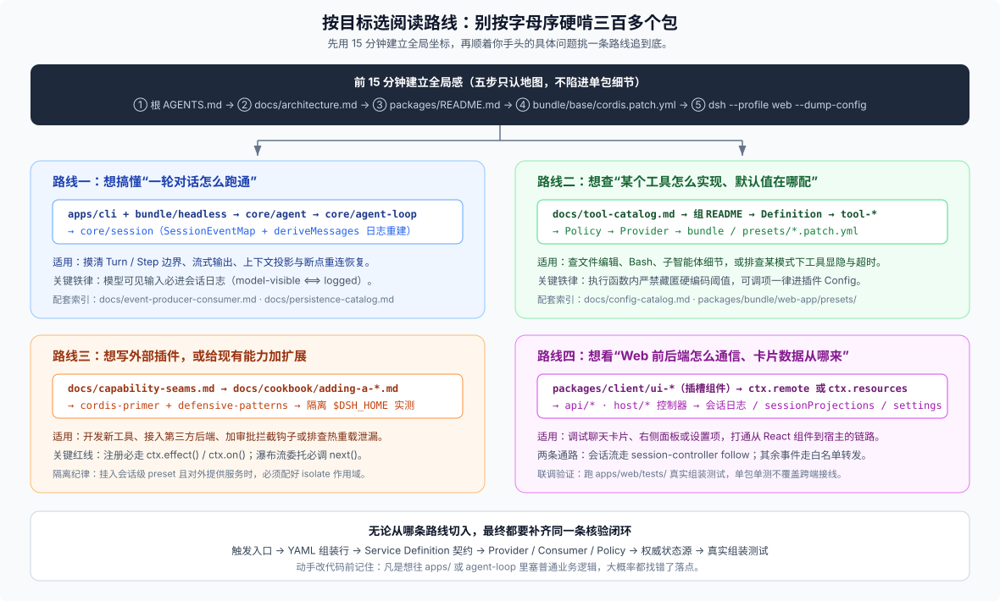

# 03 · 按目标选阅读路线：不同目的的人打开仓库先看哪几步？

面对三百多个包，最忌讳按目录字母序从 `acp/` 一路往下硬读到 `workspace/`——那样只会看一堆孤立的注册代码，完全串不起运行时的因果。最高效的读法是**先花 15 分钟建好全局坐标，再按你手头的具体问题挑一条路线追到底**。

---

## 零、前 15 分钟：五步建立全局感

第一次打开仓库，按顺序扫一眼这 5 个文件就够了（只认地图，别陷进实现细节）：

1. **根 [`AGENTS.md`](https://github.com/deepseek-ai/deepseek-harness/blob/master/AGENTS.md)**：花 3 分钟扫完顶层目录表、常用命令和核心编码铁律。
2. **[`docs/architecture.md`](https://github.com/deepseek-ai/deepseek-harness/blob/master/docs/architecture.md)**：顺着章节标题理清骨架——Cordis → Profiles & Bundles → Core → Events → Turn Flow → Session Log → Capability Seams。
3. **[`packages/README.md`](https://github.com/deepseek-ai/deepseek-harness/blob/master/packages/README.md)**：快速浏览五十多个领域组各自管什么，做到“遇事知道去翻哪个组的 `README.md`”。
4. **[`packages/bundle/base/cordis.patch.yml`](https://github.com/deepseek-ai/deepseek-harness/blob/master/packages/bundle/base/cordis.patch.yml)**：看一眼真实默认底座是怎么把一个个独立包挂成插件行的。
5. **终端敲一行 `pnpm dsh --profile web --dump-config`**：亲眼看看所有配置层合并完之后，你的机器真正启动的是哪张列表。

建好坐标后，直接按你的目标对号入座：



---

## 路线一：想搞懂“一轮对话从用户输入到模型调工具”怎么跑通

**适用场景**：想摸清 Agent 主循环、Turn 与 Step 边界、流式输出、或者“为什么模型能看见某段上下文 / 断点重连怎么恢复”（对应上图路线 A + D）。

**推荐顺读路径**：

1. **看入口怎么把任务喂给 Agent**：从 [`apps/cli/src/bin.ts`](https://github.com/deepseek-ai/deepseek-harness/blob/master/apps/cli/src/bin.ts) → [`profile-boot.ts`](https://github.com/deepseek-ai/deepseek-harness/blob/master/apps/cli/src/profile-boot.ts) 跟进 `packages/bundle/headless/cordis.patch.yml`（一次性跑单轮最干净，没有 Web 网关干扰），看启动插件怎么拿到 `ctx.agents` 并发起对话。
2. **看主循环核心契约与驱动**：先读 [`packages/core/agent/README.md`](https://github.com/deepseek-ai/deepseek-harness/blob/master/packages/core/agent/README.md) 认清公共 `Agent` 接口与 `agent/*` 实时事件，再进 [`packages/core/agent-loop/`](https://github.com/deepseek-ai/deepseek-harness/blob/master/packages/core/agent-loop/README.md) 对照 `architecture.md` 里的 Turn 流程图：
   - 一轮对话（`turn/start → turn/end`）内含零到多个模型请求步（`step/start → step/end`）；
   - 每一步依次经过 `agent/pre-step`（认领并允许拦截改写输入）→ 组装系统提示词与工具 Schema → `agent/request`（解析路由）→ `llm/stream`（流式请求模型并落定 `assistant/message`）→ `tools/pre-execute → tools/execute → tools/post-execute`（执行工具并记下 `tool/result`）。
3. **看上下文怎么从日志精确重建**：读 [`packages/core/session/`](https://github.com/deepseek-ai/deepseek-harness/blob/master/packages/core/session/README.md) 里的 `SessionEventMap` 与 `deriveMessages()`。记住 `model-visible ⟺ logged` 铁律——模型请求里的每一个字都由会话日志投影而来；想查某个事件由谁写入、被谁消费，直接翻自动生成的 [`docs/event-producer-consumer.md`](https://github.com/deepseek-ai/deepseek-harness/blob/master/docs/event-producer-consumer.md) 和 [`docs/persistence-catalog.md`](https://github.com/deepseek-ai/deepseek-harness/blob/master/docs/persistence-catalog.md)。

```sh
# 查某个会话事件或生命周期事件在全仓的写入点与监听点
rg -n "turn/stopping|agent/pre-step|tools/pre-execute" packages/
```

---

## 路线二：想查“某个工具或底层能力怎么实现、默认值在哪配”

**适用场景**：想看懂文件编辑、Bash 执行、子智能体委派、联网搜索的底层细节，或者排查“为什么换了个模式某个工具不见了 / 超时默认值从哪来的”（对应上图路线 B + E）。

**推荐顺读路径**：

1. **先查全局工具表定位归属包**：不确定工具名叫什么包时，直接打开自动生成的 [`docs/tool-catalog.md`](https://github.com/deepseek-ai/deepseek-harness/blob/master/docs/tool-catalog.md)，一秒查到工具名对应的包路径。
2. **在领域组内按“定义 → 消费 → 策略 → 实现”横向读**：打开该组的 `packages/<group>/README.md` 看清组内角色分工，依次读 Definition 的接口类型、Consumer（`tool-*`）的参数校验与呈现逻辑、Policy 的事件监听器，最后看具体 Provider（如 `-local` / `-sandbox` / `-ssh`）怎么干活。
3. **追配置与挂载开关**：DSH 严禁在执行函数内部藏匿硬编码的部署阈值（`?? default`），所有可调参数都显式声明在插件的 `Config` Schema 里并汇总进 [`docs/config-catalog.md`](https://github.com/deepseek-ai/deepseek-harness/blob/master/docs/config-catalog.md)。想看工具在哪个模式里开启，去翻 `packages/bundle/base/cordis.patch.yml` 和 Web 四大预设 `packages/bundle/web-app/presets/{standard,ptc,minimal,cordis}.patch.yml`（模式差异详见 [FAQ 03](../03_preset-modes-specialty/answer.md)）。

```sh
# 1. 查谁在提供某个 ctx 服务（以 ctx.fs 为例）
rg -n "provide\('fs'|super\(ctx, 'fs'" packages/
# 2. 查某个工具包在哪些默认 bundle 或 preset 里被挂载或禁用
rg -n "@deepseek-ai/dsh-tool-fs" packages/bundle apps/cli/config
```

---

## 路线三：想自己写外部插件，或者给现有能力加扩展

**适用场景**：准备开发新工具、接入新的第三方服务 Provider、加一道审批/安全拦截钩子，或者排查插件热重载（HMR）时的资源泄漏（对应上图路线 F + 扩展设计）。

**推荐顺读路径**：

1. **动手前先查家底，别重复造轮子**：先翻 [`docs/capability-seams.md`](https://github.com/deepseek-ai/deepseek-harness/blob/master/docs/capability-seams.md) 和 [`packages/README.md`](https://github.com/deepseek-ai/deepseek-harness/blob/master/packages/README.md)，确认你要做的能力是“已经有成熟接口、只需再写一个 Provider”，还是“仓库压根没开这条 seam”（生态成熟度与缺口评估见 [FAQ 08](../08_plugin-seam-maturity/answer.md)）。
2. **照着官方 Cookbook 搭骨架**：新增包看 [`docs/cookbook/adding-a-package.md`](https://github.com/deepseek-ai/deepseek-harness/blob/master/docs/cookbook/adding-a-package.md)，新增模型工具看 [`docs/cookbook/adding-a-tool.md`](https://github.com/deepseek-ai/deepseek-harness/blob/master/docs/cookbook/adding-a-tool.md)（工具在模型侧的提示词体验与在 Web 聊天流里的卡片呈现要一起设计）。
3. **守住生命周期与防御性编程红线**：动笔前必读 [`docs/cordis-primer.md`](https://github.com/deepseek-ai/deepseek-harness/blob/master/docs/cordis-primer.md) 和 [`docs/defensive-patterns/README.md`](https://github.com/deepseek-ai/deepseek-harness/blob/master/docs/defensive-patterns/README.md)：
   - 任何注册行为都必须走 `ctx.effect()` 或 `ctx.on()`，确保插件卸载或配置热更新时副作用能干净撤销；
   - 监听 waterfall 事件（如 `agent/pre-step`、`tools/execute`）时，放行委托**必须调用 `next()`**，漏调会直接截断整条下游链路；
   - 如果你的插件要挂进会话级 `preset` 并对外提供服务，记得配好 `isolate` 作用域，防止污染 Host 根上下文。
4. **本地免发版挂载验证**：在测试用的隔离 `$DSH_HOME` 里用 `dsh plugin` 或 `--patch` 挂进真实 profile 跑通闭环（完整六步开发闭环见 [FAQ 11](../11_native-development-loop/answer.md)，独立插件仓组织见 [FAQ 13](../13_expert-plugin-repo-organization/answer.md)）。

---

## 路线四：想看“Web 界面某张卡片的数据从哪来、点按钮改了哪”

**适用场景**：开发或调试 Web GUI 组件、右栏面板（docking）、设置项或工具结果卡片，想打通从 React 组件到 Node 宿主权威状态的整条链路（对应上图路线 C）。

**推荐顺读路径**：

1. **先在浏览器侧找到 UI 插件主人**：从 [`packages/client/README.md`](https://github.com/deepseek-ai/deepseek-harness/blob/master/packages/client/README.md) 找到对应的 `packages/client/ui-<feature>`，看它的 `src/index.ts` 往哪个界面槽位（slot）注册了组件。
2. **看清它走哪条前端数据链路**（DSH 前端拿数据有两种标准姿势）：
   - **直接调类型化 Remote / 订事件**：看组件用了哪个 `ctx.remote.<namespace>` 方法或 `ctx.remote.$on` 事件，再去 `packages/api/`、`packages/host/` 或对应能力组里搜 `@Remote` / `@RemoteScope` 装饰的宿主方法实现。
   - **订阅内容寻址资源（`dsh-resource://<type>/...`）**：如果组件用全局标准属性 `useResource` 读取资源地址（比如右栏预览面板或文件树），先去 [`packages/client/resources/`](https://github.com/deepseek-ai/deepseek-harness/blob/master/docs/subsystems/client-resources.md) 查 `ResourceProtocolMap` 里谁注册了这个协议的 provider，再顺着该 provider 内部的 Remote 调用回到 Host 侧状态源。
3. **落到服务端权威状态与真实组装测试**：穿过传输层后，找到真正持有事实的地方（`core/session` 日志、`ctx.sessionProjections` 增量视图、`settings` 或 `workspace` 服务）；验证前后端接线是否正常，看 [`apps/web/tests/`](https://github.com/deepseek-ai/deepseek-harness/tree/master/apps/web/tests) 下的组装测试，光跑单包单测证明不了跨端联通。

---

## 附：改代码时怎么选落点？（防改错地方速查表）

当你读完链路准备动手改代码时，对照下面这张表检查落点——**凡是想往 `apps/` 或 `agent-loop` 里塞普通业务逻辑的念头，十有八九都选错了地方**：

| 你想做的改动 | 正确的落点目录 |
|---|---|
| 改某项能力的公共接口、请求参数或返回结构 | 拥有该 Service Definition 的包（如 `packages/fs/fs`），并同步更新所有消费方 |
| 给已有能力换一套底层实现（如新搜索源、新沙箱） | 对应领域组下的新 Provider 包（若与某套远程运行时深度绑定，跟运行时主人放同一组，如 `packages/ssh/*`） |
| 给大模型新增一个可调用的工具 | 对应领域组下的 `tool-*` 包，向 `ctx.tools` 注册 |
| 在工具执行前后加权限拦截、审计或防呆提醒 | 独立的策略插件（监听 `fs/*`、`tools/*` 或 `agent/*` 事件），不硬塞进单个工具内部 |
| 新增或调整 Web 界面功能 | 前端组件放 `packages/client/ui-*`；需要新协议走 `ctx.resources`；后端权威状态回各自领域包 |
| 调整默认开启哪些插件、或者改某个模式的工具集 | `packages/bundle/*/cordis.patch.yml` 或 `packages/bundle/web-app/presets/*.patch.yml` |
| 新增供用户按需体验的可选配置组合 | `apps/cli/config/examples/`（只放配置，可复用代码抽回 `packages/`） |
| 改命令行参数解析、profile 合成或优雅退出 | `apps/cli/`（若是多入口共用的启动协议则放 `packages/boot/`） |
| 改 Turn/Step 推进语义或新增模型可见的持久化事实 | `packages/core/agent-loop` 或 `packages/core/session`（**必须同步更新 `docs/architecture.md` 与 TS/Python 双端 SDK 期望输出**） |
| 修改官方文档或修站点导航 | 正文改 `docs/` 或包的双语 `README`；路由显隐改 `website/docs.ts` |
