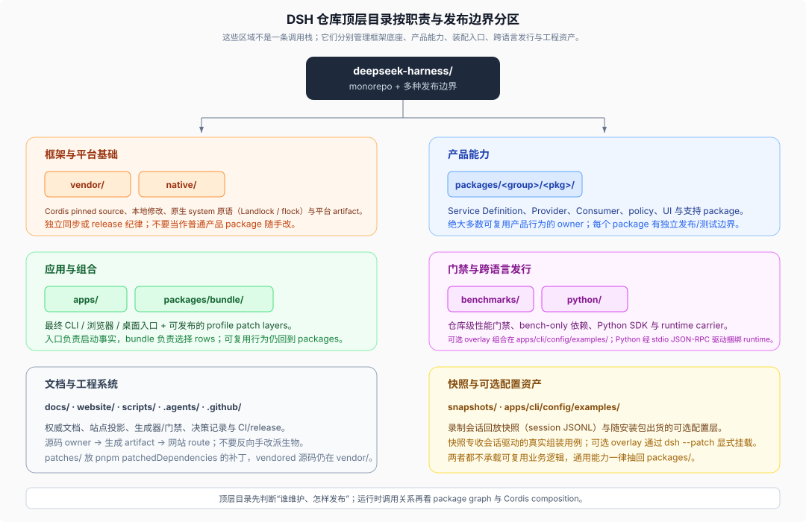
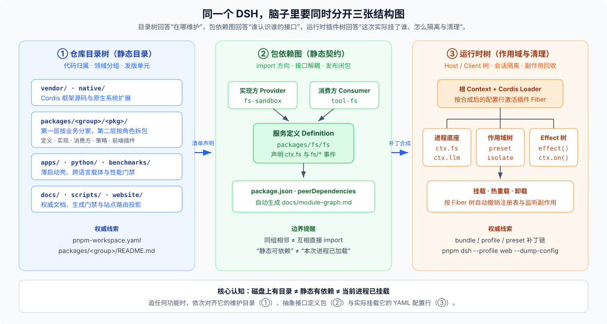

# Answer 01 · DSH 仓库全景导览：按职责边界分区、按可替换角色拆包、按三张图读运行时

## 一句话结论

DSH 没有采用传统的 `controllers / services / utils` 技术分层目录，而是按**维护归属、可替换角色与发布边界**来摆代码：**所有可复用的能力都放在 `packages/<group>/<pkg>/` 里，第一层按业务领域分家，第二层按接口、实现、消费方和策略拆包；`bundle`、profile 与 preset 只负责用 YAML 把这些插件拼起来；`apps/` 只保留最薄的进程与页面启动壳**。

想快速看懂这套目录，核心秘诀只有一条：**别拿“文件夹位置”去硬猜“运行时调用链”**——读 DSH 时，脑子里要同时分开**三张结构图**、**两个代码平面**和**三层运行作用域**。

---

## 一、顶层目录怎么记：按“谁维护、怎么发版”划成六块



不用一上来背三百多个包名，先把顶层十几个目录按职责边界归成六块就清爽了：

| 分区 | 对应目录 | 一句话记住它管什么 |
|---|---|---|
| **1. 框架与原生底座** | `vendor/`、`native/` | 钉死上游版本并本地维护的 Cordis 插件框架，以及 Linux Landlock / POSIX `flock` 原生扩展；有独立同步与发版规矩，别当普通业务包随手改 |
| **2. 可复用产品能力** | `packages/<group>/<pkg>/` | 仓库真正的主体：五十多个领域组承载接口定义、后端实现、模型工具、执行策略与前端插件；唯一例外是按成熟度收拢实验能力的 `experimental/` |
| **3. 薄入口与默认组装** | `apps/`、`packages/bundle/` | `apps/` 只管命令行解析、拉起宿主与前端挂载点；默认装哪些插件全写在 `packages/bundle/*/cordis.patch.yml` 里 |
| **4. 跨语言发行与性能门禁** | `python/`、`benchmarks/` | Python SDK 与捆绑运行时载体，以及由根 `vitest.bench.config.ts` 编排的仓库级性能门禁 |
| **5. 文档与工程治理** | `docs/`、`website/`、`scripts/`、`.agents/`、`.github/` | 只写当前状态的权威文档（`website/` 只做路由投影）、生成器与校验门禁、架构决策记录（Agent Notes）与 CI 流水线 |
| **6. 录制快照与可选配置** | `snapshots/`、`apps/cli/config/examples/`、`patches/` | 真实会话回放快照（JSONL）、用 `dsh --patch` 按需挂载的示例配置层，以及第三方依赖补丁 |

为什么 `apps/` 薄得像层纸？因为 DSH 立了死规矩：**只有命名的 `dsh` profile 才能启动受支持的 Node 应用**（桌面端也只是由 Electron 私有宿主调同一套 `runProfile` 启动完整 Web 应用）。把业务逻辑全留在 `packages/`，才能让 Web、Headless、TypeScript/Python SDK、ACP 和 Desktop 五种形态共用同一套底层实现。

---

## 二、为什么包拆得这么碎？分清“三张图 + 两平面 + 三层运行树”

在普通单体项目里，“目录里有某个模块 ≈ 主程序引用了它 ≈ 启动后它一定在跑”。DSH 因为“一切皆插件”，刻意拆开了这三件事：



### 1. 静态目录 ≠ 依赖方向 ≠ 本次实际加载

- **仓库目录树（在哪维护）**：`packages/fs/` 把文件读写相关的包放在一起，方便按领域找主人（先读组级 `packages/<group>/README.md`）。拿文件系统组举例，看名字后缀就能一眼认出各自的角色：

  ```text
  packages/fs/
  ├── fs/                       # Service Definition：声明 ctx.fs 接口与 fs/* 事件
  ├── fs-local/                 # Provider：基础本地文件系统实现
  ├── fs-sandbox/               # Provider：套上工作区沙箱围栏的本地实现
  ├── fs-observation-policy/    # Policy：监听 fs/* 事件强制“先读后改”与版本防覆盖
  ├── tool-fs/                  # Consumer：向模型暴露 read / write / edit 工具
  └── tool-fs-search/           # 相邻 Consumer：调 ctx.subprocess 跑 ripgrep 搜索
  ```

  但目录挨着不代表互相调用——同在 `fs/` 组里的 `tool-fs` 绝不会直接 import `fs-local`。
- **包依赖图（谁认识谁的接口）**：工具消费方（`tool-fs`）和具体实现（`fs-local`、`fs-sandbox`、跨组的 `ssh/fs-ssh`）都只依赖中间的服务定义包（`fs`）。全仓静态依赖由 [`docs/module-graph.md`](https://github.com/deepseek-ai/deepseek-harness/blob/master/docs/module-graph.md) 自动生成。
- **运行时插件树（这次到底挂了谁）**：包躺在磁盘上不代表进程加载了它。实际跑哪些插件，由 `bundle → profile → $DSH_HOME/cordis.patch.yml → --patch` 从空列表逐层合成；敲一行 `pnpm dsh --profile web --dump-config` 就能看到合成后的真实配置。

### 2. 源码平面 vs 产物平面（附双编译面）

每个包手写代码都在 `src/`，测试在同级 `tests/`，构建产物输出到被 Git 忽略的 `lib/`。日常跑单测、类型检查和静态门禁时，工作区直接通过根 `tsconfig.base.json` 的 `paths` 映射到 `src/`，刚克隆下来的干净树不用先跑全量构建就能做检查；只有打包校验（如 `publint`）和面向构建产物的集成测试才读 `lib/`。因此**读代码永远从包的 `README.md → src/index.ts` 进，别去翻 `lib/`**。

另外，仓库的 TypeScript 编译严格拆成 **Host（`tsconfig.host.json`）** 和 **Client（`tsconfig.client.json`）** 两套独立程序：因为服务端和浏览器端都会往同名 Cordis `Context` 键上做声明合并，混进同一个 TS Program 会直接报类型冲突。

### 3. 运行时的三层结构：Host 树、Client 树与 Agent 作用域

当你敲下 `dsh web` 时，跑起来的并不是一锅扁平的全局插件汤，而是三层职责分明的运行空间：

1. **Host Cordis 树（Node 进程）**：挂载会话日志存储（`ctx.sessions`）、主循环（`ctx.agents`）、文件系统/沙箱/模型等进程级底座服务，以及 HTTP 与 RPC 网关。
2. **Client Cordis 树（浏览器页面）**：`apps/web` 启动 `@deepseek-ai/dsh-client-web` 后，按 Host 推过来的客户端入口图在浏览器里再建一棵独立的 Cordis 树，让 `packages/client/ui-*` 往界面槽位（slots）和客户端资源模型（`ctx.resources` / `useResource`）注册组件。前后端通过类型化 Remote 与事件流对话，不共享 JS 内存。
3. **Per-Agent 作用域（`scope` / `isolate`）**：同一个 Host 进程里可以同时开出 `standard`、`ptc`、`minimal`、`cordis` 等不同模式的会话。进程级 Provider 在根树共享；而“当前会话能用哪些工具、拼哪几段系统提示词、持有哪些会话私有状态”则由 [`packages/preset/`](https://github.com/deepseek-ai/deepseek-harness/blob/master/packages/preset/README.md) 隔离在各自的 agent scope 与 `isolate` 作用域里，互不串台。

---

## 三、新手最容易踩的五个直觉误区

1. **把 `packages/core/` 当成包办一切的“不可替换内核”**：`core/` 放的是主干接口（`session`、`tools`、`system-prompt`、`agent`），连默认驱动 `agent-loop` 自己也只是一个实现 `Agent` 接口的插件。加新功能优先挂事件或注册表，不要习惯性去改 `agent-loop`。
2. **以为 `core/session` 和 `packages/session/` 重名打架**：`core/session` 管内存里的活事件流与模型上下文推导；`packages/session/` 管怎么落盘（JSONL 世代文件与格式迁移链）、怎么做增量状态投影、怎么起会话标题和发遥测；全文检索则独立在 `packages/session-query/`（SQLite FTS5）。
3. **把 `packages/experimental/` 等同于“所有可选功能”**：`experimental/` 划分的是**成熟度**（尚在评估、无正式兼容承诺）；而“可选（optional）”说的是**需用户显式开启**——像 `ssh/`、`lsp/` 这类有明确维护承诺的可选能力留在各自领域组里，由 [`scripts/product-package-policy.ts`](https://github.com/deepseek-ai/deepseek-harness/blob/master/scripts/product-package-policy.ts) 登记把关。
4. **去 `website/` 里找文档源文件改**：官网目录不存独立正文，只靠 [`website/docs.ts`](https://github.com/deepseek-ai/deepseek-harness/blob/master/website/docs.ts) 把 `docs/` 和包 `README` 投影成网页路由；`docs/*-catalog.md` 等生成目录也必须改源码后跑脚本刷新，严禁手改。
5. **按字母顺序从 `packages/` 第一个包往下硬啃**：脱离具体组合配置去干读单个插件，只会看到满屏抽象接口。选定一条具体问题链追到底，15 分钟就能摸清脉络。

---

## 继续阅读

| 你想深入了解哪一块 | 去哪篇看 |
|---|---|
| 顶层十几个目录各自归谁管？为什么 `apps/` 这么薄？CLI、Web、Desktop 怎么从命令变成活进程？ | [`01-top-level-zones-and-thin-apps.md`](./01-top-level-zones-and-thin-apps.md) |
| `packages/<group>/<pkg>/` 为什么要按接口/实现/工具/策略拆包？依赖方向、实验组与双编译面怎么配合？ | [`02-two-level-packages-and-seams.md`](./02-two-level-packages-and-seams.md) |
| 想看懂对话主循环、查工具实现、写外部插件或追 Web 前后端通信，各自该顺着哪条路线读和改？ | [`03-reading-routes-by-goal.md`](./03-reading-routes-by-goal.md) |
| 本文涉及的权威文档、核心包入口、自动生成目录与门禁脚本速查清单 | [`reference.md`](./reference.md) |

> 注：文中的“三张图”是对仓库目录布局、包依赖图与运行时插件树的通俗合称，不是 DSH 源码里的字段名。核验状态见 [核验基线登记](../00-baseline.md)。
