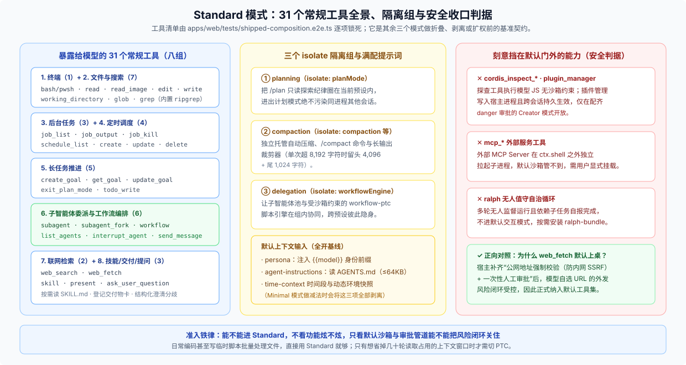

# 01 · Standard 模式：给齐 31 个常规工具，同时把未闭环的高危能力关在门外

为什么“最普通的默认模式”值得单独拆开看？

因为 `standard` 不仅是注册表的部署默认值（`default: standard`）和关闭开发者模式选择器时的兜底入口，更是端到端组合测试 [`shipped-composition.e2e.ts`](https://github.com/deepseek-ai/deepseek-harness/blob/master/apps/web/tests/shipped-composition.e2e.ts) 逐项锁死的**产品基线契约**。看懂它给了哪 31 个工具、又故意把哪三类能力挡在门外，其余三个模式改了什么就一目了然了。

---

## 一、31 个常规原生工具按职责怎么分组？

打开 [`standard.patch.yml`](https://github.com/deepseek-ai/deepseek-harness/blob/master/packages/bundle/web-app/presets/standard.patch.yml) 对照组合测试断言，发给模型的 **31 个工具** 按职责分成八组，没有任何冗余凑数：

| 职责分组 | 暴露给模型的工具名 | 关键运行机制说明 |
|---|---|---|
| **1. 终端执行（1）** | `bash`（Windows 下自动切换为 `pwsh`） | **单次独立子进程**（one-shot）：每次调用拉起新进程，目录与临时环境变量不跨调用残留 |
| **2. 文件与搜索（7）** | `read` · `read_image` · `edit` · `write` · `working_directory` · `glob` · `grep` | 改文件受 `read-before-edit` 保护；`glob`/`grep` 直接调包内自带的 `@vscode/ripgrep`，不依赖用户机器是否装了 `rg` |
| **3. 后台任务（3）** | `job_list` · `job_output` · `job_kill` | 跟踪、读取或终止转入后台运行的长耗时命令与任务 |
| **4. 定时调度（4）** | `schedule_list` · `schedule_create` · `schedule_update` · `schedule_delete` | 在当前会话内设置延时提醒或周期性跟进检查 |
| **5. 长任务推进（5）** | `create_goal` · `get_goal` · `update_goal` · `exit_plan_mode` · `todo_write` | 支撑 `/goal` 持久目标验收、`/plan` 方案审批卡片与底栏实时进度条 |
| **6. 委派与编排（6）** | `subagent` · `subagent_fork` · `list_agents` · `interrupt_agent` · `send_message` · `workflow` | 既能派独立上下文或继承上下文的子智能体，也能用 `workflow` 跑 JS 多步并发编排脚本（外部 Codex / Claude Code 后端通过按需扩展包挂载，不占默认列表） |
| **7. 联网检索（2）** | `web_search` · `web_fetch` | 搜索公开网页，或在安全校验与审批约束下抓取指定 URL |
| **8. 技能、交付与提问（3）** | `skill` · `present` · `ask_user_question` | 按需加载 `SKILL.md` 全文、向前端渲染交付物文件卡、在遇到用户决策分歧时发起结构化提问 |

这份 31 工具清单在仓库里是硬契约：任何 PR 只要往默认 Web 组装里多塞或少挂一个工具，却没同步更新 `shipped-composition.e2e.ts` 里的 `EXPECTED_TOOLS`，CI 当场报红。

---

## 二、哪些能力被刻意挡在默认门外？判据是什么？

仓库组合测试的注释专门点名：下面几组工具在 Standard 里缺席是**刻意的工程取舍（deliberate, not incidental）**，判据只有一条——**默认沙箱与权限管道能不能把它的风险闭环关住**：

1. **`cordis_inspect_*` 与 `plugin_manager` / `plugin_market`（关在门外）**
   - `cordis_inspect_list` / `cordis_inspect_query` 会执行模型编写的 JavaScript 来探查宿主内部状态，没有文件或子进程沙箱能约束它；
   - `plugin_manager` 安装的代码直接跑在宿主 Node 进程里且跨会话持久生效，因此在 `standard.patch.yml` 末尾被显式设为 `disabled: true`。这两组能力只在专门用来改造 DSH 的 [Creator 模式](./04-creator-mode.md) 中配齐审批门后开放。
2. **`mcp_*` 外部工具（关在门外）**
   外部 MCP Server 在 `ctx.shell` 之外独立拉起子进程，默认终端沙箱覆盖不到它的行为边界，因此必须由用户知情后单独挂载配置。
3. **`ralph` 无人值守循环（关在门外）**
   多轮无人监督自主循环且依赖子任务自报完成状态，不适合放进日常交互默认模式；确有需要时单独安装按需扩展包 `ralph-bundle`。
4. **正向对照：为什么 `web_fetch` 反而允许默认上桌？**
   早期任意抓网页容易带来内网探测（SSRF）或数据外带风险；但当宿主补齐了**公网地址强制校验 + 一次性人工审批**后，模型自选目标 URL 的风险面形成了闭环，于是 `web_fetch` 正式进入默认工具集。

---

## 三、三个 `isolate` 隔离组与完整提示词输入

除了工具清单，Standard 还立下了另外两块默认基准：

- **三个作用域隔离组（防多会话串台）**：
  1. `planning`（`isolate: planMode`）：把 `/plan` 注入的那大段只读探索纪律关在当前预设作用域内，进出计划模式绝不污染同进程的其他会话；
  2. `compaction`（`isolate: compaction, toolResultPruner`）：独立托管自动/手动压缩（`/compact`）以及超长工具输出裁剪器（单次工具返回超过 `8,192` 字符时，自动保留开头 `4,096` 与结尾 `1,024` 字符）；
  3. `delegation`（`isolate: workflowEngine`）：让当前预设下的子智能体池与受沙箱约束的 `workflow-ptc` Node 脚本引擎在组内协同工作。
- **满配上下文输入**：`persona` 注入当前模型身份前缀（`You are a coding agent powered by the {{model}} model.`），`agent-instructions` 自动读取工作区 `AGENTS.md`（上限 64KB），外加 `time-context` 时间段与动态环境快照。这正是 [Minimal 模式](./03-minimal-mode.md) 做减法前的完整起点。

**选型提示**：日常写业务代码、排查 Bug、整理文档，甚至让 Agent 写个临时脚本批量改几十个文件，直接选 Standard 就够了。正如界面内置指南所提醒的——**“标准模式也能编写脚本、批量处理文件；PTC 改变的是工具调用方式，批量任务并不必须使用 PTC。”**
