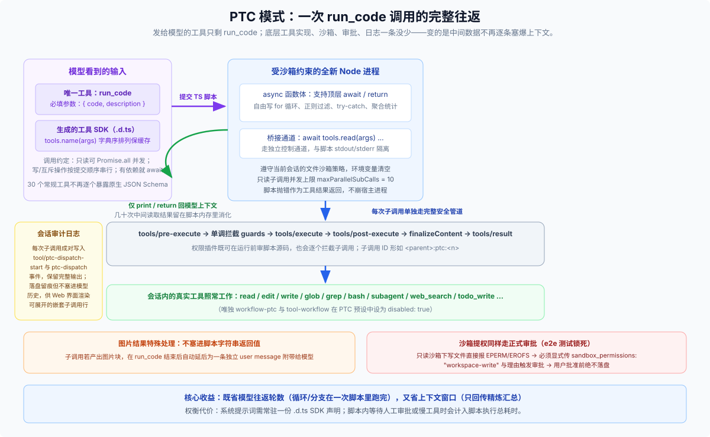

# 02 · PTC 模式：把一摞工具折叠进 run_code 代码沙盒，但子调用仍走完整审批审计管道

PTC 是 **Programmatic Tool Calling（程序化工具调用）** 的缩写。它的出发点来自大模型工程实践里的一个鲜明反差（详见 [PTC 设计记录](https://github.com/deepseek-ai/deepseek-harness/blob/master/.agents/notes/implemented/feature/2026-06-15-ptc.md) 与 Cloudflare [Code Mode](https://blog.cloudflare.com/code-mode/) 的同源观察）：

- **常规原生调用**：每调一次工具都要经历一次完整的模型请求往返，而且**每一次中间工具返回的原始大文本都会整份塞进聊天历史**；
- **大模型的真实强项**：相比一轮轮手搓 JSON 工具调用轨迹，模型写 TypeScript 循环、`if/else` 过滤和异常处理的训练量要大得多。

看一个最直观的例子——假设你要检查 `configs/` 下 50 个 JSON 文件里哪些漏掉了 `"version"` 字段：

- 在常规模式下，如果逐个调 `read`，模型要来回往返几十轮，50 份完整文件内容全堆在上下文里占地方；
- 切到 **PTC 模式**后，模型只发一次 `run_code` 工具调用，交出短短几行 TypeScript：

```ts
const { matches } = await tools.glob({ pattern: 'configs/*.json' })
const missing: string[] = []
for (const file of matches) {
  const text = await tools.read({ file_path: file })
  if (!text.includes('"version"')) missing.push(file)
}
return { checked: matches.length, missing }
```

50 份配置文件的原文在临时 Node 进程内存里读完即弃，**最终回到模型上下文窗口的，只有 `{ checked, missing }` 这一小段干净汇总**。



---

## 一、预设里到底改了哪一行？模型眼里看到了什么？

对比 `standard.patch.yml`，[`ptc.patch.yml`](https://github.com/deepseek-ai/deepseek-harness/blob/master/packages/bundle/web-app/presets/ptc.patch.yml) 真正改变调用形态的核心配置其实只有一行插件声明：

```yaml
- id: tool-presentation
  name: '@deepseek-ai/dsh-agent-tool-presentation'
  config:
    mode: ptc
```

工具注册表 `ToolRuntime` 本身支持 `'native' | 'ptc' | 'both'` 三种呈现方式（默认 `'native'`）。`dsh-agent-tool-presentation` 把 `mode: ptc` 绑定在当前会话预设的 `scope` 上（见 [`agent-tool-presentation` README](https://github.com/deepseek-ai/deepseek-harness/blob/master/packages/core/agent-tool-presentation/README.md)），带来四点立竿见影的变化：

1. **发给模型的工具列表只剩 1 个 `run_code`**：必填参数是 `{ code, description }`。`run_code` 位于工具过滤层之外，任何权限或裁剪规则都不会误删这唯一的调用入口。
2. **其余工具变成系统提示词里的 `.d.ts` SDK**：原本的 `read`、`edit`、`glob`、`bash`、`subagent`、`web_search`、`todo_write` 等工具在当前会话里一个没少，只是不再逐个发送 JSON Schema，而是按**字典序稳定排列**生成一份 TypeScript `tools.*` 类型声明与并发调用约定，确保提示词前缀字节稳定以命中模型缓存。
3. **挂载时即刻验真（Fail loud at mount）**：启用 `ptc` 要求宿主里装有兼容的 `ctx.ptcRuntime`（默认由 [`dsh-ptc-runtime-node`](https://github.com/deepseek-ai/deepseek-harness/blob/master/packages/ptc-runtime/ptc-runtime-node/README.md) 提供）；如果宿主缺运行时，预设在挂载阶段就会直接报错拒绝，不等用户发消息才抛异常。
4. **同进程多模式互不干扰**：因为呈现模式挂在会话 `scope` 上，同一个进程里开 PTC 会话完全不会影响隔壁正在跑的 Standard 会话。

---

## 二、写进代码循环里的子调用，还会受权限审批和日志约束吗？

很多人第一次见 `run_code` 会担心：“让模型写代码调工具，是不是就把权限审批和审计日志绕过去了？”

答案是：**一处都没绕过，脚本里的每一次 `await tools.xxx()` 走的依然是宿主的完整工具管道。** 这套机制由 [`ptc-round.e2e.ts`](https://github.com/deepseek-ai/deepseek-harness/blob/master/apps/web/tests/ptc-round.e2e.ts) 与 [`ptc-escalation.e2e.ts`](https://github.com/deepseek-ai/deepseek-harness/blob/master/apps/web/tests/ptc-escalation.e2e.ts) 端到端锁死：

- **独立沙箱进程 + 逐次过完整管道**：每次 `run_code` 都在全新的 Node 子进程里执行（清空环境变量，受当前会话的文件沙箱策略限制），通过独立控制通道把 `tools.xxx(args)` 请求发回宿主。每一次子调用都原封不动走完 `tools/pre-execute → 单调拦截守卫 guards → tools/execute → post-execute → result`。
- **越权写文件照常拦截并弹窗审批**：在只读沙箱下如果脚本直接写文件，会当场收到 `EPERM` / `EROFS` 拒绝；脚本必须像原生调用一样显式传入 `sandbox_permissions: "workspace-write"` 与申请理由触发审批，在用户点同意之前磁盘上绝不会落下一字节。
- **审计日志全留痕，但只给前端看、不塞爆模型历史**：每次子调用都会在会话日志里成对写入 `tool/ptc-dispatch-start` 与 `tool/ptc-dispatch` 事件（子调用 ID 形如 `<parent>:ptc:<n>`），保存完整入参与渲染结果。Web 界面靠它们渲染可展开的嵌套子调用行，但回放给模型时自动跳过中间明细，只保留 `run_code` 最终打印或返回的内容。
- **有界并发与图片自动延后**：SDK 允许模型对只读工具用 `Promise.all` 并行提速（单次运行默认最多重叠 `maxParallelSubCalls = 10` 个并发安全调用），而写操作与互斥工具自动排队独占执行；若子调用产出了图片块（无法塞进字符串返回值），系统会在 `run_code` 结束后自动将其延后（defer）为一条独立的 `user` 消息附给模型。

---

## 三、为什么默认关掉了 `workflow`？什么时候选它最划算？

翻看 `ptc.patch.yml` 会发现一个细节：`workflow-ptc` 与 `tool-workflow` 两行被显式设成了 `disabled: true`。

代码与界面引导文案只陈述了“当前 PTC 预设未启用 workflow 工具”的事实，未附额外长文说明。但从机制上看原因非常直观：`workflow` 工具干的事本来就是“让模型写一段 JS 编排脚本放进 PTC 运行时执行”（见 [`workflow-ptc` README](https://github.com/deepseek-ai/deepseek-harness/blob/master/packages/workflow/workflow-ptc/README.md)），和 PTC 模式的主入口 `run_code` 能力高度重叠；关掉它可以省去模型在两套相似脚本入口之间纠结。

**选型建议与真实代价**：

- **最划算的场景**：需要对大批文件、接口或日志做**重复检查、容错跳过、去重、分组统计、汇总出表**的任务——中间脏数据全留在脚本内存里消化，既省往返轮数又省上下文 token。
- **需要留意的边界**：
  1. 提示词里常驻一份完整 `.d.ts` SDK 声明本身有固定前缀开销，如果只是改一两个文件，用 Standard 直接调工具反而更轻快；
  2. 脚本内部等待人工审批或慢速工具时，等待时间会计入当次 `run_code` 的总执行时长预算；
  3. 如果你在自定义插件里给 `systemPrompt.toolOrder` 硬编码了原生工具名，切到对外只暴露 `run_code` 的 PTC 模式时组装校验会直接报错拦截。
