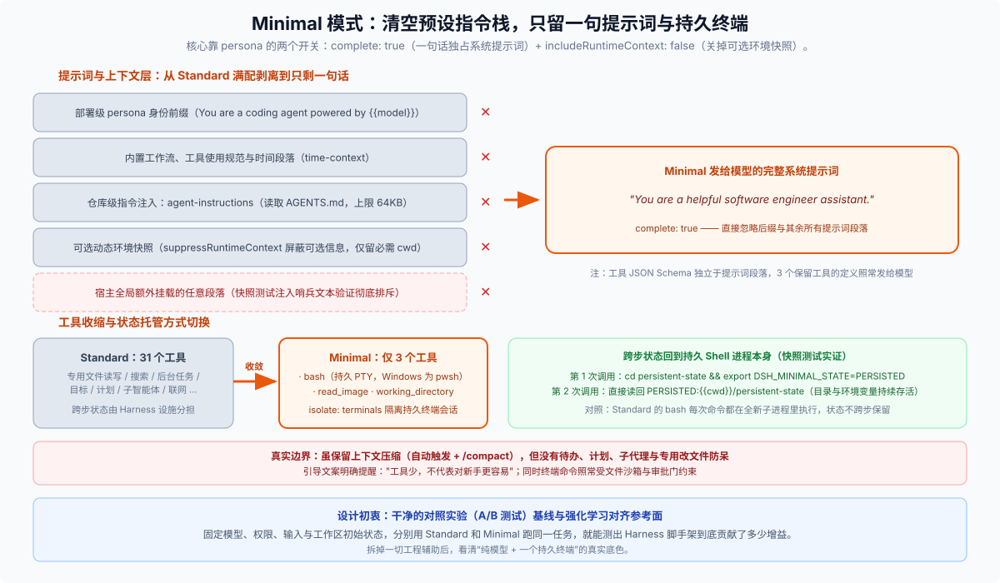

# 03 · Minimal 模式：清空预设指令只留一句提示词和持久终端，专做对照实验基线

[`minimal.patch.yml`](https://github.com/deepseek-ai/deepseek-harness/blob/master/packages/bundle/web-app/presets/minimal.patch.yml) 是四份内置预设里最短的一份。它存在的目的非常纯粹：**把 DSH 平时给模型配齐的工程脚手架（角色指令、仓库 `AGENTS.md`、30 多个专用工具、计划与子智能体）几乎全部卸掉，看“同一个模型 + 一句基础提示词 + 一个持久终端”的裸表现到底如何。**

[`apps/web/tests/minimal-preset.snapshot.ts`](https://github.com/deepseek-ai/deepseek-harness/blob/master/apps/web/tests/minimal-preset.snapshot.ts) 用内联快照把它的对外契约钉得死死的：

```yaml
# 发给模型的完整系统提示词（一字不差）：
prompt: "You are a helpful software engineer assistant."

# 发给模型的全部工具（仅 3 个，Windows 下 bash 自动换为 pwsh）：
tools: ["bash", "read_image", "working_directory"]

# /goal 命令不可用，但保留基础上下文压缩（自动压缩 + /compact）
```



---

## 一、`complete: true` 把提示词栈剥得有多干净？

Minimal 最核心的机制不在删工具，而在 `dsh-persona` 那三行配置（实现见 [`packages/preset/persona/src/index.ts`](https://github.com/deepseek-ai/deepseek-harness/blob/master/packages/preset/persona/src/index.ts)）：

```yaml
- id: persona
  name: '@deepseek-ai/dsh-persona'
  config:
    prefix: You are a helpful software engineer assistant.
    complete: true
    includeRuntimeContext: false
```

这两枚布尔开关配合预设列表的减法，一口气清掉了三层常规上下文输入：

1. **`complete: true` 一句话独占系统提示词，排斥一切其他段落**
   在常规模式下，系统提示词是由部署人设前缀、内置工具与工作流指南、插件扩展段落以及人设后缀按顺序拼接而成的。一旦开启 `complete: true`，这句 `prefix` 就直接成为最终系统提示词全文，其余所有段落统统被屏蔽。为了防止未来有人破坏这条约束，`minimal-preset.snapshot.ts` 专门在测试前向全局注册了一段 `"THIS TEXT MUST NOT REACH THE MODEL."` 哨兵文本，然后断言模型实际收到的系统提示词依然只有那一句 `"You are a helpful software engineer assistant."`。
2. **不挂载 `agent-instructions`，仓库 `AGENTS.md` 不进上下文**
   即便当前工作区根目录躺着写满规矩的 `AGENTS.md`，Minimal 模式也不会自动去读它，模型要了解项目规范只能自己跑命令去看。
3. **`includeRuntimeContext: false` 屏蔽可选动态环境快照**
   它会调用 `ctx.systemPrompt.suppressRuntimeContext()`（见 [`system-prompt` README](https://github.com/deepseek-ai/deepseek-harness/blob/master/packages/core/system-prompt/README.md)），关掉平台、系统等所有可选的动态环境信息；只有标记为 `required` 的当前工作目录（`Current working directory: "..."`，配合 `working_directory` 工具）仍作为最小必需消息保留。注意工具的 JSON Schema 独立于提示词段落，保留的 3 个工具定义照常发给模型。

---

## 二、为什么把终端换成“持久”的？上下文压缩和沙箱还在吗？

把 `read` / `edit` / `write` / `glob` / `grep`、后台作业、技能、计划模式、待办清单、子智能体和联网工具全拿掉之后，Minimal 做了两处关键安排保证基础任务能跑完：

1. **用持久终端接管跨步状态（`isolate: terminals`）**
   Standard 模式的 `bash` 是单次无状态的（每次命令启动新进程），因为跨步记忆有 `todo_write`、`/goal` 等专用设施兜着；Minimal 把这些外围辅助全拆了，改挂一套放在 `isolate: terminals` 隔离组里的持久 PTY 终端（`dsh-terminal` + `dsh-terminal-bash` + `dsh-tool-bash-persistent`；Windows 下底层的 `dsh-terminal-bash` 通过 `shellDialect: pwsh` 切换方言，暴露工具名 `pwsh`）。
   快照测试直接验证了跨步存活：第 1 次调 `bash` 执行 `cd persistent-state && export DSH_MINIMAL_STATE=PERSISTED`，第 2 次调 `bash` 直接读回 `PERSISTED:{{cwd}}/persistent-state`——工作目录和环境变量一直活着。
2. **保留基础上下文压缩，但安全沙箱与审批寸步不让**
   Minimal 依然挂载了独立的 `isolate: compaction` 组（`compaction-basic` + `/compact` 命令）：当终端输出把上下文顶到阈值时会自动压缩早期历史，Agent 空闲时你也可以手动输入 `/compact` 压缩（录制快照专门有一整套 `minimal manual compaction` 验证压缩与续聊）。同时，没有了 `edit` 工具的“先读后改”防呆，不代表脱离了安全管控——持久终端里执行的每一条命令依然照走 `ToolRuntime` 管道、文件沙箱与越权审批。

---

## 三、什么时候选 Minimal？别踩什么误区？

- **正确用法：做干净的 A/B 对照实验（或强化学习对齐基线）**
  想评估某个新模型到底强了多少，或者验证你在 `AGENTS.md` / 自定义技能里写的规则究竟有没有正收益，最准的办法就是按照官方指南说的：**把模型、权限设置、任务提示词和工作区起始状态全部固定住**，分别用 Standard 和 Minimal 各跑一遍同一个修 Bug 任务，直接对比两边的完成情况、终端折腾次数和最终代码改动。
- **最常见的误区：以为“极简模式 = 新手简单模式”**
  恰恰相反！界面指南专门写了一句大实话：**“缺少管理长任务的内置辅助能力；工具少，不代表对新手更容易。”** 遇到跨多文件的复杂重构时，没有搜索工具防刷屏、没有待办进度条、没有先读后改保护，模型但凡跑一条输出过猛的终端命令就容易迷失方向。日常干活请老老实实用 [Standard 模式](./01-standard-mode.md)。
