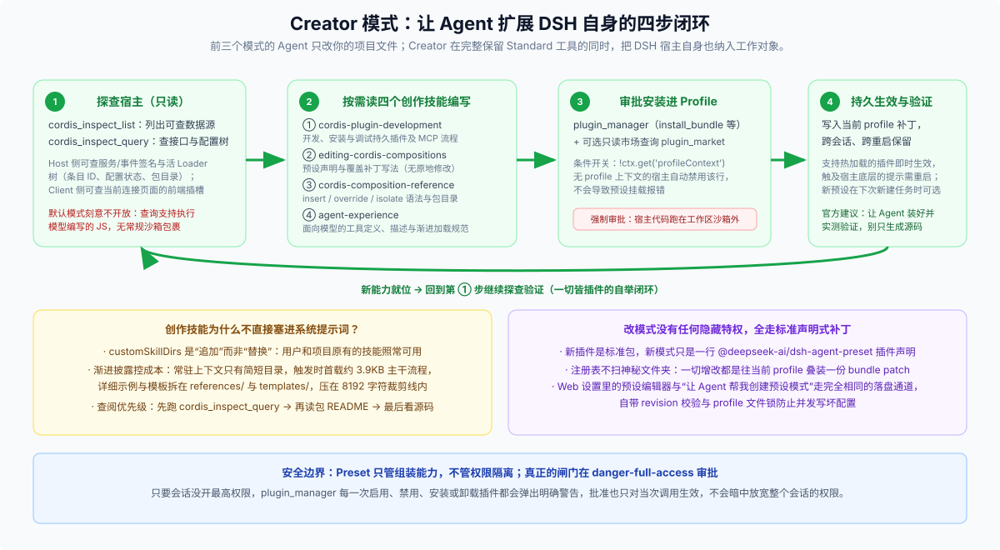

# 04 · Creator 模式：按宿主条件开放 plugin_manager 与四个创作技能，让 Agent 扩展 DSH 自身

Creator 模式在配置文件里的预设 ID 是 `cordis`，界面展示名为「创造模式 / Creator mode」。

前三个模式不管怎么换工具呈现或删减提示词，Agent 的工作对象始终是**你项目仓库里的代码和文件**；而 Creator 模式在**原封不动保留 Standard 全部 31 个常规工具**的基础上，额外给 Agent 装上了三件自省与改造装备，把 **DSH 宿主自身** 变成了对话即可修改的工作对象。



---

## 一、比 Standard 多出来的三样装备各管什么？

打开 [`cordis.patch.yml`](https://github.com/deepseek-ai/deepseek-harness/blob/master/packages/bundle/web-app/presets/cordis.patch.yml) 与 `standard.patch.yml` 逐行比对，多出来的恰好是支撑“看清宿主 → 写对代码 → 装进配置”闭环的三块拼图：

### 1. 看清活体宿主的眼睛：`tool-cordis`（只读运行时探查）

挂载 `@deepseek-ai/dsh-tool-cordis` 后，模型多了两个只读探查工具（见 [`tool-cordis` README](https://github.com/deepseek-ai/deepseek-harness/blob/master/packages/extensions/tool-cordis/README.md)）：

- `cordis_inspect_list`：列出当前可查询的运行时数据源；
- `cordis_inspect_query`：在后端（Host）查询自动生成的服务/事件签名目录，以及当前内存里活着的 Loader 配置树（每个插件行的 ID、启停与配置状态、解析出的磁盘包目录 `packageDir`）；在前端（Client）查询当前已连接浏览器页面的界面插槽与状态。

因为这套查询允许执行模型编写的 JavaScript 过滤代码、没有文件或进程沙箱能包裹，所以 [Standard 模式](./01-standard-mode.md) 刻意将它拒之门外，只在专门改造宿主的 Creator 模式中开放。

### 2. 随宿主环境自动伸缩的安装手：`plugin_manager` 与 `plugin_market`

在 `cordis.patch.yml` 末尾，插件管理与插件市场两行工具没有像 Standard 那样写死 `disabled: true`，而是挂上了同一个 `!!js` 动态判断表达式：

```yaml
- id: tool-plugin-manager
  name: '@deepseek-ai/dsh-plugin-manager/tools'
  disabled: !!js "!ctx.get('profileContext')"
- id: tool-plugin-market
  name: '@deepseek-ai/dsh-plugin-market/tools'
  disabled: !!js "!ctx.get('profileContext')"
```

这行表达式在检查**当前进程是否运行在正式的 `dsh` profile 上下文里**：

- 通过 `dsh web` / `dsh desktop` 等标准 profile 启动时，`profileContext` 存在，`plugin_manager` 自动启用（负责列出/启停插件、安装或移除 bundle、管理版本豁免；若用户同时装了自定义市场扩展包，只读检索工具 `plugin_market` 也会自动就位）；
- 在没有持久化 profile 上下文的测试或特殊嵌入环境里，这两行自动保持禁用，**绝不会因为找不到 `pluginManager` 服务而导致整个 Creator 预设挂载失败**。

### 3. 按需加载、不烧常驻上下文的说明书：四个内置创作技能

Creator 在 `skill-filesystem` 上通过 `customSkillDirs` 把 `@deepseek-ai/dsh-agent-preset/skills` 目录**追加**到了技能搜索路径中（注意是追加而非覆盖，你项目里和个人目录下的日常技能照常可用）。里面住着四个专门教 Agent 怎么按 DSH 规矩写扩展的技能：

1. **`cordis-plugin-development`**：从零编写、本地安装、热重载调试持久插件与 MCP 服务接入的完整流程；
2. **`editing-cordis-compositions`**：如何新增或覆盖 Agent 预设——明确告诉模型“没有任何原地修改预设的特殊接口，改模式就是往当前 profile 装一份声明或覆盖它的 bundle patch，内置的 `minimal.patch.yml` 最短，最适合拿来当起手模板”；
3. **`cordis-composition-reference`**：Cordis 补丁语法速查（`insert`、按 `id` 覆盖、`cordis:group`、`isolate`、`!!js` 合法位置）以及由 `doc-sync` 门禁自动保鲜的可安装官方包清单；
4. **`agent-experience`**：面向模型设计工具名、参数描述、报错下一步提示（`nextStep`）与上下文渐进加载的体验规范。

为什么不把这些开发规范直接塞进 Creator 的系统提示词？[技能渐进披露记录](https://github.com/deepseek-ai/deepseek-harness/blob/master/.agents/notes/archived/architecture/2026-09-21-creator-skills-progressive-disclosure.md) 算过这笔账：塞进系统提示词等于每一轮对话都要重复计费；做成技能后，常驻上下文里只有几行简短目录，触发时首载的 `SKILL.md` 严格压在约 3.9KB（远低于工具结果裁剪器的 `8,192` 字符阈值），详细示例与可拷贝脚手架拆在 `references/` 和 `templates/` 里按需再读，并要求 Agent 按 **“先跑 `cordis_inspect_query` → 再读包 `README` → 最后查声明文件或源码”** 的顺序获取准确接口。

---

## 二、创作成果怎么生效？安全关谁来把守？

### 1. 没有“模式专属后门”，图形界面与 Agent 走同一条落盘通道

无论是你在 Web 设置页点「让 Agent 帮我创建预设模式」、在插件页点「让 Agent 创建插件」拉起 Creator 会话调 `plugin_manager` 安装补丁，还是直接在 Web 预设编辑器里点保存，底层写的都是**当前激活 profile 的用户补丁层**（自带 `revision` 乐观锁比对与 profile 文件锁，防止并发写坏配置）。

给 Creator 提需求时，官方指南有一条非常实用的建议：**直接要求 Agent“完成安装并验证实际效果，而不是只生成源代码”**。安装完成后：

- 普通新增工具或前端插槽在支持热更新的 profile 下可即时生效；若改动触及宿主已加载的核心模块，`plugin_manager` 会在返回值的 `nextStep` 里明确提示需要重启 DSH；
- 新创建的自定义预设模式会立即出现在注册表里，新建下一个任务时就能从下拉框选到。

### 2. 真正的安全闸门在 `danger-full-access` 审批

前面提过，Preset 本身不是安全沙箱；而在 Creator 模式下，装进 profile 的插件代码直接跑在宿主 Node 进程里（不受工作区文件沙箱约束），且会影响该 profile 此后的所有会话。

因此 [`plugin-manager/src/tools.ts`](https://github.com/deepseek-ai/deepseek-harness/blob/master/packages/boot/plugin-manager/src/tools.ts) 在每一次执行管理动作前，都会强制走一次目标等级为 `danger-full-access` 的提权审批，并在弹窗里把风险原原本本摊在用户面前：

> `Profile changes persist across sessions; installed Host code runs outside the workspace sandbox.`

只要当前会话没有主动切到最高权限档位，Agent 每次装包、删包、启停插件都必须经过你点按钮确认；而且单次点同意只放行当前这一次工具调用，绝不会暗中放宽整个会话的权限模式。
