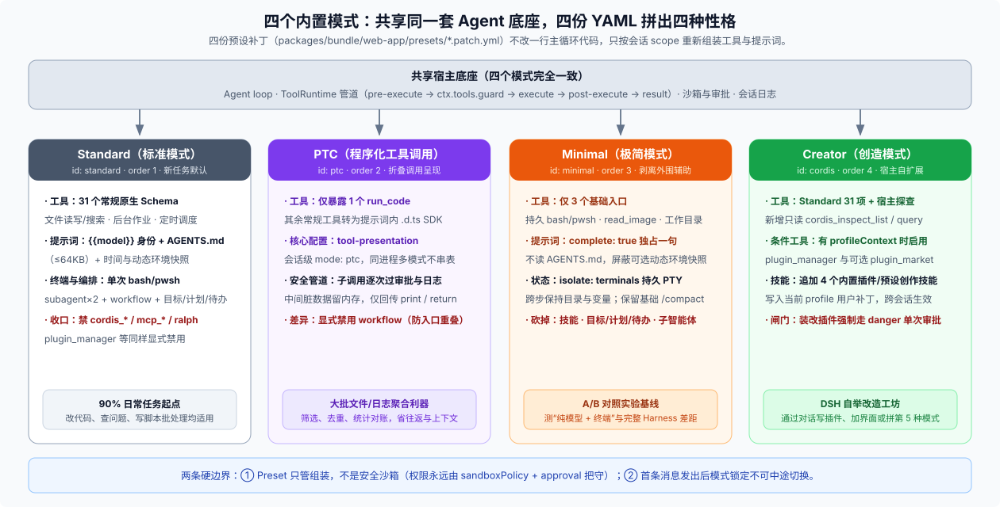

# Answer 03 · 四个内置模式：不改一行 Agent 循环，靠四份声明式补丁拼出四种性格

## 一句话结论

Web 界面下拉框里的 **Standard / PTC / Minimal / Creator** 并不是四套各自硬编码的 Agent 引擎，而是跑在同一套宿主底座（同一个 Agent 循环、同一条权限审批与工具执行管道、同一份会话日志）之上的 **四份声明式会话预设补丁**（[`packages/bundle/web-app/presets/`](https://github.com/deepseek-ai/deepseek-harness/tree/master/packages/bundle/web-app/presets) 下的四份 `*.patch.yml`）：

- **Standard（标准模式，日常主力）**：给齐 **31 个常规原生工具**、完整身份提示词与仓库 `AGENTS.md`，同时刻意收起无沙箱约束的高危自检工具和无人值守循环。日常编码、查资料、甚至写脚本批量处理文件，直接用它就够。
- **PTC（程序化工具调用，批量聚合利器）**：把一摞工具折叠进唯一的 **`run_code`** 代码沙盒，模型写一段 TypeScript 循环调工具并做筛选统计，**只有最终 `print` / `return` 的精炼汇总才回传上下文**；而脚本里的每次子调用依然逐个走完完整的权限审批与审计日志管道。
- **Minimal（极简模式，模型裸测基线）**：用 `complete: true` 清空预设指令栈，只留一句系统提示词、**持久终端（`bash`/`pwsh`）+ `read_image` + `working_directory`** 以及基础上下文压缩（`/compact`），专门用来固定变量做“纯模型 + 终端”与完整 Harness 的 A/B 对照测试。
- **Creator（创造模式，自扩展工坊）**：预设 ID 为 `cordis`，在 Standard 全套工具之上开放只读宿主探查（`cordis_inspect_*`）、按宿主环境条件启用的 `plugin_manager` / `plugin_market` 与 **四个创作技能**，让 Agent 通过对话直接给 DSH 写插件或拼出你的“第 5 种模式”。



---

## 一、先对号入座：四个模式怎么选？横向差在哪？

以默认的 `standard` 为基准，直接对比四份 `*.patch.yml` 在各维度的真实差异：

| 对比维度 | Standard（`standard`） | PTC（`ptc`） | Minimal（`minimal`） | Creator（`cordis`） |
|---|---|---|---|---|
| **日常选型一句话** | **90% 任务的默认起点**（改代码、查问题、写脚本批处理都能干） | **读几十上百份文件/日志后做筛选、去重、统计、对账** | **固定模型与工作区，测模型裸能力 vs Harness 加成** | **让 Agent 帮写 DSH 插件、加侧栏界面或定制新模式** |
| **发给模型的工具表** | **31 个原生工具 Schema** | **仅 1 个 `run_code`**（其余工具转为提示词内的 `.d.ts` SDK） | **仅 3 个**：持久 `bash`/`pwsh` + `read_image` + `working_directory` | **31 个常规工具 + `cordis_inspect_*`×2 + 条件性 `plugin_manager` / `plugin_market`** |
| **系统提示词与指令** | `{{model}}` 身份前缀 + `AGENTS.md`（≤64KB）+ 时间与环境快照 | 同 Standard + 自动生成的工具 SDK 与并发规范 | **仅一句英文提示词**（`complete: true` 屏蔽其余一切段落，不读 `AGENTS.md`） | 同 Standard |
| **终端执行形态** | 单次独立进程（`tool-bash` / `pwsh`） | 同 Standard（经 `tools.bash` 调用） | **跨步保持目录与环境变量的持久 PTY 终端**（`isolate: terminals`） | 同 Standard |
| **长任务推进与压缩** | 目标 `/goal`、计划 `/plan`、待办 `todo_write`、定时调度、压缩与长输出裁剪全齐 | 同 Standard | **仅保留基础上下文压缩**（自动触发 + `/compact`），无目标/计划/待办/提问 | 同 Standard |
| **委派与工作流编排** | `subagent`×2 + 控制工具 + `workflow` | `subagent`×2 保留，**显式禁用 `workflow`**（避免与 `run_code` 重叠） | 无 | 同 Standard（`workflow` 可用） |
| **技能（Skills）** | 项目与个人目录按需加载 | 同 Standard | 无 | 保留原有目录，并**追加四个插件/预设创作技能** |

---

## 二、为什么四份 YAML 就能同进程并存还不串台？

之所以不需要在 Agent 循环里写满 `if (mode === 'ptc')`，靠的是 [`dsh-agent-preset-registry`](https://github.com/deepseek-ai/deepseek-harness/blob/master/packages/preset/agent-preset-registry/README.md) 与 Cordis 作用域机制的三层配合（设计取舍详见 [声明式预设架构记录](https://github.com/deepseek-ai/deepseek-harness/blob/master/.agents/notes/implemented/architecture/2026-09-18-declarative-agent-presets.md)）：

1. **预设只是普通的会话级插件组，不是进程级开关**
   每份模式在配置里只是一行 `@deepseek-ai/dsh-agent-preset` 插件声明，内部挂着自己的 `plugins` 子列表。新建任务时，注册表为该会话单独创建一个 Cordis `scope` 挂载对应预设，派生的子智能体自动继承同一修订版；而底层的模型连接、权限审批、会话落盘依然共享宿主服务。因此同一个 Web 进程里完全可以一边跑着 Standard 改业务代码，另一边开着 PTC 扫日志、开着 Creator 写插件，彼此工具表和提示词互不干扰。
2. **`isolate` 给有状态服务加了“独立房间锁”**
   四份补丁里反复出现的 `cordis:group` + `isolate: { planMode | compaction | workflowEngine | terminals }`，作用是给组内服务换上局部作用域标签（见 [`packages/core/scope/README.md`](https://github.com/deepseek-ai/deepseek-harness/blob/master/packages/core/scope/README.md)）：组内插件正常协作，跨组彼此隐身。这保证了切进 `/plan` 计划模式、触发上下文压缩或改持久终端目录时，状态严格关在当前预设作用域里。
3. **界面显隐分层控制，自定义“第 5 种模式”只是一段普通 YAML**
   新任务页的模式选择胶囊受设置里的 **Developer tools（开发者工具）** 控制（关闭时自动清空未发出的暂存模式选择）；而通用设置里的 **Coding Tools** 关闭时，菜单会自动隐藏偏硬核的 `PTC` 与 `Minimal`，回退到 `Standard`。如果你想做一套自己的“只读代码审查模式”，不需要改任何宿主源码——往当前 profile 装一份声明了 `@deepseek-ai/dsh-agent-preset` 的补丁包即可（也可以直接在设置页点「让 Agent 帮我创建预设模式」拉起 Creator 会话代劳）：

```yaml
- insert:
    - id: preset-code-review
      name: '@deepseek-ai/dsh-agent-preset'
      config:
        id: code-review
        order: 10
        plugins:
          - id: persona
            name: '@deepseek-ai/dsh-persona'
            config:
              prefix: You are a code reviewer powered by {{model}}. Cite file paths and lines before suggesting edits.
          - id: tool-fs
            name: '@deepseek-ai/dsh-tool-fs'
          - id: tool-fs-search
            name: '@deepseek-ai/dsh-tool-fs-search'
```

---

## 三、三组容易看串的名字与两条硬边界

### 1. 先把三组撞车概念分清

| 容易混淆的一对 | 左边是什么 | 右边是什么 |
|---|---|---|
| **`Agent preset` vs `Runtime profile`** | **会话级模式**（如 `standard`、`ptc`）：决定单个聊天任务的 Agent 拿什么工具与提示词，同进程可多开 | **进程级启动配置**（如 `web`、`headless`、`desktop`）：决定 `dsh` 进程启动时装载哪套宿主底座（见 [`app-boot`](https://github.com/deepseek-ai/deepseek-harness/blob/master/packages/boot/app-boot/README.md)） |
| **`minimal` 预设 vs `sdk-minimal` profile** | Web 界面里做 A/B 对照实验的极简会话模式 | 供外部程序通过 JSON-RPC 嵌入调用的精简进程启动树（`dsh --profile sdk-minimal`），两者毫无包含关系 |
| **`Creator mode` vs `cordis`** | 前端界面展示名（中文「创造模式」，英文 `Creator mode`） | 该模式在 YAML 与代码里的真实预设 ID（`id: cordis`）；而 `ptc` 则同时是预设 ID 与 `ToolRuntime` 的呈现模式名 |

### 2. 两条不能想当然的边界

- **模式（Preset）绝对不是安全沙箱**：架构记录明确写明 *Presets do not provide a security sandbox*。在预设里撤掉 `write` 工具，拦不住模型在终端里用 `cat > file` 写文件；真正的读写范围与危险操作拦截，永远由底层的 `sandboxPolicy` 与 `approval` 审批门负责。
- **会话发出第一条消息后不能中途换模式**：宿主只允许在会话首轮对话开始前切换预设；一旦跑起来，顶部标题栏的模式标签就变成只读状态，保证整个会话期间提示词前缀与工具缓存稳定（见 [FAQ 10](../10_heavy-user-impressions-vs-mechanisms/answer.md)）。

---

## 继续阅读

| 你想细看哪个模式 | 去哪篇看 |
|---|---|
| Standard 的 31 个工具怎么分组？为什么 `cordis_*`、`mcp_*`、`ralph` 被刻意挡在门外，而 `web_fetch` 却能进？ | [`01-standard-mode.md`](./01-standard-mode.md) |
| PTC 怎么靠 6 行代码把 50 次工具往返压成 1 次？躲在代码里的子调用怎么过审批和记日志？ | [`02-ptc-mode.md`](./02-ptc-mode.md) |
| Minimal 的 `complete: true` 屏蔽了多彻底？持久终端怎么接管跨步状态？怎么做公平的 A/B 对照？ | [`03-minimal-mode.md`](./03-minimal-mode.md) |
| Creator 多出来的 `cordis_inspect_*`、`!ctx.get('profileContext')` 条件开关与四个创作技能怎么跑通自扩展闭环？ | [`04-creator-mode.md`](./04-creator-mode.md) |
| 四份预设补丁、核心实现包、锁死契约的 e2e/快照测试路径与本地对比命令汇总 | [`reference.md`](./reference.md) |

> 核验状态见 [核验基线登记](../00-baseline.md)。
