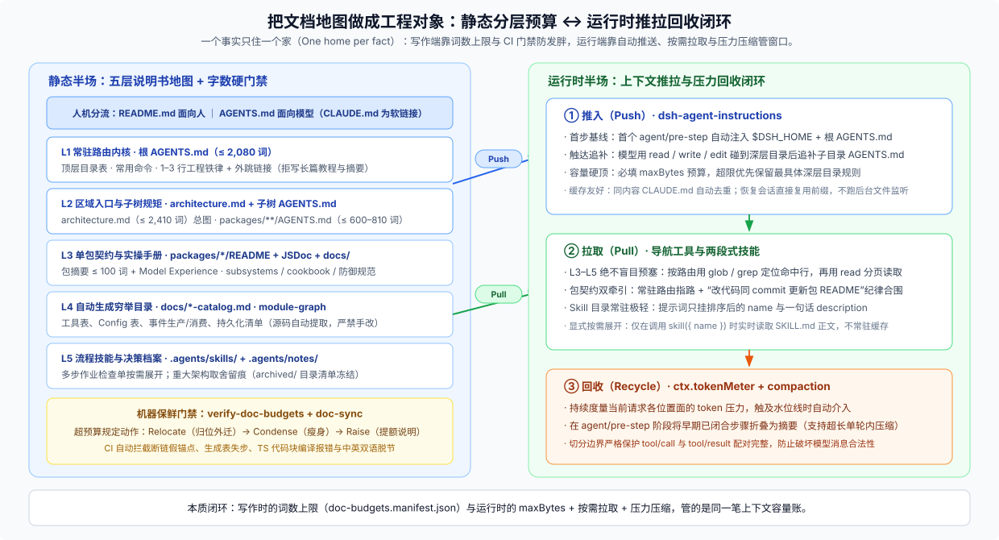

# 04 · 把文档地图做成工程对象：静态分层预算 + 运行时推拉闭环

## 一句话结论

DSH 没有去猜“一次给模型看多少背景才刚刚好”这个主观问题，而是把渐进式披露拆成了**静态建图**与**运行时消费**两套可机械验证的机制：

- **静态端（让地图不膨胀、不断链、不过期）**：把人类入口 `README.md` 与模型入口 `AGENTS.md` 分流（`CLAUDE.md` 只是指向 `AGENTS.md` 的软链接，绝不产生第二份事实）；用 [`docs/AGENTS.md`](https://github.com/deepseek-ai/deepseek-harness/blob/master/docs/AGENTS.md) 规定**一个事实只住一个家（one home per fact）**；给常驻文档上硬字数上限（[`scripts/doc-budgets.manifest.json`](https://github.com/deepseek-ai/deepseek-harness/blob/master/scripts/doc-budgets.manifest.json)），穷举表全部交由脚本从源码生成并用 CI 锁死新鲜度与死链。
- **运行时端（让该进的自动进、该查的按需拉、超了的能回收）**：[`dsh-agent-instructions`](https://github.com/deepseek-ai/deepseek-harness/blob/master/packages/context/agent-instructions/README.md) 在会话首步主动**推入（push）**根级指令链，等模型真正读/改到深层目录时再按触达追补子目录 `AGENTS.md`；包级契约（`package README`）、穷举目录与 skill 正文则由模型按路由通过 `read` / `grep` / `glob` / `skill` 工具**拉取（pull）**；整体上下文容量由 `maxBytes`、`ctx.tokenMeter` 与 `compaction` 兜底**回收（recycle）**。

换句话说，“模型进仓能按图索骥”在 DSH 里不是靠写作者文笔好或模型自觉，而是靠**容量预算 + CI 门禁 + 运行时注入与压缩**共同兜住的。



---

## 一、静态半场：根目录文件怎么按读者分流？

根目录及紧邻入口各司其职，谁也不替谁背锅：

| 入口文件 / 层级 | 面向谁 | 只负责什么 | 明确不放什么 |
|---|---|---|---|
| [`README.md`](https://github.com/deepseek-ai/deepseek-harness/blob/master/README.md) / `README.zh.md` | 人类访客与新用户 | 产品定位、安装运行、社区与开发入口引导 | 不写给 coding agent 的工作守则（末尾一行把 agent 引向 `AGENTS.md`） |
| `CLAUDE.md` | 自动寻址 `CLAUDE.md` 的工具 | 指向同目录 `AGENTS.md` 的 symlink | 不独立维护正文，杜绝两份指令漂移 |
| [`AGENTS.md`](https://github.com/deepseek-ai/deepseek-harness/blob/master/AGENTS.md) | 所有 coding agent（常驻） | 仓库布局、常用命令、每条 1–3 行的全局规矩 + 权威文档链接 | 不写长篇教程、不贴完整类型表、不讲历史演变 |
| [`docs/architecture.md`](https://github.com/deepseek-ai/deepseek-harness/blob/master/docs/architecture.md) | 准备改 `packages/` 的人与模型 | 装配关系、核心包、主循环、能力接缝与扩展点总图 | 不放单包配置细节，也不展开过去为什么这么选 |
| [`docs/AGENTS.md`](https://github.com/deepseek-ai/deepseek-harness/blob/master/docs/AGENTS.md) | 写/审文档的人与模型 | 文档分层归属（tier taxonomy）、双语规则与字数预算处理顺序 | 不放产品运行期契约 |
| `packages/<group>/<pkg>/README.md` | 使用或修改该包的人与模型 | 单包契约、配置语义、Model Experience 与已知限制 | 不重复抄写 JSDoc 参数表或自动生成的全局目录 |
| `docs/*-catalog.md` 等生成目录 | 按需检索者 | 工具、配置、持久化版本、事件生产/消费、模块依赖的穷举索引 | 严禁手改，也不写叙事段落 |
| `CONTRIBUTING.md` / `SAFETY.md` / `BRAND_GUIDELINES.md` / `THIRD_PARTY_NOTICES.md` | 外部贡献者、运维者、合规审查 | 贡献流程、实验与沙箱边界声明、品牌规范、生成式第三方许可证 | 不进入 agent 常驻指令链 |

实际走读路径只有清晰的两跳：

```text
README.md（面向人）
  ├─ 人类开发者 → docs/development.md + docs/architecture.md
  └─ Coding Agent → AGENTS.md

AGENTS.md（常驻模型上下文）
  ├─ 开篇路由：改 packages/ 先读 docs/architecture.md；改文档遵循 docs/AGENTS.md
  ├─ 常驻底座：版本与持久化红线 + 顶层目录表 + 命令速查 + 核心工程规矩
  └─ 按任务外跳：
       ├─ 查某个包的契约与限制 → packages/<group>/<pkg>/README.md
       ├─ 查全局工具/配置/事件 → docs/tool-catalog.md / config-catalog.md / event-producer-consumer.md
       ├─ 查历史取舍原因       → .agents/notes/
       └─ 查标准落地步骤       → docs/cookbook/ 或 .agents/skills/
```

---

## 二、撑住这张静态地图的三根柱子

1. **一个事实一个家（One home per fact）**：每类信息在文档分层表里有唯一归属，别处只能放链接、不准复述。这样既消灭了“改了一处忘改另一处”的漂移，也让查找方向完全可逆——看问题类型就知道去哪一层翻。
2. **常驻层设硬字数上限，超限先搬家再瘦身**：[`scripts/doc-budgets.manifest.json`](https://github.com/deepseek-ai/deepseek-harness/blob/master/scripts/doc-budgets.manifest.json) 把根 `AGENTS.md` 卡在 2,080 词以内、`docs/architecture.md` 卡在 2,410 词以内、`packages/AGENTS.md` 卡在 810 词以内。一旦超标，规定动作依次是 **Relocate（把越界内容迁回真正归属层）→ Condense（压缩本层表述）→ Raise（确需扩容才提上限并在 PR 说明理由）**。
3. **靠 CI 门禁而不是靠自觉保鲜**：`verify-md-links` 拦断链和空锚点，`verify-*catalog` 拦源码与生成目录脱节，`doc-typecheck` 编译文档里的 TypeScript 代码块，`verify-doc-budgets` 拦超字数，`verify-translation-pairing` 拦中英双语失步。地图坏没坏，提交时机器先报错。

---

## 三、运行时半场：静态分层怎样映射到模型上下文？

静态分好的五层文档，在一次真实会话里分别对应不同的加载与淘汰机制：

| 静态文档层 | 运行时怎么进上下文 | 容量怎么兜底 |
|---|---|---|
| **L1 常驻入口**（`$DSH_HOME/AGENTS.md` + 根 `AGENTS.md`） | 会话首个 `agent/pre-step` 由 `dsh-agent-instructions` 自动组装注入 | 受必填 `maxBytes` 总字节上限约束；同内容 `CLAUDE.md` 自动去重 |
| **L2 子树规则**（如 `packages/AGENTS.md`、`packages/client/AGENTS.md`） | **触达驱动（touch-driven）**：模型用一等工具 `read`/`write`/`edit` 碰到深层目录后，下一步请求自动追补对应 `AGENTS.md` | 越具体的目录优先级越高；超 `maxBytes` 时先丢宽泛外层并给出可见提示 |
| **L3 单包与子系统契约**（`package README`、`docs/subsystems/*`） | 不自动推送；由常驻规矩指引模型用 `read` 工具按需读取 | `read` 自带行号与 `offset` / `limit` 分页，避免整吞大文件 |
| **L4 穷举参考表**（`docs/*-catalog.md` 等生成目录） | 模型用 `grep` / `glob` 按关键词检索命中行，再局部 `read` | 结构化搜索结果限制返回体量，不占常驻窗口 |
| **L5 流程技能与决策背景**（`.agents/skills/`、`.agents/notes/`） | 系统提示只挂 skill 名称与一句话描述；调用 `skill({ name })` 才展开正文且不常驻缓存 | 会话变长触发 `ctx.tokenMeter` 阈值后，由 `compaction` 压缩早期已闭合步骤（完整保留 tool-call/result 配对） |

可以看到，**写作时的字数预算**与**运行时的 `maxBytes` / token 回收预算**其实是同一笔上下文账在静态与动态两端的体现。

---

## 四、适用边界

这套体系不是免费的：维护文档分层、字数清单、目录生成脚本和一串 `verify-*` 门禁都需要工程投入。它非常适合**模块多、契约密、coding agent 高频参与演进**的代码库；如果只是几千行代码的小项目，直接拿走“人机入口分流 + 根 `AGENTS.md` 只写短规矩和目录地图 + 死链检查”就够用了（轻量化裁剪方案见 [FAQ 07](../07_borrowing-dsh-harness-idea/04-step-by-step-adoption.md)）。

## 分篇导读

| 篇章 | 解决的具体问题 |
|---|---|
| [01-map-and-tiers.md](./01-map-and-tiers.md) | 根入口怎么把人与模型分流？`AGENTS.md` 留什么、拒什么？为什么大多数包只有 `README.md` 而没有 `AGENTS.md`？ |
| [02-budgets-and-gates.md](./02-budgets-and-gates.md) | 为什么渐进式披露很难靠感觉把握？字数预算、`Relocate → Condense → Raise` 与五类 CI 文档门禁怎么配合？ |
| [03-runtime-consumption.md](./03-runtime-consumption.md) | 运行时谁在推 `AGENTS.md`、谁在拉 `README.md` 与 skill、超预算后怎么压缩回收？ |
| [reference.md](./reference.md) | 本专题涉及的权威源码、文档与脚本核验清单 |
