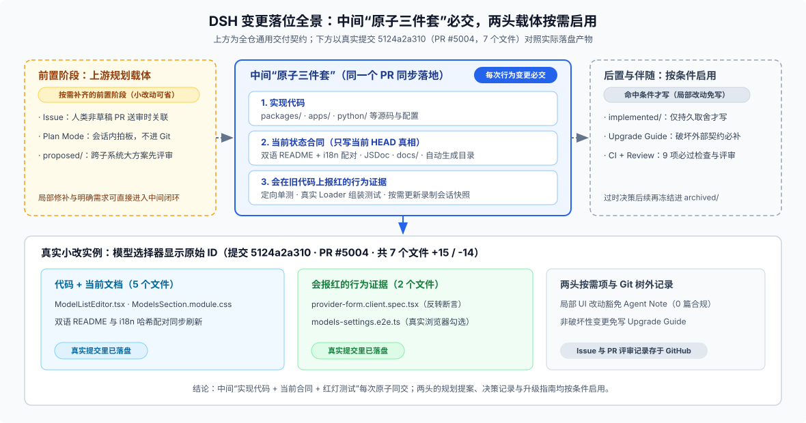

# 03 · 两笔真实提交对看：一笔 7 文件 UI 小改 vs 一整条跨包 Capability Seam

光看规则容易觉得抽象。下面直接从 DSH 的 Git 历史里拎出两笔真实提交——一笔是日常最常见的局部界面优化，另一笔是从零引入跨包能力接缝的大活——对照看看“核心三件套必交、两头载体按需启用”在真实仓库里长什么样。

---

## 案例一：小而完整的日常交付（提交 `5124a2a310`，零 Agent Note）

**起因很具体**：用户在“获取可用模型”的选择器里遇到了同名模型没法区分的问题，而且配置和日志里用的都是原始 `model ID`，平时选模型时更想直接看等宽字体的原始 ID，鼠标悬停时再看显示名称。

打开真实提交 [`5124a2a310`](https://github.com/deepseek-ai/deepseek-harness/commit/5124a2a310)（`fix(web): show model IDs in monospace and names on hover (#5004)`），全提交一共改了 **7 个文件，`+15 / -14` 行**，没有一行多余动作，却把“实现 + 当前合同 + 行为证据”装得严丝合缝：

| 改动文件 | 它在交付包里承担什么角色 |
|---|---|
| [`ModelListEditor.tsx`](https://github.com/deepseek-ai/deepseek-harness/blob/master/packages/client/ui-settings-models/src/client/ModelListEditor.tsx) + [`ModelsSection.module.css`](https://github.com/deepseek-ai/deepseek-harness/blob/master/packages/client/ui-settings-models/src/client/ModelsSection.module.css) | **实现代码**：把候选行文本从 `{candidate.name ?? candidate.id}` 改为 `{candidate.id}`、加上悬停 `title`，并配上等宽字体与单行截断样式 |
| [`README.md`](https://github.com/deepseek-ai/deepseek-harness/blob/master/packages/client/ui-settings-models/README.md) + [`README.zh.md`](https://github.com/deepseek-ai/deepseek-harness/blob/master/packages/client/ui-settings-models/README.zh.md) + [`README.i18n.yaml`](https://github.com/deepseek-ai/deepseek-harness/blob/master/packages/client/ui-settings-models/README.i18n.yaml) | **当前合同**：中英文同步更新选择器显示规则，并刷新双语哈希配对记录 |
| [`provider-form.client.spec.tsx`](https://github.com/deepseek-ai/deepseek-harness/blob/master/packages/client/ui-settings-models/tests/provider-form.client.spec.tsx) + [`models-settings.e2e.ts`](https://github.com/deepseek-ai/deepseek-harness/blob/master/apps/web/tests/models-settings.e2e.ts) | **行为证据**：组件单测反转 6 处断言并验证“改显示后按名称搜索依然好使”；Web e2e 更新真实浏览器勾选场景 |

从这笔小提交里能学到三件很实在的事：

1. **为什么它没有 Agent Note 却完全合规？** 因为这是典型的局部 UI 呈现改动，行为归组件、合同归包 `README`、防回归归测试，不存在任何“光读代码和文档看不懂的长期架构取舍”。
2. **怎么证明它的测试不是摆设？** 在本地保留这笔提交的新测试、只把 `ModelListEditor.tsx` 回退到旧写法，跑组件单测当场得出 **2 红 95 绿**——证明旧行为确实会被新测试精准拦住。
3. **语义 Review 还能挑出什么机器查不到的细节？** 仔细核对会发现，`README` 写了“等宽字体与悬停显示名称”，但单测只断言了行内主文本变成 ID 和搜索不断裂，并没有断言 `title` 属性与 CSS 类名。机器覆盖率全绿，但这类细微证据缺口只有靠人或 Review Agent 对着文档和断言逐条比对才能看出来。

---

## 案例二：跨包新能力接缝（Web Capability Seam，走满提案到落地）

当改动不再是修一个组件，而是要往系统里新增一整套多供应商可插拔的网页搜索与抓取能力（`ctx.web`）时，Git 历史就清晰留下了 `proposed → implemented` 的两步脚印：

1. **第一步：先交提案提交（[`a4091daa3d`](https://github.com/deepseek-ai/deepseek-harness/commit/a4091daa3d)）**
   在动手写业务包之前，先提交提案文档（当时还叫 `docs/rfc/proposed/architecture/2026-06-24-web-capability-seam.md`），讲清楚核心矛盾：既要给模型提供稳定的 `web_search` / `web_fetch` 工具接口，又不能把工具参数绑死在某一家搜索供应商的私有字段上。
2. **第二步：单提交原子落地整个切片（[`d01f5f73b7`](https://github.com/deepseek-ai/deepseek-harness/commit/d01f5f73b7)）**
   方案敲定后，实现提交一口气把全套产物同时合入：
   - `packages/web/` 下的服务定义、工具包以及 Exa / Perplexity 等多个 Provider 的源码、包 `README` 和单测；
   - 顶层 `docs/architecture.md`、`packages/README.md` 与 `tsconfig` / `knip` 工程配置；
   - 把提案从 `proposed/` 移入 `implemented/`。
3. **后续随制度演进保持现行态**
   当时早期 RFC 移入 `implemented/` 时还没强制改写章节标题；后来仓库统一格式门禁（[`e6fad266a6`](https://github.com/deepseek-ai/deepseek-harness/commit/e6fad266a6)）把它改写成现在式的 `Decision / Consequences`，再经 [`e8eddc7ef8`](https://github.com/deepseek-ai/deepseek-harness/commit/e8eddc7ef8) 迁入如今的 [`.agents/notes/implemented/architecture/2026-06-24-web-capability-seam.md`](https://github.com/deepseek-ai/deepseek-harness/blob/master/.agents/notes/implemented/architecture/2026-06-24-web-capability-seam.md)，至今仍是 `ctx.web` 架构取舍的活档案。

（顺带一提：不管是案例一还是案例二，当时的 GitHub Issue 讨论、PR 评审意见以及会话里用没用过 `/plan`，都不存在本地 Git 对象树里——研究仓库历史时，Git 能实锤的是提交切片本身，远端协作页的细节必须查 GitHub 记录，不能硬猜。）

---

## 延伸对照：Git 历史里常见的四种决策轨迹

如果多翻几组带 Agent Note 的功能，会发现 DSH 实际容许四种很自然的决策起点，绝不一刀切：

| 轨迹类型 | 真实样本 | 怎么走的 |
|---|---|---|
| **先提案、多轮打磨后再实现** | Plan Mode（`2602270669f1` → `5a8e3a14ee97`） | 先提 `proposed/` 讨论设计并多次修订，实现落地时同提交移入 `implemented/` |
| **先提案、一锤子大切片落地** | Remote 事件投递（`7c8ee81818cd` → `01ecb43ebcdb`） | 先单独合入 `proposed/` Note，随后一笔提交同步改完 135 个源码/协议/文档/测试文件并转正 Note |
| **提案评审后决定不做，留档防重犯** | 放弃持久化 step 边界（`cc47f76cea0f` → `7f2769c529b1`） | 从 `proposed/` 移入 `rejected/`，保留原提案并写明否决原因，省得后人再提一遍 |
| **方案已明确，随实现直接建 `implemented/`** | Plan 审批卡片呈现（`2363ef01eb14` → `6d7bd7e703a0`） | 不绕 `proposed/`，在交付 UI 和 e2e 的同一提交直接写 `implemented/` Note，后续修细节时同步更新同一篇 Note |
