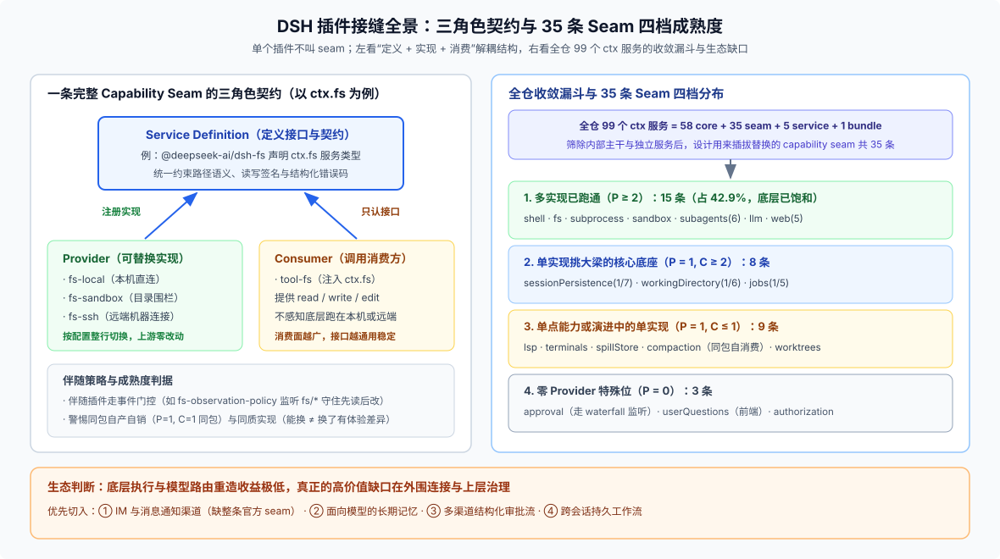

# Answer 08 · 插件生态成熟度：42.9% 的可替换率、三个常见误判与真实缺口清单

## 一句话结论

打开由源码自动生成的 [`docs/capability-seams.md`](https://github.com/deepseek-ai/deepseek-harness/blob/master/docs/capability-seams.md)，当前 DSH 一共有 **99 个 `ctx` 服务**（`58 core + 35 seam + 5 service + 1 bundle`）。其中真正按“服务定义 + 实现方 + 消费方”三角色拆开、设计用来替换的 **capability seam 共 35 条**：

- **15 条（42.9%）已有 2 个及以上 Provider**：集中分布在底层执行环境（shell / 文件系统 / 子进程 / 沙箱）、模型与搜索接入、子智能体委派和基础存储。这些底座再从头重造几乎没有收益。
- **17 条只有单个 Provider，另有 3 条在生成表里显示为 0 Provider**。
- **真正的外部生态缺口不在底层执行，而在外围连接与上层治理**：IM 与通知渠道（连官方 seam 都还没有，社区已经各自造了 8 套以上互不兼容的桥）、面向模型的长期记忆、丰富的人类审批交互与多方会签，以及跨会话可恢复的持久工作流。

下面先把这笔账摊开算清楚，再讲哪些直觉容易看走眼、哪些方向值得投入。如果想直接查“怎么在仓库里找现成能力”，可以直接跳读 [`01-finding-existing-capabilities.md`](./01-finding-existing-capabilities.md)。

---

## 一、怎么衡量一条 seam 成不成熟？

在 DSH 里，单个插件不叫 seam，**Service Definition（定义接口）+ Service Provider（提供实现）+ Consumer（调用服务）** 三个角色齐备才叫一条 capability seam。判断它成不成熟，光数插件个数不够，得同时看供需两端：

- **供给端（真能无痛换掉吗）**：看有没有第 2 个真实 Provider，并且在切换时上游消费方一行代码不用改。最典型的正例是远程 SSH 执行环境：`fs-ssh`、`subprocess-ssh`、`sandbox-ssh` 共享同一个 [`ctx.ssh`](https://github.com/deepseek-ai/deepseek-harness/blob/master/docs/capability-seams.md) 连接，上层的 `tool-fs` 和 `tool-bash` 原封不动就能把工作目录切到远端机器。
- **需求端（有多少地方在用）**：看消费方覆盖了几个平面（模型工具、前后端 Remote 通信、兼容桥、内部沙箱包装等）。消费面越多，说明接口越不是某一个工具的私有定制。
- **三个需要警惕的信号**：
  1. **自消费（`P = 1, C = 1` 且在同一个包）**：比如 `ctx.compaction`，接口和唯一调用方都在 `compaction-basic` 里，还没经历过外部实现的检验。
  2. **零 Provider（`P = 0`）**：接口先立了，但要么实现机制不走 Provider 注册，要么第一个实现还没落地。
  3. **表内零直连消费方（`C = 0`）**：不代表没人用，需看数据出口——例如 `ctx.sessionTelemetry` 直接往进程外发遥测，`ctx.sessionTitle` 通过会话投影间接消费。

---

## 二、35 条 seam 全景：按成熟度分四档看

下面按生成表的 `implementations`（记为 `P`）和 `direct consumers`（记为 `C`）把 35 条 seam 分成四档，一眼就能看出官方把精力砸在了哪里。

### 1. 多实现已跑通（`P ≥ 2`，共 15 条）

| 领域 | seam（`P / C`） | 实际构成说明 |
|---|---|---|
| **执行环境底座** | `ctx.shell`（3/4）、`ctx.fs`（3/1）、`ctx.subprocess`（2/7）、`ctx.sandbox`（2/2） | 本地直连、同环境进程沙箱（`sandbox-local`）与远程 SSH（`*-ssh`）并存；消费方无需关心底层在哪跑 |
| **子智能体与执行引擎** | `ctx.subagents`（6/3）、`ctx.ptcRuntime`（2/2） | 子智能体覆盖进程内 spawn/fork、进程外 ACP/Codex/Claude Code 与 SDK 驱动；PTC 运行时支持两套后端 |
| **模型与请求扩展** | `ctx.llm`（3/2）、`ctx.deepseekLlmApiExtensions`（2/1） | `llm-deepseek` + 多厂商路由 `llm-pi-ai` + 测试回放 `llm-replay`；官方 API 扩展支持多插件独立挂顶层字段 |
| **外部感知与技能** | `ctx.web`（5/1）、`ctx.skills`（4/1）、`ctx.browserUse`（3/3）、`ctx.computerUse`（2/2） | Web 含多家搜索与抓取；浏览器驱动含 Stagehand / Chrome DevTools MCP / Playwright MCP；桌面操控含 MCP 与原生驱动 |
| **存储与桌面交互** | `ctx.storage`（2/1）、`ctx.directoryPicker`（2/1）、`ctx.sessionTitle`（2/0） | 非会话存储支持 JSON 与 SQLite；目录选择器支持系统原生弹窗与网页内浏览（方便自动化测试） |

### 2. 单实现挑大梁的核心底座（`P = 1, C ≥ 2`，共 8 条）

这组虽然只有一个默认实现，但被多个模块重度依赖，接口已经非常稳定：

- **会话与目录核心**：`ctx.sessionPersistence`（1/7，移除早期 SQLite 后统一为 JSONL 日志）、`ctx.workingDirectory`（1/6，统一管理会话有效工作目录，供 fs/bash/pwsh/subagent/SDK 消费）、`ctx.sessionQuery`（1/2，SQLite 全文检索与浏览索引）。
- **任务、附件与账号**：`ctx.jobs`（1/5，后台任务管理）、`ctx.attachments`（1/4，二进制附件）、`ctx.credentials`（1/3，凭据管理）、`ctx.deepseekAccount`（1/2，官方账号登录态）、`ctx.workflowEngine`（1/2，基于 worker thread 的编排引擎）。

### 3. 单点或演进中的单实现（`P = 1, C ≤ 1`，共 9 条）

- **稳定单点能力**：`ctx.fileReferences`（1/1）、`ctx.terminals`（1/1，bash PTY）、`ctx.spillStore`（1/1，超长输出落盘）、`ctx.lsp`（1/1，语言服务器宿主）、`ctx.mcpResources`（1/1，按需发现与读取 MCP 资源）、`ctx.speechToText`（1/1，语音转写）。
- **尚在演进或特殊出口**：`ctx.worktrees`（1/1，目前仅 experimental 的 `worktree` 包自产自销）、`ctx.compaction`（1/1，自消费）、`ctx.sessionTelemetry`（1/0，进程外遥测出口）。

### 4. 零 Provider 特殊位（`P = 0`，共 3 条）

- `ctx.approval`（0/3）：**不是没实现，而是机制特殊**——审批应答方（Web UI 的审批卡片、ACP 桥）是通过监听 `approval/request` waterfall 响应的，不走常规 Provider 注册。
- `ctx.userQuestions`（0/1）：提问界面的真实渲染与作答落在前端客户端。
- `ctx.authorization`（0/1）：面向外部服务的授权获取流，目前刚立接口，还没有第一个正式 Provider。

---

## 三、别被 42.9% 骗了：“能换”和“换了有差异”是两码事

`15 / 35 = 42.9%` 只说明这 15 条接缝在架构上验证过“插拔替换不断裂”，但如果问“换个 Provider 能不能带来产品体验上的实质差异”，水分必须挤掉：

1. **`ctx.llm` 的 3 个实现里含 1 个测试桩**：`llm-replay` 是给无密钥录制回放测试用的（见 [FAQ 29](../29_keyless-meaning-boundaries/answer.md)），真正面向生产的只有官方 `llm-deepseek` 和多模型聚合器 `llm-pi-ai`。
2. **`ctx.web` 的 5 个实现高度同质**：Exa、Perplexity、DeepSeek 搜索加 HTTP 抓取，喂给同一个 `tool-web`，连挂掉的原因都一样（上游 API 超时或限流）。
3. **`ctx.subagents` 的 6 个实现按运行位置只有三类**：本进程内派生（spawn/fork）、外部 CLI 代理进程（ACP / Claude Code / Codex）、SDK 宿主驱动。
4. **`ctx.skills` 的 4 个实现并不是可互换替代品**：`skill-filesystem` 是通用目录加载器，而 `skill-office`、`skill-badge`、`sandbox-windows-acl` 只是借同一个注册口塞入各自的内置技能包。`ctx.shell` 里的 `bash` 和 `pwsh` 也是跨操作系统语族，不是同生态竞品。

反过来看，这也揭示了一个很关键的判断：**多 Provider 区大多是基础设施（怎么跑命令、怎么调模型），而真正拉开产品差距的能力往往还在单 Provider 甚至零 seam 区。**

---

## 四、三个容易看走眼的直觉

1. **“审批已经有完备机制了，所以不用管”——错在一半。**
   `ctx.approval` 的底座确实很硬：请求与决定成对写审计日志、没挂应答器时自动 fail-closed 拒绝、支持中断取消（见 [`user-approval` README](https://github.com/deepseek-ai/deepseek-harness/blob/master/packages/interaction/user-approval/README.md)）。但它的人机交互形态还很窄：前端只有命令确认和 diff 预览，没有结构化表单、多选确认单；而且多个监听器之间没有策略编排（比如“先自动风控、高危再转人工群批”）。缺的不是底层安全栅栏，而是上层交互与审批流。
2. **“多智能体团队编排还是空白”——印象过期了。**
   `ctx.agentTeams`（core）和配套工具早已合入仓库（目前作为可选实验能力演进，见 [Agent Teams 决策记录](https://github.com/deepseek-ai/deepseek-harness/blob/master/.agents/notes/implemented/feature/2026-08-05-agent-teams.md) 与 [FAQ 27](../27_runtime-orchestration-choice/answer.md)）。
3. **“造个新执行沙箱或新 LLM 适配器很有技术含量”——在 DSH 里性价比最低。**
   执行链路（`resolve → confine → spawn`）、会话日志格式（`SESSION_FORMAT_VERSION` + 双语 SDK 同步投影）、多入口共享 `ctx.agents` 以及 `llm-pi-ai` 配置式接模型，这四块是官方打磨最深的地方。在外面重造一套只会背上沉重的维护债。

---

## 五、真正的生态缺口排在哪？（按外部需求信号排序）

把源码现状和外部社区自发造轮子的热度（详见 [`research.md`](./research.md)）对在一起，缺口优先级非常清晰：

1. **IM 与消息通知渠道（缺整条 seam：定义 + 实现 + 消费全空）**
   官方没有任何微信、飞书、Telegram、Slack 通道包，[`schedule`](https://github.com/deepseek-ai/deepseek-harness/blob/master/packages/schedule/schedule/README.md) 也明确只做当前会话内投递。结果社区里已经冒出至少 8 套互不兼容的聊天桥和通知插件，安装方式五花八门。没有官方统一接口的代价不是没人做，而是生态严重碎片化。
2. **面向模型的长期记忆（缺整条 seam）**
   官方只有底层键值存储（`storage`）、超长输出暂存（`spillStore`）和历史会话检索（`sessionQuery`），没有“跨会话提炼与召回用户记忆”的标准 seam；而外部社区最扎堆的恰恰是五花八门的记忆插件。
3. **审批的结构化表单与多渠道/多方协同（缺上层消费与编排）**
   社区里的微信桥已经在自己做“手机聊天批权限”了。把审批接进外部 IM、支持表单级确认与审批链，是紧挨着渠道缺口的刚需。
4. **跨会话可恢复的持久工作流（`ctx.workflowEngine` 缺持久化后端）**
   现有 `workflowEngine` 跑在内存 worker 线程里，进程重启就没法断点续跑长周期流程。
5. **MCP 的治理与安全审计放大（有 `mcp-client` 和 `mcp-resources`，缺安全增强层）**
   MCP 协议本身已经中立化，但外部 MCP server 质量参差不齐甚至存在提示词投毒风险。DSH 的天然优势是所有通过 `mcp-client` 挂进 `ctx.tools` 的外部工具，都会自动受 `model-visible ⟺ logged` 约束留痕——顺着这个底座做工具权限收口与审计视图，比单纯做个“MCP 连接器”更有价值。
6. **会话评价回流与外部 OAuth 授权流**
   `messageFeedback` 目前只收点赞点踩、还没闭环回流到偏好治理；`ctx.authorization` 的首个正式 Provider 也仍待落地。

---

## 六、四条诚实边界

看“一切皆插件”时，别把下面四件事想当然：

- **启动内核不在插件树里**：Cordis 根 `Context`、`Loader` 和 `app-boot` 先于所有插件存在，插件化是长在这个微内核之上的。
- **装插件等于给本地执行权限**：持久安装插件走 `danger` 权限门控的 `plugin_manager`，插件跟宿主跑在同一个 Node 进程里，不是隔离沙箱。
- **凡是给模型看的东西都要交“日志税”**：DSH 严守 `model-visible ⟺ logged`，新增任何模型可见输入都必须定义对应的会话事件并支持从日志完整重建（见 [`docs/subsystems/session.md`](https://github.com/deepseek-ai/deepseek-harness/blob/master/docs/subsystems/session.md)）。
- **58 个 `core` 服务不是永远不能换**：里面既像 `tokenMeter` 这种紧耦合内部组件，也有单纯因为“目前还没出现第二个实现需求”而暂居 `core` 的候补能力。

---

## 继续阅读

| 你想了解什么 | 去哪篇看 |
|---|---|
| 动手写插件前，怎么查清仓库里已有的服务、工具和未默认开启的包？ | [`01-finding-existing-capabilities.md`](./01-finding-existing-capabilities.md) |
| 外部社区的插件目录、渠道桥碎片化、记忆插件和行业融资数据从哪来的？ | [`research.md`](./research.md) |

> 注：文中的“可替换率”“饱和区 / 缺口区”是本篇基于 [`docs/capability-seams.md`](https://github.com/deepseek-ai/deepseek-harness/blob/master/docs/capability-seams.md) 生成表做的统计归纳，不是 DSH 源码里的字段名。核验状态见 [核验基线登记](../00-baseline.md)。
