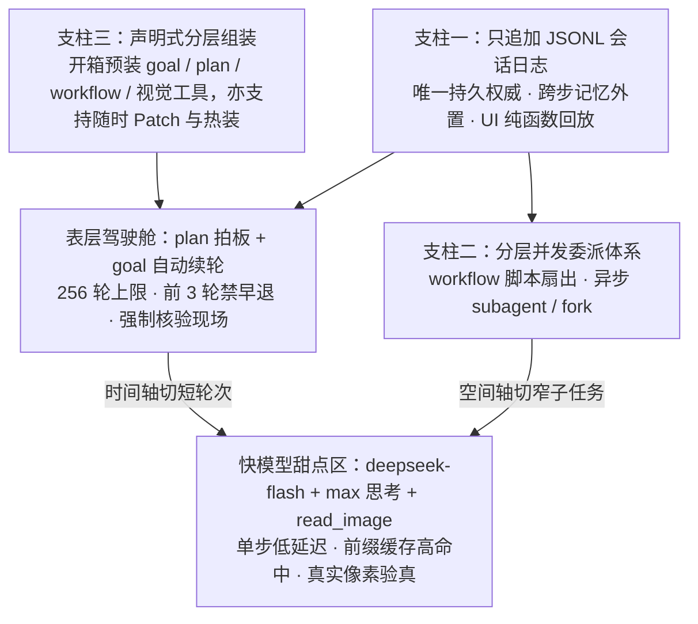

# 03 · 拨开表层看底座：撑起三条体感的会话日志、委派体系与声明式组装

前面两篇分别拆解了 `goal + plan` 状态循环、Creator 自扩展与 `read_image` 视觉闭环。但如果我们再往下追问一层：**为什么这些彼此独立的插件互不耦合，合在一起却能严丝合缝地跑出“三小时重构不掉链子”的整体体验？**

检验谁是表层、谁是地基，最直接的办法是做一个可执行的反例测试。

---

## 一、反例检验：如果把 `goal` 和 `plan` 关掉，DSH 还剩什么？

在 DSH 里，`goal`、`goal-round-driver` 和 `plan-mode` 并不是写死在 `agent-loop` 内核里的特权分支，它们只是 [`packages/bundle/base/cordis.patch.yml`](https://github.com/deepseek-ai/deepseek-harness/blob/master/packages/bundle/base/cordis.patch.yml) 里的几行普通插件声明。你随时可以用一份覆盖配置把这三行设成 `disabled: true`。

关掉它们之后会发生什么？
- **确实消失的体验**：“交个大目标就离开工位，让系统自己在 256 轮预算和防早退门禁下续跑三小时”，以及“写代码前先弹方案卡点按钮审批”。
- **依然完好无损的能力**：
  - `workflow` 脚本扇出与异步 `subagent` **多路并行**照跑不误；
  - 进程崩溃重启后的**会话无损恢复、历史分叉（fork）与全链路审计**分毫不差；
  - 代码 Diff 卡、文件交付卡与右侧边栏预览的**确定性回放**照常渲染；
  - 用 YAML 覆写配置或用 `plugin_manager` **随手改造工作台**的能力丝毫未减。

答案由此水落石出：`goal` 和 `plan` 是长在最贴近用户操作面上的“自动驾驶与审批仪表盘”；而在它们底下真正托住全局的，是三根缺一不可的基础设施支柱。

---

## 二、支柱一：只追加会话日志底座（`ctx.sessionPersistence`）

翻开 `goal` 子系统自己的架构决策记录（[`2026-07-31-goal-owned-durable-events.md`](https://github.com/deepseek-ai/deepseek-harness/blob/master/.agents/notes/implemented/architecture/2026-07-31-goal-owned-durable-events.md)），里面有一句定调的话：**“会话日志始终是唯一的持久权威（The session log remains the only durable authority）。”**

在当前架构中，早期并存过的 SQLite 会话持久化已被移除，全系统统一收口到单后端只追加 JSONL 日志（`session-persistence-jsonl`），由它一对多地支撑起 **7 个核心消费方**（见 [FAQ 08](../08_plugin-seam-maturity/answer.md)）：

1. **模型上下文完全由日志纯函数派生**：每次发往大模型的消息列表只从 `session.deriveMessages()` 生成，当轮生效的模型路由、思考档位、系统提示词与工具 Schema 随 `request/header` 一并记入日志（配合组装快照与 TypeScript / Python 双 SDK 投影测试锁死一致性）。
2. **所有上层控制流都是日志的下游**：`goal/change`、`plan/mode`、`tool-workflow/run-start`、`deliverables/presented`、`image/offload` 全都是 `SessionEventMap` 里的标准事件成员。
3. **连子智能体谱系也归档在同一套日志树下**：执行会话导出时，每个派生的子会话都会按谱系打包进归档包的 `subagents/<id>/session[.vN].jsonl`，SDK 事件流也能无过滤地观测整棵运行树的全部会话。

**这根支柱给了重度用户两样最关键的底气**：第一，快小模型不需要充当“状态数据库”，每轮重读日志就能找回百分百准确的现场；第二，跑三个小时哪怕中途关机断网，只要日志落了盘，现场就永远可恢复、可分叉、可逐帧复盘。

---

## 三、支柱二：重兵投入的分层委派体系（`ctx.subagents` + `workflow` + `jobs`）

如果只看表面工具名，很容易以为 DSH 只是一个单线程调 bash 和改文件的编码助手；但只要看一眼官方在哪些包上砸了最多的研发资源，就会发现 **DSH 骨子里的默认姿态是一个“任务拆解与委派调度器”**：

- **`ctx.subagents` 拥有全仓最多的 6 个实现方**：涵盖同进程独立派生（`spawn`）、同进程继承上下文派生（`fork`）、外部 CLI 智能体桥接（ACP / Claude Code / Codex）以及 SDK 宿主驱动（详见 [`packages/subagent/README.md`](https://github.com/deepseek-ai/deepseek-harness/blob/master/packages/subagent/README.md)）。
- **四套互补的异步与并发工具链齐备**：单步内有并发工具池，跨子代理批处理有运行在独立 Worker 线程里的 `workflow` 编排组（`workflow` + `workflow-ptc` + `tool-workflow`），长耗时命令有后台 `jobs`，多角色协同还有实验性的 `agent-team`（持久花名册 + 共享任务板；具体选型边界见 [FAQ 27](../27_runtime-orchestration-choice/answer.md)）。

把这根支柱和 `goal` 拼在一起，正好构成了一把**“时间 × 空间”双轴剪刀**：
- **时间轴切分（归 `goal`）**：把原本要连续硬撑三小时的长链路，切成最多 256 轮独立结算、每轮重验现场的短接力；
- **空间轴切分（归 `subagents` 与 `workflow`）**：把牵涉十几个模块的大改，扇出给十几个上下文干干净净的子智能体并行处理，主会话只收精炼结论（注意 `subagent_fork` 还专门设计成默认继承父会话的模型路由，以便直接复用父会话已经建好的前缀 KV Cache）。

扇出得越彻底，落在每个叶子节点上的子任务就越具体、上下文噪音越少、验收标准越单一——**小而快的模型在每一个叶子节点上都处于自己的最高效舒适区。**

---

## 四、支柱三：声明式分层组装（Bundle → Profile → Preset → Patch）

第三根支柱解释了一对表面看似矛盾的现象：为什么这位重度用户既夸 DSH“**开箱就带齐了 goal 和 plan**”，紧接着又感慨它“**特别适合按自己的习惯动手改造**”？

原因在于 DSH 把“产品默认体验”彻底做成了**声明式组装配置**，而不是硬编码进内核的死逻辑（详见 [`app-boot`](https://github.com/deepseek-ai/deepseek-harness/blob/master/packages/boot/app-boot/README.md) 与 [FAQ 03](../03_preset-modes-specialty/answer.md)）：

1. **为什么“开箱就敢放手用”**：如果 `goal`、`plan`、`workflow`、观察后写入保护（`fs-observation-policy`）和超长结果修剪（`tool-result-pruner`）都是需要用户自己去插件市场翻找安装的选配件，绝大多数人在跨过“发现 → 评估 → 配参数”这三道门槛前就放弃了。DSH 通过 `dsh-base` 与 `web-app` 两层基础 Bundle，让每一个新建会话在出生那一刻就自带完整的预算护栏与并发工具箱——**好的默认组装本身就是核心产品体验。**
2. **为什么“改起来毫无心理负担”**：因为底层加载顺序严格遵循 `内置 Bundle 层 → Profile 的 cordis.patch.yml → 全局 Home patch → 命令行 --patch 覆盖层`（按条目 `id` 精准寻址，后写覆盖先写）。你既可以在不动任何源码的情况下关掉不想要的行为、微调参数阈值，也可以切到 Creator 模式让 Agent 自己查清运行时槽位并调用 `plugin_manager` 装入新 Bundle。

---

## 五、全链路合流：三根支柱如何拼出那“三小时重构”？

现在我们可以把这位 10 亿 token 重度用户的完整实战画面，还原成一条严密的工程因果链：

三条底线缺掉任何一条，这套打法都会塌掉一角：
- **抽掉会话日志底座**：长跑变成没有存档点的走钢丝，一崩全丢，模型也只能重新靠自身参数硬背历史；
- **抽掉并发委派体系**：所有脏活累活挤回单条主会话串行硬刷，上下文迅速腐化，三小时拖成十几个小时；
- **抽掉声明式组装层**：要么内核越塞越肿改不动，要么出厂裸奔全靠用户手搭脚手架。

看透这三根支柱，也就抓住了 DSH 最核心的设计哲学：**别指望模型靠变大变慢来包揽一切；把确定性的记忆、纪律、拆分与感知做成稳固的外部轨道，快模型自然能在轨道上跑出惊人的吞吐量。**
