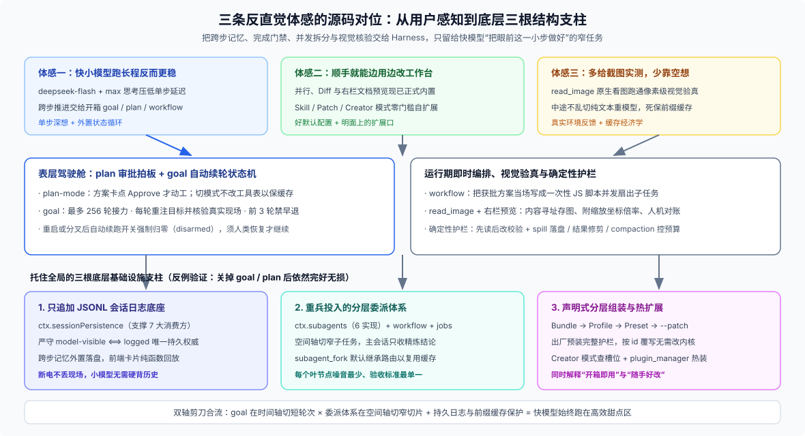

# Answer 10 · 三条反直觉体感的源码对位：外置状态循环、声明式自扩展与像素级反馈闭环

## 一句话结论

这位烧掉 10 亿 token 的重度用户之所以得出三条看似反直觉的结论——**“快小模型反而极好用”、“用好它总会顺手自己改造”、“少靠慢吞吞的大模型空想、多给截图实测”**——并不是偶然的个人偏好，而是正面撞上了 DSH 最核心的工程取向：**把跨步记忆、完成门禁、并发拆分与真实环境核验全部从模型脑子里剥离出来交给 Harness 管，只留给模型“把眼前这一小步做好”的窄任务**。

当长跑的脚手架由外置系统兜底后，单步低延迟、前缀缓存友好且原生支持看图的快模型，自然在高频迭代的编码闭环里跑赢了靠单次长推理硬撑的慢速重模型。

---

## 一、三条实战体感与当前源码机制逐条对表

把早期流传的用户原话放到当前 DSH 仓库源码下核对，既能看清每条体感背后的真实机制，也能顺手刷新几处已经被官方补齐的演进事实：

| 重度用户体感 | 当前源码核对结论 | 对应的核心机制与现状校对 |
|---|---|---|
| **1. “快就是好：Flash 开 `max` 思考 + 开箱 `goal`/`plan` + 动态工作流”** | **核心机制完全吻合（需补算回传成本账）** | 默认主力 `deepseek-flash` 压低单步延迟，`max` 思考补足当步推理；跨步推进交给开箱挂载的 `goal` + `plan` + 即时脚本编排 `workflow` |
| **2. “很多地方得顺手自己改造（并行、预览、右侧栏产出物）”** | **早期缺口大半已内置；“适合边用边改”确属基因** | 并行、Diff、右栏及 Office/PDF/表格预览现已内置；而 `.agents/skills/`、YAML Patch 与 Creator 模式确实让随手改造零门槛 |
| **3. “别用 V4 Pro，多用 vision”** | **方向完全成立（本质是环境反馈与缓存经济学）** | `deepseek-flash` 原生支持看图，经 `read_image` 跑通像素级验真；任务拆薄后切纯文本重模型不仅性价比低，还会打碎前缀缓存 |

拆开看每一条在代码里的具体落点：

### 1. 体感一：`goal + plan` 外置状态循环，让快模型也能跑长跑稳

- **单步高强度推理 + 低延迟底座**：默认主力 [`deepseek-flash`](https://github.com/deepseek-ai/deepseek-harness/blob/master/packages/llm/llm-deepseek/src/models.ts)（1M 上下文）单步吞吐快，开启 `reasoningEffort: max` 把算力集中投在当前一步的代码判断上。
- **跨步纪律全由系统接管**：[`dsh-base`](https://github.com/deepseek-ai/deepseek-harness/blob/master/packages/bundle/base/cordis.patch.yml) 出厂即挂 [`goal`](https://github.com/deepseek-ai/deepseek-harness/blob/master/packages/goal/README.md)（默认最多 256 轮自动接力、每轮强制重读工作区真实现场而非轻信早期自述、自动轮前 3 轮禁止轻言 `blocked`）与 [`plan`](https://github.com/deepseek-ai/deepseek-harness/blob/master/packages/plan/plan-mode/src/index.ts)（人类点按钮批过方案才动工，且切模式故意不改工具列表以保住前缀缓存）。
- **“dynamic workflow”的真实面目**：仓库里并没有叫这个名字的固定开关——真实过程是模型把刚获批的计划当场写成一次性 JS 脚本喂给 [`workflow`](https://github.com/deepseek-ai/deepseek-harness/blob/master/packages/workflow/workflow/README.md)，通过 `parallel()` / `pipeline()` 并发扇出子智能体。

### 2. 体感二：声明式组装与 Creator 自扩展，让“边用边改”没有门槛

- **先校对现状（很多早期痛点现已开箱即用）**：三层多路并行、代码 Diff 与 Markdown 渲染、轮末变更审查与显式 `present` 交付卡（[`ui-deliverables`](https://github.com/deepseek-ai/deepseek-harness/blob/master/packages/client/ui-deliverables/README.md)）、右侧停靠栏（[`ui-sidebar-right`](https://github.com/deepseek-ai/deepseek-harness/blob/master/packages/client/ui-sidebar-right/README.md)），乃至右栏内的 **Word / PPT（本地转 PDF）、Excel（浏览器表格引擎）、PDF、图片与沙箱 HTML 预览**（[`ui-sidebar-documentpreview`](https://github.com/deepseek-ai/deepseek-harness/blob/master/packages/client/ui-sidebar-documentpreview/README.md) 配合 [`skill-office`](https://github.com/deepseek-ai/deepseek-harness/blob/master/packages/skill/skill-office/README.md)）如今均已正式内置。
- **为什么重度用户依然爱自己改**：DSH 把同款扩展能力全摆在了明面上——零代码写 `.agents/skills/` 固化工作流套路、写两行 `cordis.patch.yml` 开关内置面板（如打开 Web 右栏浏览器），直到切进 **Creator 模式**（`cordis` preset：用只读 `cordis_inspect_*` 查清宿主服务与前端实况槽位，配内置开发技能写包，再经审批门控的 [`plugin_manager`](https://github.com/deepseek-ai/deepseek-harness/blob/master/packages/boot/plugin-manager/README.md) 安装并通过 HMR 热生效；早期的纯内存试验工具 `cordis_define` / `cordis_run` 已退回底层程序化 runner）。

### 3. 体感三：原生多模态附件流与真实环境反馈，替代纯文本空想推理

- **像素级验真最省弯路**：前端排版、图表与文档外观的对错全在渲染后的像素里，纯文本思维链想得再深也算不出文字重叠。默认主力 `deepseek-flash` 原生声明图像输入能力，截图落盘后经 [`read_image`](https://github.com/deepseek-ai/deepseek-harness/blob/master/packages/fs/tool-fs/README.md) 存入内容寻址附件库（缩放时自动附带原图坐标换算倍率），前端对话卡同步渲染同一张图供人机对账。
- **路由与缓存经济学**：框架从未限制 `deepseek-v4-pro`，但在任务已被拆薄的前提下，切去纯文本重模型不仅丢了看图能力，更会在会话中途当场清零前缀缓存。

---

## 二、撑起表面体验的三根底层结构支柱

做个简单的反例检验：如果在配置里把 `goal` 和 `plan` 关掉，“无人值守自动跑三小时”确实会停摆，但**多路并行拆解、崩溃断点恢复、确定性预览回放与随时打补丁改造**依然完好无损。这说明 `goal + plan` 只是最贴近用户感知的表层驾驶舱，真正托住全局的是底下三根基础设施支柱：

### 1. 只追加会话日志底座（`ctx.sessionPersistence` + `model-visible ⟺ logged`）

整个运行时只有一本权威账本：模型每轮看到的上下文一律从 `session.deriveMessages()` 派生，前端看到的每张卡片一律从日志事件纯函数投影；连 `goal/change`、`plan/mode`、`tool-workflow/*` 自己都只是日志里的普通事件。有了这根底座，快模型根本不需要靠参数死记三小时前的口头承诺，每轮直接读盘对账即可。

### 2. 重兵投入的分层委派体系（`ctx.subagents` + `workflow` + `jobs` + `agent-team`）

在 [`docs/capability-seams.md`](https://github.com/deepseek-ai/deepseek-harness/blob/master/docs/capability-seams.md) 的全部可替换接缝里，`ctx.subagents` 以 **6 个 Provider** 高居榜首（编排选型详见 [FAQ 27](../27_runtime-orchestration-choice/answer.md)）。`goal` 在**时间轴**上把长跑切成短轮次接力，委派体系在**空间轴**上把大活拆给干净上下文的子智能体并行干完再收回摘要——两把剪刀把每个叶节点都裁成了快小模型最擅长的窄切片。

### 3. 声明式分层组装（Bundle → Profile Patch → Preset → CLI `--patch`）

DSH 严守“新能力走插件，不改 `agent-loop` 内核”。所谓“开箱即有”，只是官方在基础 Bundle 与 Web Preset 里预先替你勾好了一张高配插件单（四大预设模式对比见 [FAQ 03](../03_preset-modes-specialty/answer.md)）；不顺手的地方随时用一层 YAML 覆写或装入新包，无需分叉改内核。

---

## 三、照抄这套打法前，先算清四笔诚实账

老手的实战打法虽然顺手，但直接照搬前必须把下面四条真实边界摆在桌面上：

1. **`max` 档思考背着沉重的“推理回传税”**

   在 [`llm-deepseek`](https://github.com/deepseek-ai/deepseek-harness/blob/master/packages/llm/llm-deepseek/README.md#model-experience) 的协议实现里，每一轮带推理的助手回复都会把完整思考原文原封不动回传进后续所有请求的历史前缀。几百轮重构跑下来之所以没破产，全靠未改动前缀命中 DeepSeek KV Cache——**一旦你在长会话中途频繁切模型或改工具列表，缓存从变更点起瞬间失效，账单会成倍暴涨**。

2. **自建全新 UI 产物视图必须交“日志回放税”**

   DSH 严禁前端脱离日志私塞内存状态（见 [`docs/cookbook/adding-a-tool.md`](https://github.com/deepseek-ai/deepseek-harness/blob/master/docs/cookbook/adding-a-tool.md)）。给新工具做自定义预览卡，要么把纯函数派生的展示元数据存进 `tool/result.meta`，要么声明新的 `SessionEventMap` 事件并确保页面刷新与导出回放完全一致。

3. **`goal` 管得住流程闸门，替不了客观验收标准**

   框架能强制模型“自动续轮跑够 3 轮才准报阻塞”“标完成前先重读目标”，但 `complete` 终归是模型提交的主张——若测试脚本本身写得松，框架拦不住“挑局部绿灯交差”。同时，进程重启或会话分叉后自动续跑开关会故意归零（`disarmed`），必须等人类明确恢复才继续。

4. **耗时对比与默认模型目录均属部署层事实**

   “3 小时跑完 vs 竞品做梦”只是单方非受控体感，本文只拆解 DSH 减少空转的机制下限，不为跨产品跑分背书；默认模型目录（`deepseek-flash` 与 `deepseek-v4-pro`）也只是随上游列表演进的出厂建议配置，而非锁死在内核里的永久承诺。

---

## 继续阅读

| 你想细看哪一块机制 | 去哪篇看 |
|---|---|
| `goal` 自动续轮、`plan` 零工具变动保缓存、`workflow` 即时脚本编排怎么配合放大快小模型？`max` 回传账怎么算？ | [`01-goal-plan-and-fast-models.md`](./01-goal-plan-and-fast-models.md) |
| 哪些预览与侧栏面板现已内置？怎么用 Skill / Patch / Creator 模式顺手改造？`read_image` 五级图片压缩预算怎么跑？ | [`02-self-customization-and-vision.md`](./02-self-customization-and-vision.md) |
| 为什么说 `goal/plan` 之下还有会话日志、委派体系与声明式组装三根底座支柱？关掉表层后各会发生什么？ | [`03-three-structural-roots.md`](./03-three-structural-roots.md) |
| 本专题涉及的全部源码包路径、设计决策记录与外部反馈说明汇总 | [`reference.md`](./reference.md) |

> 核验状态见 [核验基线登记](../00-baseline.md)。
