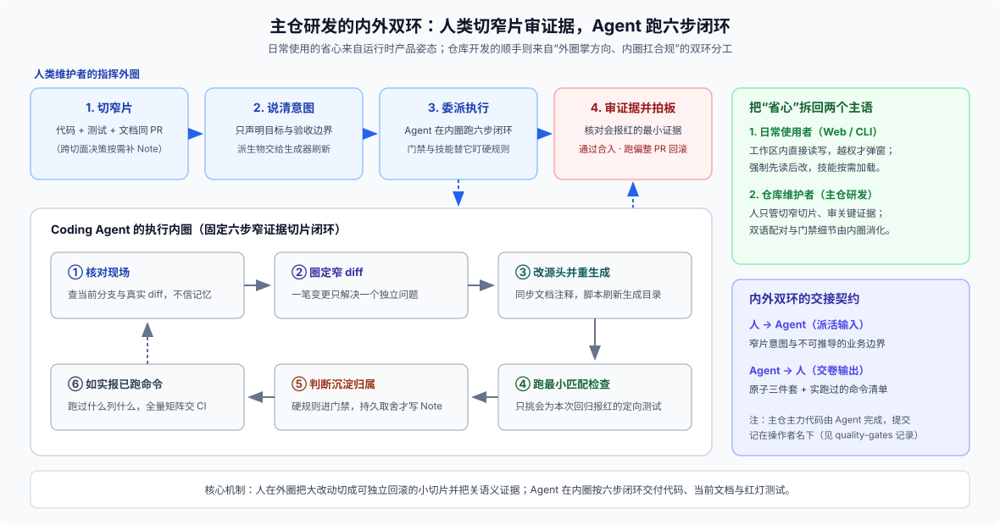
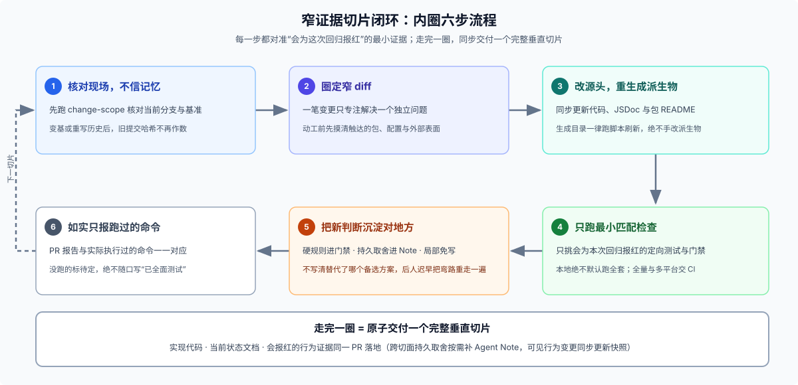
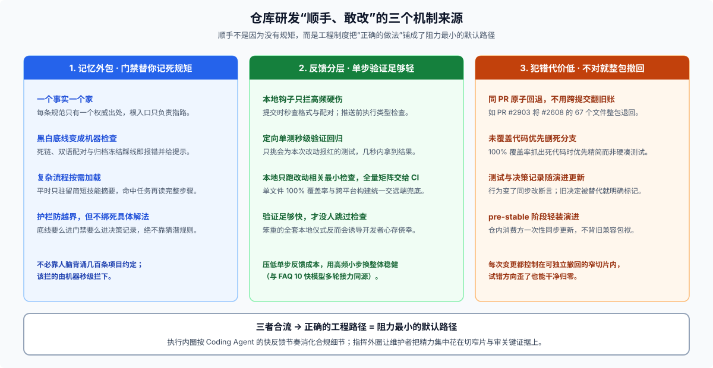

# Answer 11 · 把“省心”拆回两个主语：运行时不瞎打扰，开发时走窄切片闭环

## 一句话结论

觉得 DSH“轻松好用”，其实来自两套完全不同层面的设计——聊之前必须先把**“谁在觉得轻松”**拆开：

1. **如果你是打开 Web 或 CLI 指挥 DSH 干活的用户**：你根本碰不到仓库里的门禁脚本或 Agent Note。你觉得省心，是因为 **DSH 的运行时产品姿态**——工作区内直接读写、只有越权提权才弹窗找你；能自己读代码查明白的事绝不反问你；改文件前强制先读防瞎改；进度有实时 Todo 面板和可选的 `/plan` 审批卡兜着；跑偏卡壳时先温和提醒而不是直接报错崩掉。
2. **如果你是在 DSH 仓库里开发（指挥 Coding Agent 改代码、写插件的维护者）**：你觉得顺手，是因为仓库把 **“窄证据切片闭环”** 做成了最省力的默认轨道——`核对现场 → 圈定窄 diff → 改源头并自动派生 → 只跑针对本次回归的最小检查 → 机械规则进门禁 / 持久取舍进 Note → 老实报告跑过的命令`。人在外圈只管切小任务、审关键证据；繁琐的合规体力活由内圈的 Agent 和门禁消化掉。

下面把这两层分别摊开讲透，最后把它的真实代价和边界也摊在桌面上。想看从零写一个新工具走完闭环的实战推演，直接看 [`01-walkthrough-adding-a-tool.md`](./01-walkthrough-adding-a-tool.md)。

---

## 一、对日常使用者（Web / CLI）：为什么指挥它干活不累？

普通用户面对的是 [`base`](https://github.com/deepseek-ai/deepseek-harness/blob/master/packages/bundle/base/cordis.patch.yml) + [`web-app`](https://github.com/deepseek-ai/deepseek-harness/blob/master/packages/bundle/web-app/cordis.patch.yml) + 默认 [`standard`](https://github.com/deepseek-ai/deepseek-harness/blob/master/packages/bundle/web-app/presets/standard.patch.yml) 模式组装出来的运行时。让人觉得“不用手把手盯着”的，是六条实打实的运行时设计：

1. **只在真正需要你拍板的地方打断你**
   默认权限是 `workspace-write` 配 `ask`：工作区内的正常读写直接干，只有触发沙箱提权时才会弹出审批面板（`Reject` / `Allow once`）。同时，系统提示词给 `ask_user_question` 立了死规矩：**凡是翻代码能自己查清的事实一律自己查，严禁问用户“代码在哪”**（`"Resolve discoverable facts by inspection... Do not ask the user where code lives"`），而且明确规定“用户在闲聊里的附和不算数，正式审批才算数”。
2. **引擎级强制“先看再改”，防盲目覆盖**
   不管开没开计划模式，底层 [`fs-observation-policy`](https://github.com/deepseek-ai/deepseek-harness/blob/master/packages/fs/fs-observation-policy/src/index.ts) 都在生效：没先 `read` 过的文件调 `edit` 直接报 `FS_NOT_OBSERVED`，写文件也带版本校验防意外覆盖。
3. **进度看得见，大活可先审方案**
   多步任务有 [`todo_write`](https://github.com/deepseek-ai/deepseek-harness/blob/master/packages/todo/tool-todo/src/index.ts) 实时刷新底栏进度条；遇到复杂改动，敲 `/plan` 进入计划模式后，模型交卷时在 Web 端渲染出专门的决策卡片（按钮是 `Approve` / `Refuse` / `Chat about it`），聊透批过再动手。
4. **知识按需加载，不用人提前喂说明书**
   [`tool-skill`](https://github.com/deepseek-ai/deepseek-harness/blob/master/packages/skill/tool-skill/src/index.ts) 采用两层加载：常驻上下文里只有带哈希去重的简短技能目录，匹配到具体任务（或用户敲 `/技能名`）时才把完整指令读进来。
5. **卡壳时温和纠偏，后台子任务自动回交**
   模型如果连续撞墙（比如反复调同一个被拒的命令），[`repeat-tool-reminder`](https://github.com/deepseek-ai/deepseek-harness/blob/master/packages/guard/repeat-tool-reminder/src/index.ts) 会在第 3、5、8 次调用后逐级注入提醒帮它换思路，而不是一棍子中断整轮对话。派出去的 `subagent` 和 `subagent_fork` 在 Web 默认都是后台运行，跑完后由运行时自动把结论拼成通知塞回父会话（见 [`docs/subsystems/subagent.md`](https://github.com/deepseek-ai/deepseek-harness/blob/master/docs/subsystems/subagent.md)）。
6. **发生过什么随时能复盘**
   严格遵守 `model-visible ⟺ logged`：模型看到的每一个字都在会话日志里有据可查，不怕黑盒乱跑。

一句话总结产品侧的省心：**脏活累活 Agent 自己查自己干，安全底线由引擎兜着，只在真正属于你的决定上敲你的门。**

---

## 二、对仓库开发者与 Coding Agent：窄证据切片闭环

切到“改 DSH 仓库或开发插件”的视角，画风就变了。[`quality-gates` 决策记录](https://github.com/deepseek-ai/deepseek-harness/blob/master/.agents/notes/archived/process/2026-06-11-quality-gates.md) 第一句就交了底：**这个代码库主要是由 Coding Agent 开发的。** 仓库里的十几套 `dsh-*` 技能、门禁和 PR 历史共同指向一套内外双圈配合的工作流：

内圈 Agent 每次迭代跑的是固定的 **六步闭环**：

1. **核对现场，不信记忆**：动手前先跑 `pnpm --silent run change-scope --base <verified-base-ref>` 看清当前分支与真实改动，绝不靠上一轮对话的印象或 rebase 前的旧 commit hash 下判断（见 [`dsh-pre-push-checks`](https://github.com/deepseek-ai/deepseek-harness/blob/master/.agents/skills/dsh-pre-push-checks/SKILL.md)）。
2. **圈定窄 diff**：一笔变更只专注解决一个独立问题，改前先看清到底触达了哪几个包和表面。
3. **改源头，重生成派生物**：改代码的同时同步更新该包的 `README` 与 JSDoc；像 `tool-catalog.md`、`capability-seams.md` 这类生成目录一律跑生成器刷新，绝不手改；写下的每一句注释和文档都按“只看当前 HEAD、没看过聊天记录的读者能否读懂”来检验（见 [`dsh-trim-cot-leakage`](https://github.com/deepseek-ai/deepseek-harness/blob/master/.agents/skills/dsh-trim-cot-leakage/SKILL.md)）。
4. **只跑“会为这次回归报红”的最小检查**：本地绝不默认跑全量测试套件，只挑最窄的对应单测、`doc-sync` 或包构建；把耗时的全量覆盖率（`test:coverage`）和跨平台矩阵留给远端 CI。
5. **把新判断沉淀对地方（或干脆不加）**：能用代码死查的规则写成非零退出的门禁脚本；代码、测试和现有文档都解释不了的**持久设计取舍**（尤其是放弃了哪些备选方案）写进 [Agent Note](https://github.com/deepseek-ai/deepseek-harness/blob/master/.agents/notes/README.md#when-to-write-one)；普通局部修改就什么额外记录都不加，防止文档膨胀。
6. **老老实实只报跑过的命令**：PR 和汇报里跑了哪条命令就列哪条，没跑的标待定，绝不随口写“已全面测试”。

### 为什么这套闭环让人觉得“顺手、敢改”？

- **不用靠脑子死记硬背硬性规矩**：每个事实只有一个权威存放处（`docs/AGENTS.md`）；类型、死链、双语哈希配对、归档文件冻结（`lefthook.yml` 在提交时直接拦截任何对 `.agents/notes/archived/**` 的改动）都做成了机器检查，踩线当场报错并给出修复提示。
- **单步验证足够轻，人才愿意真跑**：改两个文件、跑单个包的 `vitest` 往往只要几秒钟。把每次迭代的反馈成本压下来，开发者和 Agent 才不会产生“太慢了干脆跳过检查直接推”的侥幸心理（这与 [FAQ 10](../10_heavy-user-impressions-vs-mechanisms/answer.md) 里“用快模型多跑几轮换总质量”是同一个工程思路）。
- **犯错代价低，不对就整包撤回**：仓库代码还处于 `pre-stable` 阶段，不背历史兼容包袱；100% 覆盖率抓到未覆盖代码时，默认优先删死代码而不是硬凑测试；万一合进去发现方向歪了，团队习惯是**整个 PR 镜像回滚**（例如 PR `#2903` 一把将 `#2608` 涉及的 67 个代码、测试、文档、Note 文件原样退回），而不是在错底座上打补丁。
- **反转一个常见误会——不是“先写厚规格书再写代码”**：外人翻 DSH 仓库看到齐全的 `docs/`、生成目录和 Agent Note，很容易以为这里是瀑布式的“规格先行（SDD）”。其实因果刚好反过来：**先有高频滚动的窄切片闭环和门禁，规格感是闭环跑了很多圈之后沉淀下来的结果**（静态载体的详细分工见 [FAQ 06](../06_change-landing-path/answer.md)）。

---

## 三、分清三层边界：什么是强制的，什么是自觉的？

把仓库经验往自己项目搬之前，一定要分清下面三层——它们并不是全都靠代码卡死的：

| 层级 | 具体包含什么 | 谁在管 |
|---|---|---|
| **1. Harness 运行时默认** | `workspace-write + ask` 权限、`read-before-edit` 校验、技能按需加载、后台子智能体自动回交、`lefthook.yml` 本地钩子、CI 门禁矩阵 | **代码与配置硬性执行** |
| **2. 仓库贡献纪律** | “只跑最窄测试不跑全套”“只报实际跑过的命令”“涉及持久取舍写 Agent Note” | **`AGENTS.md` 与 `dsh-*` 技能引导**（你真在本地敲 `pnpm run test` 全量跑一遍，机器并不会拦你） |
| **3. 团队历史惯例** | 代码+文档+测试同提交落地、出问题整 PR 回滚、分支演进中保留 checkpoint 或按需用 stacked PR / 普通独立 PR | **Git 历史里的协作习惯**（简单改动完全可以走普通单分支 PR，不必强套栈式 PR） |

---

## 四、诚实摊牌：这套模式有哪些真实代价和局限？

不把话说满，下面四笔账是在 DSH 里干活实打实会碰到的摩擦：

1. **本地钩子比 CI 快得多，但绝不是“零延迟”**
   `pre-commit` 跑 lint 和空白检查确实很快，但每次 `git push` 触发的 `pnpm run typecheck` 实际上会跑完整的宿主侧构建与客户端类型检查（[`lefthook.yml`](https://github.com/deepseek-ai/deepseek-harness/blob/master/lefthook.yml) + `package.json`）。在 50 多个包的工作区里，冷缓存跑一次要几十秒到一两分钟，仓库自己的归档记录也明确拒绝承诺固定耗时。
2. **门禁只能替你记“死规矩”，记不住“软判断”**
   机器能抓类型错、格式错、覆盖率掉线，但抓不住“这笔改动到底该不该写 Agent Note”“你的切片是不是塞进了两件不相关的事”“注释是不是在复述代码”。这一半负担依然压在 `dsh-*` 技能阅读和人工/Agent Code Review 肩上。
3. **真模型测试并不便宜，“不设配额”是为了防偷懒**
   [`docs/testing.md`](https://github.com/deepseek-ai/deepseek-harness/blob/master/docs/testing.md) 里写着 `"We are DeepSeek — do not ration real-API tests"`。这句话千万别读成“调真模型很便宜”——恰恰因为带密钥的真模型 e2e 最慢也最花钱，团队才专门立规矩堵死“为了省 token 只跑 mock”的借口。
4. **整包回滚有前提，垂直切片也有“宽度税”**
   整 PR 无痛回滚只在后续没有别的 PR 改过同一批文件时才清爽（历史上也发生过 `#3326` 把回滚又二次撤回的折腾）。另外，哪怕只改几行对外行为，往往也要同步更新中英文 `README` 和 `.i18n.yaml` 配对文件——之所以大家不觉得苦，是因为这部分体力活主要由内圈的 Coding Agent 代劳了。

---

## 继续阅读

| 你想了解什么 | 去哪篇看 |
|---|---|
| 跟着一个具体需求（新增工具插件 vs 写技能/编排脚本），从头到尾走一遍六步闭环 | [`01-walkthrough-adding-a-tool.md`](./01-walkthrough-adding-a-tool.md) |
| 一笔变更涉及的 Issue、Note、`docs/`、测试、CI 在仓库里各自住哪？ | [FAQ 06 · 变更落位路径](../06_change-landing-path/answer.md) |
| 想把这套方法搬进自己的业务仓库，该先抄哪几样？ | [FAQ 07 · 借鉴 DSH 的 Harness 思路](../07_borrowing-dsh-harness-idea/answer.md) |

> 核验状态见 [核验基线登记](../00-baseline.md)。
