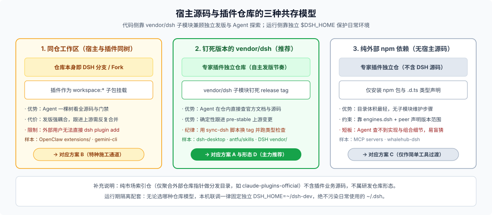

# 四种插件仓库布局对比：目录结构、取舍与迁移路径

选插件仓库怎么摆，本质上只在拍板两件事：**第一，DSH 宿主源码要不要进仓、怎么进（区分方案 A / B / C）；第二，这个仓库只养一个领域专家，还是养一整套共享底座的专家矩阵（区分方案 A 与方案 D）。**

下面把四种布局放在同一张桌面上对比，给出可直接照抄的目录骨架、Coding Agent 探索配置与平滑迁移条件。

---

## 一、四种布局横向细表



| 对比维度 | 方案 A：独立仓 + `vendor/dsh`（推荐主力） | 方案 B：DSH 主仓 `packages/` 内生 | 方案 C：纯外部 npm 依赖 | 方案 D：多专家 Marketplace 单体仓 |
|---|---|---|---|---|
| **DSH 源码怎么拿** | Git submodule 钉在明确 release tag | 仓库本身就是 DSH fork / 分支 | 不进仓，仅装 npm 包与 `.d.ts` | 同方案 A（共用一个 `vendor/dsh`） |
| **Coding Agent 视野** | 仓内直接 `grep` / `read` 官方文档与源码 | 天然一棵树全看清 | 断在 `node_modules` 类型层，查实现靠猜或跳出仓库 | 同方案 A，且新专家可照抄仓内同构模板 |
| **分发与安装方式** | 独立发 npm / Git / `.tgz`，用户 `dsh plugin add` 即装 | **无法直接作为外部插件安装**，绑死主仓发版节奏 | 同方案 A | 既可按单专家独立安装，也可提供市场索引 JSON |
| **UI 能力边界** | 默认兜底卡 + `dsh.client`（`toolview` 槽、设置页、自定义会话视图） | **唯一能直接改内置客户端组件本体与壳层布局**的地方 | 同方案 A | 同方案 A（可在 `shared` 包沉淀通用卡片组件） |
| **测试与门禁成本** | 按需自建轻量 `vitest` + 打包冒烟 + 少量快照 | 现成享全套门禁与 `snapshots/`，但须承担 100% 覆盖率与双语门禁义务 | 自建轻量测试；因缺源码对照，**真装冒烟最关键** | 按单专家跑单测，改共享层时跑全专家矩阵冒烟 |
| **跟随上游升级** | 跑 `sync-dsh` 脚本换 tag → 记 SHA → `typecheck` 抓破坏点 | 每次同步主干都要做分支合并与全量回归复核 | `pnpm update` 后靠编译报错被动排雷 | 同方案 A，额外跑一遍全专家兼容冒烟 |

---

## 二、方案 A：独立仓库 + 钉死版本的 `vendor/dsh` 子模块（推荐起点）

对绝大多数严肃的领域专家团队来说，方案 A 是兼顾**独立演进主权**与**Coding Agent 仓内可读性**的最佳平衡点。DSH 主仓自己管 `vendor/`（钉死 Cordis 上游 commit 并配同步清单，见 [`vendor/README.md`](https://github.com/deepseek-ai/deepseek-harness/blob/master/vendor/README.md)），以及社区项目 `anywhere-labs/dsh-desktop`、`antfu/skills` 用的都是同一套思路。

### 1. 第 0 天极简目录树（单包起步，别过早拆多包）

起步阶段完全不需要搞复杂的三四层子包，单包根目录直接就是一个合法的 Bundle：

```text
my-domain-expert/
├── AGENTS.md                 # 几百词短地图：本仓命令、开发 DSH_HOME 约定、vendor/dsh 查阅路径
├── CLAUDE.md -> AGENTS.md    # 软链接，兼容不同 Coding Agent 入口
├── package.json              # 声明 dsh.bundle.patch、可选 dsh.client、engines.dsh 与 peerDependencies
├── cordis.patch.yml          # 插入 @deepseek-ai/dsh-agent-preset 行与本包提供的插件行
├── src/
│   ├── index.ts              # Host 插件入口（注册专属工具、流服务、拦截守卫等）
│   ├── client.ts             # 可选：Web 客户端入口（打包输出到 lib/client.js）
│   └── skills/               # 随包分发的领域只读技能（SKILL.md + 参考资料）
├── tests/                    # 单元与局部 Loader 组装测试
├── scripts/
│   ├── sync-dsh.mjs          # 切换 vendor/dsh tag、更新上游 SHA 记录并跑 typecheck
│   └── release-smoke.mjs     # pnpm pack -> 临时干净 DSH_HOME 真装冒烟
├── docs/                     # 只写当前有效合同：服务键、工具参数、preset 行为边界
├── notes/                    # 轻量决策记录：只记有备选方案取舍的关键决定
└── vendor/
    └── dsh/                  # git submodule，钉在明确的 DSH release tag（只读不改）
```

> **什么时候再从单包拆成 `packages/{flows,tools,pack}` 工作区？**
> 只有当内部流引擎膨胀到需要独立复用，或者你想把“内部实现子包”和“唯一对外发布的自包含 `expert-pack`”在目录上硬隔离时，再加一层 `pnpm-workspace.yaml`。拆包后务必守住一条铁律：**最终 `pnpm pack` 打出的发布包必须把内部子包代码打进去（或同步公开发布），绝不能留任何指向仓库内部或 `vendor/dsh` 的相对路径。**

### 2. 最小可用的 `package.json` 与 `cordis.patch.yml` 正例

不要去建早已废弃的 `agent.cordis.yml` 预设目录，也不要靠自造 `dsh.compatibility` 指望宿主做版本检查。标准声明长这样（完整字段契约见 [`package-manifest/src/types.ts`](https://github.com/deepseek-ai/deepseek-harness/blob/master/packages/util/package-manifest/src/types.ts) 与 [FAQ 24](../24_plugin-publishing-and-data/answer.md)）：

```json
{
  "name": "@acme/dsh-legal-expert",
  "version": "0.1.0",
  "type": "module",
  "exports": {
    ".": "./lib/index.js",
    "./client": "./lib/client.js"
  },
  "files": ["lib", "cordis.patch.yml", "skills"],
  "engines": {
    "node": "^22.19 || >=24",
    "dsh": ">=0.2.0 <0.3.0"
  },
  "peerDependencies": {
    "@deepseek-ai/cordis": "^4.0.0",
    "@deepseek-ai/dsh-tools": "^0.2.0"
  },
  "devDependencies": {
    "@deepseek-ai/cordis": "^4.0.0",
    "@deepseek-ai/dsh-tools": "^0.2.0"
  },
  "dsh": {
    "manifestVersion": 1,
    "bundle": { "patch": "./cordis.patch.yml" },
    "client": { "platform": "web" }
  }
}
```

配套的 `cordis.patch.yml` 同时挂载你的后端能力插件，并插入会话级专家预设（可对照内置 [`cordis.patch.yml` 预设写法](https://github.com/deepseek-ai/deepseek-harness/blob/master/packages/bundle/web-app/presets/cordis.patch.yml)）：

```yaml
- insert:
    - id: legal-expert-host
      name: '@acme/dsh-legal-expert'
    - id: preset-legal-expert
      name: '@deepseek-ai/dsh-agent-preset'
      config:
        id: legal-expert
        plugins:
          - id: persona
            name: '@deepseek-ai/dsh-persona'
            config:
              prefix: '你是专注于合同合规审查的法律领域专家智能体。'
          - id: tool-fs
            name: '@deepseek-ai/dsh-tool-fs'
          - id: legal-clause-checker
            name: '@acme/dsh-legal-expert'
```

### 3. `vendor/dsh` 接入的两个实操细节

- **先避开子工作区脚本冲突**：DSH 仓库里的不少构建与门禁脚本默认假设自己处在 Git 顶层根目录。最稳妥省心的接法是：**插件包自身的依赖通过 npm 的 `peerDependencies` + `devDependencies` 安装（与 `vendor/dsh` 所钉的 release tag 版本一致）**，把 `vendor/dsh/` 当作纯只读的源码与文档知识库（必要时在本地跑一次 `pnpm --dir vendor/dsh install` 供源码级调试使用），而不强行把 `vendor/dsh/packages/*/*` 塞进你外层仓库的 `pnpm-workspace.yaml`。
- **把上游升级固化成单条脚本**：公开 API 仍在快速演进，切忌让 `vendor/dsh` 裸跟 `master` 漂移。写一个 `scripts/sync-dsh.mjs`，每次升级固定执行五步：`切换子模块到新 release tag → 记录精确 SHA → 同步升级 package.json 中的 peer/dev 依赖与 engines.dsh → 跑 pnpm run typecheck 让接口变更在编译期报错 → 跑真装冒烟脚本`。

---

## 三、方案 B：直接在 DSH 主仓 `packages/` 里长（何时进、何时退）

方案 B 是把你的代码直接放进 DSH 仓库 fork 分支的 `packages/<group>/<pkg>/` 下开发（分组与依赖方向规则见 [`packages/README.md`](https://github.com/deepseek-ai/deepseek-harness/blob/master/packages/README.md)）。

- **它不可替代的两大优势**：
  1. **直接修改内置客户端本体**：虽然自定义单工具卡（`tool.call.toolview`）、设置分区和独立会话视图在仓外都能做，但如果你要改内置消息流骨架、改官方现成卡片组件本体，只有树内能直接动 `packages/client/*`。
  2. **零成本享用全套重型基建**：`test:coverage`（单文件 100% 覆盖率）、`doc-sync`、自动刷新的 `capability-seams.md` / `tool-catalog.md`，以及现成的 `snapshots/` 无密钥回放线全部开箱即用。
- **为什么外部团队不该拿它当长期大本营**：
  住在 fork 里意味着你不再是在“发一个插件”，而是在“维护一个自定义分支的 DSH”。普通用户没法一句 `dsh plugin add` 装上你的专家（除非你真的准备按 [FAQ 26](../26_harness-distribution/answer.md) 自己长期发整套定制版工作台），而且上游每发一个新版本，你都要为所有改动重付一遍合并与门禁复核成本。
- **正确用法**：只把方案 B 当**特种施工通道**——要么在里面快速验证深水区 UI 原型（跑通后把通用槽位提 PR 给上游，业务代码折回方案 A），要么专门用来给 DSH 官方贡献新的 capability seam 定义。

---

## 四、方案 C：纯外部 npm 依赖，DSH 不进仓（过渡形态与补救法）

如果插件只有一两个薄工具，且你实在不想维护 Git submodule，就会落到方案 C：仓库里完全没有 `vendor/dsh`，全靠 `node_modules` 里的 `@deepseek-ai/*` 类型声明写代码。

- **真实代价**：MCP 官方 `servers` 仓库能愉快地用纯外部依赖，是因为 `@modelcontextprotocol/sdk` 接口极小且高度稳定；而 DSH 的组合约定多、接口仍在演进。没有仓内源码对照，Coding Agent 遇到配置覆盖顺序、预设作用域隔离或卡片元数据投影问题时极易开始“凭想象编字段”。
- **留在方案 C 时的必做补救（知识内化）**：
  借鉴闭源宿主生态（如 Claude Code 插件把框架知识写成随包 `SKILL.md`）的做法，在仓内建一个精简的 `docs/dsh-notes/`，把最常踩坑的四页核心规则（Bundle 叠层顺序、预设插件行语法、`model-visible ⟺ logged` 约束、`dsh.client` 构建要求）浓缩摘录进去，并在 `AGENTS.md` 里约定可通过本机环境变量 `$DSH_REPO` 指向本地另一份 DSH 克隆。一旦业务演进出多流编排，执行一条 `git submodule add` 即可原地升入方案 A。

---

## 五、方案 D：多专家 Marketplace 单体仓（规模化终局）

当你手头不再只有一个“法律合规专家”，而是陆续立项了“财务审计专家”“安全巡检专家”，并且它们确实需要共用同一套流编排辅助函数、卡片组件或测试夹具时，再把方案 A 升级为方案 D：

```text
acme-expert-suite/
├── AGENTS.md
├── pnpm-workspace.yaml           # 管理 packages/*
├── marketplace.json              # 可选：静态插件市场索引清单，供插件市场源订阅
├── packages/
│   ├── shared-kit/               # 内部共享辅助库（流工具、通用 UI 小组件、测试夹具）
│   ├── legal-expert/             # 独立自包含 Bundle（package.json + cordis.patch.yml + src/）
│   └── finance-expert/           # 同构的第二个独立 Bundle
├── templates/
│   └── expert-scaffold/          # 新专家目录模板，供 Coding Agent 按标准结构扩建
├── scripts/
│   ├── validate-suite.mjs        # 校验市场索引、各包版本与 engines.dsh 一致性
│   ├── smoke-all.mjs             # shared-kit 变更时触发全量专家真装冒烟
│   └── sync-dsh.mjs              # 统一升级 vendor/dsh 并跑全仓 typecheck
└── vendor/
    └── dsh/                      # 钉死 release tag 的 DSH 子模块
```

运营方案 D 只需死守三条纪律：

1. **没立项第二个专家前绝不提前建 `shared-kit`**：提前抽出的公共层九成是猜错的抽象。
2. **每个专家发布包必须严格自包含**：无论是通过打包器把 `shared-kit` 内联进各专家的 `lib/`，还是把 `shared-kit` 单独发成正式 npm 依赖，都必须保证用户单独执行 `dsh plugin add @acme/dsh-legal-expert` 时不依赖单体仓目录结构。
3. **变更影响面分级验证**：改单个专家只跑该包的单测与冒烟；一旦动了 `packages/shared-kit/` 或升级了 `vendor/dsh/`，CI 必须跑 `smoke-all.mjs` 验证所有专家包都能干净安装启动。

---

## 六、一张表看清何时迁移

| 当前所处位置 | 出现什么真实信号 | 推荐动作 |
|---|---|---|
| **方案 C（纯外部依赖）** | Agent 频繁写错 Cordis 配置或钩子签名，需要反复人肉翻 DSH 源码纠偏 | `git submodule add` 引入 `vendor/dsh` 钉住当前 tag，升为 **方案 A** |
| **方案 A（单包独立仓）** | 内部模块膨胀，希望严格隔离内部实现与对外发布的 Bundle 产物 | 留在 **方案 A**，仓内启用 `pnpm-workspace.yaml` 拆分子包 |
| **方案 A（独立仓）** | 现有 `tool.call.toolview` 与 `dsh.client` 槽位装不下需求，必须改内置前端组件或向上游提新 seam | 临时开 **方案 B** 分支验证并向上游提 PR；合入后业务侧折回 **方案 A** |
| **方案 A（独立仓）** | 第二个领域专家正式立项，且明确要复用第一套专家的流基座与测试工具 | 把现有单包目录平移进 `packages/<first-expert>/`，升为 **方案 D** |
| **方案 A / D（单人开发）** | 团队加入多名协作者，或需要跨仓库先审设计方案再动工 | 仓库形态不变，在流程上叠加显式提案目录（如 `notes/proposed/` 或 OpenSpec） |

> 核验状态见 [核验基线登记](../00-baseline.md)。
