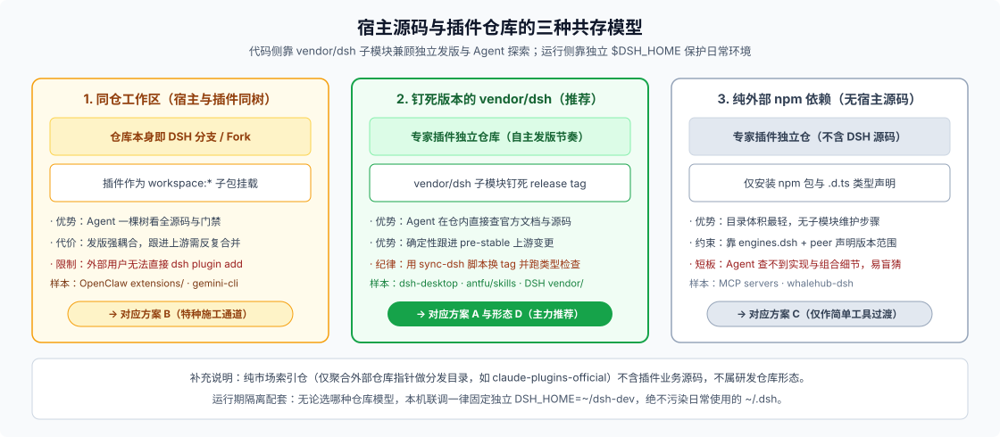

# 双环境物理隔离与不可变命名清单：第 0 天防踩坑指南

搭插件仓库的第 0 天，有两件事当时顺手做只要五分钟，一旦偷懒拖到发版后就会变成大麻烦：

1. **本地调试直接往日常使用的 `~/.dsh` 里塞半成品插件**，一个配置写歪就把手头正在干活的 DSH 环境搞挂；
2. **包名、插件行 `id`、工具名、`preset id` 随手乱起**，等写进了用户的会话日志和自定义配置后，发现改任何一个名字都等于断兼容。

下面把**运行时双环境物理隔离**与**命名“身份 vs 外皮”分层**一次讲透。

---

## 一、双 `$DSH_HOME` 物理隔离：不用装两套软件，开发折腾零风险

在代码仓库层面，前文推荐用 `pinned vendor`（`vendor/dsh` 子模块）让插件代码与宿主源码安全共存；而在本机运行层面，你同样**不需要安装两份 DSH 程序**——因为 DSH 的隔离边界不是“装了几份 CLI”，而是 **`$DSH_HOME` 数据根目录**（解析优先级：显式参数 → 环境变量 `$DSH_HOME` → 默认 `~/.dsh`）。



### 1. 为什么切一个 `DSH_HOME` 就是彻底的物理隔离？

- **Profile 依赖树完全独立**：每个 Profile 都是 `$DSH_HOME/profiles/<name>` 下一个独立的 pnpm 项目，拥有自己的 `package.json`、锁文件、`node_modules` 和 `cordis.patch.yml`（见 [`app-boot` README](https://github.com/deepseek-ai/deepseek-harness/blob/master/packages/boot/app-boot/README.md)）。你在开发目录里把依赖装劈了、把 patch 写炸了，DSH 按 fail-loud 原则只会在开发进程启动时当场报错退出，默认 `~/.dsh` 里的日常环境连文件都不会被碰一下。
- **会话日志、存储与凭据互不可见**：`sessions/` 会话记录、`storages/` 键值与 SQLite 数据、`.credentials.yaml` 密钥以及全局 `AGENTS.md` 全部收在各自的 `$DSH_HOME` 下。测试插件产生的脏数据或异常事件绝不会混进你的日常工作会话（若使用 Electron 桌面端做实验，再叠加 `--user-data-dir` 即可连浏览器窗口状态一起拆开，详见 [FAQ 23](../23_standalone-vs-web-release-forms/answer.md)）。

### 2. 三条落地实操规矩（重点防 Coding Agent 误闯日用环境）

```sh
# 日常干活：什么环境变量都不设，默认走 ~/.dsh（只装正式发布的稳定插件）
dsh web

# 插件开发：固定指向独立的开发目录（可放在 ~/dsh-dev 或仓内已 gitignore 的 dev/dsh-home）
export DSH_HOME="$HOME/dsh-dev"
dsh plugin --profile dev add ./
dsh --profile dev web --port 3081   # 错开日常 Web 端口（默认 3080），两边可同时开着对照
```

落地时记住三个细节：

1. **把 `DSH_HOME` 固化进仓库脚本或 `.envrc`（direnv）**：这一点最关键——**千万别指望 Coding Agent 在终端里跑验证命令时每次都能自觉加上 `DSH_HOME=~/dsh-dev`**。直接写进仓库 `package.json` 的 `"dev"` / `"smoke"` 脚本里，让 Agent 启动的一切进程自动落在开发沙盒中。
2. **给开发目录单独配一次 API Key**：因为 `.credentials.yaml` 按 Home 隔离，新建的 `~/dsh-dev` 需要单独配一次测试用密钥（或通过环境变量注入 `DEEPSEEK_API_KEY`）。
3. **坚持单向晋升，绝不反向链接**：日常 `~/.dsh` 永远不执行 `add ./本地工作区`；等插件在 `~/dsh-dev` 走完开发与 `.tgz` 冒烟正式发版后，再回日常环境用 `dsh plugin --profile web add <正式包名>` 像普通用户一样安装。

---

## 二、名字的“身份 vs 外皮”分层：哪些名字第 0 天定下就难反悔？

一套领域专家插件会涉及十来种名字。判断哪个名字必须第 0 天慎重点名、哪个名字以后随便改，只有一条硬标准：

> **凡是被机器写进持久化文件（会话 JSONL 日志、Profile 配置、用户设置）或跨包代码引用的，都是“不可变身份”；只有纯粹给人眼阅读的标题和介绍，才是零兼容成本的“展示外皮”。**

### 1. DSH 插件命名全景分层表

| 命名项 | 所属层级 | 约束与作用域 | 谁在持久引用它 | 发布后改名的真实代价 |
|---|---|---|---|---|
| **npm 包名** | **机器身份** | 第三方使用自家 `@scope/*` 或独立名；禁占 `@deepseek-ai/*` | Profile 的 `dsh.profile.bundles` 清单、`node_modules` 路径、插件市场索引 | **等于另发新包**：老用户收不到升级，重装后配置清单里会出现新旧两个包 |
| **插件行 `id`** | **机器身份** | 同一运行组合内唯一 | 下游用户的 `cordis.patch.yml` 靠 `id` 定位并做整行配置覆盖 | **下游覆盖失效或报错**：用户自定义的开关与参数全部落空 |
| **`ctx` 服务键** | **机器身份** | 与声明的 Service Definition 同名 | 其他插件的 `inject` 数组、架构依赖图 | **消费方卡死**：所有 `inject` 旧名字的插件永远等不到依赖就绪 |
| **工具 wire 名** | **机器身份** | 建议短横线或下划线短名；组合内唯一 | **逐字写入会话 JSONL 的 `tool/call` 事件**；同时是 `tool.call.toolview` 槽位与工具白名单键 | **历史会话重放断裂**：旧日志里的调用匹配不到工具，专属 Web 卡片与权限过滤同步失配 |
| **`SessionEventMap` 事件名** | **机器身份** | 须通过类型合并声明；全局命名空间 | 直接写进会话 JSONL 日志；非 `ignorable` 事件要求读取方必认识 | **最重**：不认识旧事件名会直接拒绝读取旧会话，触发版本迁移级负担（外部插件尽量别自造底层事件） |
| **`preset id`** | **机器身份** | 必填稳定标识（`config.id`）；重复 ID 在挂载期直接报错 | 会话绑定记录按该 ID 恢复预设；前端按该 ID 查显示文案 | 用户历史会话找不到原绑定预设，恢复时报错拒绝 |
| **`settings` 命名空间** | **机器身份** | `[a-z0-9-]` 小写字母数字连字符（见 [`settings` README](https://github.com/deepseek-ai/deepseek-harness/blob/master/packages/settings/settings/README.md)） | 用户修改后的个人设置按该命名空间持久化落盘 | 用户保存过的旧配置变成无人认领的孤儿数据 |
| **Client `slot` 名** | **机器身份** | `<domain>.<entry>.<hole>` 三段式（见 [`packages/client/AGENTS.md`](https://github.com/deepseek-ai/deepseek-harness/blob/master/packages/client/AGENTS.md)） | 客户端插件之间的槽位注册与消费契约 | 提供方与消费方脱钩；若误占官方已声明域会在加载期直接报错 |
| **工具与参数的 `description`** | **行为中间层** | 自然语言说明 | 不当持久化主键，但**每次请求都会发给模型看** | 不破坏旧日志兼容，但会直接改变模型调用时机与传参质量，须按行为变更做回归验证 |
| **包标题 / 预设显示名 / 面板文案** | **展示外皮** | 走本地化元数据与多语言字典（`t`） | 仅在界面渲染时读取，不进持久引用键 | **零兼容代价**，品牌升级或文案润色随时可改 |

> **给工具留一条折中后路：`toolName` 配置化**
> 像预设显示名可以通过本地化字典随时换皮，但工具的 wire 名直接暴露给模型且写进日志，没有“显示别名”。如果你预期部署方可能在同一会话里挂载两个同款工具实例、或者需要按场景改名，可以模仿官方 `tool-subagent` 把工具名做成插件 `Config` 里的 `toolName` 字段——注意这只是把名字变成了“部署期配置”，一旦跑过会话，历史日志里的旧名字依然不会自动改写。

---

## 三、宿主保留禁区与第 0 天五分钟定名清单

### 1. 五块绝对别踩的官方保留区

- **包作用域与核心服务**：`@deepseek-ai/*` 归官方工作区包所有；`ctx.agents` 等核心服务名与十三种基础会话事件名（`turn/start` 等）归宿主内核所有。
- **内置 Profile 名**：`web`、`headless`、`sdk`、`sdk-minimal`、`acp` 以及桌面端专用的 `desktop` 为官方保留模板名；你自己的开发测试 Profile 可以自由起名（如 `dev`、`legal-dev`）。
- **内置四大 Preset ID**：`standard`、`ptc`、`cordis`、`minimal`。若非刻意编写覆盖补丁，新建专家预设必须避开这四个 ID，否则会在挂载期因重复声明直接失败。
- **`package.json` 的 `bin` 字段**：严禁插件包声明可执行 `bin`——所有运行形态统一由 `dsh` Profile 启动。
- **`package.json` 的 `dsh.*` 字段键**：DSH 规范只认 `dsh.bundle`、`dsh.profile`、`dsh.client` 与 `manifestVersion`（版本范围认顶层 `engines.dsh`），不要在 `dsh` 下自造私有配置键。

### 2. 第 0 天五分钟对齐动作

开工写第一行代码前，先定一个简短无歧义的**领域前缀**（例如 `legal-review`），把所有机器身份一次对齐写进 `docs/`：

1. **包名**：`@你的组织/dsh-legal-review`（带 `dsh-` 前缀方便社区检索与识别）；
2. **插件行 `id` 与 `preset id`**：Preset ID 定为 `legal-review`，Bundle 里的插件行统一用 `legal-review-host`、`preset-legal-review`；
3. **服务键、设置命名空间与客户端槽位域**：分别对齐为 `ctx.legalReview`、`legal-review`（settings namespace）和 `legalReview.*`（slot 首段域名）；
4. **产品中文名、Logo 与宣传语**：全部放进本地化字典与 `package.json` 展示元数据，留到上线前一天再慢慢打磨也完全来得及。

这套“锁死底层机器 ID、放开上层展示外皮”的做法并非 DSH 独创——VS Code（`publisher.name` vs `displayName`）、Obsidian（`id` vs `name`）、Claude Code（`name` vs `displayName`）和 MCP Registry 全都遵循同一条铁律（五个主流生态的一手规则对照见 [`research.md`](./research.md#四跨生态命名与标识规则对照)）。

> 核验状态见 [核验基线登记](../00-baseline.md)。
