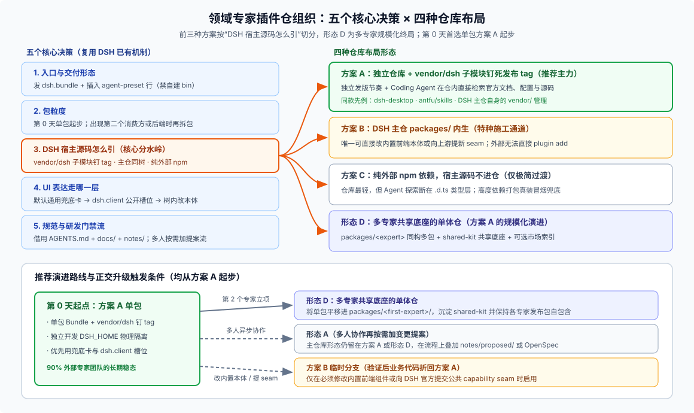

# Answer 13 · 领域专家插件仓组织：五个核心决策、四种仓库摆法与推荐演进路线

## 一句话结论

做一套“上下文干净可控、带专属工具与业务流、可插拔安装”的领域专家套件，**既不需要 fork DSH，也不需要另写 CLI 可执行入口**：

- **交付物形态已经由 DSH 定好**：对外发一个声明了 `dsh.bundle.patch` 的 **Bundle 包**，在 `cordis.patch.yml` 里 `insert` 一条 `@deepseek-ai/dsh-agent-preset` 插件行（把专属工具、提示词和技能关进会话级预设），再附上你的业务插件行即可。
- **仓库布局首选“方案 A（独立仓库 + `vendor/dsh` 钉死发布 tag 的 Git 子模块）”**：第 0 天**单包起步**即可。它既保住了独立仓库的自由发版节奏，又让仓内的 Coding Agent 能直接翻阅 `vendor/dsh` 里的文档、类型和源码，是在 `pre-stable` 阶段兼顾开发效率与上游跟进的最优解。只有在改内置前端组件本体或向上游提新 seam 时才进 **方案 B（DSH 主仓内）**；一两个简单小工具可用 **方案 C（纯 npm 依赖）** 过渡；等长出第二个共享底座的专家时再平滑扩成 **方案 D（多专家单体仓）**。

---

## 一、一张决策矩阵看清：五个决策 × 四种仓库布局

前三种方案（A / B / C）本质上按**“DSH 宿主源码怎么引”**切分，而方案 D 是方案 A 在**“同一仓库养多个专家”**时的规模化形态：

| 决策维度 | 方案 A：独立仓 + `vendor/dsh`（推荐主力） | 方案 B：DSH 主仓 `packages/` 内生 | 方案 C：纯外部 npm 依赖 | 方案 D：多专家 Marketplace 单体仓 |
|---|---|---|---|---|
| **1. 入口与交付形态** | 独立 Bundle（`dsh.bundle.patch` 含 `agent-preset` 行），用户 `dsh plugin add` 安装 | 主仓工作区子包，随主仓内置 Bundle 挂载，**外部无法单独 `plugin add`** | 同方案 A | 多个独立自包含 Bundle + 可选市场索引 `marketplace.json` |
| **2. 包粒度** | **单包起步**；内部复杂后再按发布边界拆子包 | 按主仓领域组规则拆包（见 [`packages/README.md`](https://github.com/deepseek-ai/deepseek-harness/blob/master/packages/README.md)） | 单包为主 | `packages/<expert>` 同构多包 + `packages/shared-kit` 共享底座 |
| **3. DSH 源码与 Agent 视野** | 子模块钉 release tag；**Agent 在仓内直接查文档与源码** | 仓库即 DSH 本体；视野最全，但背负主仓合并税 | 不进仓，仅看 `.d.ts`；**Agent 仓内探索断裂** | 同方案 A（全仓共用一份 `vendor/dsh`） |
| **4. UI 表达上限** | 默认兜底卡 → `dsh.client`（`toolview` 槽 / 设置页 / 会话视图） | **唯一可直接修改内置前端组件本体与壳层布局** | 同方案 A | 同方案 A（通用 UI 小组件可下沉到共享层） |
| **5. 规范与门禁流** | 轻装借用 `AGENTS.md` + `docs/` + `notes/` + 真装冒烟；多人再叠提案流 | 强制走主仓全套门禁（单文件 100% 覆盖率、`doc-sync`、录制快照） | 同方案 A，但缺源码对照，**打包真装冒烟最关键** | 模板化脚手架 + 清单一致性校验 + 共享层变更全量冒烟 |

---

## 二、为什么这五个决策不需要你从头发明？

1. **入口是 Bundle + `agent-preset`，而不是新程序**
   DSH 的 Web、Desktop、Headless、SDK 与 ACP 共用同一套 `ctx.agents` 运行时，架构规则明令禁止插件包声明 `bin` 可执行入口（见 [`docs/architecture.md`](https://github.com/deepseek-ai/deepseek-harness/blob/master/docs/architecture.md#application-launch)）。
   作者交付的是 **Bundle**（详见 [FAQ 24](../24_plugin-publishing-and-data/answer.md)）；会话级独立上下文靠在 patch 里插入 `@deepseek-ai/dsh-agent-preset` 行实现——只有选中该预设的会话才会加载你的工具、提示词与技能，其他会话完全不受影响（注意：早期扫描 `.agent-presets` 或 `agent.cordis.yml` 目录的做法早已退役，[`agent-preset-registry`](https://github.com/deepseek-ai/deepseek-harness/blob/master/packages/preset/agent-preset-registry/README.md) 只认插件行声明）。

2. **第 0 天单包起步，出现第二个消费方再拆包**
   社区 90% 以上的第三方插件都是单包仓库。DSH 的 `Definition / Provider / Consumer` 三角色拆包是演进目标而非起跑门槛（见 [FAQ 08](../08_plugin-seam-maturity/answer.md)）——当某条服务只有你自己这一个包消费时，提前拆成三四个子包只会徒增构建与发版负担。

3. **方案 A 比方案 B 和方案 C 更适合严肃外部团队**
   DSH 公开接口仍处于 `pre-stable` 阶段。选方案 C（不放源码），Coding Agent 查不到 [`docs/user/develop/`](https://github.com/deepseek-ai/deepseek-harness/tree/master/docs/user/develop) 和 [`extension-cookbook.md`](https://github.com/deepseek-ai/deepseek-harness/blob/master/docs/cookbook/extension-cookbook.md)，写配置和钩子极易盲猜出错；选方案 B（住进主仓 fork），专家就失去了独立插件身份，每次上游发版都要重付合并复核税。方案 A 用只读 `vendor/dsh` 子模块钉住 release tag，把“Agent 就地查源码”“确定性跟进上游”和“独立发版节奏”三件事同时拿齐。

4. **UI 表达分三层认领，别一步跳进宿主深水区**
   - **第 1 阶（零前端代码）**：什么都不配时，内置 Web 端自动渲染通用兜底卡；工具可用 `output.presentationMeta` 将结构化结果持久化到 `result.meta`（注：工具上的 `presentCall` / `presentResult` 纯函数意图供非 Web 宿主或自定义客户端消费，**内置 Web 客户端不直接读取这两个函数**，见 [`adding-a-tool.md`](https://github.com/deepseek-ai/deepseek-harness/blob/master/docs/cookbook/adding-a-tool.md#web-client-presentation)）。
   - **第 2 阶（仓外 Web 扩展）**：在 `package.json` 声明 `dsh.client: { "platform": "web" }` 并导出构建产物 `./client`（见 [`dsh-client-modules`](https://github.com/deepseek-ai/deepseek-harness/blob/master/packages/client/modules/README.md)）。专属工具卡注册到 `tool.call.toolview` 槽位；自定义设置页或会话视图走 `settings.section`、`ctx.uiConversation.views` 等公开槽位。
   - **第 3 阶（树内改本体）**：只有确需改动内置卡片组件本体或壳层布局时，才临时进方案 B 验证并向上游提 PR。

5. **先借 DSH 原生轻量纪律，多人或跨仓时再加 OpenSpec**
   单人或小团队直接复用 DSH 的轻量闭环（见 [FAQ 06](../06_change-landing-path/answer.md)、[FAQ 07](../07_borrowing-dsh-harness-idea/answer.md)）：根 `AGENTS.md` 指路、`docs/` 只写当前状态合同、`notes/` 只记有取舍的架构决定。等引入多人异步方案评审，或准备向上游提交跨包新 seam 时，再叠加 OpenSpec 等重型提案流。

---

## 三、推荐演进路线与四条防翻车铁律

### 推荐四步演进路线

1. **第 0 天起跑**：按**方案 A（单包 + `vendor/dsh` 子模块）**建仓，配好开发专用的 `DSH_HOME` 隔离脚本，用 `agent-preset` + 默认通用兜底卡先把核心领域流跑通。
2. **需要定制 Web 视觉时**：留在方案 A，增加 `dsh.client` 构建导出，优先挂 `tool.call.toolview` 或现有客户端槽位；槽位真不够用再去方案 B 开分支提上游扩展点。
3. **立项第二个领域专家且需共享底座时**：将单包平移进 `packages/<first-expert>/`，升级为**方案 D**。
4. **多人协作或向上游贡献接口时**：多人协作留在方案 A/D 叠加显式提案流；向上游贡献公共 seam 定义时走方案 B。

### 从外部生态踩坑提炼的四条底线

1. **版本兼容认准 `engines.dsh` 与 `peerDependencies`**：DSH 安装器与启动器真正强制校验的是 `package.json` 的 `engines.dsh`（缺省回退校验 `@deepseek-ai/dsh*` 的 `peerDependencies` 范围，见 [`publish.md`](https://github.com/deepseek-ai/deepseek-harness/blob/master/docs/user/develop/basic/publish.md#the-bundle-manifest)）。共享宿主实例的包一律写进 `peerDependencies` + `devDependencies`；**切忌锁死在 `dependencies` 里**，也别误以为社区自发写的 `dsh.compatibility` 会被宿主自动拦截。
2. **发布产物自包含 + 干净环境真装冒烟**：打包后的 `.tgz` 绝不能引用 `vendor/dsh` 或仓内未发布路径；发版前必须在临时空 `DSH_HOME` 里跑一遍 `pnpm pack` → `dsh plugin add` 冒烟。
3. **日常与开发物理分家**：用 `DSH_HOME` 隔离开发折腾，绝不碰日常使用的 `~/.dsh`。
4. **第 0 天锁死机器身份 ID，展示文字走多语言字典**：包名、插件行 `id`、工具 wire 名、事件名和 `preset id` 一旦落入用户配置或会话日志极难反悔；界面标题与简介交给本地化字典随时换皮。

---

## 四、三条诚实边界

- **Preset 隔离的是上下文与工具可见性，不是安全沙箱**：预设里的插件与宿主跑在同一个 Node 进程里，拥有同等进程执行权限。
- **`vendor/dsh` 同步纪律需要自己维护**：子模块不会自动升级，每次切换 tag 都应跑一遍类型检查与真装冒烟，及时消化 `pre-stable` 接口变更。
- **别把主仓的大团队门禁原样照搬进单人小仓**：双语 `.i18n.yaml` 哈希配对和全量快照矩阵是服务 300+ 包主仓的，外部插件仓按需裁剪才能保持高频迭代。

---

## 继续阅读

| 你想细看哪一部分 | 去哪篇看 |
|---|---|
| 四种仓库方案的目录树样板、最小配置正例、`vendor/dsh` 同步脚本与迁移条件 | [`01-four-repo-layouts.md`](./01-four-repo-layouts.md) |
| 日常怎么免发版挂进 Profile 调试、热重载边界、`disabled: true` 排障注意与测试分层 | [`02-dev-and-debug-loop.md`](./02-dev-and-debug-loop.md) |
| 怎么用双 `$DSH_HOME` 保护日常官方环境 + 哪些名字第 0 天定下就不能改 | [`03-isolation-and-naming.md`](./03-isolation-and-naming.md) |
| 第三方 DSH 插件仓样本与 VS Code / Claude Code / OpenClaw / MCP 生态实证 | [`research.md`](./research.md) |

> 注：文中的“方案 A–D”是本篇为方便对比起的代号，不是 DSH 源码里的专有名词。核验状态见 [核验基线登记](../00-baseline.md)。
