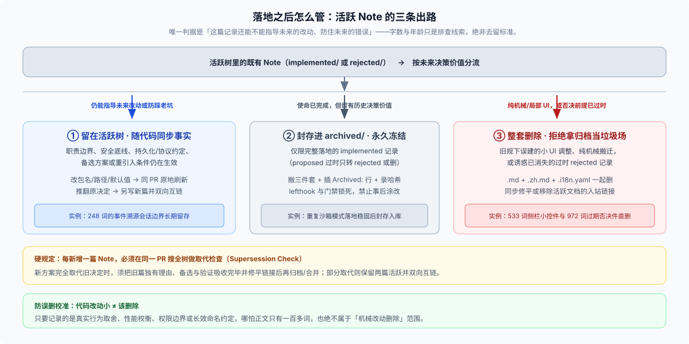

# 02 · 落地之后的生命周期：同步事实、取代检查、归档冻结与整套删除

很多团队写 ADR 最大的痛点不是“第一天没人写”，而是**“写完往目录里一扔，半年后真假混杂，谁也不敢信”**。DSH 用一套清晰的后期分流规则解决了这个问题：活跃树里的记录必须跟着代码走，失去指导价值的旧记录按语义分三条路清退，而进了归档库的快照则由机器永久锁死。

---

## 一、留在 `implemented/` 的记录是“活”的：同步事实，绝不篡改历史决定

只要一篇 Note 还留在 `.agents/notes/implemented/` 下，它就受 [`implemented/AGENTS.md`](https://github.com/deepseek-ai/deepseek-harness/blob/master/.agents/notes/implemented/AGENTS.md) 约束：**必须与当前已交付代码保持事实一致。**

日常维护时，必须严格分清“刷新事实”与“推翻决定”的界限：

| 后续演进场景 | 正确操作方式 | 严禁踩的红线 |
|---|---|---|
| **代码搬家、包改名、配置键或默认值调整**（原设计取舍未变） | 在同一个 PR 里直接修改原 `implemented/` Note 中的路径、包名或默认值，同步更新 `.zh.md` 与 `.i18n.yaml` | 严禁在正文里写 `"v2 更新：现已改名为..."` 或 `"此前曾叫..."`——文件修订史归 Git 管 |
| **同一条决定补充了新的支撑理由或边界说明** | 直接扩充原拥有者 Note，保持一个决定只有一个权威出处 | 严禁为同一个决定再开一篇重复的补充 Note |
| **原决定被部分修改或局部推翻** | **新建一篇 Note** 写清这次新取舍，并在新旧两篇里用相对链接双向注明部分取代关系（Partial Supersession），两篇同时留在活跃树 | 严禁把旧 Note 悄悄改成相反的结论，冒充当初就是这么定的 |
| **原决定被新方案 100% 完整取代（或特性彻底下线）** | 新 Note 完整吸收旧篇全部独有动机、备选方案、代价、验证与覆盖缺口，修平全仓入站链接后，将旧三件套归档或合并移除 | 只要还有残留兼容层、持久化旧数据或部分传输通道仍在服役，就只算**部分取代**，不准删并旧篇 |

对于“先加特性、后来彻底删掉该特性”的合并场景，[`.agents/notes/README.md`](https://github.com/deepseek-ai/deepseek-harness/blob/master/.agents/notes/README.md#when-to-write-one) 卡得尤其严：只有当生产代码、配置、Schema、持久化/线协议格式、迁移逻辑与正向测试里已**完全清零**该特性时，删除特性的新 Note 才能在完整保留“最初动机、为何不再成立、全删之外的备选方案、放弃的能力、未来重引入条件及清零验证”的前提下合并旧篇。

---

## 二、每新增一篇 Note 必做的硬动作：全树取代检查（Supersession Check）

[`.agents/notes/AGENTS.md`](https://github.com/deepseek-ai/deepseek-harness/blob/master/.agents/notes/AGENTS.md) 立了一条每次必触发的子树铁律：**每写一篇新 Agent Note，必须在同一个 PR 里搜索活跃树，排查是否存在覆盖同一决定或机制的老记录。**

为什么要把这一步绑死在“写新篇的当下”而不是留到年底大扫除？因为在 Coding Agent 主导的仓库里，如果活跃树里同时躺着一新一旧两篇互不通气、结论相左的 `implemented/` 记录，后续 Agent 搜到哪篇就会信哪篇，立刻造成规格分裂。

排查后的处理动作只有两种：

- **完全取代（Full Supersession）**：旧决定的机制与理由已被新篇完全覆盖或推翻，在同一 PR 里按 [`dsh-archive-agent-notes`](https://github.com/deepseek-ai/deepseek-harness/blob/master/.agents/skills/dsh-archive-agent-notes/SKILL.md) 流程将旧三件套封存进 `archived/`（或按上节完全合并规则清理），并把活跃文档里的入站链接改指新篇。
- **部分取代（Partial Supersession）**：旧决定的主体仍然有效，新篇只改了其中一条分支（例如 `2026-09-16-sandbox-same-mode` 只放宽了 `2026-07-06-sandbox` 里重复同级模式的拦截，而沙箱隔离与逐次提权审批依然有效），此时两篇都留在活跃树，互相加上明确链接并同步修准各自陈述的当前事实。

---

## 三、旧记录的三条出路：留活树、进 `archived/` 冻结、整套删除

随着仓库演进，活跃树累计到数百篇后，怎么防止检索信噪比恶化？[`dsh-archive-agent-notes`](https://github.com/deepseek-ai/deepseek-harness/blob/master/.agents/skills/dsh-archive-agent-notes/SKILL.md) 给出了唯一标尺：**按语义判断“它还能不能指导未来的工作”，绝不按字数多少、文件新旧或凑指标配额来划线。**



对照官方技能里的真实校准样本，三条出路的分寸非常清晰：

### 1. 出路 ①：留在活跃树（篇幅再短也要留）

只要记录里的备选方案对比、职责归属边界、否定性保证（明确规定“不做什么”）、持久化或线协议语义、安全规则，或者**未来重新引入某能力的条件**仍可能指导后续改动，就一直留在 `implemented/` 或 `rejected/`：

- **短篇留存正例**：`event-sourced sessions` 全文仅 **248 词**，但它定义了会话事件溯源的核心权威边界，必须常驻活跃树；`dropped image content block`（334 词）写明了多模态落地时如何协同恢复支持，在条件达成前同样常驻。
- **`rejected/` 留存正例**：[`2026-07-26-builtin-timer-promises-for-hand-rolled-sleeps.md`](https://github.com/deepseek-ai/deepseek-harness/blob/master/.agents/notes/rejected/simplification/2026-07-26-builtin-timer-promises-for-hand-rolled-sleeps.md) 记录了“为什么不用 Node 内置 `timers/promises` 替换 10 行手写 sleep 包装”——因为 Vitest 假时钟无法拦截内置 promise 定时器，换完会废掉确定性快测试。只要这个诱惑还在，这篇否决记录就继续站岗。

### 2. 出路 ②：封存进 `archived/{class}/` 冷藏库

当一项已交付决定已经彻底稳固、极少再有后续改动需要参考它的取舍过程，但它作为架构演进史仍有备查价值时，将完整三件套迁入 `archived/{class}/`。

- **铁律：只有 `implemented/` 能归档。** 过时的 `proposed/` 提案从未成为交付事实，绝不准塞进 `archived/`——要么标明理由转入 `rejected/`，要么直接删掉。

### 3. 出路 ③：整套删除清场（拒绝拿归档库当回收站）

两类没有任何保留价值的旧记录，直接把 `.md`、`.zh.md`、`.i18n.yaml` 三件套一并从 Git 树删除，并同步修平或移除入站链接：

- **早期门槛收紧前留下的局部 UI 微调与纯机械搬迁 `implemented/` 记录**：例如长达 **533 词**却只讲侧栏折叠控件导轨局部样式的记录，以及只做纯模块文件搬迁与 import 重接、对外行为零变化的记录。（但切记：小 bug 修复、性能权衡或真实行为决定，哪怕实现只改了几行代码，也**不**属于机械改动，不得误删。）
- **诱惑前提已经消失的过时 `rejected/` 记录**：例如长达 **972 词**的“通过工具调用流式上报 workflow 进度”否决件，随着底层 ACP 与 UI 架构演进，当初讨论的前提早已不复存在，没有人会再去踩那个旧坑，留着纯属检索噪音，直接整套删除。

---

## 四、五步归档操作与为什么 `archived/` 被钩子永久焊死

在 DSH 里归档一篇 Note 不是随手拖文件夹，而是严格受控的**五步原子操作**：

1. **搬迁三件套**：把 `.md`、`.zh.md`、`.i18n.yaml` 从 `implemented/{class}/` 移至 `archived/{class}/`（因为只有已实现记录能进归档，归档路径下刻意省去了 `implemented` 这一层目录）。
2. **插入归档日期行，正文一字不动**：两侧文件的 `Status: implemented` 保持原样，仅在其正下方紧接插入一行相同日期的 `Archived: YYYY-MM-DD`；原有的标题标点、空行排版和正文内容一律保持封存原貌，严禁趁机润色、重排或修补内容。
3. **切换为整文件哈希记录**：归档件不再维护逐章节翻译哈希，`.i18n.yaml` 改为记录中英两个文件的 Git blob 哈希。
4. **单向清理入站链接**：检查活跃文档（`docs/`、活跃 Note、`README`）里指向它的入站链接——如果只是引用当前契约，改指现行权威文档；如果确需引用历史背景，更新为 `archived/` 新路径。**绝不去检查或修复归档件内部指向外面的旧出站链接**（`doc-sync` 会自动跳过对归档源文件的死链扫描）。
5. **追加写入防篡改封条**：运行下面的命令校验既有全部封条无误后，将新归档三件套的哈希追加进封存清单，最后跑通门禁：

```sh
pnpm run verify-archived-agent-notes --write
pnpm run verify-archived-agent-notes
```

### 为什么要动用 Git 钩子做“永久冻结”这么重的手段？

道理很简单：**一份允许事后随便修改的“历史档案”，比没有档案更危险**——读者（尤其是没有时间感的 Coding Agent）一旦打开它，根本分不清里面写的包名、接口和数字到底是半年前封存时的快照，还是后来被人改过一半的半成品。

因此，DSH 在 [`lefthook.yml`](https://github.com/deepseek-ai/deepseek-harness/blob/master/lefthook.yml) 的本地 `pre-commit`、`pre-merge-commit` 钩子以及 CI 的 `doc-sync` 里同时挂载了 [`scripts/verify-archived-agent-notes.ts`](https://github.com/deepseek-ai/deepseek-harness/blob/master/scripts/verify-archived-agent-notes.ts)：任何碰触 `.agents/notes/archived/**` 下已封存字节的提交都会当场被拒（全仓历史上唯一一次例外是移除某篇归档件里的敏感外部 Figma 链接，专门在 [`scripts/archived-agent-notes.ts`](https://github.com/deepseek-ai/deepseek-harness/blob/master/scripts/archived-agent-notes.ts) 与 [`archived/AGENTS.md`](https://github.com/deepseek-ai/deepseek-harness/blob/master/.agents/notes/archived/AGENTS.md) 里硬编码登记了那三个文件的精确旧新哈希转换）。封死归档库，才能让活跃树清清爽爽地只代表现在。

> 核验状态见 [核验基线登记](../00-baseline.md)。
