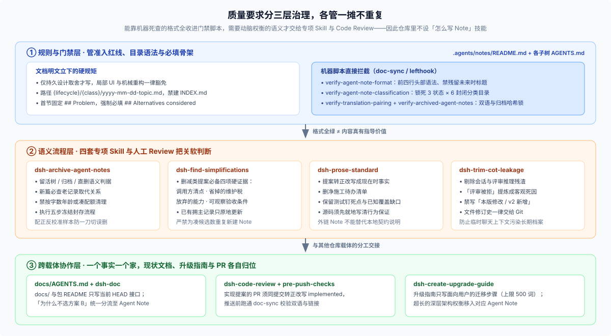

# 03 · 为什么搞这么严、真实提交怎么走完闭环，以及外部项目怎么轻量化照抄

读完前两篇实操规则，很多人心里还会留着最后一层疑问：**一套内部 ADR 而已，真的值得上这么多门禁脚本和目录规矩吗？如果我想在自己的项目里借鉴，怎么避免搬回去一套没人愿意维护的繁文缛节？**

本篇把制度背后的真实防错账本摊开，拆解 DSH 里两笔真实的 Git 提交闭环，最后给你一份拿来就能用的单语轻量版裁剪方案。

---

## 一、为什么要卡这么严？防住四种代价高昂的“工程失忆”

[`.agents/notes/AGENTS.md`](https://github.com/deepseek-ai/deepseek-harness/blob/master/.agents/notes/AGENTS.md) 第一句就挑明了身份：**Agent Note 本质上是由 Coding Agent 撰写并阅读的内部 RFC。**

人类团队可以靠老员工口口相传记住“那块代码别乱动，去年试过会崩”，但 Coding Agent 每次新开会话都是彻底失忆的。更关键的是，DSH 在早期的 [`2026-06-11-quality-gates.md`](https://github.com/deepseek-ai/deepseek-harness/blob/master/.agents/notes/archived/process/2026-06-11-quality-gates.md) 里验证过一条铁律：**Agent 遵守可执行门禁的可靠度远远高于遵守散文约定；而且既然体力活由 Agent 干，“维护格式有点麻烦”就不再是偷懒的理由。**

整套制度的所有条款，都是为了精准堵死下面四种高频翻车场景（按返工代价从高到低排列）：

| 要防的工程失忆 | 在真实开发里长什么样 | 制度里哪一招专门治它 |
|---|---|---|
| **1. 翻旧账重踩老坑** | 新人或新会话里的 Agent 看到一处“只要删掉 10 行手写包装、换成标准库就更清爽”的改动，兴冲冲提了 PR，浑然不知半年前试过会导致假时钟测试全崩 | 强制必填 `## Alternatives considered` + 保留仍有诱惑力的 `rejected/` 记录 |
| **2. 看代码瞎猜当初意图** | 维护者只看见代码“现在写成了这样”，自己脑补了一个错误的设计理由，顺着假理由一路改下去把隐性保护全拆了 | `## Decision` 与 `## Consequences` 明确写死真实边界、放弃了什么以及靠哪条测试钉住 |
| **3. 祖传代码没人敢碰** | 某段逻辑看起来别扭至极，但谁也不知道它在防什么线上边缘情况，久而久之变成全组绕着走的禁区 | 强制首节 `## Problem` 脱离代码方案独立把原始业务/技术困境讲透 |
| **4. 满仓翻记录考古** | 想搞清一个跨包约定的来龙去脉，得在几百个 PR、Issue 和早已压缩的聊天日志里大海捞针 | 封闭的 `{生命周期}/{6类领域}/` 目录自索引 + 严禁同决定拆多篇重复建档 |

---

## 二、仓库记忆怎么分工：`docs/` vs `Agent Notes` vs `Git/PR`，以及三层治理

在 DSH 里，“一个事实只放一个地方”不仅管代码注释，也把所有文字载体的时态切得一清二楚（详见 [`docs/AGENTS.md`](https://github.com/deepseek-ai/deepseek-harness/blob/master/docs/AGENTS.md)）：

- **`docs/`、包 `README` 与 JSDoc（只写现在）**：系统截至当前 `HEAD` 对外承诺的接口、配置与行为是什么？严禁在这里写“以前叫什么”“为什么没选方案 B”的历史故事。
- **`.agents/notes/`（只写持久取舍）**：当初面临什么困境、选了哪条路、淘汰了哪些备选方案、承担了什么代价？
- **Git 提交历史与 PR 描述（只写本次增量）**：这一回具体改了哪几个文件、为什么要发这笔变更、本地跑过了哪些验证命令？
- **GitHub Issue（只写未来待办）**：哪些已知问题或后续演进还没做、归谁跟进？

翻遍 `.agents/skills/` 你还会发现一个很有意思的现象：**仓库里有十几套 `dsh-*` 技能，唯独没有一套叫“怎么写 Agent Note”的技能。** 这不是漏写了，而是刻意把质量要求拆成了互不重叠的三层：



1. **规则与门禁层（机器能死查的，绝不写成唠叨提示词）**：路径深度、6 个分类目录名、前四行头部语法、各状态必填与禁用标题、中英双语章节数量对齐、归档文件防篡改哈希，全部收进 [`doc-sync`](https://github.com/deepseek-ai/deepseek-harness/blob/master/scripts/run-gates.ts) 门禁脚本，写错一秒报错。
2. **语义流程层（机器查不出的软判断，交给四套专项 Skill 与 Review）**：该留该删看 [`dsh-archive-agent-notes`](https://github.com/deepseek-ai/deepseek-harness/blob/master/.agents/skills/dsh-archive-agent-notes/SKILL.md)；删减提案够不够扎实看 [`dsh-find-simplifications`](https://github.com/deepseek-ai/deepseek-harness/blob/master/.agents/skills/dsh-find-simplifications/SKILL.md)；提案转正怎么剪掉计划留住测试证据看 [`dsh-prose-standard`](https://github.com/deepseek-ai/deepseek-harness/blob/master/.agents/skills/dsh-prose-standard/SKILL.md)；剔除评审过程黑话看 [`dsh-trim-cot-leakage`](https://github.com/deepseek-ai/deepseek-harness/blob/master/.agents/skills/dsh-trim-cot-leakage/SKILL.md)。
3. **跨载体协作层（管文档交接）**：比如破坏性变更写升级指南（[`dsh-create-upgrade-guide`](https://github.com/deepseek-ai/deepseek-harness/blob/master/.agents/skills/dsh-create-upgrade-guide/SKILL.md)）严格限长 500 词，写不下的背景原因就分流进对应的 Agent Note。

---

## 三、真实提交全程走查：零 Note 交付 vs 171 词走完原子闭环

光看条文容易觉得抽象，把仓库里两笔真实的提交放在一起对比，什么时候免写、什么时候必写、怎么在一个提交里闭环就一目了然了。

### 参照 A：改了 7 个文件却一篇 Note 都不写的合格交付

历史提交 [`5124a2a310`](https://github.com/deepseek-ai/deepseek-harness/commit/5124a2a310)（PR [`#5004`](https://github.com/deepseek-ai/deepseek-harness/pull/5004)）修改了 Web 端模型选择器与设置列表：把原本显示模型友好名称改为等宽字体显示精确 Model ID，鼠标悬停时再展示友好名称，共涉及 7 个组件与测试文件（`+15 / -14`）。

- **为什么零篇 Note 直接过关？** 因为它纯属局部 UI 呈现调整，既没有改变底层数据结构、持久化格式或权限协议，也不存在让后人误踩的架构陷阱。改动动机写在 PR `#5004` 描述里，行为由组件测试钉住——**干净利落不凑字数，这就是日常大多数提交的标准姿态。**

### 参照 B：核心代码只改十几行，却同提交补齐 171 词 Note 的全程重放

再看历史提交 [`2e15f2046c`](https://github.com/deepseek-ai/deepseek-harness/commit/2e15f2046c)（`fix(sandbox): accept repeated effective permission modes`）：当模型调用工具重复传入当前已经生效的沙箱权限（如 `danger-full-access`）时，`approveEscalation` 直接放行返回，不再当成非法非加宽请求报错拒绝。

跟着这笔提交的 23 个变更文件走一遍，就是一次教科书级的标准闭环：

1. **准入判定（为什么非写不可）**：虽然 `packages/sandbox/sandbox/src/escalation.ts` 核心逻辑只改了十来行，但它**放宽了一条既有的安全校验规则**。如果不留记录，下一个维护者读到“重复请求高危模式居然不拦截也不弹审批”，十有八九会把它当成安全漏洞“修”回去。
2. **落盘建三件套与写正文**：作者直接在 `.agents/notes/implemented/feature/` 下创建 `2026-09-16-sandbox-same-mode.{md,zh.md,i18n.yaml}`。英文全文仅 **171 词**，四段毫不多余：

```markdown
# Agent Note: Repeated sandbox modes need no approval

Status: implemented

English | [中文](2026-09-16-sandbox-same-mode.zh.md)

## Problem
Models can repeat `sandbox_permissions: danger-full-access` while that mode is
already effective. Rejecting the call prevents authorized work without preventing
any permission increase.

## Decision
`approveEscalation` returns the effective mode immediately when the requested mode
matches it. Argument pairing remains mandatory at the tool. Wider modes still require
approval; narrower and unsupported targets still fail. This partially supersedes the
non-widening rejection in the sandbox decision (`2026-07-06-sandbox.md`); its
confinement and per-call approval decisions remain active.

## Alternatives considered
**Reject every non-widening request.** This makes a redundant argument fatal even
though it asks for no additional permission.

**Ask for approval again.** Existing permission is sufficient, so another prompt adds
no authorization.

## Consequences
Bash and filesystem tools accept repeated effective modes without an approval service
or agent. Shared unit tests cover both advertised targets, both tool consumers execute
the repeated mode, and the `fs-same-mode` ACP snapshot verifies an unrestricted write
with no approval events and checks the resulting file.
```

3. **同提交完成取代互链与合同刷新**：
   - **取代检查（Supersession Check）**：搜出旧沙箱主记录 `2026-07-06-sandbox.md`，确认属于**部分取代**，于是在同一个提交里同步修改了旧沙箱 Note 的中英三件套，双向写明新边界；
   - **刷新当前合同与测试证据**：同步更新 `sandbox` 与 `tool-bash` 两个包的双语 `README`，补齐 `escalation.spec.ts`、`tool-fs` / `tool-bash` 消费端单测，并录制 `snapshots/acp/fs-same-mode/` 无密钥快照；
   - **跑通门禁**：执行 `pnpm run verify-translation-pairing --write ...` 与 `pnpm run doc-sync` 一次全绿合入。
4. **生命周期收尾**：半个月后，这项局部行为边界已由单测、快照和包文档彻底焊稳，不再需要留在活跃树指导后续设计，于是按五步归档法迁入 [`archived/feature/2026-09-16-sandbox-same-mode.md`](https://github.com/deepseek-ai/deepseek-harness/blob/master/.agents/notes/archived/feature/2026-09-16-sandbox-same-mode.md)，加上 `Archived: 2026-09-30` 永久封存。

---

## 四、往自己的项目搬一套轻量版：留哪六条灵魂，砍掉哪四样包袱？

如果你在维护一个业务仓库、中小型团队项目或独立 DSH 插件仓，千万别一上来照抄双语哈希锁和千篇级归档工程。把“核心防错机制”和“DSH 大仓专属配套”拆开，半小时就能搭出一套极清爽的轻量版：

### 1. 绝对不能省的 6 条灵魂（省掉任何一条都会退化成废纸堆）

1. **高准入门槛**：写死“只有代码、测试与现有文档解释不清的持久取舍才写；日常 bug 修复、机械重构与局部 UI 微调一律免写”。
2. **强制必填 `## Alternatives considered`**：只记录真实淘汰掉的方案与客观技术死因，没备选方案就别硬写 Note。
3. **`## Problem` 独立成文**：第一段只讲问题处境，不出现具体代码解法。
4. **落地只写现在时态**：如果用了 `proposed/`，合入实现时必须把正文改写成现在时的 `## Decision`，清掉待办清单，绝不能只挪文件夹。
5. **活记录随代码更新事实，推翻决定另写互链**：改包名/默认值原地修，反悔重做新开一篇并检查旧篇取代关系。
6. **垃圾直接删，不拿归档当回收站**：过时的否决件和误建的流水账直接 `git rm`，只留真正防踩坑的记录。

### 2. 中小与单语仓库大可砍掉的 4 项包袱

1. **砍掉双语三件套（`.zh.md` + `.i18n.yaml`）**：团队日常用中文就只写单个中文 `.md`，用英文就只写英文 `.md`，立刻省掉一半维护成本。
2. **砍掉归档哈希封条清单**：总篇数不到百篇时，根本不需要 `archived/` 和防篡改哈希表，活跃树完全装得下。
3. **按需省掉 `proposed/`**：如果团队习惯在 Issue 或飞书/Notion 文档里做前置评审，仓库里只留 `implemented/` 和 `rejected/` 两个目录就够了。
4. **收缩领域子目录**：不必凑齐 6 个分类，按项目实际拆成 `architecture/`、`feature/`、`process/` 两三个封闭子目录即可（但仍禁止建手工维护的 `INDEX.md`）。

### 3. 最小可用目录模板（配一个 50 行以内的 CI 检查脚本）

落地到你自己的仓库里，全部家当只需要长这样：

```text
notes/
├── AGENTS.md                 ← 30 行以内写清上面 6 条灵魂规矩，供人、Review 与 Coding Agent 共读
├── implemented/
│   ├── architecture/
│   │   └── 2026-10-15-plugin-storage-isolation.md
│   └── process/
│       └── 2026-10-20-ci-smoke-pack-gate.md
└── rejected/
    └── architecture/
        └── 2026-10-22-shared-sqlite-across-workers.md
```

最后补上一条极简的 CI / `pre-commit` 脚本（哪怕只有三四十行 Node 或 Python）：校验文件名带 `yyyy-mm-dd-`、前四行含 `# Agent Note:` 与合法 `Status:`、首个二级标题是 `## Problem`、且正文包含 `## Alternatives considered`。有了这道几毫秒跑完的硬检查，哪怕换十个不同的 Coding Agent 进仓干活，决策记录也不会腐烂走样。

> 核验状态见 [核验基线登记](../00-baseline.md)。
