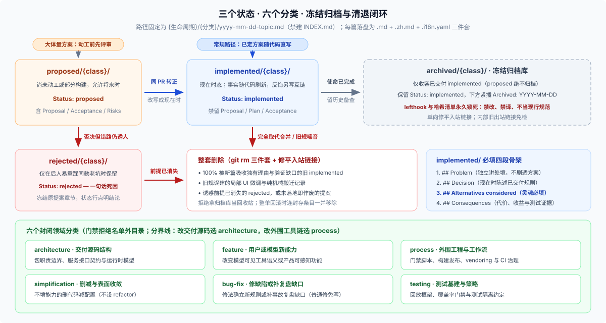

# Answer 20 · Agent Note 实战标准：日常改动默认不写，严苛规矩专为管住 Coding Agent

## 一句话结论

**大多数日常改动根本不用写 Agent Note；它之所以把目录、章节骨架、双语配对和归档冻结卡得这么死，不是形式主义，而是因为主笔和主要读者都是 Coding Agent——严规矩是为了防它制造流水账垃圾、翻旧账重踩老坑，以及拿过期方案当现行规范。**

记住下面三条铁律，就已经握住了这套制度的八成精髓：

1. **默认不写，写是例外**：代码说清“现在怎么做”，测试钉死“什么行为不能破”，PR 描述交代“这回改了啥”——只有这三样都装不下的**持久设计取舍**（尤其是放弃了什么备选方案），才需要写进 [`.agents/notes/`](https://github.com/deepseek-ai/deepseek-harness/blob/master/.agents/notes/README.md)。
2. **`## Alternatives considered` 是全篇灵魂**：只记结论不记“淘汰了哪条路、为什么淘汰”，半年后新人或下一个 Agent 看到那条看似更省事的捷径，一定会翻旧账再踩一遍坑。
3. **活树跟代码同步，归档库永久焊死**：留在 `implemented/` 里的记录必须随代码改名、改默认值同步刷新事实（但推翻原决定必须另写新篇互链）；一旦使命完成移入 `archived/`，本地钩子与门禁会用哈希清单把它永久锁死，禁改也禁当现行规范引用。

---

## 一、三秒钟先判：我这笔 PR 到底要不要写？

动手前按下面三个问题顺次筛一遍——先看能不能免写，再看能不能更新现成记录，最后才考虑新建：

1. **这次改动产生“新的持久取舍”了吗？没有就不用写（占绝大多数）。**
   - 修既有设计覆盖下的普通 bug、局部 UI 呈现与交互微调、改文案、纯机械重构或重命名，一律豁免。
   - 本次动机写进 PR 描述，当前接口更新包 `README` 与 `docs/`，行为靠单测或快照钉死。
   - **真实参照**：历史提交 [`5124a2a310`](https://github.com/deepseek-ai/deepseek-harness/commit/5124a2a310)（PR [`#5004`](https://github.com/deepseek-ai/deepseek-harness/pull/5004)）改了 7 个文件调整模型列表呈现（显示 ID、悬停显示名称），零篇 Note 合格合入。
2. **仓库里已经有哪篇 Note 管着这个决定了吗？有就原地更新，别重复新建。**
   - 如果背后的设计决定没变，只是文件搬家、包改名、配置键或默认值变了，在同一个 PR 里把原 `implemented/` Note 里的旧名称刷新成现状即可。
   - 注意不要往正文里加“v2 更新记录”，文件自身的修改历史归 Git 管。
3. **不写下来，半年后维护者会不会按直觉改错？会就同 PR 新写一篇。**
   - 当跨组件状态归属、持久化格式、通信协议、安全权限边界或工程约定立下了非显然的新规矩，且代码与现有文档解释不清“为什么不走另一条路”时，必须同提交落盘，并顺手搜全树检查是否取代了旧记录（Supersession Check）。
   - **真实参照**：历史提交 [`2e15f2046c`](https://github.com/deepseek-ai/deepseek-harness/commit/2e15f2046c) 让已生效的沙箱模式免于重复审批，代码只改十几行、Note 正文仅 171 词，却挡住了后人把它当成权限校验漏洞“修”回去的风险。

> **避开过期旧规**：如果你在早期资料里见过 `"Every non-trivial change MUST add or update at least one Agent Note"`，那是已被历史提交 [`730bcc7c85`](https://github.com/deepseek-ai/deepseek-harness/commit/730bcc7c85) 废止的老黄历——当时因为任何改动都能自称“非平凡”，导致仓库攒出一堆机械建档噪音，团队随后才把门槛收紧到“唯有持久设计理由才写”。

---

## 二、全景速览：三个状态、六个分类与一个冻结归档库

凡是进入 `.agents/notes/` 的记录，路径统一编码为 `{生命周期}/{分类}/yyyy-mm-dd-topic-title.md`（日期取该议题首次提出的日期；目录内严禁新建集中式 `INDEX.md`，路径加全文检索就是唯一清单）。由于 DSH 主仓实行中英双语同权，每篇在磁盘上由 `.md` + `.zh.md` + `.i18n.yaml` 兄弟三件套组成：



顺着生命周期看，每一站的规矩都非常干脆：

| 目录位置 | 状态行语法 | 什么时候进 / 核心硬约束 |
|---|---|---|
| `proposed/{class}/` | `Status: proposed` | 体量大、动工前需先对齐方案时才写；骨架含 `Problem / Proposal / Alternatives considered / Acceptance criteria / Risks` |
| `implemented/{class}/` | `Status: implemented` | 方案随代码交付（可直写，也可由 `proposed/` 转正）；**全文必须改写成现在时态**（`Decision / Consequences`），残留 `Proposal` 或 `Plan` 标题会被 [`verify-agent-note-format.ts`](https://github.com/deepseek-ai/deepseek-harness/blob/master/scripts/verify-agent-note-format.ts) 直接拦截 |
| `rejected/{class}/` | `Status: rejected — <原因>` | 提案被否决但该错误方案仍很诱人时保留，状态行一句话点明死因；一旦诱惑前提消失，整套三件套直接删除 |
| `archived/{class}/` | 仍为 `Status: implemented`<br>（下插 `Archived: YYYY-MM-DD`） | 仅收容已完成使命但仍有历史备查价值的 `implemented` 记录（`proposed` 绝不归档）；由 [`lefthook.yml`](https://github.com/deepseek-ai/deepseek-harness/blob/master/lefthook.yml) 与只追加哈希清单永久锁死 |

路径第二层的 `{class}` 从六个封闭名称里选：`architecture`（交付源码结构）、`feature`（面向用户/模型的新能力）、`process`（门禁/构建/协作工具链）、`testing`（测试策略与基建）、`simplification`（不增能力的删减收敛；仓库故意不设 `refactor`）、`bug-fix`（修缺陷或补事故复盘缺口）。

一篇合格的 `implemented/` 正文只需要清爽的**四段骨架**（几百词即可，严禁凑字数）：

```markdown
# Agent Note: <标题>

Status: implemented

English | [中文](yyyy-mm-dd-topic-title.zh.md)

## Problem                  ← 动机：不看解决方案也要能读懂原始处境
## Decision                 ← 现在时态：实际交付的规则与边界（中间可插必要的协议/拓扑小节）
## Alternatives considered  ← 强制必填：每个真实备选方案，以及淘汰它的技术原因
## Consequences             ← 收益、付出的代价，以及钉死该行为的测试或门禁证据
```

---

## 三、四个最容易踩的误区与诚实边界

1. **“代码改动小就不用写，字数写得多就值得留”——完全反了**
   去留只看**决策本身的未来指导价值**，跟代码行数和文章长短无关。在 [`dsh-archive-agent-notes`](https://github.com/deepseek-ai/deepseek-harness/blob/master/.agents/skills/dsh-archive-agent-notes/SKILL.md) 的校准案例里，248 词的事件溯源会话边界必须长期保留，而 533 词描述侧栏折叠导轨的 UI 记录、972 词但前提已失效的流式进度否决件，全都属于直接删除的对象。
2. **“Note 是只读历史档案，写完就不能改”——混淆了活树与归档库**
   `archived/` 确实一个字都不许动，但活跃树 `implemented/` 里的记录必须跟代码保持同步：包改名、换默认值时同 PR 刷新事实；唯独**推翻原设计决定**时不能原地涂改反悔，必须另写新篇并双向互链。
3. **“想查某个服务怎么调，先去翻 Agent Note”——找错了门**
   Agent Note 绝不是 API 说明书。查当前接口签名、配置项与默认行为，永远看源码类型、包 `README`、`docs/` 和生成目录（分工见 [FAQ 06](../06_change-landing-path/answer.md)）；代码注释也不能拿一句“详见某篇 Note”省掉调用方原地需要的行为说明。
4. **“门禁跑绿就代表 Note 写得好，外部项目也得照搬三件套”——不必自我加戏**
   门禁脚本只管标题骨架、目录合法性与双语哈希配对，抓不住“这笔改动根本不配写 Note”或“备选方案是硬凑的稻草人”，语义把关仍靠 `dsh-*` 技能与 Code Review。双语三件套与归档哈希锁纯粹是 DSH 大仓的配套，外部单语项目裁剪成单文件 Markdown 即可。

---

## 继续阅读

无论你是**正在给 DSH 提 PR 想 5 分钟交差**（直接读 `01`），还是**想研究长效研发记忆、往自己团队搬一套轻量 ADR 制度**（重点读 `02` 与 `03`），都可按需直达：

| 你想解决什么具体问题 | 去哪篇看 |
|---|---|
| **实操手册**：准入自检清单、6 个分类怎么选、四段骨架与 232 词短范本、提案转正改写与双语配对细节 | [`01-when-to-write-and-how.md`](./01-when-to-write-and-how.md) |
| **后期治理**：活跃 Note 如何同步事实、新增必做的取代检查（Supersession）、留/封/删三条出路与五步归档冻结 | [`02-lifecycle-archiving-and-pruning.md`](./02-lifecycle-archiving-and-pruning.md) |
| **制度内幕与移植**：防哪四种工程失忆、三层治理分工、两笔真实提交全程重放，以及外部项目极简裁剪模板 | [`03-why-so-strict-and-real-walkthrough.md`](./03-why-so-strict-and-real-walkthrough.md) |
| **出处总表**：规则原文、门禁脚本、配套 Skill 与真实样本仓库链接汇总 | [`reference.md`](./reference.md) |
| **横向延伸**：想把入口地图、决策记录与快门禁整套思路搬进外部仓库？ | [FAQ 07 · 借鉴 DSH 的 Harness 思路](../07_borrowing-dsh-harness-idea/answer.md) |

> 核验状态见 [核验基线登记](../00-baseline.md)。
