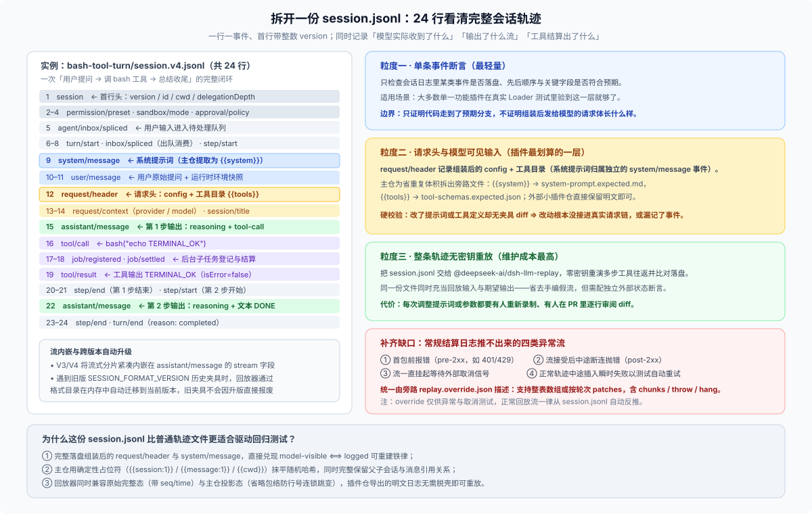
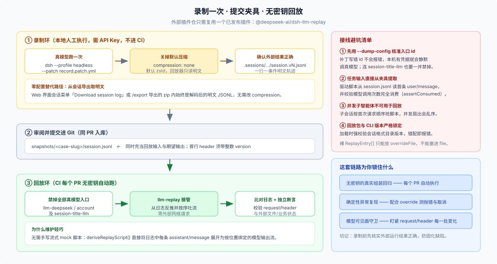

# 01 · 主仓为什么离不开它，以及这套录制回放到底怎么跑

## 一、起点不是纸面设计，而是一次“178 个单测全绿”的生产事故

DSH 主仓之所以把录制会话快照定为硬性门禁，直接导火索是 [`dsh --profile acp` 的早期生产瘫痪事故（postmortem 0001）](https://github.com/deepseek-ai/deepseek-harness/blob/master/docs/postmortem/0001-acp-default-export-drops-inject.md)。

当时 ACP 桥接插件拥有 **178 个全绿的单元测试和 100% 的单文件行覆盖率**，但用户从真实命令行启动 `dsh --profile acp` 时却彻底报错无法工作。复盘揪出了藏在同一个表面错误背后的两个独立缺陷（其中一个就是插件误写了 `export default`，导致 Cordis Loader 拆包时直接丢掉了具名导出的 `inject` 依赖声明）。两个缺陷之所以双双漏网，根源完全一致：**没有任何一条测试真正走过发布时的配置装载路径和真实子进程调用链。**

这次事故之后，团队在设计快照层时把当时市面上常见的替代方案挨个摆上台面比对，最终全部否决：

| 曾考虑过的替代方案 | 为什么在 DSH 里行不通 |
|---|---|
| **手写一份 `llm.json` 假模型脚本** | 手搭假数据不是系统的真实运行产物，既容易写偏，也没法顺带验证持久化落盘结果 |
| **HTTP 字节级录制回放（Polly / nock / MSW）** | 与具体厂商的 HTTP/SSE 传输格式强绑定，面对流式增量分片非常笨重，且层级太低、看不清会话语义 |
| **在 `DEEPSEEK_BASE_URL` 挂假 HTTP 服务或在浏览器拦 SSE** | 等于在会话日志之外再发明第二套手写流式夹具格式，维护两套真相迟早静默漂移 |
| **除了 `session.jsonl` 再单独存一份 `session.expected.jsonl`** | 对正常回放场景，两份规范化日志逐字相同，多存一份纯属冗余噪音，并不会增加校验独立性 |
| **把会话日志里的请求头删成哈希值来瘦身** | 直接破坏 `model-visible ⟺ logged` 可重建性原则——出问题时没人看得见当初到底给模型发了什么 |

最终拍板的核心设计只有一句话：**用真实模型跑通一次完整装配件，把落盘的那份 `session.jsonl` 提交进仓库，同时充当后续无密钥回放的“模型流输入源”与“持久化期望输出”。**

这恰好与 DSH 的根级铁律 **`model-visible ⟺ logged`**（凡是进入模型请求的内容都必须能从会话日志完整重建）咬合在一起：如果一笔代码改动声称调整了给模型的提示词或工具定义，跑完快照后却没有任何夹具的请求头发生变化，那就当场抓住了“改动其实没接进真实请求链”或“漏记了会话事件”的隐蔽 bug。

---

## 二、拆开一份 `session.jsonl`：它比普通轨迹多出了什么？

在 Agent 工程里，大家常把一次任务的完整交互过程叫做 **trajectory（运行轨迹）**。DSH 的 `session.jsonl` 就是一份标准的一行一事件轨迹文件——以主仓 [`snapshots/session/bash-tool-turn/session.v4.jsonl`](https://github.com/deepseek-ai/deepseek-harness/blob/master/snapshots/session/bash-tool-turn/session.v4.jsonl) 为例，一次“用户提问 → 调 `bash` 工具 → 模型总结收尾”的完整闭环一共只有 **24 行**：



它之所以能直接驱动回归测试，靠的是普通运行日志没有的四个关键设计：

1. **完整记录组装后的真实请求头（`request/header`）**
   第 9～13 行清晰记下了 `system/message`、`user/message` 以及真正发往模型的 `request/header`（包含模型配置与完整工具列表）。主仓为了防止几百个场景反复拷贝大段相同的系统提示词与工具 JSON Schema，用幂等归一化把它们替换成 `{{system}}` 和 `{{tools}}` 占位符，再将完整正文提取到旁边的 `system-prompt.expected.md` 和 `tool-schemas.expected.json` 供人工审阅——**搬走的是重复体积，保留的是逐字可核对的完整内容**。
2. **保留引用关系的确定性占位符（Typed Tokens）**
   每次运行随机生成的会话 ID、消息 ID 和临时工作目录，在主仓快照里会被按首次出现顺序替换为 `{{session:1}}`、`{{message:1}}`、`{{cwd}}`。这样既消除了随机哈希噪音，又完整保留了父子会话与消息之间的指向关系。同时，主仓严禁“看着像 ID 就随便脱敏用户或工具正文”，防止误伤真实业务输出。
3. **兼容“投影态”与“完整态”，并支持旧版本自动内存升级**
   运行时落盘的原始日志每行带有递增序号 `seq` 和时间戳 `time`（称为 `complete` 完整态）；主仓提交的快照省略了这两个包络字段（称为 `projected` 投影态），以免中间多插一条事件导致下半截行号全盘重编。回放器 [`parseSessionLog`](https://github.com/deepseek-ai/deepseek-harness/blob/master/packages/test-support/llm-replay/src/index.ts) **同时接受完整态和投影态**（只要同一个文件内不混用），而且遇到旧版 `SESSION_FORMAT_VERSION` 的历史夹具时，会在内存中通过格式目录自动迁移到当前版本后再展开模型流——**插件仓早先录下的夹具不会因为 DSH 升版而直接报废**。
4. **用 `replay.override.json` 补齐“成功落盘日志里不存在”的四类异常**
   回放器默认通过遍历日志里的 `assistant/message`（或 `assistant/attempt`）反推每次模型调用该吐什么流。但有四类异常在持久化结算里是推不出来的：① **首包前直接报错**（如 HTTP 401/429）；② **吐了一半流中途抛错**（post-2xx 断流）；③ **流一直挂起等待外部取消**；④ **在正常脚本中途插入一次瞬时报错以测试自动重试**。这四类场景统一由同目录可选的 `replay.override.json` 描述（具体写法见 [`02-plugin-value-and-limits.md`](./02-plugin-value-and-limits.md)）。

---

## 三、外部插件仓怎么直接复用？四步最小配置

外部插件仓不需要、也不应该去复刻主仓的 `snapshot.yml` 门禁脚本。真正干活的回放引擎 [`@deepseek-ai/dsh-llm-replay`](https://github.com/deepseek-ai/deepseek-harness/blob/master/packages/test-support/llm-replay/README.md) 已经作为公开包发布在 npm 上，导出结构就是最标准的 Cordis 函数插件（`name: 'llm-replay'`、`inject: ['llm']`、`apply(ctx, config)`），而且直接吃未经投影的原始运行日志。



想在自己的插件仓跑通“本地真跑一次 → 提交 `session.jsonl` → CI 无密钥回放”，最小配置只需要四步：

### 第 1 步：安装与当前 CLI 版本严格一致的回放包

`dsh-llm-replay` 在加载时会强校验 `dsh-session-format-catalog` 与 `@deepseek-ai/dsh-session` 的写入器版本是否一致，版本错配会当场抛错。装包时请务必锁定与你当前 `dsh` CLI 相同的版本号（DSH 正式版走 `latest`，`rc` 预发布版走 `next` dist-tag）：

```sh
dsh plugin --profile headless add "@deepseek-ai/dsh-llm-replay@$(dsh --version)"
```

### 第 2 步：获取明文 `session.jsonl`（两种方式任选）

- **方式 A（零配置，最省事）**：在 Web 界面跑完一次理想交互后，点会话标题栏菜单的 **「Download session log」** 或输入 `/export`。导出的 zip 压缩包里自带解码重序列化后的标准明文 `.jsonl`，不受底层压缩开关影响。
- **方式 B（命令行录制补丁 `record.patch.yml`）**：DSH 会话持久化默认开启 `zstd` 二进制压缩，而 `llm-replay` 只用 `readFileSync` 逐行读明文 JSON。若直接从会话目录拷文件，需叠一层录制补丁关掉压缩（注意 Cordis 补丁的 `config` 是整块替换而非深合并，需同时写明独立 `root`，切勿与默认压缩目录混用）：

```yaml
# snapshots/record.patch.yml
- id: session-persistence-jsonl
  name: '@deepseek-ai/dsh-session-persistence-jsonl'
  config:
    root: ./.sessions
    compression: none
```

人工带密钥跑一次，确认生成的外部文件和行为完全正确后，把 `.sessions/` 下对应的 `session.v4.jsonl` 拷入 `snapshots/<case-slug>/session.jsonl`（记得把临时 `.sessions/` 加进 `.gitignore`）。

### 第 3 步：编写无密钥回放补丁 `replay.patch.yml`

回放层的任务是**关掉所有会发起真实模型请求的插件行**，再挂载 `llm-replay` 指向刚才保存的夹具（参见主仓 [`packages/bundle/base/cordis.patch.yml`](https://github.com/deepseek-ai/deepseek-harness/blob/master/packages/bundle/base/cordis.patch.yml) 与 [`cordis.snapshot.yml`](https://github.com/deepseek-ai/deepseek-harness/blob/master/snapshots/session/compaction-recovery/cordis.snapshot.yml)）：

```yaml
# snapshots/replay.patch.yml
- id: llm-deepseek
  name: '@deepseek-ai/dsh-llm-deepseek-api-key'
  disabled: true

- id: llm-deepseek-account
  name: '@deepseek-ai/dsh-llm-deepseek-account'
  disabled: true

# 若所用 profile 启用了首轮标题生成模型，必须一并禁用，防止它抢走一条回放流
- id: session-title-llm
  name: '@deepseek-ai/dsh-session-title-first-prompt-llm'
  disabled: true

- insert:
    - id: llm-replay
      name: '@deepseek-ai/dsh-llm-replay'
      config:
        file: ./snapshots/<case-slug>/session.jsonl
```

### 第 4 步：在 CI 中驱动回放并避开三个“静默失效”陷阱

测试脚本从 `snapshots/<case-slug>/session.jsonl` 里读出首条 `user/message` 作为输入任务文本（不要在旁边手抄第二份输入字符串，防止两边不一致），叠加 `--patch ./snapshots/replay.patch.yml` 启动即可。

第一次接线时，务必逐条核对以下三个**不会直接崩溃、但会让回放形同虚设的静默陷阱**：

1. **补丁里的 `id` 写错，导致真模型在后台悄悄接单**
   比如把基础包里的 `id: llm-deepseek` 误写成包名 `llm-deepseek-api-key` 时，Loader 不会直接报错退出，只会在 `--dump-config` 里留下一句 `entry not found`；如果开发机 `~/.dsh/.credentials.yaml` 里恰好存着凭据，测试就会静默去调真模型，表面全绿却根本没走回放！**每次建补丁或升级 DSH 后，先跑 `dsh --profile headless --dump-config` 核准真实行 `id`，并在无凭据隔离目录（`DSH_HOME`）下验证一次。**
2. **漏禁 `session-title-llm`，导致主对话少跑一轮**
   `session-title-first-prompt-llm` 同样通过 `llm/stream` 请求模型，会跟主会话抢占回放脚本里的槽位（例如录了 3 次模型回复，第 2 个槽位被标题生成器拿走，主循环就只剩 2 次）。不用测标题生成时，一律在回放补丁里将它 `disabled: true`。
3. **把裸 `ReplayEntry[]` 数组误填进 `file` 字段，或漏查“少调模型”**
   `file` 只能传带 `session` 头部的会话 JSONL；手写的异常覆盖数组必须放进 `overrideFile`。此外，如果代码改出了 bug 导致模型提前终止、少调了一次流，纯命令行外部启动拿不到进程内的 `assertConsumed()` 句柄——你的测试断言必须主动检查新生成的会话日志里**模型调用轮数（`assistant/message` 数量）与预期终态完全跑满**（且注意：回放器按首次调用顺序绑定子会话，**不支持并发扇出的子智能体场景**）。
