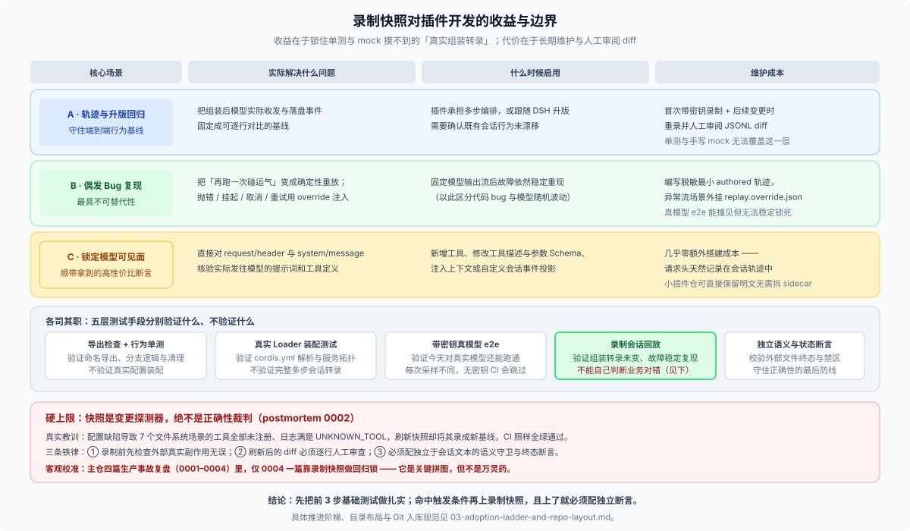

# 02 · 对插件开发的真实价值与硬上限：它能抓什么、又绝不能信什么？



## 一、对插件作者来说，录制快照真正解决哪三件事？

引入录制快照并不是为了“追求更高的测试覆盖率”，而是为了锁住单测和手搭 mock 根本够不到的三类证据：

### 1. 锁定组装后的模型可见面与跨版本回归

当你的插件往系统提示词里注入了一段规则、新增了两个工具定义，或者自定义了一条会话投影事件时，单看 TypeScript 源码很难百分之百确信“跟其他十几个插件拼在一起之后，最终发给模型的 JSON 请求体到底长什么样”。

跑一次录制，直接比对 `session.jsonl` 里的 `request/header` 和 `system/message`，多加了什么字段、漏挂了哪个工具一目了然（插件仓如果只有几条轨迹，甚至不必像主仓那样拆 `{{system}}` / `{{tools}}` sidecar，直接保留原文字段更直观）。等到上游 DSH 发新版本时，拿同一份历史轨迹在新版运行时上无密钥重放一遍，就能立刻确认插件的多步交互行为有没有发生意外漂移。

### 2. 把偶发的模型流 Bug 变成百分百可复现的回归闸

插件开发中最头疼的是用户报来一个跟多轮工具调用或流式中断有关的怪异现象，你自己在本地拿真模型跑十次却怎么都撞不上同款输出。回放机制直接给出了区分问题性质的硬判据：

- **固定模型输出流后依然稳定复现** → 坐实是插件或宿主代码的确定性 bug，值得沉淀成一条永久回归用例；
- **固定模型输出流后不再出现** → 属于模型单次采样的提示词遵循波动，靠改提示词或真模型评估解决，不必建快照。

处理真实 bug 复现时，务必区分两种轨迹来源：

| 来源类型 | 怎么来 | 适用场景与隐私纪律 |
|---|---|---|
| **`live`（实跑采集）** | 开发者在自己机器上构造公开测试样例、带密钥跑一次留存 | 适合锁住正常功能基线；后续提示词或工具调整时可重新录制覆盖 |
| **`authored`（手写最小轨迹）** | 只挑触发 bug 必需的那十几行事件手工编写（如主仓 [`error-finish`](https://github.com/deepseek-ai/deepseek-harness/blob/master/snapshots/session/error-finish/session.jsonl) 仅 16 行） | **复现用户上报的 bug 必须走这条路**——用户发来的日志里往往夹带私人提示词、代码片段和本机路径，绝不能原样提交进仓库；且手写异常场景在重录时**严禁被自动覆盖冲掉** |

如果 bug 涉及“网络抛错、流式断连、用户中途点取消或瞬时重试”这类常规结算日志记不下来的异常，只需在旁边配一份封闭字段校验的 `replay.override.json`：

```ts
type ReplayEntry =
  | { kind: 'chunks'; chunks: StreamChunk[] }
  | { kind: 'throw'; chunks: StreamChunk[]; message: string; code: string; accepted?: boolean }
  | { kind: 'hang'; readyFile?: string }
type ReplayOverrideDoc = ReplayEntry[] | { patches: { at: number; entry: ReplayEntry }[] }
```

- **首包前报错（pre-2xx）**：写 `[{"kind": "throw", "chunks": [], "message": "HTTP 401", "code": "AUTH"}]`（`chunks` 为空默认视为请求未被服务端接受）；
- **流接受后中途断连（post-2xx）**：在 `throw` 条目中带上部分前缀 `chunks` 或显式声明 `"accepted": true`；
- **流挂起测取消**：写 `[{"kind": "hang", "readyFile": ".stream-ready"}]`，回放器写下标志文件后无限挂起，供测试脚本在精确时机发送取消信号（样例见主仓 [`snapshots/acp/cancel/`](https://github.com/deepseek-ai/deepseek-harness/blob/master/snapshots/acp/cancel/replay.override.json)）；
- **正常轨迹中途插一次瞬时失败测重试**：用 `{"patches": [{"at": 1, "entry": ...}]}` 精准替换指定轮次，并在末尾追加重试后的成功响应。

主仓修复“历史会话中含非法引号的工具参数导致第二轮请求直接抛 `INVALID_REQUEST`”就是最典型的正面教材（[`deepseek-messages-invalid-tool-history`](https://github.com/deepseek-ai/deepseek-harness/blob/master/snapshots/session/deepseek-messages-invalid-tool-history/session.v3.jsonl)，修复提交 [`1f030b3c1c`](https://github.com/deepseek-ai/deepseek-harness/commit/1f030b3c1c5aa7164a42f483075c80fe29559f41)）：作者手写了一条仅 22 行的 `authored` 轨迹，第 15 行塞入畸形历史参数，断言第 20 行第二轮模型调用依然顺利跑完。一旦将来有人改坏了容错逻辑，第二轮调用发不出去，`assertConsumed()` 就会当场报 `fixture not fully consumed` 拦住提交。

### 3. 客观校准：不是所有生产事故都靠快照挡，但日志自带取证价值

把主仓公开的四篇生产事故复盘（`postmortem 0001`～`0004`）摊开看，能帮我们给快照的价值去魅：

- [`0001`（ACP 默认导出丢依赖）](https://github.com/deepseek-ai/deepseek-harness/blob/master/docs/postmortem/0001-acp-default-export-drops-inject.md)：事后守门靠的是无需密钥的真实子进程协议加载测试，不必非得回放模型流；
- [`0002`（`!!js` 表达式误禁用文件系统工具）](https://github.com/deepseek-ai/deepseek-harness/blob/master/docs/postmortem/0002-js-expression-disabled-filesystem-tools.md)：**快照非但没拦住，反而在盲目刷新时替故障背了书**，最后靠配置静态门禁 + 语义守卫解决；
- [`0003`（Web 智能体启动裸 Vite 糊弄 UI 验收）](https://github.com/deepseek-ai/deepseek-harness/blob/master/docs/postmortem/0003-web-agent-gui-feedback-loop.md)：回归靠分层真实入口 e2e，但**当时的会话轨迹成了事后复盘还原作案现场的唯一黑匣子**；
- [`0004`（Landlock 部分降级提示被误判为沙箱启动失败）](https://github.com/deepseek-ai/deepseek-harness/blob/master/docs/postmortem/0004-landlock-partial-notice-misclassified-child-failures.md)：**四篇里唯一真正用录制会话快照钉死组装回归的案例**。

结论很清楚：快照是测试拼图里不可替代的一块，但绝不是万灵药。

---

## 二、硬上限：快照只是“变更探测器”，不是“正确性裁判”

[`postmortem 0002`](https://github.com/deepseek-ai/deepseek-harness/blob/master/docs/postmortem/0002-js-expression-disabled-filesystem-tools.md) 值得每一位准备引入快照的插件作者反复警醒。

在那次事故中，配置里一段错误的 `!!js` 条件让 7 个文件系统快照场景的工具全部处于禁用状态。模型在录制时调不到读写文件工具，会话日志里记满了 `UNKNOWN_TOOL` 报错。然而当开发者执行快照刷新并把新生成的夹具提交后，**整个快照测试套件在 CI 里绿得发亮**——因为回放器的职责只是忠实重演夹具里的确定性转录，它根本分不清“成功读写了文件”和“稳定复现了一次工具丢失故障”！

主仓在复盘报告里写下的那句总结点破了本质：**刷新快照只是生产夹具，不等于正确性评审（A snapshot refresh is fixture production, not correctness review）。** 主仓随后专门在框架里打补丁，硬性拒绝将含 `UNKNOWN_TOOL` 的结果录为正常期望输出。

搬到你自己的独立插件仓，没有主仓框架替你兜底，必须靠自己立下三条规矩：

1. **录制前先验外部真实世界，绝不轻信模型自述**
   模型在最后一条消息里回答“文件已生成、配置已更新”没有任何证明力。拷贝录制日志进仓库前，必须亲自检查工作区磁盘文件、数据库记录或外部调用计数确实符合预期。
2. **给涉及副作用的场景配一份独立的 `world.expected.json`**
   模仿主仓 `workspace.expected/` 的做法（如 [`background-confinement-failure`](https://github.com/deepseek-ai/deepseek-harness/blob/master/snapshots/session/background-confinement-failure/workspace.expected/confinement-audit.json) 单独用 `{"confineCalls": 1, "spawnCalls": 0}` 校验沙箱行为）：把期望的最终文件树或关键副作用计数写成独立文件，**并且严禁录制脚本自动改写它**。
3. **写死你的插件专属“语义禁区断言”，并保留定期真模型冒烟**
   对你的插件来说，哪些错误码、空结果或降级分支在正常场景里“绝对不该出现”，只有你最清楚——把它们写成回放后的硬断言。同时记住：无密钥回放只证明“你的组装代码没变”，证明不了“线上模型升级后依然听懂你的提示词”，发版前仍需保留少量带密钥的真模型 e2e 冒烟。

---

## 三、算清维护账：哪些主仓包袱千万别往插件仓搬？

决定上录制快照前，先把长期维护成本算明白：

- **绝对不要搬的四样主仓内政**：① `scripts/session-snapshot-corpus-policy.ts` 里的基线版本配额、保留角色上限与 `V0` 豁免名单；② 强制绑定 `dsh` 四大官方入口（headless / SDK / ACP / Web）的目录拆分；③ 保留多代历史文件（同一目录并存 `session.v2.jsonl`、`session.v3.jsonl`、`session.v4.jsonl`——插件仓没有验证宿主历史格式迁移的义务，重录时直接用新版覆盖旧版即可）；④ 内部强行 `import 'vitest'` 的 `@deepseek-ai/dsh-session-snapshot` 辅助包。
- **需要你自己拍板安排的三件事**：① 明确谁在什么时机花真 API 配额重新录制，以及 PR 里谁负责逐行盯 JSONL diff；② 没有 `dsh session` 命令行查看器，日常排查直接用文本工具或 `jq` 读按行分隔的 JSON，或者在 Web 端走 `/export` 导出；③ 任何涉及并发子智能体同时抢流的场景一律移出回放套件，改用常规单测加真模型冒烟覆盖。
