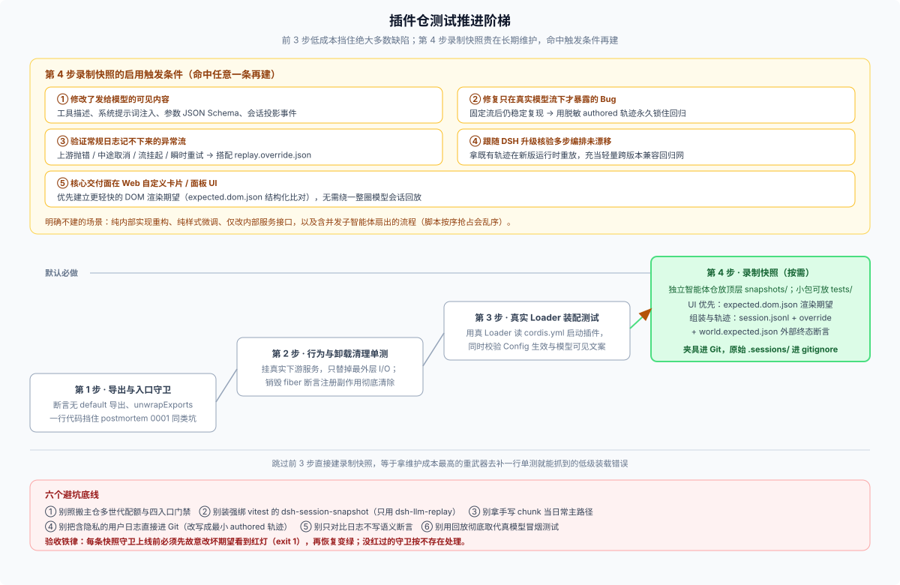

# 03 · 落地阶梯、目录布局与 Git 入库规范：怎么一步步搭起来还不失控？



## 一、别跳级：插件仓的四步测试推进顺序

录制快照最大的成本不在“第一次搭起来那半小时”，而在后续每次改提示词、改工具参数时都要有人重录、有人逐行审 diff。如果跳过便宜的基础测试直接上会话回放，就等于拿维护最贵的重锤去敲一行单测就能挡住的钉子。

无论插件大小，推荐严格按下面四步从低到高推进（前三步默认必做，第四步命中条件再开）：

| 步骤 | 测什么 | 成本与执行策略 | 主仓参考样板 |
|---|---|---|---|
| **第 1 步 · 导出形态与模块入口检查** | 断言包入口不存在 `export default`，并用 `unwrapExports` 校验具名导出与 `inject` 未丢失 | **默认必做**；仅需几行断言，秒级跑完，直接免疫 `postmortem 0001` 同类装载事故 | [`packages/lsp/tool-lsp/tests/load-path.spec.ts`](https://github.com/deepseek-ai/deepseek-harness/blob/master/packages/lsp/tool-lsp/tests/load-path.spec.ts) |
| **第 2 步 · 行为与卸载清理（HMR）单测** | 挂上真实的下游依赖服务（只替掉最外层网络/时钟），从注册后的真实入口调用；销毁插件 fiber 后断言注册项干净撤回 | **默认必做**；覆盖参数校验、错误分支与热重载无残留 | [`packages/todo/tool-todo/tests/tool-todo.spec.ts`](https://github.com/deepseek-ai/deepseek-harness/blob/master/packages/todo/tool-todo/tests/tool-todo.spec.ts) |
| **第 3 步 · 真实 Loader 装配测试** | 用真 `Loader` 读取临时 `cordis.yml` 启动插件，同时校验 `Config` 配置项解析生效以及生成的模型可见文案 | **默认必做**；挡住绝大多数配置拼写、依赖顺序与默认值缺陷 | [`packages/todo/tool-todo/tests/loader-composition.spec.ts`](https://github.com/deepseek-ai/deepseek-harness/blob/master/packages/todo/tool-todo/tests/loader-composition.spec.ts) |
| **第 4 步 · 渲染期望 / 录制会话回放** | 固化前端真实挂载后的结构化 DOM 证据，或用 `dsh-llm-replay` 无密钥重演完整多步会话轨迹 | **按需启用**；命中下方五条触发条件之一再建，每条用例配独立语义断言 | [`snapshots/session/deepseek-messages-invalid-tool-history/`](https://github.com/deepseek-ai/deepseek-harness/blob/master/snapshots/session/deepseek-messages-invalid-tool-history/session.v3.jsonl) |

---

## 二、进第 4 步时：先选“DOM 渲染期望”还是“完整会话回放”？

很多开发者一提快照就想到录 `session.jsonl`，其实进入第 4 步前应该先问一句：**我的插件核心交付面到底住在哪？**

- **如果核心交付面在 Web 界面（自定义工具卡片 `toolview`、侧栏面板、状态页签）→ 优先建“DOM 渲染期望”**
  直接构造确定的事件或投影状态喂给前端宿主，提取渲染后的关键可见文本、按钮可交互状态与控制台零报错，写成一份窄带结构化的 `expected.dom.json`。跑一次只需十来秒，不需要折腾模型流录制；顺手导出的 `.png` 截图只留本地肉眼确认排版，不提交进仓库。
- **如果核心交付面在模型上下文与编排（注入系统提示词、定义复杂工具 Schema、自定义会话投影、多轮流式交互）→ 建“录制会话回放”**
  只有当命中以下条件之一时，才真正值得建一条 `session.jsonl` 回放用例：
  1. 修改了实际发往模型的请求头内容（系统提示词片段、工具描述与参数 Schema、上下文投影事件）；
  2. 修复了一个只有配合真实模型输出流才会触发的状态流转 bug（用脱敏 `authored` 轨迹锁住回归）；
  3. 需要验证上游 API 报错、流挂起、中途取消或瞬时重试（搭配 `replay.override.json`）；
  4. 维护多角色智能体编排，需要在跟随 DSH 升级版本时自动确认各角色的组装和交接未走样。
- **哪些改动明确不该建快照？**
  纯内部代码重构、纯 CSS 视觉微调、只影响插件内部服务接口的改动，以及任何包含**并发子智能体扇出**的任务（回放器按首次请求顺序抢脚本，并发下天生不确定）。

---

## 三、目录怎么摆？顶层 `snapshots/` 与 `tests/` 的取舍

选定要做录制快照后，文件放在哪里最顺手？按仓库规模分三种情况（关于独立插件仓的整体结构可对照 [FAQ 13 · 专家插件仓组织](../13_expert-plugin-repo-organization/answer.md)）：

1. **在 DSH 主仓内开发**：完全不自建目录，直接按 [`snapshots/AGENTS.md`](https://github.com/deepseek-ai/deepseek-harness/blob/master/snapshots/AGENTS.md) 规范往顶层 `snapshots/session/<场景名>/` 加场景，用 `cordis.snapshot.yml` 补丁挂上你的插件。
2. **独立智能体仓或多插件仓库（尤其平时用 Coding Agent 协作开发）→ 推荐顶层 `snapshots/`**
   放在仓库根下的 `snapshots/` 有三个实打实的好处：
   - **按需向 Agent 注入规则**：DSH 的目录指令机制会在 Agent 读写 `snapshots/` 下文件时自动加载 `snapshots/AGENTS.md`（例如提醒“禁止为凑绿放宽比对字段、禁止改写 `world.expected.json`”），平时改业务源码时则不占上下文预算；
   - **同时收口两类回归证据**：`snapshots/replay/` 放会话回放，`snapshots/web-face/` 放前端 DOM 渲染期望，一套规矩统一管理；
   - **唯一的注意点（防命名先验撞车）**：熟悉 DSH 主仓的 Agent 看到顶层 `snapshots/` 容易默认套用主仓 `snapshot.yml` 的封闭字段规则，因此务必在 `snapshots/README.md` 开头写明一句：“本目录清单由本仓测试脚本自行解析校验，不采用 DSH 主仓内部 `snapshot.yml` 格式。”
3. **单一功能小插件包 → 直接放 `tests/snapshots/` 即可**
   整个仓库只有一个小工具包、未来也不会长出前端渲染快照，只为锁住一两个棘手 bug 放一两条 `session.jsonl` 时，直接摆在 `tests/snapshots/` 下由 Vitest 顺手跑掉最省心，没必要为了形式感硬搭顶层目录。

一套干净、好维护的独立仓顶层 `snapshots/` 推荐长这样：

```text
your-plugin-repo/
├── AGENTS.md                           # 仓库根指令
├── cordis.yml                          # 日常开发配置
├── tests/                              # 第 1～3 步常规测试（导出、单测、真 Loader 装配）
└── snapshots/                          # 第 4 步按需启用的回归快照
    ├── AGENTS.md                       # 本目录铁律：严禁凑绿放宽断言、严禁自动改写外部终态期望
    ├── README.md                       # 清单说明（声明非主仓 schema）+ 各场景「防什么 bug」登记表
    ├── record.patch.yml                # 录制叠加层：compression: none，指向临时 ./.sessions
    ├── replay.patch.yml                # 回放叠加层：禁用全部真模型与标题模型，挂载 llm-replay
    ├── replay/
    │   ├── <feature-slug>/
    │   │   └── session.jsonl           # live 实跑轨迹（核验过外部结果正确后入库）
    │   └── <bug-slug>/
    │       ├── session.jsonl           # authored 手写脱敏最小轨迹（重录脚本跳过不覆盖）
    │       ├── replay.override.json    # 可选：模拟抛错 / 挂起取消 / 重试
    │       └── world.expected.json     # 可选：独立于会话文本的外部文件或调用计数断言
    └── web-face/                       # 可选：涉及自定义 UI 时优先建立的窄带 DOM 渲染期望
        └── <view-slug>/
            └── expected.dom.json
```

不管目录放在哪，守住四条健康习惯就能防止快照腐烂：① **先红后绿验收**——新加一条快照断言，先故意改坏一处期望确认测试真能报错退出（`exit 1`），再恢复变绿；② **宁可重录，不搞半新半旧拼接**——提示词大改后直接重新真跑一次，别拿旧的模型回复硬配新的系统提示词；③ **记录代码锚点**——在场景说明或清单里记下录制时的本仓 commit 与 DSH 版本；④ **只归一化真正随机的值**——仅处理端口、临时目录与随机 ID，正文、时间戳语义与结构化参数一律原样比对。

---

## 四、快照文件该不该提交进 Git？会不会把仓库撑爆？

**结论非常明确：审阅过的快照夹具必须随代码同 PR 提交进 Git，而且绝对不要开 Git LFS。**

很多团队担心 `.jsonl` 塞进 Git 会导致仓库体积失控，拿真实数据算一笔账就能打消顾虑：

- **真实体积到底多大？** DSH 主仓攒了约 **250 个跨入口复杂场景、600 多个 `.jsonl` 文件**，在 Git 树里的未压缩总大小也才 **9.8 MB 左右**，折合平均每个场景不到 **40 KB**（哪怕一个多角色重型插件仓把完整工具 Schema 留在夹具里，4 个角色加起来也不过两三百 KB）。再加上 Git packfile 对纯文本 JSONL 天然有 3～5 倍压缩率，一个普通插件仓维护 10～20 个核心场景，克隆体积连一张高清 PNG 截图都不到。
- **为什么不能不进 Git，也不能进 Git LFS？**
  无密钥 CI 的前提就是 runner 拉下代码就能直接读到夹具；一旦放到外部对象存储或本地缓存，PR CI 立刻断炊。更关键的是，防住 `postmortem 0002` 的核心防线就是 **Code Review 时在 GitHub PR 页面逐行审阅 JSONL 与请求头的文本 diff**——一旦塞进 Git LFS 变成二进制指针，逐行 diff 当场报废。

真正决定仓库干不干净的，是把文件严格分成三类区别对待，并用四个“防膨胀阀门”管住生命周期：

| 类别 | 具体包含哪些文件 | Git 策略 |
|---|---|---|
| **1. 经审阅的回归证据** | `session.jsonl`、`replay.override.json`、`world.expected.json`、`expected.dom.json`、回放补丁与场景 `README.md` | **必须提交进 Git**，且与触发变化的功能代码在同一个 PR 原子落地 |
| **2. 原始运行副产物** | 录制临时目录 `./.sessions/`、`$DSH_HOME` 会话库、调试导出的 `.png` 截图、**未经脱敏的用户上报原始日志** | **严禁进 Git**，第一时间写进 `.gitignore`，审完即删 |
| **3. 过时的旧场景与旧世代** | 所防特性已下线的场景、重录前的旧版本 `session.v2/v3.jsonl` | **直接删除或原地覆盖**——在 `snapshots/README.md` 给每个场景写清一句“它防什么”，条件消失就果断删掉；插件仓不背历史格式迁移任务，重录永远覆盖单文件 |
