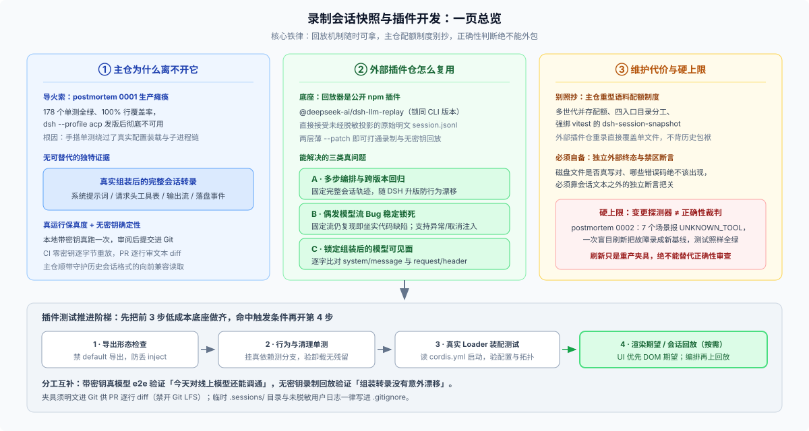
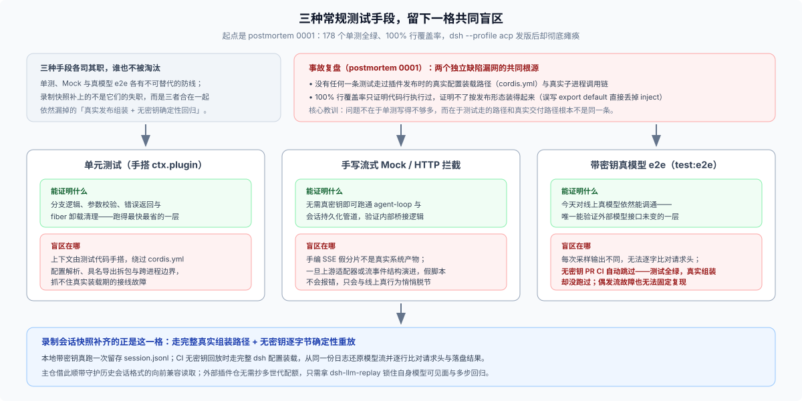

# Answer 21 · 录制会话快照：回放机制随时可拿，主仓制度别照抄，正确性判断不能外包

## 一句话结论

把“DSH 主仓的多世代语料配额制度”和“底层的录制回放机制”拆开看，插件作者的决策其实非常清晰：

1. **为什么 DSH 主仓离不开 `snapshots/`？** 起点是一次真实的生产瘫痪（[`postmortem 0001`](https://github.com/deepseek-ai/deepseek-harness/blob/master/docs/postmortem/0001-acp-default-export-drops-inject.md)）：ACP 插件在 **178 个单测全绿、100% 行覆盖率** 的情况下发版后完全不可用，因为手搭单测绕过了真实配置装载与子进程调用链；而带密钥的真模型 e2e 每次采样结果不同，且在无密钥 PR CI 中会自动跳过。**只有“真模型跑一次落盘、后续无密钥逐字节回放”能同时保住真实组装路径与确定性回归。**
2. **外部插件仓能不能用这套机制？能。** 核心回放器 [`@deepseek-ai/dsh-llm-replay`](https://github.com/deepseek-ai/deepseek-harness/blob/master/packages/test-support/llm-replay/README.md) 是公开发布在 npm 上的标准 Cordis 插件，而且直接接受未经脱敏投影的原始明文 `session.jsonl`。本地带密钥真跑一次留存日志，就能在 CI 里零密钥反复重演。
3. **你的插件仓该用到哪一步？按阶梯走，别跳级。** 先把 **导出形态检查 → 行为与卸载清理单测 → 真实 Loader 装配测试** 这三步低成本底座做齐；**只有当插件负责多步轨迹编排、修改了发给模型的提示词或工具定义，或是需要固定复现与模型流耦合的 bug 时**，才按需引入录制会话回放（若插件重点在前端卡片，优先做更轻快的 DOM 渲染期望）。
4. **看清它的硬上限——快照只是“变更探测器”，绝不是“正确性裁判”。** 在 [`postmortem 0002`](https://github.com/deepseek-ai/deepseek-harness/blob/master/docs/postmortem/0002-js-expression-disabled-filesystem-tools.md) 中，配置缺陷导致 7 个文件系统场景报 `UNKNOWN_TOOL`，结果一次快照刷新把故障原样录成了新基线，测试照样全绿放行。

---

## 一、按仓库形态对号入座：你的插件仓该怎么选？

不同规模与交付面的仓库，根本不需要整齐划一地建同一套目录：

| 你的项目形态 | 默认必做的测试底座 | 要不要建录制会话回放？ | 推荐目录与落点做法 |
|---|---|---|---|
| **1. 在 DSH 主仓内开发插件**（monorepo 成员包） | 包内 `tests/` 单测 + 清理测试 + 真实 Loader 装配测试 | **涉及模型/协议/界面可见变化时必建** | **不自建私有快照目录**；直接在主仓顶层 `snapshots/session/<场景>/` 新增场景，用 `cordis.snapshot.yml` 挂载插件 |
| **2. 单一工具 / 后端服务小插件仓** | 禁 `default` 导出检查 + 行为单测 + 真实 `Loader` 配置测试 | **默认不建**；仅在要核验复杂提示词注入或锁死线上棘手模型流 bug 时加 1～2 条 | 直接放在 `tests/snapshots/` 下跟 Vitest 一起跑即可，不必单独搞顶层治理目录 |
| **3. 独立智能体 / 多角色编排仓**（维护专属 preset、多工具协同与根 `AGENTS.md`） | 前三步基础测试 + 核心工具链真实组装校验 | **推荐按触发条件建立**（锁定各角色 `request/header`、多步交接与跨 DSH 升版行为） | **放顶层 `snapshots/`**（让 Coding Agent 进目录时按需读取 `snapshots/AGENTS.md` 边界规则），并在 `README.md` 注明清单由本仓脚本自管 |
| **4. 重前端交互插件仓**（自定义工具卡片、状态面板、设置页） | 前三步基础测试 + 组件交互单测 | **优先建 DOM 渲染期望，暂缓完整会话回放** | 在 `snapshots/web-face/`（或 `tests/expected/`）比对真实挂载后的结构化 `expected.dom.json`；十来秒跑完，性价比远高于跑整轮会话 |

动手建第一条录制快照前，先过一遍下面四句快速判据，能省下大量无用功：

- **去掉真模型也能复现的问题，一律写单测或真实 Loader 测试**，不要拿重型会话回放凑数；
- **只改内部实现重构或纯样式微调**，完全不需要新增或重录会话快照；
- **涉及并发子智能体同时扇出请求**的场景不能做确定性回放（回放器按首次调用顺序分配脚本，并发抢占会导致乱序）；
- **一旦决定建一条快照，同一天就写下“它防什么 bug”和它的独立语义断言**——没有删除判据和独立断言的快照迟早变成没人敢动的历史包袱。

---

## 二、为什么“100% 单测覆盖 + 真模型 e2e”还是填不上这个坑？

很多团队觉得“单测管逻辑、真模型 e2e 管端到端”就已经闭环了。把三种常见手段摆在一起，就能看清漏掉的那一格到底在哪：

- **单元测试（手搭 `ctx.plugin(...)`）**：跑得最快，但它测的是你手里拼出来的上下文，绕过了 `cordis.yml` 解析、模块具名导出拆包和跨进程通信。行覆盖率 100% 只证明代码行执行过，不证明插件按真实发布形态装得起来。
- **手写流式 Mock / HTTP 拦截**：要自己编造一套 OpenAI/DeepSeek SSE 流式分片脚本。一旦上游适配器或流事件结构演进，手写假数据不会报错，只会和真实线上行为悄悄脱节。
- **带密钥真模型 e2e（`test:e2e`）**：它是唯一能证明“今天对线上真模型还能跑通”的手段，但每次输出都有随机性，没法逐字比对请求头和中间步骤；而且为了保护密钥安全，开源 PR CI 默认无密钥运行，遇到无密钥就会自动 skip，看起来绿油油其实没跑。

录制会话快照恰好卡在这三者中间：**用真模型跑一次生成真实的 `session.jsonl`，回放时既走完整的 `dsh` 配置装载与 `agent-loop`，又从同一份日志里确定性地还原模型输出流**（参见 [FAQ 29 · Keyless 的含义与边界](../29_keyless-meaning-boundaries/answer.md)）。

---

## 三、落地的三条铁律：拿机制、弃制度、补断言

决定在自己的插件仓引入录制快照时，守住下面三条底线就能避开 90% 的弯路：

1. **只拿 `@deepseek-ai/dsh-llm-replay` 插件，别抄主仓的语料配额制度**
   主仓的 `snapshot.yml` 封闭校验、`V0–V3` 多世代保留配额、四入口（headless / SDK / ACP / Web）强制分工，以及强依赖 Vitest 内部环境的 `@deepseek-ai/dsh-session-snapshot`，全是为“单仓集中管控数百个场景与历史格式迁移”设计的。外部插件仓只需要装与当前 `dsh` CLI 同版本的 `@deepseek-ai/dsh-llm-replay`，用两个薄 `--patch` 叠加层即可跑通录制与回放，重录时直接覆盖旧文件，不背历史世代包袱。
2. **审阅过的快照夹具必须提交进 Git，原始运行目录坚决不进**
   无密钥 CI 回放和 PR 逐行审阅全靠仓库里的明文 `.jsonl` 文本（单场景通常只有二三十 KB，Git 压缩后极小，**切勿使用 Git LFS** 自废文本 diff）。真正该写进 `.gitignore` 的是每次运行临时生成的 `.sessions/` 目录、未脱敏的用户原始日志（复现用户 bug 应手写脱敏的最小 `authored` 轨迹），以及仅作肉眼核对的临时截图。
3. **永远配一条独立于会话文本的“外部事实或禁区断言”**
   既然一份 `session.jsonl` 同时充当回放输入和期望输出，如果你录下了一次错误的运行（比如工具根本没注册上、文件根本没写进磁盘，模型只在嘴上说“已完成”），后续回放就会忠实地为这个 bug 打绿勾。录制前必须先核实外部文件与进程状态正确，并在测试里加上独立的语义红线断言（例如严禁出现 `UNKNOWN_TOOL`、独立校验目标文件内容或调用计数）。

---

## 四、关键概念速查（防初次看源码踩坑）

| 常见词 / 配置项 | 人话解释与实操要点 |
|---|---|
| **`session.jsonl`（夹具）** | 按行分隔的完整会话事件轨迹；回放时既用它反推每次模型流，又拿跑完的新日志跟它比对 |
| **`complete` 与 `projected`** | 原始运行日志每行带 `seq`/`time` 包络（`complete`），主仓入库夹具省去了包络（`projected`）；`dsh-llm-replay` **两种都认**，但单个文件内不能混排 |
| **`compression: none`** | DSH 会话日志默认用 `zstd` 压缩，回放器只读明文；直接从会话目录取文件必须关压缩（走 Web `/export` 导出则天生是明文） |
| **`live` 与 `authored`** | `live` 是本地真跑采集的功能基线；`authored` 是为复现 bug 手写的最小脱敏轨迹（避免提交含隐私的用户日志，且重录时不应被覆盖） |
| **`replay.override.json`** | 可选补充文件，专门表达正常结算日志推不出来的四类异常：首包前报错、半途断流、挂起等取消、中途注入瞬时失败重试 |
| **独立外部终态断言** | 类似主仓 `workspace.expected/` 或插件自定的 `world.expected.json`，独立校验磁盘文件与真实副作用，且禁止录制脚本自动改写 |

---

## 继续阅读

| 你想深入了解什么 | 去哪篇看 |
|---|---|
| `postmortem 0001` 到底怎么翻车的？`session.jsonl` 内部长什么样？插件仓最小四文件配置怎么接线、避开哪三个静默失效坑？ | [`01-why-main-repo-needs-it-and-how-it-works.md`](./01-why-main-repo-needs-it-and-how-it-works.md) |
| 快照能帮插件解决哪三类具体问题？怎么用 `replay.override.json` 稳定复现抛错/挂起/取消？`postmortem 0002` 为什么会给回归背书？ | [`02-plugin-value-and-limits.md`](./02-plugin-value-and-limits.md) |
| 插件测试四步阶梯怎么一步步搭？DOM 渲染期望和会话回放怎么选？顶层 `snapshots/` 怎么摆、Git 体积怎么控住不膨胀？ | [`03-adoption-ladder-and-repo-layout.md`](./03-adoption-ladder-and-repo-layout.md) |
| 文中所有机制、事故复盘、配置项与源码实现的仓库精确出处 | [`reference.md`](./reference.md) |
| 延伸：独立插件仓整体目录结构、调试期还没有基线时怎么用轻量探针、以及 `keyless` 的精确边界 | [FAQ 13](../13_expert-plugin-repo-organization/answer.md) · [FAQ 28](../28_probe-usage-and-origin/answer.md) · [FAQ 29](../29_keyless-meaning-boundaries/answer.md) |

> 核验状态见 [核验基线登记](../00-baseline.md)。
