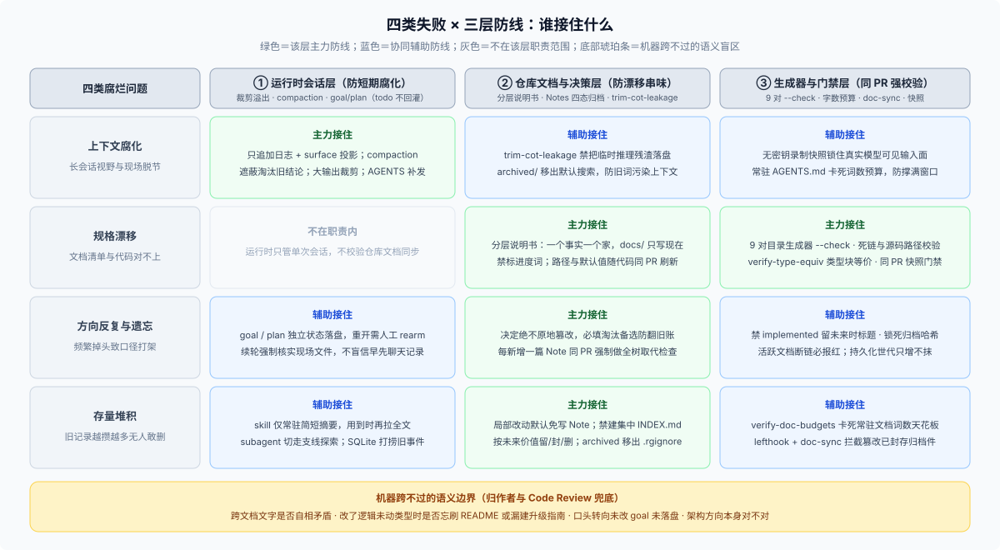

# Answer 22 · 防腐化与防漂移全景：三层有账防线，与一道机器跨不过的语义边界

## 一句话结论

**DSH 没有“阻止你中途改主意”的设计，它做的是“让每一次改主意和每一次压缩都有账可查，且全仓永远只留一份现行口径”。**

聊这套机制前，必须先把两个常被混在一起的主语拆开：
- **会话内的“上下文腐化”**：由 **DSH 产品运行时**自动替你兜底，你只要正常用 CLI 或 Web 就能享受到；
- **关掉会话后仓库里的“规格漂移、方向反复与存量堆积”**：靠的是 **DSH 主仓管自己演进的文档纪律与门禁脚本**，外部项目可以按规模挑着抄（注：DSH 源码里没有 `context rot` 这个词，对应的一手原语是 `surface`、`shadow`、`reconstructable`、`supersede` 与 `archive`）。

先把人们笼统抱怨的“项目烂掉了”拆回四个真实问题，就能一眼看清三层防线各自接住了什么，以及最底下那条没有任何机器接得住的语义盲区：

| 常见痛点 | 烂在哪一层 | DSH 靠什么接住 |
|---|---|---|
| **上下文腐化** | 单次会话的模型可见消息面（`surface`） | 只追加日志 + 纯函数投影；`compaction` 只遮蔽不删底账，重写摘要时主动淘汰过期结论；`goal/plan` 状态外置 |
| **规格漂移** | 仓库里的文档、清单与粘贴代码 | 一个事实一个家、`docs/` 只写现在；9 对目录生成器配 `--check` 门禁、死链与类型块等价校验 |
| **方向反复** | 架构决策的版本化方式 | 事实原地刷新，**决定绝不原地篡改**；每写新 Note 同 PR 强制做取代检查（Supersession Check） |
| **存量堆积** | 规则与历史记录的总体积 | 局部修改默认免写 Note；常驻文档设词数红线；老记录哈希封存进 `archived/` 并移出默认全文检索 |

---

## 一、第一层：运行时会话层——防模型“记串、记漏、抱残守缺”

只要你在用 DSH 干活，下面五组产品机制就在后台运转（详见 [`01-runtime-context-hygiene.md`](./01-runtime-context-hygiene.md)）：

1. **原始日志只追加，模型看到的只是投影**
   严守 `model-visible ⟺ logged`（[`docs/architecture.md`](https://github.com/deepseek-ai/deepseek-harness/blob/master/docs/architecture.md)）。会话事件日志只增不改，模型每一步收到的消息列表（`surface`）是由 `Session.deriveMessages()` 纯函数投影出来的视图——就算视图被裁剪，底账也绝不会丢。
2. **上下文压缩（`compaction`）是“记账遮蔽”而非删库，且主动淘汰旧话**
   长对话触发压缩时，原始事件原封不动留在日志里（且在 SQLite 会话检索索引中依然可搜），只是在 `surface` 上被新摘要遮蔽（`shadow`），遮蔽序号（`shadowedSeqs`）与 token 账单全程落盘；更关键的是，[`compaction-basic`](https://github.com/deepseek-ai/deepseek-harness/blob/master/packages/compaction/compaction-basic/README.md) 的摘要提示词明确要求**保留仍成立的事实、丢弃已过期的旧结论**，绝不机械照抄上一轮摘要。
3. **关键目标外置成状态值，续轮强制回看现场**
   `goal` 和 `plan` 模式都作为独立状态事件落盘，跨重启和压缩靠折叠日志恢复；自动续轮时，[`goal-round-driver`](https://github.com/deepseek-ai/deepseek-harness/blob/master/packages/goal/goal-round-driver/src/prompt.ts) 会直接警告模型“别盲信早先的聊天叙述，以当前工作区和工具结果为准”。（**注意一个极易踩的坑**：`todo_write` 写的待办清单纯粹服务前端进度条 UI，**永远不会回灌进模型历史**，千万别靠 `todo` 给模型存需求约束！）
4. **工作区规则被压缩遮蔽后会自动补发**
   [`agent-instructions`](https://github.com/deepseek-ai/deepseek-harness/blob/master/packages/context/agent-instructions/README.md) 注入的 `AGENTS.md` 一旦在长对话里被压缩遮蔽，下一步 `pre-step` 会自动把它恢复回可见上下文。
5. **源头控量与支线隔离**
   [`tool-skill`](https://github.com/deepseek-ai/deepseek-harness/blob/master/packages/skill/tool-skill/README.md) 常驻上下文只放简短技能目录，用到时才拉取全文；支线调研派给 `subagent`（`spawn` 空对话起步，`fork` 只拷已完成轮次的一次性前缀快照），避免探索噪音把主会话撑爆。

---

## 二、第二层：仓库文档与决策层——接住“左晃右晃”与存量堆积

项目做久了方向摇摆、文档越攒越多，DSH 靠四条硬家规把仓库理清（详见 [`02-repo-governance-and-pivots.md`](./02-repo-governance-and-pivots.md) 与 [FAQ 20](../20_agent-note-quality-bar/answer.md)）：

1. **一个事实一个家，`docs/` 只写现在**
   [`docs/AGENTS.md`](https://github.com/deepseek-ai/deepseek-harness/blob/master/docs/AGENTS.md) 严禁同一规则贴两处，严禁在文档里手写“已实现 / 规划中”状态标签。`docs/` 和包 `README` 只陈述当前 HEAD 的契约（`Document current state`）；演进过程归 Git 提交，淘汰方案与取舍归 `.agents/notes/`。
2. **事实原地刷新，但决定绝不原地篡改**
   已交付（`implemented/`）Note 里的路径或默认值变了，随代码直接改原文；但只要**推翻了原先的决定或核心理由**，绝不允许把旧 Note 偷偷改成反面（那样当初为什么往东走、淘汰了什么备选就彻底失传了），必须新开一篇并双向交叉链接。
3. **每写一篇新 Note，同 PR 强制做“取代检查”（Supersession Check）**
   趁新方案作者最清楚重叠边界时，当场分诊老记录——部分取代的保留现行并互链注明幸存条款；100% 被取代的把独有理由与测试缺口并入新篇后直接删掉旧篇；未落地就作废的提案进 `rejected/`。
4. **高门槛少写 + 冻结归档移出默认搜索**
   日常局部修改和纯 UI 调整一律免写 Note；已完成且不再指导后续决策的记录，三件套整体移入 `archived/` 永久哈希封存、禁止再改，并通过 [`.rgignore`](https://github.com/deepseek-ai/deepseek-harness/blob/master/.rgignore) **默认移出全文检索**，防止过期的老词条在搜索时压过现行文档。

---

## 三、第三层：生成器与门禁层——把账实不符挡在合入前

光靠文档倡议一定会烂，DSH 把能机械核对的规则全写成了非零退出的检查（详见 [`03-gates-limits-and-borrowing.md`](./03-gates-limits-and-borrowing.md)）：

- **能算出来的清单绝不手抄**：工具、配置、Cordis 服务、持久化格式、Session 格式、官方 Bundle 等 **9 类目录**全部由源码生成，并配齐 `--check` 校验脚本——改了源码忘刷新目录，或者手改生成文件，门禁直接报红。
- **`pnpm run doc-sync` 守住结构与容量**：集中拦截本地 Markdown 死链、TS 注释里失效的文档路径、文档代码块里粘贴过期的 TS 类型（`verify-type-equiv`）、常驻入口文档超字数预算（如根 `AGENTS.md` 硬上限 2080 词）、`implemented/` Note 残留未来时标题，以及篡改 `archived/` 封存文件。
- **行为与数据世代只增不抹**：模型或界面可见行为变化必须同步更新无密钥录制快照（[`snapshots/`](https://github.com/deepseek-ai/deepseek-harness/blob/master/snapshots/AGENTS.md)）；持久化格式变更只追加新世代并强制登记 `docs/persistence-changes/` 确认记录。

---

## 四、诚实摊牌：哪些漏洞连 DSH 的机器门禁也防不住？

别把这套体系神化成“全自动防错网”，下面四块盲区在 DSH 仓库里明文归**人（与语义 Code Review）**兜底：

1. **跨文档的语义自相矛盾，机器完全看不懂**
   门禁能查死链、查哈希、查生成物新不新，但**没有任何脚本能判断“A 文档第 3 段和 B Note 的文字是不是在唱反调”**。就连双语配对门禁（[`docs/i18n/README.md`](https://github.com/deepseek-ai/deepseek-harness/blob/master/docs/i18n/README.md)）也直白写明：只查哈希和段落骨架，审不了两边意思对不对。
2. **“忘了同步改散文”与“压根没建升级指南”查不出**
   改了代码逻辑但没碰类型签名时，忘了改包 `README` 的文字说明门禁不会报警；破坏性变更要求立刻写升级指南，但 `verify-upgrade-guides` 只检查**已存在**指南的格式——如果你压根没建那个目录，脚本直接绿灯放行。
3. **散文里的手写数字照样会漂移**
   哪怕在专门立规矩的 `docs/AGENTS.md` 里，正文手写的预算目标（如 `architecture.md ≤ 2,400`、`testing.md 1,300`）与机器真正执行的 [`doc-budgets.manifest.json`](https://github.com/deepseek-ai/deepseek-harness/blob/master/scripts/doc-budgets.manifest.json) 上限（`2410`、`1350`）之间留有余量差，也没有门禁去核对这两组数。
4. **没落盘的口头转向谁也救不了，运行时也没有语义裁判**
   只在聊天里说一句“换个方向”却没改 `goal` 也没写进仓库，压缩一过照样淡化；运行时 `goal` 驱动器也明确声明没有独立的跑偏评估器（`No independent evaluator`），方向对不对最终仍靠人拍板。

---

## 继续阅读

| 你想细看哪一部分 | 去哪篇看 |
|---|---|
| 会话日志投影、`compaction` 记账遮蔽、`goal / plan / todo` 差异、按需加载与运行时有损边界 | [`01-runtime-context-hygiene.md`](./01-runtime-context-hygiene.md) |
| 文档防烂铁律、Note 取代检查与冻结归档机制，以及 6 个真实架构掉头（Git 可查）怎么记账 | [`02-repo-governance-and-pivots.md`](./02-repo-governance-and-pivots.md) |
| 9 对生成器与 `doc-sync` 门禁清单、机器查不出的 5 个盲区，以及插件仓 / 传统业务项目的实操抄法 | [`03-gates-limits-and-borrowing.md`](./03-gates-limits-and-borrowing.md) |
| 本篇涉及的 DSH 权威文件链接与历史转向提交本地复核命令 | [`reference.md`](./reference.md) |
| 延伸：单笔变更的交付载体分工 / Agent Note 写作门槛 / 外部仓库怎么低成本借这套思路 | [FAQ 06](../06_change-landing-path/answer.md) · [FAQ 20](../20_agent-note-quality-bar/answer.md) · [FAQ 07](../07_borrowing-dsh-harness-idea/answer.md) |

> 核验状态见 [核验基线登记](../00-baseline.md)。
