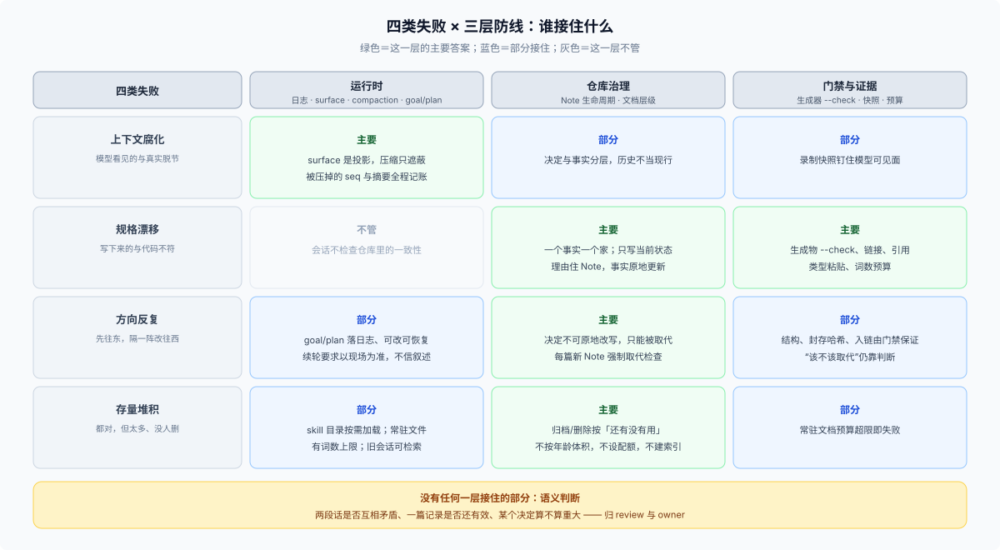

# Answer · 上下文腐化与规格漂移：机理、边界与用法

## 一分钟版

**DSH 没有「防止你改主意」的设计，它有「让每次改主意都有账」的设计。** 三层各自成立：

1. **运行时**——会话日志只追加，模型可见面只是它的投影；compaction 压缩上下文时**遮蔽**旧事件而不是删除，被遮蔽的 seq、token 数和摘要模型全部记账；压缩提示词本身还要求「保留仍然成立的，丢掉过期的」（[02](./02-runtime-anti-rot.md)）。
2. **仓库治理**——每个事实只有一个家；文档只写现在，历史归 commit / PR / Note / postmortem；**决定不可原地改写**，改主意必须新开一篇并交叉链接，每篇新 Note 强制做一次取代检查（[03](./03-note-process-anti-drift.md)）。
3. **门禁与证据**——生成目录有 `--check` 孪生、链接/引用/类型粘贴/预算/配对/封存都有门禁；但**语义判断被明确留给 review**，仓库自己写着「No automated gate attempts to classify a diff as trivial or non-trivial」（[04](./04-gates-and-evidence.md)、[07](./07-limits.md)）。

所以对提问者的直接回答是：**「项目左晃右晃」在这里不是异常，是被流程假设并记账的常态；真正会出事的是「转向没有留下任何载体」。** 你担心的两种腐化里，运行时的那一种被记录面挡住了，仓库的那一种被「一个事实一个家 + 取代检查」挡住了；剩下的空白是语义层的（[07](./07-limits.md)）。

上图是全文的总览：四类失败按三层分工排列，底部那条是没有任何一层接住的部分。

## 一句话结论（可核对的版本）

> DSH 的处理方式是：**历史只追加、现行只有一个 owner、每次变化都要有账、能机器查的绝不靠人记、查不了的明说归人。**

这条概括是本篇从三层机制里综合出来的 `[推断]`，不是仓库里的某一句话；每一半都有原文支撑（见 [reference.md](./reference.md)）。

## 目录里都有什么

| 文件 | 回答的问题 |
|---|---|
| [`question.md`](./question.md) | 问题怎么来的、范围与边界 |
| [01 先分清烂的是哪一层](./01-what-actually-rots.md) | 上下文腐化 / 规格漂移 / 方向反复 / 存量堆积，四种失败的载体与信号 |
| [02 运行时机理](./02-runtime-anti-rot.md) | 会话日志、surface、compaction 记账、goal/plan/todo 外置、按需加载、检索与隔离 |
| [03 Note 流程](./03-note-process-anti-drift.md) | 三条硬规则、生命周期去向表、哪些是机器拦的哪些靠人 |
| [04 门禁与证据](./04-gates-and-evidence.md) | 生成器 + `--check`、`doc-sync` 叶子门禁、快照与持久化确认 |
| [05 「左晃右晃」](./05-agile-swings.md) | 三次真实转向的完整走法 + 五个 git 可核案例 + 它接不住什么 |
| [06 使用手册](./06-how-to-use.md) | 插件仓抄哪五条、传统应用迁移哪六条、症状→动作表、三个反模式 |
| [07 它没防住什么](./07-limits.md) | 语义矛盾、目标与上限的数值不一致、归档清单不是单调账本、浅克隆边界 |
| [`reference.md`](./reference.md) | 全部出处：路径、行号、提交号与实测口径 |
| [`figures/three-layers.svg`](./figures/three-layers.svg) | 总览图：四类失败 × 三层防线 |

## 按什么顺序读

| 顺序 | 读哪一篇 | 什么时候读 |
|---|---|---|
| 1 | [01](./01-what-actually-rots.md) | 先确认你说的「腐化」是哪一种 |
| 2 | [03](./03-note-process-anti-drift.md) | 只想回答「Note 流程考虑了没有」——这一篇就是答案 |
| 3 | [02](./02-runtime-anti-rot.md) | 想知道运行时到底防住了什么 |
| 4 | [05](./05-agile-swings.md) | 想知道方向反复怎么记账 |
| 5 | [04](./04-gates-and-evidence.md) | 想自己搭一套门禁 |
| 6 | [06](./06-how-to-use.md) | 想直接拿去做 |
| 7 | [07](./07-limits.md) | 想避免过度相信它 |

## 六个要点

1. **压缩不等于遗忘。** 被压缩的内容仍可检索（`packages/session-query/session-query-sqlite/README.md:59`），而摘要按「现在还成立吗」重写（`packages/compaction/compaction-basic/README.md:224`）。
2. **工作状态是值，不是叙述。** goal / plan 会重新进入请求，todo 只服务 UI（`packages/todo/tool-todo/src/types.ts:30`）——这个区别决定了你把什么当作「模型会记得的东西」。
3. **方向反复的成本被显式定价。** 写新 Note、交叉链接、分诊旧篇、修入链；配套的是「默认不写」的高门槛。
4. **每篇新 Note 强制取代检查**，这是整套流程里最直接针对「spec 越堆越矛盾」的一条（`.agents/notes/AGENTS.md:5`）。
5. **机器管形状与新鲜度，人管语义。** 门禁很密，但没有一条能判断「两段话是否互相矛盾」。
6. **术语提醒**：DSH 自己的源码与文档里没有「context rot」这个词（本仓 `_misc/` 的外部参考材料里出现过）；DSH 用的词是 surface / shadow / reconstructable / supersede / archive。"[原文]" 与 "[推断]" 的分工见 [reference.md](./reference.md)。

## 术语速查

| 词 | 白话 |
|---|---|
| **surface** | 模型实际看见的有序消息历史，由日志投影而来；压缩用 `replace` 遮蔽其中一段 |
| **shadowed** | 被压缩遮蔽的事件：不再进入模型消息，但仍留在日志里、仍可检索 |
| **model-visible ⟺ logged** | 任何进入模型请求的东西都必须能从日志重建 |
| **supersede** | 取代：新决定接管现行地位，旧记录交叉链接后归档或（完全取代时）合并删除 |
| **archive** | 冻结归档：三件套整体移入 `archived/`，内容此后不可编辑，也不作现行权威 |
| **rejected** | 被否决的提案：冻结在提案时代，否决理由写在 `Status:` 行 |
| **one home per fact** | 一个事实只有一个权威载体，其余地方链接过去 |
| **freshness gate** | 生成物与源码是否仍然一致的检查（`gen-X --check`） |
