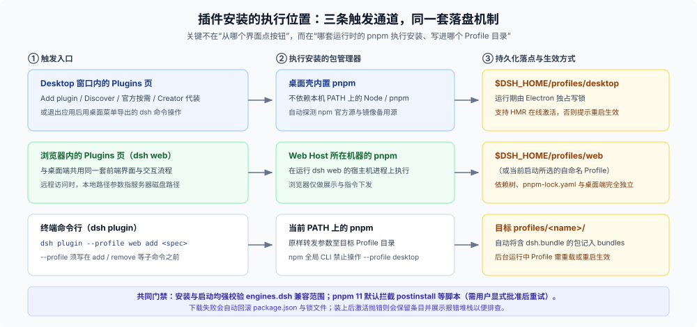
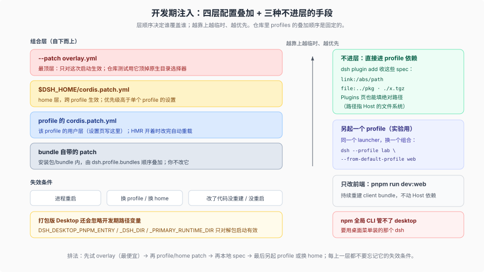

# 02 · 插件安装入口与开发期免发版调试

不管你用 Desktop 还是 `dsh web`，也不管你是从图形界面点按钮还是在终端敲命令，DSH 装插件始终遵守同一条底层规则：**插件的持久化落点永远是某个具体的 Profile 目录（`$DSH_HOME/profiles/<name>/` 下的 `package.json` 依赖与 `cordis.patch.yml` 配置层），真正干活的永远是宿主机上的 pnpm。**

下面先理清正式装插件的所有入口与生效边界，再讲本地写插件时怎么绕过正式发版直接挂载调试。

---

<a id="plugin-install-paths"></a>

## 一、正式安装入口：三条触发通道，同一套落盘机制



### 1. Desktop 的六种安装途径（全部落入 `profiles/desktop`）

在桌面端，包管理操作的所有权归 Electron 壳内置的 pnpm（[`plugin-manager` README](https://github.com/deepseek-ai/deepseek-harness/blob/master/packages/boot/plugin-manager/README.md)）。它一共开放了六种装法：

| # | 途径 | 谁发起 / 谁执行 | 关键行为与注意点 |
|---|---|---|---|
| 1 | 侧栏 **Plugins → Add plugin** | 用户点按钮 / 内置 pnpm | 支持填 npm 包名与版本、Git 仓库地址、本地 `.tgz` 或**宿主机绝对路径**；安装前先调 `inspect` 预检并自动探测 npm 官方源与 `npmmirror` 备用源；装完可直接点 **Enable now** |
| 2 | **Discover**（开启实验组件 Custom plugin markets 后） | 用户点选索引条目 / 内置 pnpm | 官方不预置任何索引源，需自行添加符合格式的第三方市场 JSON URL，选中后走与第 1 条相同的安装流 |
| 3 | **On-demand Official**（官方与实验按需列表） | 用户点开关或安装 / 内置 pnpm | 正式打包版自动拉取与当前 DSH 同版本的 `package@<version>`；源码开发态（`dev:desktop`）则自动改为 `link:<工作区包目录>` |
| 4 | **Creator 模式**（调用 `plugin_manager` 工具） | 模型发起（需用户审批或 `danger` 权限）/ 内置 pnpm | 让智能体在本地写完插件后直接安装启用，返回结果自带是否需要重启及原因 |
| 5 | **Desktop 自带命令行**（`Manage dsh Command…` 安装后） | 终端敲 `dsh plugin --profile desktop add <spec>` / 内置 pnpm | **必须先启动过一次 Desktop 初始化目录，并在完全退出 Desktop 释放写锁后执行**；用 npm 全局装的 `dsh` 执行此命令会被直接拒绝 |
| 6 | 手动编辑 `profiles/desktop/` 配置 | 开发者手改文件 | 运行期间 Electron 持有 Profile 写锁；适合排查或写入简单开关，开启 HMR 时保存即触发重载，否则重启生效 |

### 2. CLI / Web 的三种安装途径（默认落入 `profiles/web`）

`dsh web` 与桌面端共用完全相同的 Plugins 前端页面，区别只在于后端换成了跑在你 Node 环境上的 Web Host：

1. **浏览器里的 Plugins 页面**：操作体验与桌面端完全一致（含 Add plugin、Discover、On-demand Official 与 Creator 模式），由运行 `dsh web` 那台机器上的 `pnpm` 执行安装；如果你是远程打开浏览器连服务器，填的本地路径也是指**服务器文件系统上的路径**。
2. **`dsh plugin` 命令行**：`dsh plugin --profile <name> <args...>` 会把参数原样转发给对应 Profile 目录下的 `pnpm`（`add`、`remove`、`update`、`why` 均可直接用），安装成功后自动对账：凡是在 `package.json` 里声明了 `"dsh": { "bundle": { "patch": "./cordis.patch.yml" } }` 的包，都会自动追加进 `dsh.profile.bundles` 启用列表。注意 `--profile <name>` 必须写在 `add` 等子命令前面。
3. **手动修改 `profiles/web/package.json` 与 `cordis.patch.yml`**：适合直接调整插件配置项。

### 3. 装完之后什么时候生效？四个硬边界

- **热重载（HMR）与重启提示**：`web` 与 `desktop` 默认开启 `dsh-hmr`，普通插件启停和配置修改可在线重装生效；但如果改动触及了不支持热替换的模块、包解析路径发生迁移（`package-moved`），或者在未开 HMR 的 Profile（如 `headless`）下操作，系统会返回 `restart-required`，重启进程后才生效。
- **构建脚本拦截（`pendingBuilds`）**：pnpm 11 默认拦截依赖包的安装脚本（如 `postinstall`）。一旦被拦，安装会回滚 `package.json` 与 `pnpm-lock.yaml`，并在 Plugins 页提示 **Allow these scripts and retry**，由你显式批准具体包名后再重试。
- **失败回滚与激活报错分离**：下载或校验失败会自动把 `package.json` 和锁文件恢复原样；但如果包已经装进依赖树、只是启动时代码抛错激活失败，依赖和勾选状态会保留在列表里并标红展示报错堆栈，方便你修好代码后重装或直接取消勾选。
- **DSH 版本兼容门禁（`engines.dsh`）**：安装外部插件和启动 Profile 时都会强校验包的 `engines.dsh`（未声明时回退检查 `@deepseek-ai/dsh*` 的 `peerDependencies`）是否匹配当前 `dsh --version`。版本不符会在跑 pnpm 前直接拒装；确需强行测试时，只能按精确的“包版本 × 运行时版本”显式签发风险豁免（`dsh plugin --profile web allow-version <pkg@ver> --dsh-version <ver> --accept-risk`）。

---

<a id="dev-bypass"></a>

## 二、开发期免发版调试：四层配置叠加 + 三种本地挂载法

还在本地写插件或调优配置时，完全没必要走“改一行 → 发版到 npm → 再拉下来测”的慢循环。先看懂 DSH 固定的**四层配置叠加顺序**（见 [`apps/cli/reference/README.md`](https://github.com/deepseek-ai/deepseek-harness/blob/master/apps/cli/reference/README.md#profile-boot)，越靠后优先级越高，按行整块替换 `config`）：

```text
1. Bundle 自带 patch（按 profile package.json 的 dsh.profile.bundles 顺序依次铺底）
   ↓
2. Profile 用户层：$DSH_HOME/profiles/<name>/cordis.patch.yml（Web/Desktop 设置界面写的就是这一层）
   ↓
3. Home 全局层：$DSH_HOME/cordis.patch.yml（跨该 Home 下所有 Profile 生效，优先级高于单个 Profile！）
   ↓
4. 命令行临时层：--patch <overlay.yml>（按参数顺序叠加，最后一个赢；仅对当前这一次进程有效）
```



顺着这套机制，本地开发调试有四招可直接复制使用，按介入深度从轻到重排列：

### 手法 1：最轻量的单次验证——启动时挂 `--patch` 覆盖文件

不想改动任何持久配置、只想临时禁掉某个内置插件或插入一个本地插件时，写一个几行的 YAML 挂在 `--patch` 上即可。仓库自带的 [`apps/web/tests/pin-browse-picker.overlay.yml`](https://github.com/deepseek-ai/deepseek-harness/blob/master/apps/web/tests/pin-browse-picker.overlay.yml) 就是最标准的“禁一行、插一行”模板：

```yaml
- id: directory-picker
  disabled: true
- insert:
    - id: directory-picker-browse
      name: '@deepseek-ai/dsh-host-directory-picker-browse'
```

启动或静态预检合成结果（不真正拉起服务，直接看每行配置来自哪个文件）：

```sh
# 仅本次运行挂载覆盖层
dsh web --patch ./my-dev.overlay.yml

# 不启动进程，直接打印四层合并后的最终配置与来源注释，排查有没有写错 id
dsh --profile web --patch ./my-dev.overlay.yml --dump-config
```

### 手法 2：跨 Profile 全局覆写——改 `$DSH_HOME/cordis.patch.yml`

如果你想让某条规则对该 `$DSH_HOME` 下的 `web`、`desktop`、`headless` 同时生效（例如社区常用的在首次启动前关掉桌面产品遥测），可以直接写在 `$DSH_HOME/cordis.patch.yml` 里：

```yaml
# ~/.dsh/cordis.patch.yml
- id: desktop-product-telemetry
  disabled: true
- id: product-analytics
  disabled: true
```

> **注意一个连锁反应**：因为 `$DSH_HOME/cordis.patch.yml` 和 `--patch` 的优先级都**高于**单个 Profile 的 `profiles/<name>/cordis.patch.yml`，一旦你在上面这两层覆写了某个插件的 `config`，再去 Web/Desktop 的图形设置页修改同一个插件时，后端 `configEditor` 会立刻拒绝保存并报错：`Configuration for "<id>" is overridden by a home patch or command-line overlay`。这不是界面坏了，而是在保护你高优先级的覆写不被静默吞掉。

### 手法 3：把未发版的本地插件包直接装进 Profile（`link:` / `.tgz`）

当你的独立插件仓库需要按真实 Bundle 跑通依赖解析与生命周期时，直接用本地路径或打包产物安装，无需经过任何远程 npm 仓库：

```sh
# 方式 A：软链挂载本地开发目录（改完插件源码重新 build 后，重启或靠 HMR 即可加载新代码）
dsh plugin --profile web add link:/Users/me/src/my-dsh-plugin
# 若你当前终端就在该插件仓库根目录下，相对路径会自动按当前目录解析：
dsh plugin --profile web add link:.

# 方式 B：装前做一次最接近真实发版的打包冒烟（检验 files 白名单与导出路径有没有漏文件）
pnpm pack
dsh plugin --profile web add ./my-dsh-plugin-0.1.0.tgz
```

在 Desktop 或 Web 的 **Plugins → Add plugin** 输入框里直接粘贴 `/Users/me/src/my-dsh-plugin` 绝对路径，底层走的也是同一条本地读取与安装通道。

### 手法 4：不碰日常环境的沙盒调试（独立 Profile 或仓库开发态）

- **在同 Home 下克隆一个干净测试 Profile**：
  ```sh
  # 从官方 web 模板重置出一个全新的 lab profile（注意：复制的是内置干净模板，不含你自己在 web 里装过的插件）
  dsh --profile lab --from-default-profile web --port 3090
  dsh plugin --profile lab add link:/Users/me/src/my-dsh-plugin
  ```
- **在 DSH 主仓内改前端或桌面端**：
  - 只改前端 UI 插件时，跑 `pnpm run dev:web` 会在文件保存时持续增量重建前端客户端 bundle；
  - 测桌面端集成时，跑 `pnpm run dev:desktop`（二次启动无需重编可跑 `pnpm run start:desktop`）——它会自动把运行目录和浏览器数据全部关进 `apps/desktop/.desktop-build/development/`，完全不碰你的 `~/.dsh`，而且列表里的官方按需插件会自动 `link:` 到本地工作区源码包。

---

## 三、本地调试最常踩的五个坑

1. **拿开发期环境变量去喂正式安装的 Desktop 应用**：像 `DSH_DESKTOP_PNPM_ENTRY`、`DSH_DESKTOP_DSH_DIR`、`DSH_DESKTOP_PRIMARY_RUNTIME_DIR` 这组底层路径覆盖变量**只在未打包的开发启动态生效**；正式签名的 Desktop 安装包会直接忽略它们。
2. **忘了 `--patch` 是一次性的**：用 `dsh web --patch ...` 调通了插件，第二天直接裸敲 `dsh web` 发现插件没影了——要持久保留在某个环境里，必须写进 Profile 的 `cordis.patch.yml` 或通过 `dsh plugin add` 装进 `bundles`。
3. **改了 `link:` 插件的 TypeScript 源码却忘了重新构建产物**：DSH Profile 加载外部包时读的是插件 `package.json` `exports` 指向的编译产物（如 `lib/`），不是直接解析外部包的 `.ts` 源码；改完插件记得先在插件目录跑构建（或开着 `tsc --watch` / `tsdown --watch`）。
4. **误以为 `--from-default-profile web` 会克隆你现有的 `profiles/web`**：它读取的是内置出厂模板而非你本地的 `profiles/web` 目录，因此不会带上你之前装过的第三方插件或改过的设置，而且对已有同名自定义 Profile 再次加该参数会**清空重建**该 Profile。
5. **用 npm 全局 `dsh` 去操作 `--profile desktop`**：两套运行时的原生模块与 Electron ABI 不同，npm 版 CLI 硬性禁止修改 `desktop` Profile；桌面端插件要么在桌面窗口的 Plugins 页里装，要么用桌面菜单导出的 `dsh` 命令在退出应用后操作。

> 核验状态见 [核验基线登记](../00-baseline.md)。
